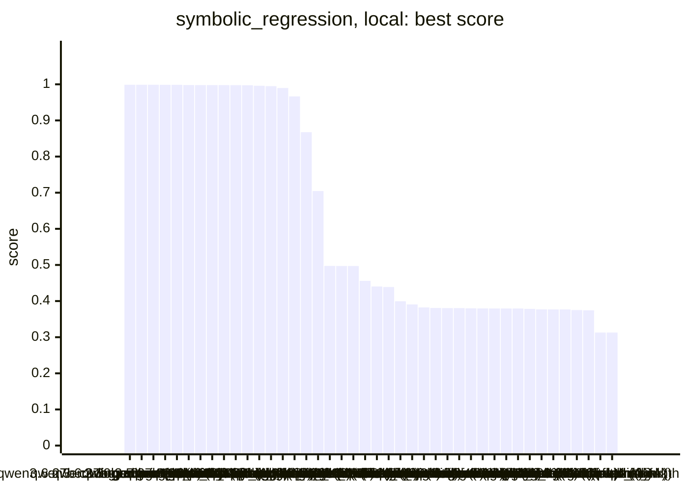
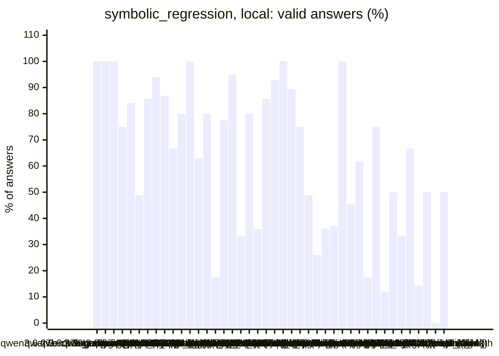
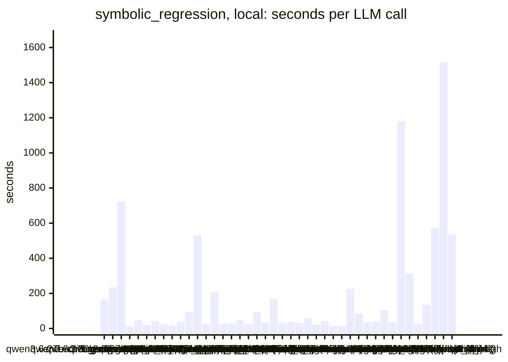
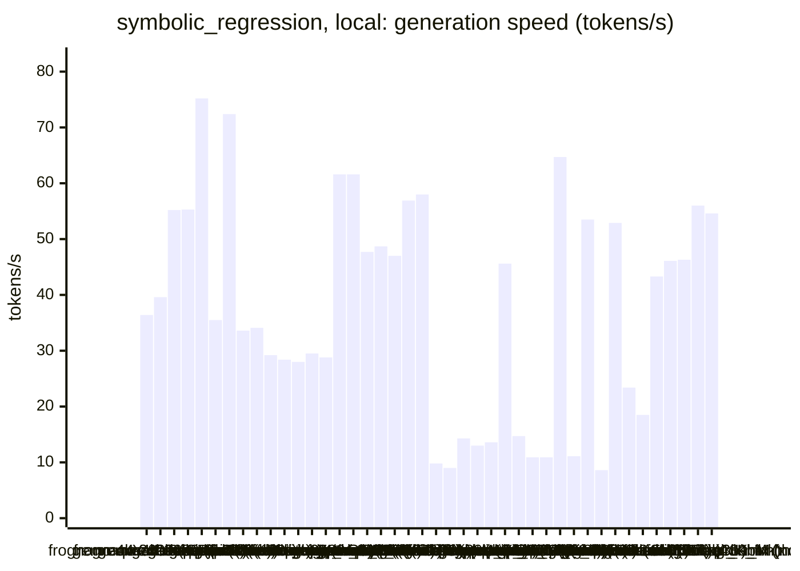
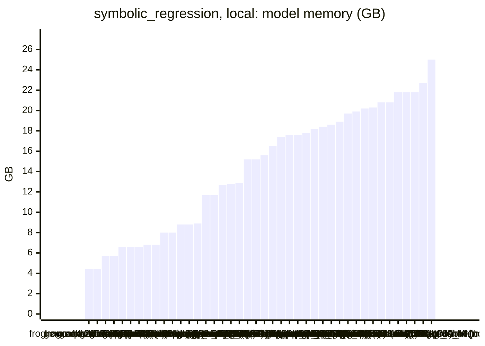

<!-- Copyright (c) 2026 by C. Klukas -->
<!-- SPDX-License-Identifier: GPL-3.0-only -->
<!-- Generated by `omega report` from bench/results/*.json. Do not edit by hand. -->

# symbolic_regression

43 models, 15 minutes each, one run per model. The [overall ranking](../benchmarks.md#overall-ranking) compares the models over all examples.

Machine: Apple M1 Max (Mac13,1), 10 cores, 32 GB.

## Local models

Ollama on this machine.

| Model | Params | Initial | Best | Gain | LLM calls | s/call | Valid | New bests | Min to best |
|---|---|--:|--:|--:|--:|--:|--:|--:|--:|
| qwen3.6:27b-coding-mtp-q4_K_M (no-think) | 27.3B | 0.31284 | **0.99869** | ×3.19 | 6 | 165 | 100% | 2 | 6.3 |
| qwen3.5:27b (think) | 27.8B | 0.31284 | **0.99866** | ×3.19 | 5 | 235 | 100% | 2 | 19.6 |
| qwen3.6:27b-coding-mtp-q4_K_M (think) | 27.3B | 0.31284 | **0.99865** | ×3.19 | 2 | 721 | 100% | 1 | 11.3 |
| gemma4:latest (no-think) |  | 0.31284 | **0.99864** | ×3.19 | 68 | 13 | 75% | 7 | 12.3 |
| qwen3.5:latest (think) | 9.7B | 0.31284 | **0.99862** | ×3.19 | 19 | 49 | 84% | 4 | 10.4 |
| qwen3:30b-a3b-instruct-2507-q4_K_M (think) | 30.5B | 0.31284 | **0.99801** | ×3.19 | 43 | 20 | 49% | 4 | 7.2 |
| gemma4:12b-it-qat (no-think) | 11.9B | 0.31284 | **0.9978** | ×3.19 | 21 | 44 | 86% | 4 | 9.8 |
| gemma4:26b-a4b-it-qat (no-think) | 25.2B | 0.31284 | **0.99772** | ×3.19 | 33 | 27 | 94% | 3 | 4.7 |
| gemma4:e4b-it-qat (no-think) | 7.5B | 0.31284 | **0.99768** | ×3.19 | 53 | 17 | 87% | 6 | 13.4 |
| gemma4:e4b-it-qat (think) | 7.5B | 0.31284 | **0.99759** | ×3.19 | 24 | 38 | 67% | 2 | 13.1 |
| qwen3.5:27b (no-think) | 27.8B | 0.31284 | **0.99752** | ×3.19 | 10 | 92 | 80% | 2 | 5.2 |
| gemma4:26b-a4b-it-qat (think) | 25.2B | 0.31284 | **0.99595** | ×3.18 | 2 | 530 | 100% | 1 | 14.2 |
| qwen3:30b-a3b-instruct-2507-q4_K_M (no-think) | 30.5B | 0.31284 | **0.99477** | ×3.18 | 35 | 26 | 63% | 2 | 10.2 |
| qwen3.8:27b-mtp-q4_K_M (no-think) | 27.3B | 0.31284 | **0.98968** | ×3.16 | 5 | 208 | 80% | 1 | 7.6 |
| nemotron-3.5-lightning:30b-mlx (no-think) |  | 0.31284 | **0.96645** | ×3.09 | 34 | 27 | 18% | 5 | 14.4 |
| richardyoung/frognano-4b-2609:latest (no-think) | 4.3B | 0.31284 | **0.86755** | ×2.77 | 31 | 29 | 77% | 4 | 6.0 |
| gpt-oss:20b (think) | 20.9B | 0.31284 | **0.70451** | ×2.25 | 19 | 47 | 95% | 4 | 15.0 |
| gemma4:e2b (think) | 5.1B | 0.31284 | **0.49742** | ×1.59 | 36 | 25 | 33% | 4 | 15.4 |
| gpt-oss:20b (no-think) | 20.9B | 0.31284 | **0.49719** | ×1.59 | 10 | 94 | 80% | 4 | 11.7 |
| MichelRosselli/apertus:8b-instruct-2509-q4_k_m (no-think) | 8.1B | 0.31284 | **0.49714** | ×1.59 | 25 | 36 | 36% | 3 | 9.0 |
| ingu627/exaone4.0:32b (no-think) | 32.0B | 0.31284 | **0.45589** | ×1.46 | 7 | 170 | 86% | 2 | 20.0 |
| qwen2.5-coder:7b (no-think) | 7.6B | 0.31284 | **0.44035** | ×1.41 | 28 | 33 | 93% | 5 | 10.5 |
| glm-4.7-flash:latest (no-think) | 29.9B | 0.31284 | **0.43898** | ×1.40 | 25 | 36 | 100% | 4 | 11.7 |
| qwen3.5:latest (no-think) | 9.7B | 0.31284 | **0.39952** | ×1.28 | 28 | 32 | 89% | 6 | 9.8 |
| devstral-small-2:24b (no-think) | 24.0B | 0.31284 | **0.39071** | ×1.25 | 16 | 58 | 75% | 2 | 11.4 |
| nemotron-3-nano:4b (think) |  | 0.31284 | **0.38238** | ×1.22 | 41 | 22 | 49% | 4 | 5.6 |
| yandex/YandexGPT-5-Lite-8B-instruct-GGUF:latest (no-think) | 8.0B | 0.31284 | **0.38103** | ×1.22 | 23 | 41 | 26% | 2 | 4.6 |
| nemotron-3-nano:4b (no-think) |  | 0.31284 | **0.38063** | ×1.22 | 72 | 12 | 36% | 4 | 10.5 |
| gemma4:e2b (no-think) | 5.1B | 0.31284 | **0.38046** | ×1.22 | 70 | 13 | 37% | 6 | 12.9 |
| muse-glimmer:30b (no-think) | 27.9B | 0.31284 | **0.37999** | ×1.21 | 4 | 226 | 100% | 3 | 8.6 |
| nemotron-3-nano:30b-a3b-mlx (think) |  | 0.31284 | **0.37956** | ×1.21 | 11 | 84 | 45% | 2 | 15.5 |
| gemma4:latest (think) |  | 0.31284 | **0.3795** | ×1.21 | 26 | 35 | 62% | 2 | 9.8 |
| llm-jp-4-8b-omega:q4_k_m (no-think) | 8.6B | 0.31284 | **0.37945** | ×1.21 | 23 | 39 | 17% | 1 | 6.7 |
| richardyoung/frognano-4b-2609:latest (think) | 4.3B | 0.31284 | **0.37945** | ×1.21 | 12 | 104 | 75% | 1 | 1.2 |
| nemotron-3-nano:30b-a3b-mlx (no-think) |  | 0.31284 | **0.37836** | ×1.21 | 25 | 36 | 12% | 2 | 5.8 |
| muse-glimmer:30b (think) | 27.9B | 0.31284 | **0.37701** | ×1.21 | 2 | 1180 | 50% | 1 | 9.2 |
| nemotron-3.5-lightning:30b-mlx (think) |  | 0.31284 | **0.37689** | ×1.20 | 3 | 314 | 33% | 1 | 15.7 |
| qwen3-coder:30b (no-think) | 30.5B | 0.31284 | **0.37689** | ×1.20 | 33 | 28 | 67% | 2 | 2.8 |
| frob/sarvam:30b (no-think) | 32.2B | 0.31284 | **0.37509** | ×1.20 | 7 | 134 | 14% | 1 | 4.9 |
| gemma4:12b-it-qat (think) | 11.9B | 0.31284 | **0.37429** | ×1.20 | 2 | 574 | 50% | 1 | 19.1 |
| qwen3.8:27b-mtp-q4_K_M (think) | 27.3B | 0.31284 | **0.31284** | ×1.00 | 1 | 1515 | 0% | 0 | - |
| glm-4.7-flash:latest (think) | 29.9B | 0.31284 | **0.31284** | ×1.00 | 2 | 535 | 50% | 0 | - |
| frob/sarvam:30b (think) | 32.2B | | | | | | | | failed: all 2 model requests failed: frob/sarvam:30b: answer stopped |

### Inference speed and memory

RAM is what Ollama reports for the loaded model (weights, context cache and buffers; on Apple silicon this is shared memory). Load is the time to bring the model into memory. Prompt and generation speeds are tokens per second over all calls of the run.

| Model | Params | RAM GB | Load s | Prompt tok/s | Gen tok/s | Median s/call | p90 s/call | Tokens/answer | Stopped |
|---|---|--:|--:|--:|--:|--:|--:|--:|--:|
| richardyoung/frognano-4b-2609:latest (no-think) | 4.3B | 4.4 | 14 | 647 | 36.4 | 27 | 46 | 772 | 0 |
| richardyoung/frognano-4b-2609:latest (think) | 4.3B | 4.4 | 16 | 656 | 39.6 | 72 | 109 | 3820 | 0 |
| gemma4:e4b-it-qat (no-think) | 7.5B | 5.7 | 55 | 530 | 55.2 | 16 | 21 | 351 | 0 |
| gemma4:e4b-it-qat (think) | 7.5B | 5.7 | 97 | 549 | 55.3 | 36 | 50 | 1462 | 0 |
| gemma4:e2b (think) | 5.1B | 6.6 | 35 | 885 | 75.2 | 25 | 33 | 1447 | 0 |
| qwen2.5-coder:7b (no-think) | 7.6B | 6.6 | 52 | 481 | 35.5 | 34 | 45 | 780 | 0 |
| gemma4:e2b (no-think) | 5.1B | 6.6 | 37 | 795 | 72.4 | 10 | 23 | 422 | 0 |
| qwen3.5:latest (think) | 9.7B | 6.8 | 40 | 332 | 33.6 | 45 | 84 | 1133 | 0 |
| qwen3.5:latest (no-think) | 9.7B | 6.8 | 70 | 341 | 34.1 | 28 | 40 | 569 | 0 |
| gemma4:12b-it-qat (no-think) | 11.9B | 8.0 | 142 | 213 | 29.2 | 36 | 50 | 525 | 0 |
| gemma4:12b-it-qat (think) | 11.9B | 8.0 | 62 | 213 | 28.4 | 655 | 655 | 14980 | 0 |
| yandex/YandexGPT-5-Lite-8B-instruct-GGUF:latest (no-think) | 8.0B | 8.8 | 17 | 501 | 28.0 | 41 | 71 | 917 | 0 |
| llm-jp-4-8b-omega:q4_k_m (no-think) | 8.6B | 8.8 | 18 | 495 | 29.5 | 34 | 68 | 871 | 0 |
| MichelRosselli/apertus:8b-instruct-2509-q4_k_m (no-think) | 8.1B | 8.9 | 17 | 396 | 28.8 | 33 | 60 | 666 | 0 |
| nemotron-3-nano:4b (think) |  | 11.7 | 8 | 772 | 61.6 | 20 | 30 | 994 | 0 |
| nemotron-3-nano:4b (no-think) |  | 11.7 | 8 | 752 | 61.6 | 12 | 16 | 371 | 1 |
| gemma4:latest (think) |  | 12.7 | 110 | 1075 | 47.7 | 31 | 43 | 1265 | 0 |
| gpt-oss:20b (think) | 20.9B | 12.8 | 243 | 535 | 48.7 | 34 | 58 | 1326 | 0 |
| gpt-oss:20b (no-think) | 20.9B | 12.9 | 55 | 601 | 47.0 | 83 | 193 | 3854 | 0 |
| gemma4:26b-a4b-it-qat (no-think) | 25.2B | 15.2 | 198 | 476 | 56.9 | 21 | 28 | 560 | 1 |
| gemma4:26b-a4b-it-qat (think) | 25.2B | 15.2 | 256 | 948 | 58.0 | 854 | 854 | 11982 | 0 |
| muse-glimmer:30b (no-think) | 27.9B | 15.6 | 57 | 110 | 9.8 | 216 | 387 | 1795 | 0 |
| muse-glimmer:30b (think) | 27.9B | 16.5 | 56 | 138 | 9.0 | 1813 | 1813 | 10184 | 0 |
| qwen3.6:27b-coding-mtp-q4_K_M (think) | 27.3B | 17.4 | 290 | 160 | 14.3 | 765 | 765 | 7964 | 0 |
| qwen3.8:27b-mtp-q4_K_M (no-think) | 27.3B | 17.6 | 322 | 126 | 13.0 | 160 | 457 | 1468 | 0 |
| qwen3.8:27b-mtp-q4_K_M (think) | 27.3B | 17.6 | 282 | 94 | 13.6 | 1515 | 1515 | 16384 | 0 |
| gemma4:latest (no-think) |  | 17.8 | 88 | 1061 | 45.6 | 11 | 15 | 296 | 1 |
| qwen3.6:27b-coding-mtp-q4_K_M (no-think) | 27.3B | 18.2 | 189 | 103 | 14.7 | 155 | 283 | 1362 | 0 |
| qwen3.5:27b (think) | 27.8B | 18.4 | 146 | 112 | 10.9 | 213 | 353 | 1901 | 0 |
| qwen3.5:27b (no-think) | 27.8B | 18.6 | 134 | 102 | 10.9 | 79 | 234 | 446 | 0 |
| frob/sarvam:30b (no-think) | 32.2B | 18.9 | 61 | 1379 | 64.7 | 130 | 192 | 7974 | 0 |
| devstral-small-2:24b (no-think) | 24.0B | 19.7 | 48 | 134 | 11.1 | 57 | 72 | 278 | 0 |
| nemotron-3.5-lightning:30b-mlx (think) |  | 19.9 | 0 | 905 | 53.5 | 264 | 445 | 12336 | 2 |
| ingu627/exaone4.0:32b (no-think) | 32.0B | 20.2 | 61 | 54 | 8.6 | 138 | 364 | 384 | 0 |
| nemotron-3-nano:30b-a3b-mlx (think) |  | 20.3 | 90 | 504 | 52.9 | 62 | 100 | 3669 | 0 |
| glm-4.7-flash:latest (no-think) | 29.9B | 20.8 | 57 | 407 | 23.4 | 35 | 56 | 522 | 0 |
| glm-4.7-flash:latest (think) | 29.9B | 20.8 | 56 | 566 | 18.5 | 579 | 579 | 9290 | 0 |
| qwen3:30b-a3b-instruct-2507-q4_K_M (think) | 30.5B | 21.8 | 137 | 660 | 43.3 | 14 | 39 | 372 | 0 |
| qwen3:30b-a3b-instruct-2507-q4_K_M (no-think) | 30.5B | 21.8 | 138 | 666 | 46.1 | 18 | 43 | 585 | 1 |
| qwen3-coder:30b (no-think) | 30.5B | 21.8 | 134 | 674 | 46.3 | 22 | 40 | 742 | 2 |
| nemotron-3-nano:30b-a3b-mlx (no-think) |  | 22.7 | 114 | 548 | 56.0 | 29 | 44 | 1289 | 2 |
| nemotron-3.5-lightning:30b-mlx (no-think) |  | 25.0 | 0 | 699 | 54.6 | 21 | 43 | 828 | 7 |

### Best score over time

| Model | 3.75 min | 7.5 min | 11.25 min | 15 min |
|---|--:|--:|--:|--:|
| qwen3.6:27b-coding-mtp-q4_K_M (no-think) | 0.31284 | 0.99869 | 0.99869 | 0.99869 |
| qwen3.5:27b (think) | 0.31284 | 0.37945 | 0.37945 | 0.37945 |
| qwen3.6:27b-coding-mtp-q4_K_M (think) | 0.31284 | 0.31284 | 0.31284 | 0.99865 |
| gemma4:latest (no-think) | 0.38367 | 0.38367 | 0.96341 | 0.99864 |
| qwen3.5:latest (think) | 0.37945 | 0.99843 | 0.99862 | 0.99862 |
| qwen3:30b-a3b-instruct-2507-q4_K_M (think) | 0.99458 | 0.99801 | 0.99801 | 0.99801 |
| gemma4:12b-it-qat (no-think) | 0.37621 | 0.37945 | 0.9978 | 0.9978 |
| gemma4:26b-a4b-it-qat (no-think) | 0.37813 | 0.99772 | 0.99772 | 0.99772 |
| gemma4:e4b-it-qat (no-think) | 0.8683 | 0.8683 | 0.8683 | 0.99768 |
| gemma4:e4b-it-qat (think) | 0.37945 | 0.37945 | 0.37945 | 0.99759 |
| qwen3.5:27b (no-think) | 0.31284 | 0.99752 | 0.99752 | 0.99752 |
| gemma4:26b-a4b-it-qat (think) | 0.31284 | 0.31284 | 0.31284 | 0.99595 |
| qwen3:30b-a3b-instruct-2507-q4_K_M (no-think) | 0.99458 | 0.99458 | 0.99477 | 0.99477 |
| qwen3.8:27b-mtp-q4_K_M (no-think) | 0.31284 | 0.31284 | 0.98968 | 0.98968 |
| nemotron-3.5-lightning:30b-mlx (no-think) | 0.37743 | 0.96485 | 0.96645 | 0.96645 |
| richardyoung/frognano-4b-2609:latest (no-think) | 0.85097 | 0.86755 | 0.86755 | 0.86755 |
| gpt-oss:20b (think) | 0.31284 | 0.37945 | 0.37945 | 0.37945 |
| gemma4:e2b (think) | 0.37945 | 0.38132 | 0.38257 | 0.38257 |
| gpt-oss:20b (no-think) | 0.37945 | 0.49719 | 0.49719 | 0.49719 |
| MichelRosselli/apertus:8b-instruct-2509-q4_k_m (no-think) | 0.49713 | 0.49713 | 0.49714 | 0.49714 |
| ingu627/exaone4.0:32b (no-think) | 0.37945 | 0.37945 | 0.37945 | 0.37945 |
| qwen2.5-coder:7b (no-think) | 0.38236 | 0.38236 | 0.44035 | 0.44035 |
| glm-4.7-flash:latest (no-think) | 0.37945 | 0.43898 | 0.43898 | 0.43898 |
| qwen3.5:latest (no-think) | 0.38095 | 0.38153 | 0.39952 | 0.39952 |
| devstral-small-2:24b (no-think) | 0.37945 | 0.37945 | 0.37945 | 0.39071 |
| nemotron-3-nano:4b (think) | 0.38127 | 0.38238 | 0.38238 | 0.38238 |
| yandex/YandexGPT-5-Lite-8B-instruct-GGUF:latest (no-think) | 0.37945 | 0.38103 | 0.38103 | 0.38103 |
| nemotron-3-nano:4b (no-think) | 0.37748 | 0.37748 | 0.38063 | 0.38063 |
| gemma4:e2b (no-think) | 0.37945 | 0.37945 | 0.37948 | 0.38046 |
| muse-glimmer:30b (no-think) | 0.37519 | 0.37836 | 0.37999 | 0.37999 |
| nemotron-3-nano:30b-a3b-mlx (think) | 0.31284 | 0.37945 | 0.37945 | 0.37945 |
| gemma4:latest (think) | 0.37945 | 0.37945 | 0.3795 | 0.3795 |
| llm-jp-4-8b-omega:q4_k_m (no-think) | 0.31284 | 0.37945 | 0.37945 | 0.37945 |
| richardyoung/frognano-4b-2609:latest (think) | 0.37945 | 0.37945 | 0.37945 | 0.37945 |
| nemotron-3-nano:30b-a3b-mlx (no-think) | 0.37649 | 0.37836 | 0.37836 | 0.37836 |
| muse-glimmer:30b (think) | 0.31284 | 0.31284 | 0.37701 | 0.37701 |
| nemotron-3.5-lightning:30b-mlx (think) | 0.31284 | 0.31284 | 0.31284 | 0.31284 |
| qwen3-coder:30b (no-think) | 0.37689 | 0.37689 | 0.37689 | 0.37689 |
| frob/sarvam:30b (no-think) | 0.31284 | 0.37509 | 0.37509 | 0.37509 |
| gemma4:12b-it-qat (think) | 0.31284 | 0.31284 | 0.31284 | 0.31284 |
| qwen3.8:27b-mtp-q4_K_M (think) | 0.31284 | 0.31284 | 0.31284 | 0.31284 |
| glm-4.7-flash:latest (think) | 0.31284 | 0.31284 | 0.31284 | 0.31284 |

### Outcome of the LLM answers

| Model | duplicate | edit error | invalid | llm error | ok | timeout |
|---|--:|--:|--:|--:|--:|--:|
| qwen3.6:27b-coding-mtp-q4_K_M (no-think) | 0 | 0 | 0 | 0 | 6 | 0 |
| qwen3.5:27b (think) | 0 | 0 | 0 | 0 | 5 | 0 |
| qwen3.6:27b-coding-mtp-q4_K_M (think) | 0 | 0 | 0 | 0 | 2 | 0 |
| gemma4:latest (no-think) | 11 | 2 | 3 | 1 | 51 | 0 |
| qwen3.5:latest (think) | 2 | 0 | 1 | 0 | 16 | 0 |
| qwen3:30b-a3b-instruct-2507-q4_K_M (think) | 6 | 7 | 9 | 0 | 21 | 0 |
| gemma4:12b-it-qat (no-think) | 0 | 0 | 3 | 0 | 18 | 0 |
| gemma4:26b-a4b-it-qat (no-think) | 0 | 0 | 1 | 1 | 31 | 0 |
| gemma4:e4b-it-qat (no-think) | 4 | 2 | 1 | 0 | 46 | 0 |
| gemma4:e4b-it-qat (think) | 8 | 0 | 0 | 0 | 16 | 0 |
| qwen3.5:27b (no-think) | 0 | 2 | 0 | 0 | 8 | 0 |
| gemma4:26b-a4b-it-qat (think) | 0 | 0 | 0 | 0 | 2 | 0 |
| qwen3:30b-a3b-instruct-2507-q4_K_M (no-think) | 1 | 4 | 6 | 1 | 22 | 1 |
| qwen3.8:27b-mtp-q4_K_M (no-think) | 0 | 0 | 1 | 0 | 4 | 0 |
| nemotron-3.5-lightning:30b-mlx (no-think) | 3 | 14 | 4 | 7 | 6 | 0 |
| richardyoung/frognano-4b-2609:latest (no-think) | 0 | 6 | 1 | 0 | 24 | 0 |
| gpt-oss:20b (think) | 0 | 1 | 0 | 0 | 18 | 0 |
| gemma4:e2b (think) | 17 | 5 | 2 | 0 | 12 | 0 |
| gpt-oss:20b (no-think) | 0 | 2 | 0 | 0 | 8 | 0 |
| MichelRosselli/apertus:8b-instruct-2509-q4_k_m (no-think) | 1 | 11 | 4 | 0 | 9 | 0 |
| ingu627/exaone4.0:32b (no-think) | 1 | 0 | 0 | 0 | 6 | 0 |
| qwen2.5-coder:7b (no-think) | 0 | 0 | 2 | 0 | 26 | 0 |
| glm-4.7-flash:latest (no-think) | 0 | 0 | 0 | 0 | 25 | 0 |
| qwen3.5:latest (no-think) | 1 | 1 | 1 | 0 | 25 | 0 |
| devstral-small-2:24b (no-think) | 3 | 0 | 1 | 0 | 12 | 0 |
| nemotron-3-nano:4b (think) | 3 | 11 | 7 | 0 | 20 | 0 |
| yandex/YandexGPT-5-Lite-8B-instruct-GGUF:latest (no-think) | 7 | 5 | 5 | 0 | 6 | 0 |
| nemotron-3-nano:4b (no-think) | 9 | 26 | 10 | 1 | 26 | 0 |
| gemma4:e2b (no-think) | 24 | 14 | 6 | 0 | 26 | 0 |
| muse-glimmer:30b (no-think) | 0 | 0 | 0 | 0 | 4 | 0 |
| nemotron-3-nano:30b-a3b-mlx (think) | 4 | 2 | 0 | 0 | 5 | 0 |
| gemma4:latest (think) | 8 | 0 | 2 | 0 | 16 | 0 |
| llm-jp-4-8b-omega:q4_k_m (no-think) | 0 | 9 | 10 | 0 | 4 | 0 |
| richardyoung/frognano-4b-2609:latest (think) | 1 | 2 | 0 | 0 | 9 | 0 |
| nemotron-3-nano:30b-a3b-mlx (no-think) | 1 | 13 | 6 | 2 | 3 | 0 |
| muse-glimmer:30b (think) | 0 | 1 | 0 | 0 | 1 | 0 |
| nemotron-3.5-lightning:30b-mlx (think) | 0 | 0 | 0 | 2 | 1 | 0 |
| qwen3-coder:30b (no-think) | 8 | 0 | 1 | 2 | 22 | 0 |
| frob/sarvam:30b (no-think) | 0 | 6 | 0 | 0 | 1 | 0 |
| gemma4:12b-it-qat (think) | 0 | 1 | 0 | 0 | 1 | 0 |
| qwen3.8:27b-mtp-q4_K_M (think) | 0 | 1 | 0 | 0 | 0 | 0 |
| glm-4.7-flash:latest (think) | 0 | 0 | 1 | 0 | 1 | 0 |

### Best idea per model

- **qwen3.6:27b-coding-mtp-q4_K_M (no-think)**: Replace the simple linear basis with a candidate set including quadratic terms, interaction terms, and trigonometric functions, then use forward selection to pick the best subset …
- **qwen3.5:27b (think)**: Add sin(x1), cos(x1), sin(x1)*x2, and cos(x1)*x2 to the basis to capture periodic behavior in x1 that polynomials cannot extrapolate, which is suggested by the sign-flipping …
- **qwen3.6:27b-coding-mtp-q4_K_M (think)**: Expand the basis to include quadratic terms, pairwise interactions, and sinusoidal functions of x1 to capture nonlinearities and periodic behavior that linear models miss …
- **gemma4:latest (no-think)**: Replace the linear scaling of $x_3$ with a term that is more sensitive to the upper bound of $x_3$, like $x_3^2$, as the feedback suggests high errors at large $x_3$.
- **qwen3.5:latest (think)**: Add sin/cos trigonometric basis terms for x1 with their interactions to capture oscillatory behavior that polynomials cannot represent, enabling proper extrapolation beyond …
- **qwen3:30b-a3b-instruct-2507-q4_K_M (think)**: Expose the coefficient of the x3*sin(x3) term as a tunable parameter to better fit the periodic growth in x3, especially in extrapolation where the model underpredicts at large x3 …
- **gemma4:12b-it-qat (no-think)**: The current basis might be over-parameterized or missing the correct interaction for extrapolation; I will add a term for $x_1 \cdot \sin(x_2)$ and $x_2 \cdot \sin(x_1)$ to better …
- **gemma4:26b-a4b-it-qat (no-think)**: The large extrapolation errors suggest a trigonometric component, specifically `sin(x1)` or similar, because polynomials diverge rapidly while the errors don't follow a polynomial …
- **gemma4:e4b-it-qat (no-think)**: The large extrapolation errors at large $|x_1|$ and $|x_2|$ suggest that the simple product terms and low-order polynomials might not capture the curvature or growth rate …
- **gemma4:e4b-it-qat (think)**: Introduce interaction terms between linear and trigonometric functions (e.g., $x_1 \sin(x_2)$) to allow the model to capture dependencies between different input features that are …
- **qwen3.5:27b (no-think)**: The current linear model fails to extrapolate because the true underlying function likely contains non-linear terms (periodic, polynomial, or interaction terms) which manifest as …
- **gemma4:26b-a4b-it-qat (think)**: Expand the basis functions to include higher-order polynomials, trigonometric functions, and their interactions to better capture non-linearities and periodicities that might be …
- **qwen3:30b-a3b-instruct-2507-q4_K_M (no-think)**: Add x3-dependent frequency modulation to trigonometric terms (e.g., sin(f*x1) where f is a learned scale like x3) to better capture periodic behavior that varies with x3 …
- **qwen3.8:27b-mtp-q4_K_M (no-think)**: Replace the raw-linear basis with a richer set of elementary basis functions (polynomial, cross terms, trigonometric and exp terms) and fit them all with one least-squares call …
- **nemotron-3.5-lightning:30b-mlx (no-think)**: Add a ridge-regularized coefficient with a learnable exponent to the cubic x1 term, allowing the solver to balance polynomial fit magnitude against extrapolation behavior; this …
- **richardyoung/frognano-4b-2609:latest (no-think)**: Replace the polynomial basis with a trigonometric basis (sin, cos, sin*cos products) which captures periodic behavior and avoids the unbounded growth of polynomials at large |x| …
- **gpt-oss:20b (think)**: tuned RIDGE=0.001 on top of: Replace the exploding exponential and trigonometric terms with bounded tanh functions and scale inputs to avoid large magnitudes; keep a modest ridge …
- **gemma4:e2b (think)**: Expand the polynomial basis to include cubic terms and higher-order interactions as suggested by the search history to better capture the non-linear functional form.
- **gpt-oss:20b (no-think)**: tuned RIDGE=0.0001 on top of: Scale the inputs and use a richer polynomial basis up to degree 4 with a small ridge penalty to improve extrapolation while keeping the model linear …
- **MichelRosselli/apertus:8b-instruct-2509-q4_k_m (no-think)**: Add polynomial terms beyond x^3 to improve extrapolation.
- **ingu627/exaone4.0:32b (no-think)**: Introduce a combination of trigonometric and polynomial terms to better capture periodic patterns and nonlinear relationships, which should improve both interpolation and …
- **qwen2.5-coder:7b (no-think)**: Introduce a periodic term to capture any potential sinusoidal dependence in the data.
- **glm-4.7-flash:latest (no-think)**: tuned DECAY=0.01 on top of: Introduce variable decay factors for the higher-order basis terms to mitigate their aggressive influence during extrapolation, which currently causes …
- **qwen3.5:latest (no-think)**: The current basis set lacks trigonometric terms (`sin`, `cos`) which are essential to model periodic behaviors that can exist even within the limited training range but fail when …
- **devstral-small-2:24b (no-think)**: Remove the logarithmic basis terms to avoid math domain errors when x1 or x2 is negative, as log(1 + x) is undefined for negative x.
- **nemotron-3-nano:4b (think)**: replace quadratic term x3**2 with exponential exp(x3) to better capture rapid growth in x3 and improve extrapolation.
- **yandex/YandexGPT-5-Lite-8B-instruct-GGUF:latest (no-think)**: Add trigonometric functions and their products with other inputs as basis functions to the model to improve predictive power.
- **nemotron-3-nano:4b (no-think)**: Use a single high-degree polynomial in x3 to capture extreme extrapolation behavior while keeping the model sparse and fast.
- **gemma4:e2b (no-think)**: Try a non-polynomial transformation on $x_3$ to capture potential exponential or power-law behavior suggested by the extrapolation failures.
- **muse-glimmer:30b (no-think)**: reduce harmful high-degree growth by dropping cubic monomials and add physically plausible x3 non-linearities (exp and log1p) which are hinted for non-negative inputs, to improve …
- **nemotron-3-nano:30b-a3b-mlx (think)**: tuned INCLUDE_X1_CUBE=1.939, INCLUDE_X1_X2_SQ=1.227 on top of: Add optional cubic and quadratic‑interaction terms controlled by sweepable constants to capture higher‑order growth …
- **gemma4:latest (think)**: Introduce $\sin(x_3)$ and $\cos(x_3)$ terms to the basis functions to introduce bounded behavior and improve extrapolation, as suggested by previous successful attempts.
- **llm-jp-4-8b-omega:q4_k_m (no-think)**: Replace the very limited linear basis with a richer set of polynomial + interaction terms (x1, x2, x3, x1·x2, x1·x3, x2·x3) so that curvature and cross‑effects can be captured …
- **richardyoung/frognano-4b-2609:latest (think)**: Replace the simple linear basis with a full quadratic polynomial basis including all pairwise interaction terms (x1*x2, x1*x3, x2*x3, x1^2, x2^2, x3^2) to capture nonlinearity and …
- **nemotron-3-nano:30b-a3b-mlx (no-think)**: Add quadratic and interaction terms and a few trigonometric functions to the basis, expose their amplitudes as sweep‑adjustable constants.
- **muse-glimmer:30b (think)**: expand the linear basis to quadratic/cubic monomials, pairwise products, sine/cosine of each input and log1p(x3) so the model can capture nonlinear and periodic structure and …
- **nemotron-3.5-lightning:30b-mlx (think)**: Expand the basis function set from 4 terms (constant + 3 linear) to 20 terms including quadratic, product, trigonometric, exponential, and logarithmic functions, enabling the …
- **qwen3-coder:30b (no-think)**: Expand the basis functions to include interaction terms, powers, and transcendental functions that can capture the underlying structure better than a simple linear model.
- **frob/sarvam:30b (no-think)**: Expand the basis to include polynomial, interaction, and trigonometric terms, enabling proper extrapolation.
- **gemma4:12b-it-qat (think)**: Expand the basis functions to include quadratic, cubic, and trigonometric terms, as well as pairwise products and exponentials, to better capture the non-linear and periodic …
- **qwen3.8:27b-mtp-q4_K_M (think)**: initial program
- **glm-4.7-flash:latest (think)**: initial program
