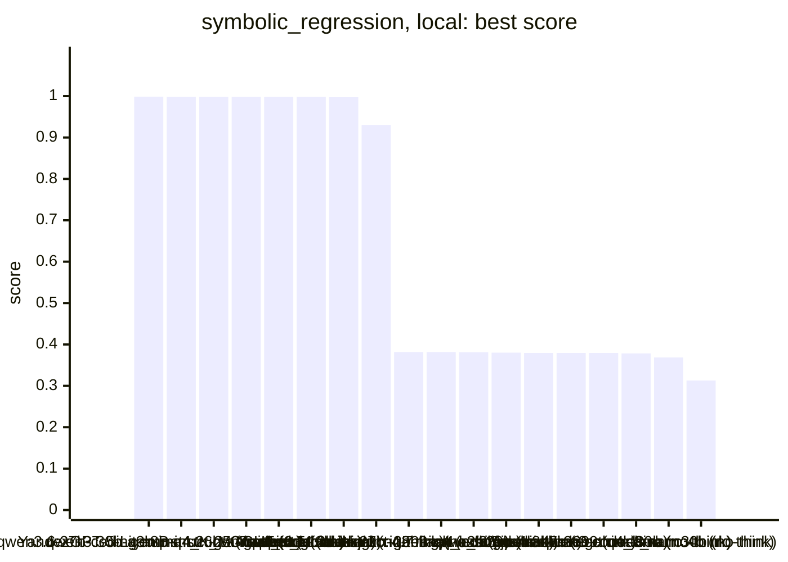
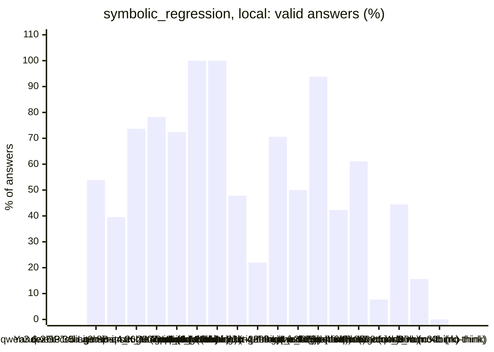
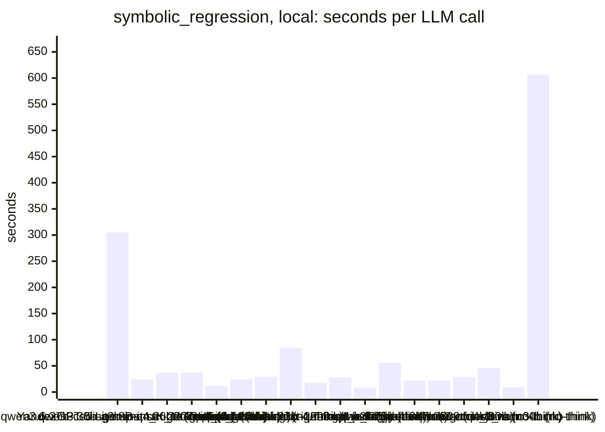
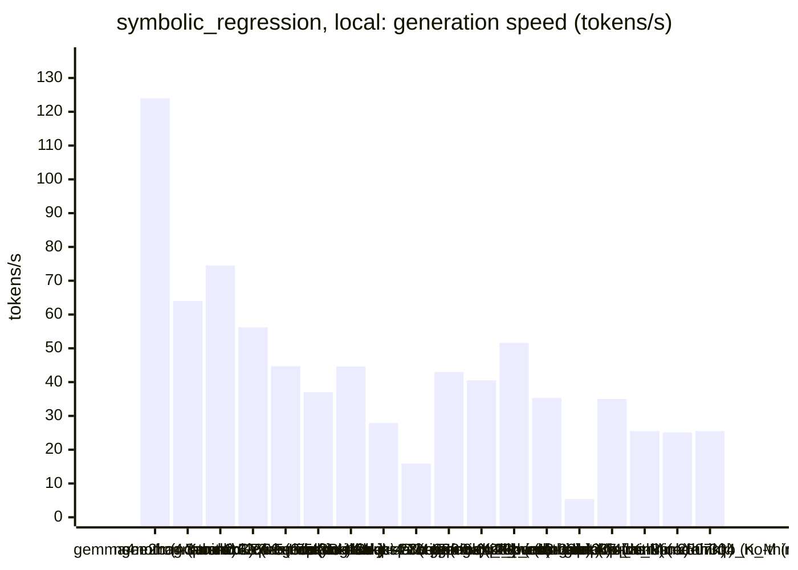
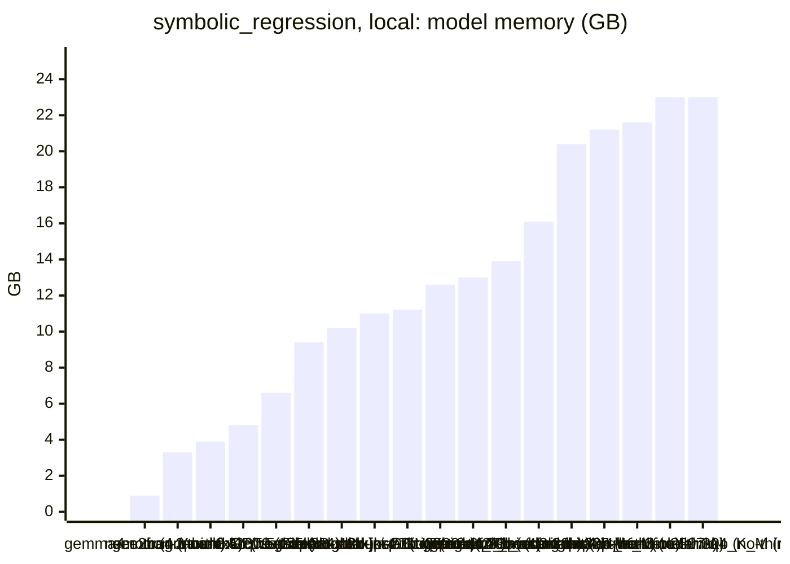
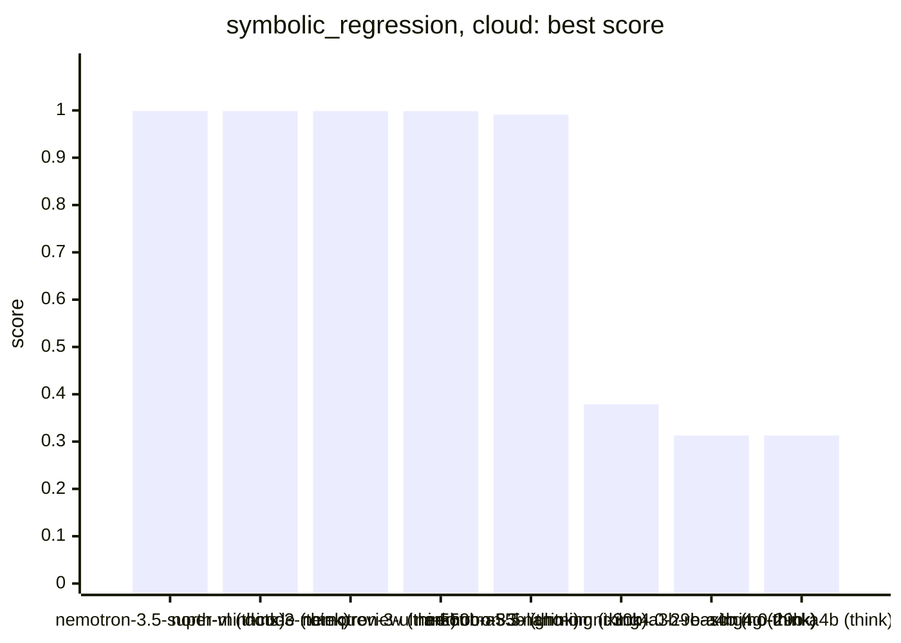
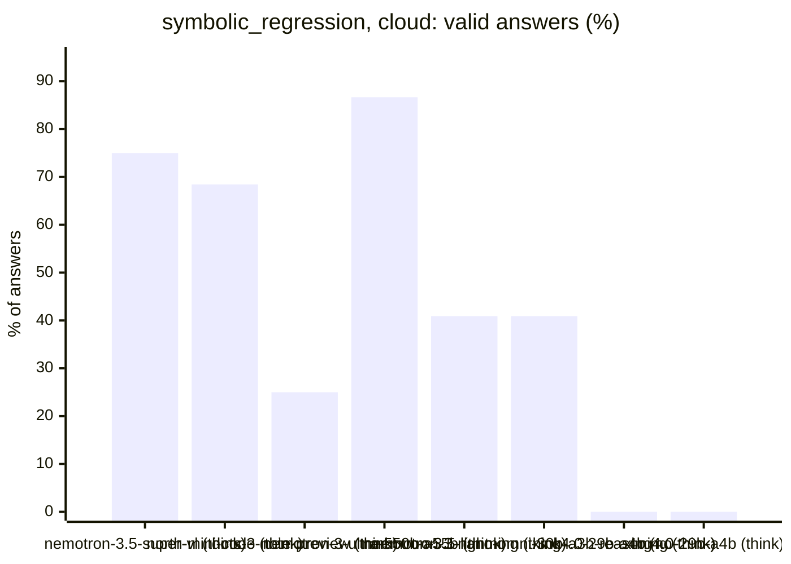
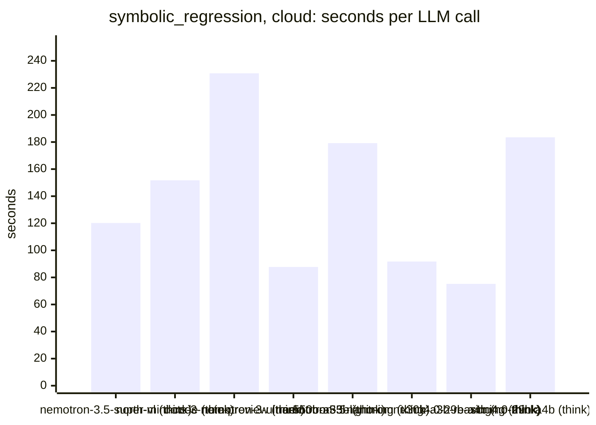
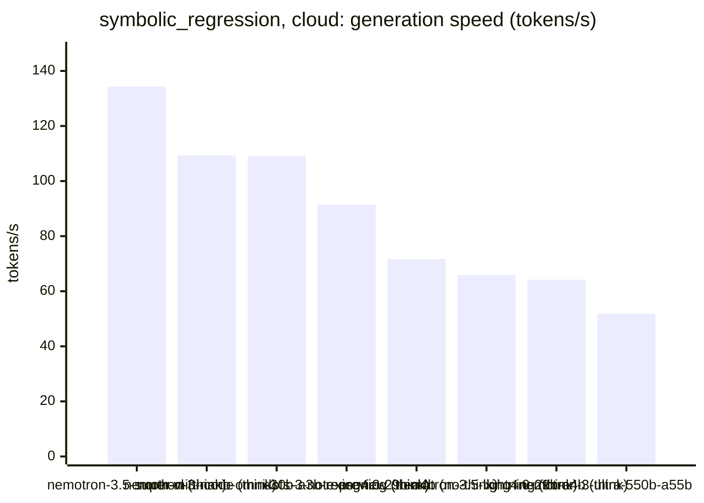

<!-- Copyright (c) 2026 by C. Klukas -->
<!-- SPDX-License-Identifier: GPL-3.0-only -->
<!-- Generated by `omega report` from bench/results/*.json. Do not edit by hand. -->

# symbolic_regression

35 models, each run at most 60 minutes, ended earlier after 15 answers in a row without progress; one run per model. The [overall ranking](../benchmarks.md#overall-ranking) compares the models over all examples.

Machine: Intel(R) Core(TM) i7-8700K CPU @ 3.70GHz (MS-7A98), 12 cores, 64 GB, 2x NVIDIA GeForce GTX 1080 Ti, 11264 MiB.

## Local models

Ollama on this machine.

| Model | Params | Initial | Best | Gain | LLM calls | s/call | Valid | New bests | Min to best | Minutes | Stopped by |
|---|---|--:|--:|--:|--:|--:|--:|--:|--:|--:|---|
| qwen3.6:27b-coding-mtp-q4_K_M (no-think) | 27.3B | 0.31284 | **0.99856** | ×3.19 | 13 | 305 | 54% | 2 | 20.8 | 66.5 | time limit |
| yandex/YandexGPT-5-Lite-8B-instruct-GGUF:latest (no-think) | 8.0B | 0.31284 | **0.99823** | ×3.19 | 43 | 24 | 40% | 7 | 15.5 | 18.4 | no progress |
| qwen3:30b-a3b-instruct-2507-q4_K_M (no-think) | 30.5B | 0.31284 | **0.9981** | ×3.19 | 19 | 36 | 74% | 2 | 4.7 | 12.1 | no progress |
| gemma4:26b-a4b-it-qat (no-think) | 25.2B | 0.31284 | **0.99809** | ×3.19 | 23 | 37 | 78% | 7 | 14.3 | 14.9 | no progress |
| gemma4:latest (no-think) | 7.5B | 0.31284 | **0.99803** | ×3.19 | 29 | 12 | 72% | 4 | 2.9 | 6.2 | no progress |
| qwen3.5:latest (no-think) | 9.0B | 0.31284 | **0.998** | ×3.19 | 17 | 25 | 100% | 1 | 1.1 | 7.4 | no progress |
| gemma4:12b-it-qat (no-think) | 11.9B | 0.31284 | **0.99728** | ×3.19 | 26 | 29 | 100% | 5 | 7.5 | 13.6 | no progress |
| underdog-saluki-27b:iq2-mix (no-think) | 26.9B | 0.31284 | **0.93038** | ×2.97 | 23 | 84 | 48% | 5 | 32.2 | 33.4 | no progress |
| MichelRosselli/apertus:8b-instruct-2509-q4_k_m (no-think) | 8.1B | 0.31284 | **0.38171** | ×1.22 | 41 | 18 | 22% | 3 | 8.3 | 12.9 | no progress |
| glm-4.7-flash:latest (no-think) | 29.9B | 0.31284 | **0.38166** | ×1.22 | 17 | 28 | 71% | 2 | 2.2 | 8.2 | no progress |
| gemma4:e2b (no-think) | 4.6B | 0.31284 | **0.38132** | ×1.22 | 32 | 8 | 50% | 3 | 2.2 | 4.6 | no progress |
| gpt-oss:20b (no-think) | 20.9B | 0.31284 | **0.38018** | ×1.22 | 16 | 56 | 94% | 2 | 12.1 | 15.2 | no progress |
| qwen2.5-coder:7b (no-think) | 7.6B | 0.31284 | **0.37945** | ×1.21 | 26 | 22 | 42% | 5 | 5.0 | 10.1 | no progress |
| richardyoung/frognano-4b-2609:latest (no-think) | 4.3B | 0.31284 | **0.37945** | ×1.21 | 18 | 21 | 61% | 3 | 3.2 | 6.7 | no progress |
| llm-jp-4-8b-omega:q4_k_m (no-think) | 8.6B | 0.31284 | **0.37945** | ×1.21 | 26 | 29 | 8% | 1 | 4.8 | 16.0 | no progress |
| qwen3-coder:30b (no-think) | 30.5B | 0.31284 | **0.37836** | ×1.21 | 18 | 46 | 44% | 2 | 2.8 | 14.2 | no progress |
| nemotron-3-nano:4b (no-think) | 4.0B | 0.31284 | **0.36846** | ×1.18 | 32 | 9 | 16% | 3 | 2.4 | 5.4 | no progress |
| hf.co/LiquidAI/LFM3-1.7B-GGUF:Q4_K_M (no-think) | 1.73B | | | | | | | | | | failed: all 7 model requests failed: hf.co/LiquidAI/LFM3-1.7B-GGUF:Q |
| frob/sarvam:30b (no-think) | 32.2B | 0.31284 | **0.31284** | ×1.00 | 6 | 607 | 0% | 0 | - | 61.0 | time limit |
| gemma4:e4b-it-qat (no-think) | 7.5B | | | | | | | | | | failed: RuntimeError: the initial program does not pass the evaluato |

### Inference speed and memory

RAM is what Ollama reports for the loaded model (weights, context cache and buffers; on Apple silicon this is shared memory). Load is the time to bring the model into memory. Prompt and generation speeds are tokens per second over all calls of the run.

| Model | Params | RAM GB | Load s | Prompt tok/s | Gen tok/s | Median s/call | p90 s/call | Tokens/answer | Stopped |
|---|---|--:|--:|--:|--:|--:|--:|--:|--:|
| gemma4:e2b (no-think) | 4.6B | 0.9 | 22 | 2457 | 124.0 | 7 | 10 | 410 | 0 |
| gemma4:latest (no-think) | 7.5B | 3.3 | 60 | 1401 | 64.0 | 10 | 14 | 267 | 0 |
| nemotron-3-nano:4b (no-think) | 4.0B | 3.9 | 10 | 2230 | 74.5 | 7 | 14 | 359 | 0 |
| richardyoung/frognano-4b-2609:latest (no-think) | 4.3B | 4.8 | 12 | 1893 | 56.2 | 21 | 43 | 655 | 2 |
| qwen2.5-coder:7b (no-think) | 7.6B | 6.6 | 15 | 1494 | 44.7 | 25 | 29 | 713 | 0 |
| qwen3.5:latest (no-think) | 9.0B | 9.4 | 50 | 1094 | 37.0 | 21 | 37 | 575 | 0 |
| yandex/YandexGPT-5-Lite-8B-instruct-GGUF:latest (no-think) | 8.0B | 10.2 | 38 | 1701 | 44.6 | 23 | 32 | 817 | 0 |
| gemma4:12b-it-qat (no-think) | 11.9B | 11.0 | 24 | 609 | 27.9 | 29 | 37 | 506 | 0 |
| underdog-saluki-27b:iq2-mix (no-think) | 26.9B | 11.2 | 0 | 413 | 15.9 | 57 | 134 | 940 | 2 |
| MichelRosselli/apertus:8b-instruct-2509-q4_k_m (no-think) | 8.1B | 12.6 | 34 | 1485 | 43.0 | 14 | 32 | 434 | 0 |
| llm-jp-4-8b-omega:q4_k_m (no-think) | 8.6B | 13.0 | 96 | 1530 | 40.5 | 22 | 45 | 778 | 0 |
| gpt-oss:20b (no-think) | 20.9B | 13.9 | 42 | 1652 | 51.6 | 47 | 97 | 2498 | 0 |
| gemma4:26b-a4b-it-qat (no-think) | 25.2B | 16.1 | 0 | 819 | 35.3 | 33 | 46 | 844 | 1 |
| qwen3.6:27b-coding-mtp-q4_K_M (no-think) | 27.3B | 20.4 | 81 | 197 | 5.4 | 324 | 444 | 1468 | 0 |
| frob/sarvam:30b (no-think) | 32.2B | 21.2 | 64 | 1544 | 35.0 | 721 | 798 | 24576 | 1 |
| glm-4.7-flash:latest (no-think) | 29.9B | 21.6 | 62 | 415 | 25.5 | 23 | 49 | 336 | 0 |
| qwen3:30b-a3b-instruct-2507-q4_K_M (no-think) | 30.5B | 23.0 | 140 | 719 | 25.1 | 20 | 152 | 320 | 1 |
| qwen3-coder:30b (no-think) | 30.5B | 23.0 | 109 | 672 | 25.5 | 35 | 107 | 808 | 0 |

### Best score over time

| Model | 15 min | 30 min | 45 min | 60 min |
|---|--:|--:|--:|--:|
| qwen3.6:27b-coding-mtp-q4_K_M (no-think) | 0.99832 | 0.99856 | 0.99856 | 0.99856 |
| yandex/YandexGPT-5-Lite-8B-instruct-GGUF:latest (no-think) | 0.99814 | 0.99823 | 0.99823 | 0.99823 |
| qwen3:30b-a3b-instruct-2507-q4_K_M (no-think) | 0.9981 | 0.9981 | 0.9981 | 0.9981 |
| gemma4:26b-a4b-it-qat (no-think) | 0.99809 | 0.99809 | 0.99809 | 0.99809 |
| gemma4:latest (no-think) | 0.99803 | 0.99803 | 0.99803 | 0.99803 |
| qwen3.5:latest (no-think) | 0.998 | 0.998 | 0.998 | 0.998 |
| gemma4:12b-it-qat (no-think) | 0.99728 | 0.99728 | 0.99728 | 0.99728 |
| underdog-saluki-27b:iq2-mix (no-think) | 0.38022 | 0.9301 | 0.93038 | 0.93038 |
| MichelRosselli/apertus:8b-instruct-2509-q4_k_m (no-think) | 0.38171 | 0.38171 | 0.38171 | 0.38171 |
| glm-4.7-flash:latest (no-think) | 0.38166 | 0.38166 | 0.38166 | 0.38166 |
| gemma4:e2b (no-think) | 0.38132 | 0.38132 | 0.38132 | 0.38132 |
| gpt-oss:20b (no-think) | 0.38018 | 0.38018 | 0.38018 | 0.38018 |
| qwen2.5-coder:7b (no-think) | 0.37945 | 0.37945 | 0.37945 | 0.37945 |
| richardyoung/frognano-4b-2609:latest (no-think) | 0.37945 | 0.37945 | 0.37945 | 0.37945 |
| llm-jp-4-8b-omega:q4_k_m (no-think) | 0.37945 | 0.37945 | 0.37945 | 0.37945 |
| qwen3-coder:30b (no-think) | 0.37836 | 0.37836 | 0.37836 | 0.37836 |
| nemotron-3-nano:4b (no-think) | 0.36846 | 0.36846 | 0.36846 | 0.36846 |
| frob/sarvam:30b (no-think) | 0.31284 | 0.31284 | 0.31284 | 0.31284 |

### Outcome of the LLM answers

| Model | duplicate | edit error | invalid | llm error | ok | runtime error | timeout |
|---|--:|--:|--:|--:|--:|--:|--:|
| qwen3.6:27b-coding-mtp-q4_K_M (no-think) | 0 | 2 | 0 | 0 | 7 | 0 | 4 |
| yandex/YandexGPT-5-Lite-8B-instruct-GGUF:latest (no-think) | 2 | 16 | 8 | 0 | 17 | 0 | 0 |
| qwen3:30b-a3b-instruct-2507-q4_K_M (no-think) | 3 | 1 | 0 | 1 | 14 | 0 | 0 |
| gemma4:26b-a4b-it-qat (no-think) | 0 | 2 | 2 | 1 | 18 | 0 | 0 |
| gemma4:latest (no-think) | 7 | 0 | 1 | 0 | 21 | 0 | 0 |
| qwen3.5:latest (no-think) | 0 | 0 | 0 | 0 | 17 | 0 | 0 |
| gemma4:12b-it-qat (no-think) | 0 | 0 | 0 | 0 | 26 | 0 | 0 |
| underdog-saluki-27b:iq2-mix (no-think) | 1 | 2 | 6 | 2 | 11 | 0 | 1 |
| MichelRosselli/apertus:8b-instruct-2509-q4_k_m (no-think) | 8 | 20 | 4 | 0 | 9 | 0 | 0 |
| glm-4.7-flash:latest (no-think) | 2 | 3 | 0 | 0 | 12 | 0 | 0 |
| gemma4:e2b (no-think) | 5 | 3 | 6 | 0 | 16 | 2 | 0 |
| gpt-oss:20b (no-think) | 0 | 1 | 0 | 0 | 15 | 0 | 0 |
| qwen2.5-coder:7b (no-think) | 4 | 1 | 10 | 0 | 11 | 0 | 0 |
| richardyoung/frognano-4b-2609:latest (no-think) | 1 | 2 | 2 | 2 | 11 | 0 | 0 |
| llm-jp-4-8b-omega:q4_k_m (no-think) | 0 | 8 | 13 | 0 | 2 | 0 | 3 |
| qwen3-coder:30b (no-think) | 5 | 0 | 4 | 0 | 8 | 0 | 1 |
| nemotron-3-nano:4b (no-think) | 0 | 19 | 8 | 0 | 5 | 0 | 0 |
| frob/sarvam:30b (no-think) | 0 | 5 | 0 | 1 | 0 | 0 | 0 |

### Best idea per model

- **qwen3.6:27b-coding-mtp-q4_K_M (no-think)**: The previous model had a score of 0.99832 but still had extrapolation errors; I will replace the heuristic backward elimination with a more robust cross-validation based feature …
- **yandex/YandexGPT-5-Lite-8B-instruct-GGUF:latest (no-think)**: Introduce interaction terms between the trigonometric functions (sin and cos) of the input variables to better capture potential periodic dependencies and interactions between the …
- **qwen3:30b-a3b-instruct-2507-q4_K_M (no-think)**: Replace the linear basis with a richer set of nonlinear basis functions including powers, products, and trigonometric terms to capture the underlying periodic and nonlinear …
- **gemma4:26b-a4b-it-qat (no-think)**: tuned RIDGE_VAL=0.006655 on top of: The current basis is missing a key interaction term $x_1 \cdot x_2 \cdot x_3$ or higher order interactions which might be needed to capture the …
- **gemma4:latest (no-think)**: Enhance the basis set by adding interaction terms involving trigonometric functions to better capture complex functional dependencies suggested by the extrapolation errors.
- **qwen3.5:latest (no-think)**: Replace the linear-only basis functions with a rich set including quadratic terms, cross-products of inputs, sine/cosine interactions, and an exponential term to capture …
- **gemma4:12b-it-qat (no-think)**: The feedback shows errors at high $|x_1|$ and $x_2$ where the prediction is too high, and the current basis lacks a potentially large but bounded term like $\sin(x_1 \cdot x_2 …
- **underdog-saluki-27b:iq2-mix (no-think)**: Add higher-degree polynomial terms in x1 (x1^2, x1^3) and x1^2*x2, x1^2*x3 to capture the growth seen at extrapolation, since tanh saturates while true y keeps growing with x1 …
- **MichelRosselli/apertus:8b-instruct-2509-q4_k_m (no-think)**: Add a cubic term to the basis to better fit non-linear dependencies and potentially allow better extrapolation.
- **glm-4.7-flash:latest (no-think)**: Add sinusoidal basis terms to capture periodic behavior and reduce extrapolation errors, as the largest errors occur at high |x| where polynomial terms fail.
- **gemma4:e2b (no-think)**: The current model is suffering from poor extrapolation, suggesting that the cubic basis might be insufficient, and increasing the complexity of the basis functions, perhaps by …
- **gpt-oss:20b (no-think)**: Add interaction terms between squared inputs and exp(x3) to better capture the exponential growth in x3, improving extrapolation.
- **qwen2.5-coder:7b (no-think)**: tuned RIDGE=0.001 on top of: Use a more compact basis function set that includes powers and pairwise products, and introduce regularization to prevent overfitting.
- **richardyoung/frognano-4b-2609:latest (no-think)**: Replace the polynomial basis with a sparse, normalized polynomial basis using `math.sqrt` for scaling to improve numerical stability during least-squares, and remove the unstable …
- **llm-jp-4-8b-omega:q4_k_m (no-think)**: replace the extremely sparse linear basis with a richer yet compact set of nonlinear features (polynomial terms ≤ 2, all pairwise products, and simple trig functions) so that the …
- **qwen3-coder:30b (no-think)**: Replace the linear basis with a richer set of nonlinear terms that can capture periodicity and interactions while maintaining good extrapolation properties.
- **nemotron-3-nano:4b (no-think)**: tuned NAME=0.583 on top of: Replace the hardcoded constant 0.5 in the `(1.0 + x2)` term with a tunable parameter to better model the linear extrapolation error in x1.
- **frob/sarvam:30b (no-think)**: initial program

## Cloud models (OpenRouter)

Free OpenRouter models; times include the network and the provider's queue.

| Model | Params | Initial | Best | Gain | LLM calls | s/call | Valid | New bests | Min to best | Minutes | Stopped by |
|---|---|--:|--:|--:|--:|--:|--:|--:|--:|--:|---|
| nvidia/nemotron-3.5-super-vl:free (think) |  | 0.31284 | **0.99881** | ×3.19 | 12 | 120 | 75% | 4 | 19.3 | 24.4 | no progress |
| cohere/north-mini-code:free (think) |  | 0.31284 | **0.99872** | ×3.19 | 19 | 152 | 68% | 5 | 36.7 | 48.6 | no progress |
| dots-studio/dots-3-note-preview:free (think) |  | 0.31284 | **0.99867** | ×3.19 | 16 | 231 | 25% | 2 | 61.9 | 62.0 | time limit |
| nvidia/nemotron-3-ultra-550b-a55b:free (think) |  | 0.31284 | **0.99853** | ×3.19 | 15 | 88 | 87% | 5 | 20.6 | 22.5 | no progress |
| nvidia/nemotron-3.5-lightning:free (think) |  | 0.31284 | **0.99085** | ×3.17 | 22 | 179 | 41% | 4 | 50.2 | 68.0 | time limit |
| nvidia/nemotron-3-nano-omni-30b-a3b-reasoning:free (think) |  | 0.31284 | **0.37881** | ×1.21 | 22 | 92 | 41% | 6 | 33.9 | 34.3 | no progress |
| cohere/north-mini-code:free (no-think) |  | | | | | | | | | | failed: all 6 model requests failed: cohere/north-mini-code:free: ra |
| nvidia/nemotron-3.5-super-vl:free (no-think) |  | | | | | | | | | | failed: all 6 model requests failed: nvidia/nemotron-3.5-super-vl:fr |
| nvidia/nemotron-3-ultra-550b-a55b:free (no-think) |  | | | | | | | | | | failed: all 6 model requests failed: nvidia/nemotron-3-ultra-550b-a5 |
| dots-studio/dots-3-note-preview:free (no-think) |  | | | | | | | | | | failed: all 6 model requests failed: dots-studio/dots-3-note-preview |
| nvidia/nemotron-3.5-lightning:free (no-think) |  | | | | | | | | | | failed: all 6 model requests failed: nvidia/nemotron-3.5-lightning:f |
| nvidia/nemotron-3-nano-omni-30b-a3b-reasoning:free (no-think) |  | | | | | | | | | | failed: all 6 model requests failed: nvidia/nemotron-3-nano-omni-30b |
| xingchen-agi/xing4.0-29b-a4b:free (no-think) |  | 0.31284 | **0.31284** | ×1.00 | 16 | 75 | 0% | 0 | - | 20.1 | no progress |
| xingchen-agi/xing4.0-29b-a4b:free (think) |  | 0.31284 | **0.31284** | ×1.00 | 15 | 184 | 0% | 0 | - | 45.9 | no progress |
| recursive/flint-v1.0:free (think) |  | | | | | | | | | | failed: all 5 model requests failed: recursive/flint-v1.0:free: requ |

### Inference speed and cost

Generation speed is measured from the first to the last streamed token; the time to the first token is counted as prompt time. Cost is what OpenRouter charged for the run.

| Model | Gen tok/s | Median s/call | p90 s/call | Tokens/answer | Stopped | Cost $ |
|---|--:|--:|--:|--:|--:|--:|
| nvidia/nemotron-3.5-super-vl:free (think) | 134.3 | 125 | 208 | 15993 | 0 | 0.000 |
| cohere/north-mini-code:free (think) | 109.3 | 180 | 256 | 15445 | 0 | 0.000 |
| nvidia/nemotron-3-nano-omni-30b-a3b-reasoning:free (think) | 109.2 | 75 | 189 | 8962 | 2 | 0.000 |
| dots-studio/dots-3-note-preview:free (think) | 91.4 | 269 | 287 | 20741 | 0 | 0.000 |
| xingchen-agi/xing4.0-29b-a4b:free (no-think) | 71.7 | 75 | 85 | 110 | 2 | 0.000 |
| nvidia/nemotron-3.5-lightning:free (think) | 65.9 | 162 | 391 | 12481 | 2 | 0.000 |
| xingchen-agi/xing4.0-29b-a4b:free (think) | 64.2 | 75 | 428 | 3699 | 4 | 0.000 |
| nvidia/nemotron-3-ultra-550b-a55b:free (think) | 51.9 | 52 | 206 | 4451 | 0 | 0.000 |

### Best score over time

| Model | 15 min | 30 min | 45 min | 60 min |
|---|--:|--:|--:|--:|
| nvidia/nemotron-3.5-super-vl:free (think) | 0.99881 | 0.99881 | 0.99881 | 0.99881 |
| cohere/north-mini-code:free (think) | 0.49907 | 0.99872 | 0.99872 | 0.99872 |
| dots-studio/dots-3-note-preview:free (think) | 0.31284 | 0.31284 | 0.31284 | 0.99867 |
| nvidia/nemotron-3-ultra-550b-a55b:free (think) | 0.99853 | 0.99853 | 0.99853 | 0.99853 |
| nvidia/nemotron-3.5-lightning:free (think) | 0.37971 | 0.98961 | 0.98961 | 0.99085 |
| nvidia/nemotron-3-nano-omni-30b-a3b-reasoning:free (think) | 0.37879 | 0.37879 | 0.37881 | 0.37881 |
| xingchen-agi/xing4.0-29b-a4b:free (no-think) | 0.31284 | 0.31284 | 0.31284 | 0.31284 |
| xingchen-agi/xing4.0-29b-a4b:free (think) | 0.31284 | 0.31284 | 0.31284 | 0.31284 |

### Outcome of the LLM answers

| Model | duplicate | edit error | invalid | llm error | ok | timeout |
|---|--:|--:|--:|--:|--:|--:|
| nvidia/nemotron-3.5-super-vl:free (think) | 1 | 2 | 0 | 0 | 9 | 0 |
| cohere/north-mini-code:free (think) | 0 | 5 | 0 | 1 | 13 | 0 |
| dots-studio/dots-3-note-preview:free (think) | 0 | 11 | 1 | 0 | 4 | 0 |
| nvidia/nemotron-3-ultra-550b-a55b:free (think) | 1 | 0 | 1 | 0 | 13 | 0 |
| nvidia/nemotron-3.5-lightning:free (think) | 3 | 7 | 1 | 2 | 9 | 0 |
| nvidia/nemotron-3-nano-omni-30b-a3b-reasoning:free (think) | 0 | 11 | 0 | 2 | 9 | 0 |
| xingchen-agi/xing4.0-29b-a4b:free (no-think) | 0 | 0 | 1 | 14 | 0 | 1 |
| xingchen-agi/xing4.0-29b-a4b:free (think) | 0 | 1 | 0 | 13 | 0 | 1 |

### Best idea per model

- **nvidia/nemotron-3.5-super-vl:free (think)**: Add Gaussian (exp(-x^2)) and sum-angle trig candidates to the dictionary; LASSO will zero useless ones, while any true term of this form improves extrapolation without overfitting …
- **cohere/north-mini-code:free (think)**: tuned MAX_TERMS=6, TOL=1e-05, RIDGE=0.1 on top of: Adjust suboptimal constants MAX_TERMS, TOL, RIDGE to better defaults (MAX_TERMS=6, RIDGE=0.01) and sweep them to find optimal …
- **dots-studio/dots-3-note-preview:free (think)**: Expose key hyperparameters (max terms, ridge regularization, random seed, and extra basis terms) as named constants and sweep them to find the optimal combination for feature …
- **nvidia/nemotron-3-ultra-550b-a55b:free (think)**: tuned RIDGE=0.001 on top of: Replace the fixed basis with a larger pool of candidate functions (including exponentials, logarithms, and trigonometric products) and use forward …
- **nvidia/nemotron-3.5-lightning:free (think)**: Add cross-variable cos product terms and x*cos(x) self terms to the basis, providing complementary periodic modulation pathways that capture out-of-phase structure and improve …
- **nvidia/nemotron-3-nano-omni-30b-a3b-reasoning:free (think)**: tuned RIDGE=0.005 on top of: Add higher-degree polynomial terms and expose the ridge constant for sweeping to better capture curvature and allow regularization tuning.
- **xingchen-agi/xing4.0-29b-a4b:free (no-think)**: initial program
- **xingchen-agi/xing4.0-29b-a4b:free (think)**: initial program
