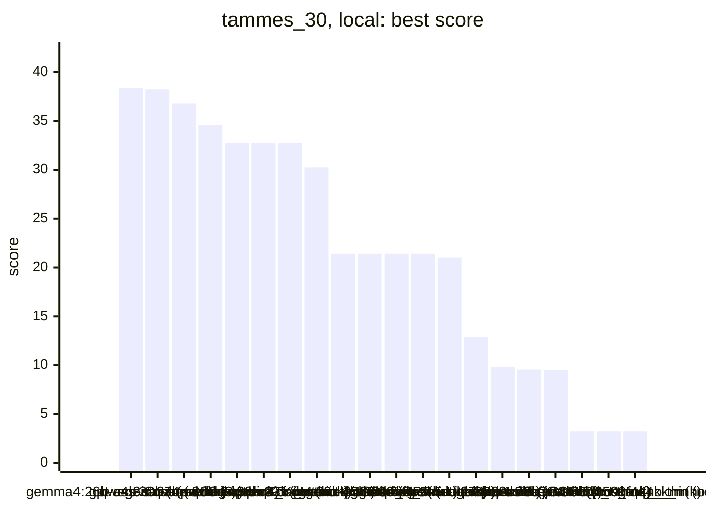
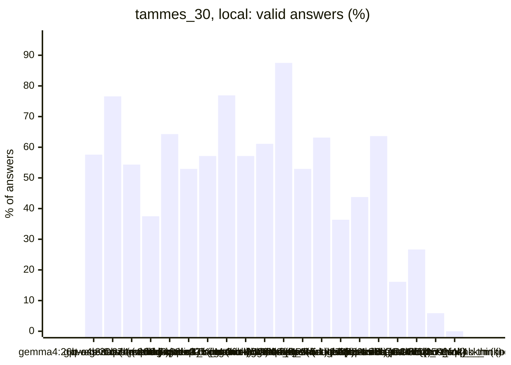
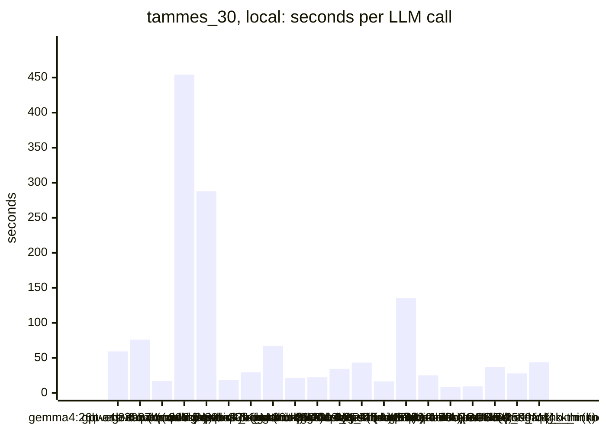
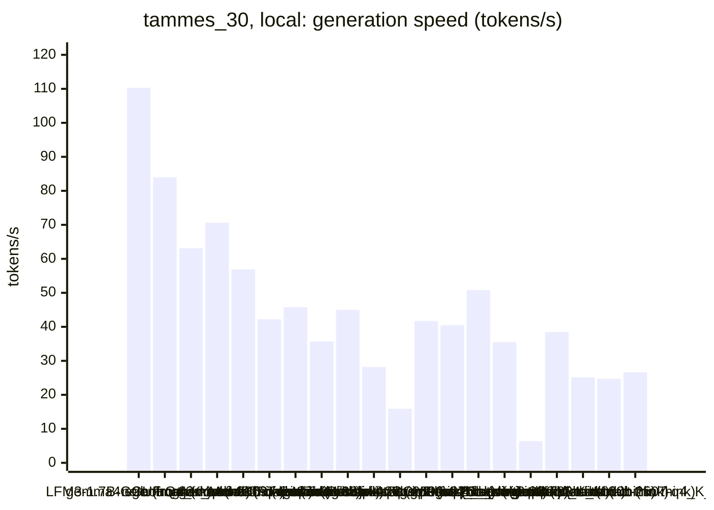
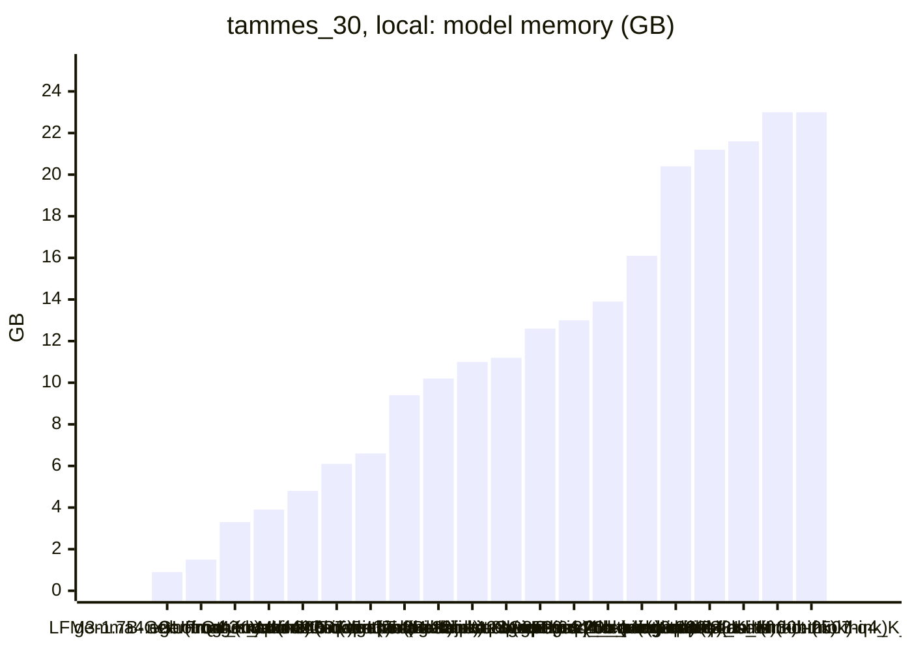
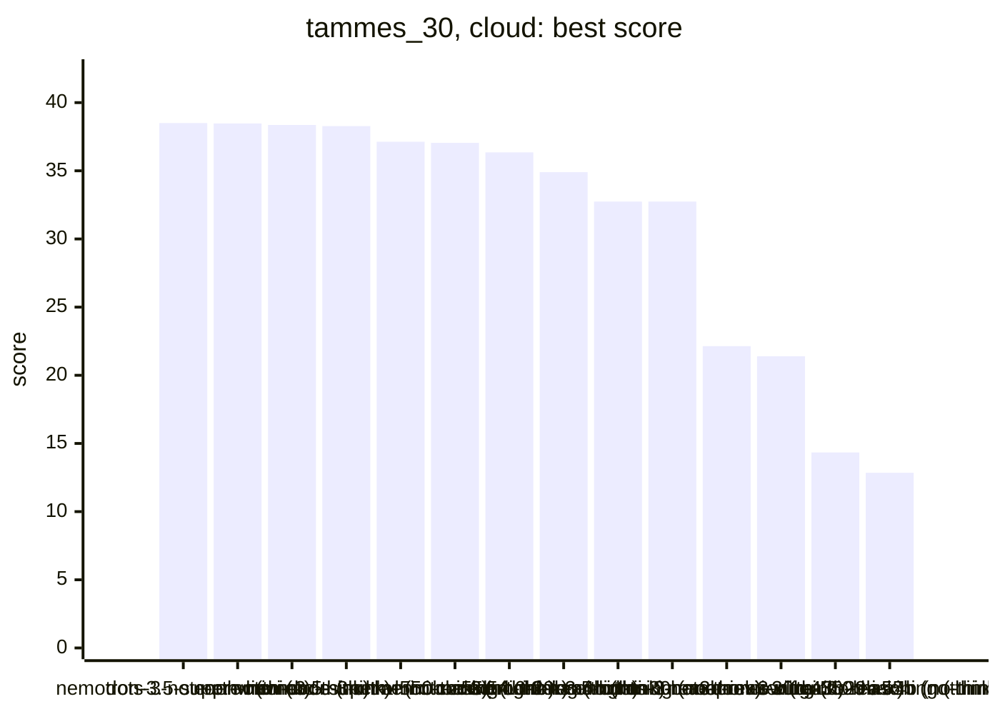
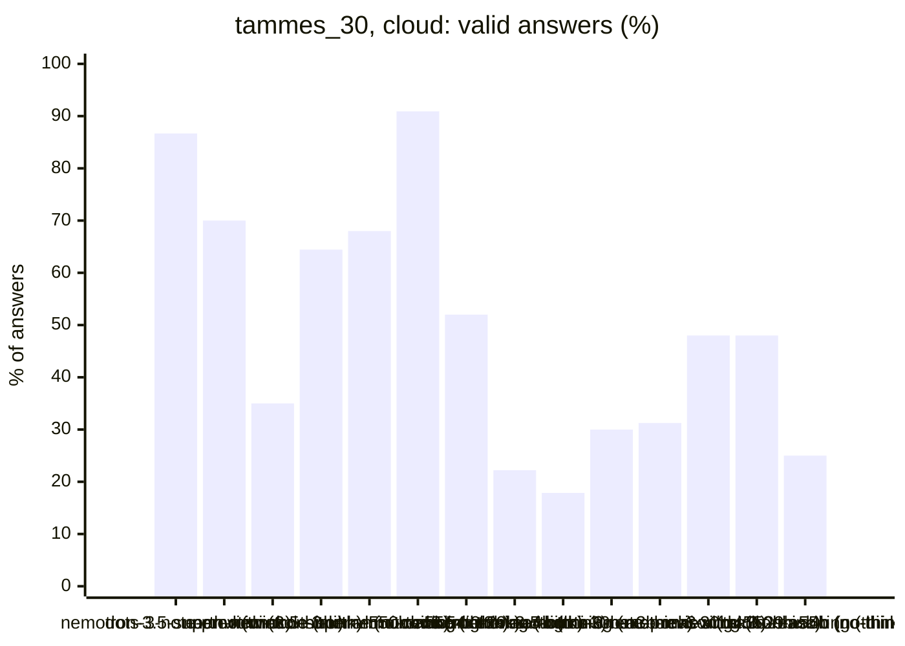
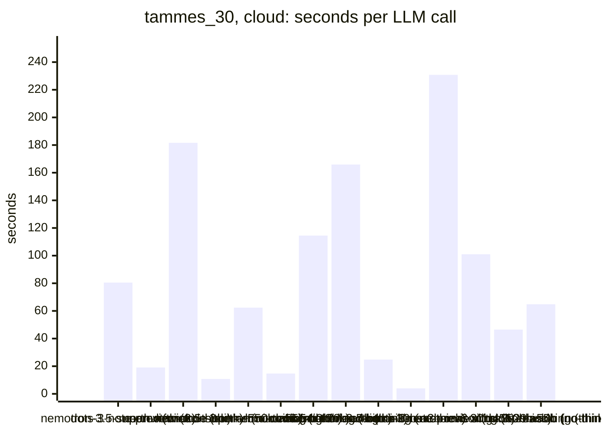
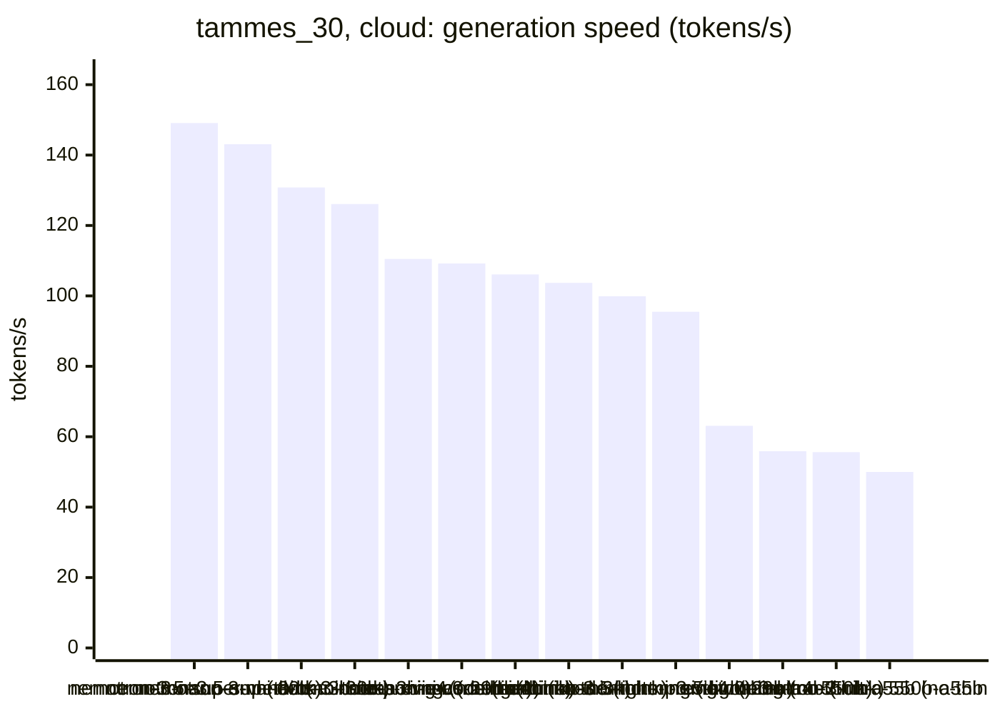

<!-- Copyright (c) 2026 by C. Klukas -->
<!-- SPDX-License-Identifier: GPL-3.0-only -->
<!-- Generated by `omega report` from bench/results/*.json. Do not edit by hand. -->

# tammes_30

35 models, each run at most 60 minutes, ended earlier after 15 answers in a row without progress; one run per model. The [overall ranking](../benchmarks.md#overall-ranking) compares the models over all examples.

Machine: Intel(R) Core(TM) i7-8700K CPU @ 3.70GHz (MS-7A98), 12 cores, 64 GB, 2x NVIDIA GeForce GTX 1080 Ti, 11264 MiB.

## Local models

Ollama on this machine.

| Model | Params | Initial | Best | Gain | LLM calls | s/call | Valid | New bests | Min to best | Minutes | Stopped by |
|---|---|--:|--:|--:|--:|--:|--:|--:|--:|--:|---|
| gemma4:26b-a4b-it-qat (no-think) | 25.2B | 3.20136 | **38.3889** | ×11.99 | 33 | 59 | 58% | 4 | 15.1 | 33.3 | no progress |
| gpt-oss:20b (no-think) | 20.9B | 3.20136 | **38.2397** | ×11.94 | 47 | 76 | 77% | 12 | 50.1 | 60.6 | time limit |
| gemma4:latest (no-think) | 7.5B | 3.20136 | **36.8186** | ×11.50 | 46 | 17 | 54% | 7 | 8.7 | 13.8 | no progress |
| frob/sarvam:30b (no-think) | 32.2B | 3.20136 | **34.5838** | ×10.80 | 8 | 454 | 38% | 2 | 32.4 | 60.8 | time limit |
| qwen3.6:27b-coding-mtp-q4_K_M (no-think) | 27.3B | 3.20136 | **32.7402** | ×10.23 | 14 | 288 | 64% | 2 | 6.2 | 67.4 | time limit |
| qwen2.5-coder:7b (no-think) | 7.6B | 3.20136 | **32.7402** | ×10.23 | 17 | 19 | 53% | 1 | 0.8 | 5.7 | no progress |
| qwen3.5:latest (no-think) | 9.0B | 3.20136 | **32.7402** | ×10.23 | 28 | 30 | 57% | 2 | 9.1 | 15.4 | no progress |
| qwen3-coder:30b (no-think) | 30.5B | 3.20136 | **30.2470** | ×9.45 | 26 | 67 | 77% | 5 | 14.4 | 29.8 | no progress |
| qwen3:30b-a3b-instruct-2507-q4_K_M (no-think) | 30.5B | 3.20136 | **21.4033** | ×6.69 | 14 | 21 | 57% | 2 | 1.6 | 5.3 | no progress |
| richardyoung/frognano-4b-2609:latest (no-think) | 4.3B | 3.20136 | **21.4033** | ×6.69 | 18 | 22 | 61% | 1 | 0.9 | 7.2 | no progress |
| gemma4:12b-it-qat (no-think) | 11.9B | 3.20136 | **21.4033** | ×6.69 | 16 | 34 | 88% | 1 | 1.2 | 9.4 | no progress |
| glm-4.7-flash:latest (no-think) | 29.9B | 3.20136 | **21.4033** | ×6.69 | 17 | 43 | 53% | 1 | 1.4 | 12.5 | no progress |
| gemma4:e4b-it-qat (no-think) | 7.5B | 3.20136 | **21.0395** | ×6.57 | 19 | 16 | 63% | 2 | 1.0 | 6.3 | no progress |
| underdog-saluki-27b:iq2-mix (no-think) | 26.9B | 3.20136 | **12.9182** | ×4.04 | 22 | 135 | 36% | 1 | 14.8 | 51.1 | no progress |
| yandex/YandexGPT-5-Lite-8B-instruct-GGUF:latest (no-think) | 8.0B | 3.20136 | **9.80576** | ×3.06 | 32 | 25 | 44% | 3 | 6.8 | 13.9 | no progress |
| gemma4:e2b (no-think) | 4.6B | 3.20136 | **9.55566** | ×2.98 | 22 | 8 | 64% | 3 | 1.0 | 3.5 | no progress |
| nemotron-3-nano:4b (no-think) | 4.0B | 3.20136 | **9.50191** | ×2.97 | 31 | 9 | 16% | 1 | 2.5 | 5.4 | no progress |
| hf.co/LiquidAI/LFM3-1.7B-GGUF:Q4_K_M (no-think) | 1.73B | 3.20136 | **3.20136** | ×1.00 | 15 | 37 | 27% | 0 | - | 9.6 | no progress |
| MichelRosselli/apertus:8b-instruct-2509-q4_k_m (no-think) | 8.1B | 3.20136 | **3.20136** | ×1.00 | 17 | 28 | 6% | 0 | - | 9.6 | no progress |
| llm-jp-4-8b-omega:q4_k_m (no-think) | 8.6B | 3.20136 | **3.20136** | ×1.00 | 16 | 44 | 0% | 0 | - | 12.1 | no progress |

### Inference speed and memory

RAM is what Ollama reports for the loaded model (weights, context cache and buffers; on Apple silicon this is shared memory). Load is the time to bring the model into memory. Prompt and generation speeds are tokens per second over all calls of the run.

| Model | Params | RAM GB | Load s | Prompt tok/s | Gen tok/s | Median s/call | p90 s/call | Tokens/answer | Stopped |
|---|---|--:|--:|--:|--:|--:|--:|--:|--:|
| gemma4:e2b (no-think) | 4.6B | 0.9 | 21 | 2675 | 110.3 | 7 | 12 | 492 | 0 |
| hf.co/LiquidAI/LFM3-1.7B-GGUF:Q4_K_M (no-think) | 1.73B | 1.5 | 0 | 4032 | 84.0 | 36 | 72 | 1680 | 10 |
| gemma4:latest (no-think) | 7.5B | 3.3 | 24 | 1256 | 63.1 | 17 | 27 | 701 | 1 |
| nemotron-3-nano:4b (no-think) | 4.0B | 3.9 | 19 | 1755 | 70.6 | 8 | 12 | 347 | 0 |
| richardyoung/frognano-4b-2609:latest (no-think) | 4.3B | 4.8 | 23 | 1675 | 56.9 | 22 | 38 | 986 | 0 |
| gemma4:e4b-it-qat (no-think) | 7.5B | 6.1 | 21 | 1594 | 42.2 | 12 | 30 | 465 | 1 |
| qwen2.5-coder:7b (no-think) | 7.6B | 6.6 | 16 | 1415 | 45.8 | 17 | 32 | 643 | 0 |
| qwen3.5:latest (no-think) | 9.0B | 9.4 | 24 | 980 | 35.7 | 23 | 59 | 741 | 0 |
| yandex/YandexGPT-5-Lite-8B-instruct-GGUF:latest (no-think) | 8.0B | 10.2 | 17 | 1638 | 45.0 | 23 | 35 | 890 | 0 |
| gemma4:12b-it-qat (no-think) | 11.9B | 11.0 | 23 | 646 | 28.2 | 36 | 49 | 731 | 0 |
| underdog-saluki-27b:iq2-mix (no-think) | 26.9B | 11.2 | 24 | 399 | 15.9 | 144 | 203 | 1873 | 1 |
| MichelRosselli/apertus:8b-instruct-2509-q4_k_m (no-think) | 8.1B | 12.6 | 49 | 1499 | 41.7 | 18 | 64 | 506 | 0 |
| llm-jp-4-8b-omega:q4_k_m (no-think) | 8.6B | 13.0 | 18 | 1462 | 40.5 | 40 | 68 | 1471 | 1 |
| gpt-oss:20b (no-think) | 20.9B | 13.9 | 40 | 1714 | 50.8 | 65 | 135 | 3547 | 1 |
| gemma4:26b-a4b-it-qat (no-think) | 25.2B | 16.1 | 56 | 786 | 35.5 | 58 | 92 | 1710 | 1 |
| qwen3.6:27b-coding-mtp-q4_K_M (no-think) | 27.3B | 20.4 | 58 | 185 | 6.4 | 298 | 529 | 1543 | 1 |
| frob/sarvam:30b (no-think) | 32.2B | 21.2 | 64 | 1217 | 38.5 | 650 | 696 | 18617 | 1 |
| glm-4.7-flash:latest (no-think) | 29.9B | 21.6 | 62 | 454 | 25.1 | 41 | 75 | 817 | 0 |
| qwen3-coder:30b (no-think) | 30.5B | 23.0 | 59 | 542 | 24.7 | 68 | 114 | 1328 | 0 |
| qwen3:30b-a3b-instruct-2507-q4_K_M (no-think) | 30.5B | 23.0 | 58 | 682 | 26.6 | 16 | 59 | 299 | 0 |

### Best score over time

| Model | 15 min | 30 min | 45 min | 60 min |
|---|--:|--:|--:|--:|
| gemma4:26b-a4b-it-qat (no-think) | 38.1180 | 38.3889 | 38.3889 | 38.3889 |
| gpt-oss:20b (no-think) | 34.8850 | 34.9704 | 37.5720 | 38.2397 |
| gemma4:latest (no-think) | 36.8186 | 36.8186 | 36.8186 | 36.8186 |
| frob/sarvam:30b (no-think) | 3.20136 | 5.25633 | 34.5838 | 34.5838 |
| qwen3.6:27b-coding-mtp-q4_K_M (no-think) | 32.7402 | 32.7402 | 32.7402 | 32.7402 |
| qwen2.5-coder:7b (no-think) | 32.7402 | 32.7402 | 32.7402 | 32.7402 |
| qwen3.5:latest (no-think) | 32.7402 | 32.7402 | 32.7402 | 32.7402 |
| qwen3-coder:30b (no-think) | 30.2470 | 30.2470 | 30.2470 | 30.2470 |
| qwen3:30b-a3b-instruct-2507-q4_K_M (no-think) | 21.4033 | 21.4033 | 21.4033 | 21.4033 |
| richardyoung/frognano-4b-2609:latest (no-think) | 21.4033 | 21.4033 | 21.4033 | 21.4033 |
| gemma4:12b-it-qat (no-think) | 21.4033 | 21.4033 | 21.4033 | 21.4033 |
| glm-4.7-flash:latest (no-think) | 21.4033 | 21.4033 | 21.4033 | 21.4033 |
| gemma4:e4b-it-qat (no-think) | 21.0395 | 21.0395 | 21.0395 | 21.0395 |
| underdog-saluki-27b:iq2-mix (no-think) | 12.9182 | 12.9182 | 12.9182 | 12.9182 |
| yandex/YandexGPT-5-Lite-8B-instruct-GGUF:latest (no-think) | 9.80576 | 9.80576 | 9.80576 | 9.80576 |
| gemma4:e2b (no-think) | 9.55566 | 9.55566 | 9.55566 | 9.55566 |
| nemotron-3-nano:4b (no-think) | 9.50191 | 9.50191 | 9.50191 | 9.50191 |
| hf.co/LiquidAI/LFM3-1.7B-GGUF:Q4_K_M (no-think) | 3.20136 | 3.20136 | 3.20136 | 3.20136 |
| MichelRosselli/apertus:8b-instruct-2509-q4_k_m (no-think) | 3.20136 | 3.20136 | 3.20136 | 3.20136 |
| llm-jp-4-8b-omega:q4_k_m (no-think) | 3.20136 | 3.20136 | 3.20136 | 3.20136 |

### Outcome of the LLM answers

| Model | duplicate | edit error | invalid | llm error | ok | timeout |
|---|--:|--:|--:|--:|--:|--:|
| gemma4:26b-a4b-it-qat (no-think) | 0 | 10 | 3 | 1 | 19 | 0 |
| gpt-oss:20b (no-think) | 1 | 6 | 3 | 1 | 36 | 0 |
| gemma4:latest (no-think) | 1 | 2 | 17 | 1 | 25 | 0 |
| frob/sarvam:30b (no-think) | 0 | 4 | 0 | 1 | 3 | 0 |
| qwen3.6:27b-coding-mtp-q4_K_M (no-think) | 0 | 3 | 1 | 1 | 9 | 0 |
| qwen2.5-coder:7b (no-think) | 2 | 0 | 6 | 0 | 9 | 0 |
| qwen3.5:latest (no-think) | 0 | 0 | 3 | 0 | 16 | 9 |
| qwen3-coder:30b (no-think) | 4 | 0 | 2 | 0 | 20 | 0 |
| qwen3:30b-a3b-instruct-2507-q4_K_M (no-think) | 1 | 3 | 2 | 0 | 8 | 0 |
| richardyoung/frognano-4b-2609:latest (no-think) | 2 | 1 | 4 | 0 | 11 | 0 |
| gemma4:12b-it-qat (no-think) | 0 | 0 | 2 | 0 | 14 | 0 |
| glm-4.7-flash:latest (no-think) | 0 | 0 | 8 | 0 | 9 | 0 |
| gemma4:e4b-it-qat (no-think) | 2 | 1 | 3 | 1 | 12 | 0 |
| underdog-saluki-27b:iq2-mix (no-think) | 0 | 0 | 12 | 1 | 8 | 1 |
| yandex/YandexGPT-5-Lite-8B-instruct-GGUF:latest (no-think) | 11 | 1 | 6 | 0 | 14 | 0 |
| gemma4:e2b (no-think) | 0 | 2 | 6 | 0 | 14 | 0 |
| nemotron-3-nano:4b (no-think) | 0 | 21 | 5 | 0 | 5 | 0 |
| hf.co/LiquidAI/LFM3-1.7B-GGUF:Q4_K_M (no-think) | 0 | 1 | 0 | 10 | 4 | 0 |
| MichelRosselli/apertus:8b-instruct-2509-q4_k_m (no-think) | 0 | 11 | 2 | 0 | 1 | 3 |
| llm-jp-4-8b-omega:q4_k_m (no-think) | 0 | 3 | 12 | 1 | 0 | 0 |

### Best idea per model

- **gemma4:26b-a4b-it-qat (no-think)**: Introduce a multi-start strategy with multiple random seeds to escape local minima and improve the chance of finding a superior configuration.
- **gpt-oss:20b (no-think)**: Use a steeper 1/d³ repulsion (force ∝1/d³) and add a brief polishing phase that pushes the closest pair apart, which better approximates the max‑min objective and improves the …
- **gemma4:latest (no-think)**: Implement the energy minimization step on the golden spiral initialization to refine the point positions and increase the minimum angle, as suggested by expert hints and previous …
- **frob/sarvam:30b (no-think)**: tuned N_ITER_REPULSION=15, S_EXP=2, STEP_SIZE=0.05 on top of: Use Fibonacci spiral for initial placement and repulsion optimization to maximize the minimum angle.
- **qwen3.6:27b-coding-mtp-q4_K_M (no-think)**: Replace the random initial placement with a Fibonacci (golden-ratio) spiral distribution, which provides a highly uniform starting configuration that avoids the extreme clustering …
- **qwen2.5-coder:7b (no-think)**: Use a Fibonacci sphere as a more uniform initial guess than random points.
- **qwen3.5:latest (no-think)**: Replace random uniform initialization with a deterministic Fibonacci spiral lattice seed that provides an excellent initial uniform configuration, avoiding the single close pair …
- **qwen3-coder:30b (no-think)**: tuned LOCAL_SEARCH_STEPS=20, SIMULATED_ANNEALING_STEPS=100, INITIAL_TEMPERATURE=0.05 on top of: Replace the gradient-based optimization with a hybrid approach using local search …
- **qwen3:30b-a3b-instruct-2507-q4_K_M (no-think)**: tuned phi=8.056 on top of: Replace the uniform random initialization with a golden-spiral Fibonacci sphere layout to achieve better initial uniformity and higher minimum angle.
- **richardyoung/frognano-4b-2609:latest (no-think)**: Replace the random uniform initialization with a deterministic Fibonacci sphere layout to provide a much more uniform initial distribution, ensuring no pairs start too close and …
- **gemma4:12b-it-qat (no-think)**: Use a Fibonacci spiral for a much better uniform initial distribution, which significantly improves the starting point for the Tammes problem compared to random placement.
- **glm-4.7-flash:latest (no-think)**: Replace the naive random initialization with a Fibonacci lattice (golden spiral) to distribute points evenly across the sphere, providing a much stronger starting configuration …
- **gemma4:e4b-it-qat (no-think)**: Initialize points using the Fibonacci spiral pattern for a much better starting configuration before applying optimization.
- **underdog-saluki-27b:iq2-mix (no-think)**: Fix the three bugs causing failures: (1) `base * _sub(pi, pj)` multiplies a float by a tuple — replace with explicit component arithmetic; (2) `_anneal_min_angle` calls `_restore` …
- **yandex/YandexGPT-5-Lite-8B-instruct-GGUF:latest (no-think)**: Tune the move_step parameter to further improve the minimum angle by slightly increasing the step size.
- **gemma4:e2b (no-think)**: Replace the simple uniform distribution with a known, better starting configuration like the Fibonacci sphere to improve the initial minimum angle score.
- **nemotron-3-nano:4b (no-think)**: Replace the initial uniform random generation with a Fibonacci-based spherical code to create a more even distribution and reduce close pairs.
- **hf.co/LiquidAI/LFM3-1.7B-GGUF:Q4_K_M (no-think)**: initial program
- **MichelRosselli/apertus:8b-instruct-2509-q4_k_m (no-think)**: initial program
- **llm-jp-4-8b-omega:q4_k_m (no-think)**: initial program

## Cloud models (OpenRouter)

Free OpenRouter models; times include the network and the provider's queue.

| Model | Params | Initial | Best | Gain | LLM calls | s/call | Valid | New bests | Min to best | Minutes | Stopped by |
|---|---|--:|--:|--:|--:|--:|--:|--:|--:|--:|---|
| nvidia/nemotron-3.5-super-vl:free (think) |  | 3.20136 | **38.5034** | ×12.03 | 15 | 80 | 87% | 4 | 19.6 | 20.5 | no progress |
| dots-studio/dots-3-note-preview:free (no-think) |  | 3.20136 | **38.4693** | ×12.02 | 50 | 19 | 70% | 10 | 15.7 | 16.2 | no progress |
| cohere/north-mini-code:free (think) |  | 3.20136 | **38.3608** | ×11.98 | 20 | 182 | 35% | 5 | 60.7 | 60.8 | time limit |
| nvidia/nemotron-3.5-super-vl:free (no-think) |  | 3.20136 | **38.2850** | ×11.96 | 45 | 11 | 64% | 8 | 5.2 | 8.4 | no progress |
| nvidia/nemotron-3-ultra-550b-a55b:free (think) |  | 3.20136 | **37.1262** | ×11.60 | 25 | 62 | 68% | 5 | 26.6 | 26.6 | no progress |
| cohere/north-mini-code:free (no-think) |  | 3.20136 | **37.0540** | ×11.57 | 22 | 15 | 91% | 4 | 1.0 | 5.8 | no progress |
| nvidia/nemotron-3.5-lightning:free (think) |  | 3.20136 | **36.3532** | ×11.36 | 25 | 114 | 52% | 5 | 23.0 | 48.6 | no progress |
| xingchen-agi/xing4.0-29b-a4b:free (think) |  | 3.20136 | **34.8992** | ×10.90 | 18 | 166 | 22% | 2 | 18.8 | 49.9 | model errors |
| nvidia/nemotron-3.5-lightning:free (no-think) |  | 3.20136 | **32.7402** | ×10.23 | 28 | 25 | 18% | 2 | 6.3 | 11.7 | no progress |
| nvidia/nemotron-3-nano-omni-30b-a3b-reasoning:free (no-think) |  | 3.20136 | **32.7402** | ×10.23 | 20 | 4 | 30% | 1 | 0.3 | 1.5 | no progress |
| dots-studio/dots-3-note-preview:free (think) |  | 3.20136 | **22.1357** | ×6.91 | 16 | 231 | 31% | 4 | 51.0 | 61.6 | time limit |
| nvidia/nemotron-3-nano-omni-30b-a3b-reasoning:free (think) |  | 3.20136 | **21.4033** | ×6.69 | 25 | 101 | 48% | 3 | 14.7 | 42.3 | no progress |
| nvidia/nemotron-3-ultra-550b-a55b:free (no-think) |  | 3.20136 | **14.3393** | ×4.48 | 25 | 46 | 48% | 5 | 8.3 | 19.9 | no progress |
| xingchen-agi/xing4.0-29b-a4b:free (no-think) |  | 3.20136 | **12.8503** | ×4.01 | 24 | 65 | 25% | 1 | 8.2 | 27.2 | no progress |
| recursive/flint-v1.0:free (think) |  | | | | | | | | | | failed: all 6 model requests failed: recursive/flint-v1.0:free: requ |

### Inference speed and cost

Generation speed is measured from the first to the last streamed token; the time to the first token is counted as prompt time. Cost is what OpenRouter charged for the run.

| Model | Gen tok/s | Median s/call | p90 s/call | Tokens/answer | Stopped | Cost $ |
|---|--:|--:|--:|--:|--:|--:|
| nvidia/nemotron-3.5-super-vl:free (think) | 149.1 | 72 | 118 | 11862 | 0 | 0.000 |
| nvidia/nemotron-3.5-super-vl:free (no-think) | 143.1 | 9 | 20 | 1345 | 6 | 0.000 |
| nvidia/nemotron-3-nano-omni-30b-a3b-reasoning:free (no-think) | 130.8 | 4 | 8 | 443 | 0 | 0.000 |
| nvidia/nemotron-3-nano-omni-30b-a3b-reasoning:free (think) | 126.1 | 107 | 179 | 12616 | 0 | 0.000 |
| dots-studio/dots-3-note-preview:free (no-think) | 110.5 | 18 | 30 | 1906 | 1 | 0.000 |
| cohere/north-mini-code:free (no-think) | 109.2 | 14 | 22 | 1551 | 1 | 0.000 |
| xingchen-agi/xing4.0-29b-a4b:free (no-think) | 106.1 | 55 | 96 | 2128 | 6 | 0.000 |
| cohere/north-mini-code:free (think) | 103.7 | 207 | 344 | 18683 | 0 | 0.000 |
| nvidia/nemotron-3.5-lightning:free (think) | 99.9 | 117 | 240 | 11813 | 1 | 0.000 |
| dots-studio/dots-3-note-preview:free (think) | 95.5 | 260 | 273 | 21834 | 0 | 0.000 |
| nvidia/nemotron-3.5-lightning:free (no-think) | 63.1 | 17 | 55 | 1640 | 8 | 0.000 |
| xingchen-agi/xing4.0-29b-a4b:free (think) | 55.9 | 76 | 429 | 4876 | 1 | 0.000 |
| nvidia/nemotron-3-ultra-550b-a55b:free (no-think) | 55.6 | 39 | 104 | 2252 | 1 | 0.000 |
| nvidia/nemotron-3-ultra-550b-a55b:free (think) | 50.0 | 45 | 138 | 3041 | 0 | 0.000 |

### Best score over time

| Model | 15 min | 30 min | 45 min | 60 min |
|---|--:|--:|--:|--:|
| nvidia/nemotron-3.5-super-vl:free (think) | 38.2201 | 38.5034 | 38.5034 | 38.5034 |
| dots-studio/dots-3-note-preview:free (no-think) | 38.4469 | 38.4693 | 38.4693 | 38.4693 |
| cohere/north-mini-code:free (think) | 3.20136 | 3.20136 | 38.3547 | 38.3600 |
| nvidia/nemotron-3.5-super-vl:free (no-think) | 38.2850 | 38.2850 | 38.2850 | 38.2850 |
| nvidia/nemotron-3-ultra-550b-a55b:free (think) | 36.7876 | 37.1262 | 37.1262 | 37.1262 |
| cohere/north-mini-code:free (no-think) | 37.0540 | 37.0540 | 37.0540 | 37.0540 |
| nvidia/nemotron-3.5-lightning:free (think) | 35.4987 | 36.3532 | 36.3532 | 36.3532 |
| xingchen-agi/xing4.0-29b-a4b:free (think) | 3.20136 | 34.8992 | 34.8992 | 34.8992 |
| nvidia/nemotron-3.5-lightning:free (no-think) | 32.7402 | 32.7402 | 32.7402 | 32.7402 |
| nvidia/nemotron-3-nano-omni-30b-a3b-reasoning:free (no-think) | 32.7402 | 32.7402 | 32.7402 | 32.7402 |
| dots-studio/dots-3-note-preview:free (think) | 3.20136 | 3.20136 | 16.5495 | 22.1357 |
| nvidia/nemotron-3-nano-omni-30b-a3b-reasoning:free (think) | 21.4033 | 21.4033 | 21.4033 | 21.4033 |
| nvidia/nemotron-3-ultra-550b-a55b:free (no-think) | 14.3393 | 14.3393 | 14.3393 | 14.3393 |
| xingchen-agi/xing4.0-29b-a4b:free (no-think) | 12.8503 | 12.8503 | 12.8503 | 12.8503 |

### Outcome of the LLM answers

| Model | duplicate | edit error | invalid | llm error | ok | timeout |
|---|--:|--:|--:|--:|--:|--:|
| nvidia/nemotron-3.5-super-vl:free (think) | 0 | 2 | 0 | 0 | 13 | 0 |
| dots-studio/dots-3-note-preview:free (no-think) | 1 | 7 | 6 | 1 | 35 | 0 |
| cohere/north-mini-code:free (think) | 2 | 10 | 0 | 0 | 7 | 1 |
| nvidia/nemotron-3.5-super-vl:free (no-think) | 3 | 1 | 6 | 6 | 29 | 0 |
| nvidia/nemotron-3-ultra-550b-a55b:free (think) | 5 | 1 | 2 | 0 | 17 | 0 |
| cohere/north-mini-code:free (no-think) | 0 | 0 | 1 | 1 | 20 | 0 |
| nvidia/nemotron-3.5-lightning:free (think) | 3 | 7 | 1 | 1 | 13 | 0 |
| xingchen-agi/xing4.0-29b-a4b:free (think) | 0 | 1 | 1 | 12 | 4 | 0 |
| nvidia/nemotron-3.5-lightning:free (no-think) | 4 | 7 | 4 | 8 | 5 | 0 |
| nvidia/nemotron-3-nano-omni-30b-a3b-reasoning:free (no-think) | 0 | 14 | 0 | 0 | 6 | 0 |
| dots-studio/dots-3-note-preview:free (think) | 1 | 10 | 0 | 0 | 5 | 0 |
| nvidia/nemotron-3-nano-omni-30b-a3b-reasoning:free (think) | 0 | 12 | 1 | 0 | 12 | 0 |
| nvidia/nemotron-3-ultra-550b-a55b:free (no-think) | 3 | 1 | 7 | 1 | 12 | 1 |
| xingchen-agi/xing4.0-29b-a4b:free (no-think) | 0 | 1 | 6 | 11 | 6 | 0 |

### Best idea per model

- **nvidia/nemotron-3.5-super-vl:free (think)**: tuned SA_ITERS=100000, SA_T0=0.001, SA_STEP0=0.05, SA_STEP_DECAY=1 on top of: Replace the greedy single-pair max-min polish with a simulated-annealing phase that directly …
- **dots-studio/dots-3-note-preview:free (no-think)**: tuned REPULSION_STEP_2=0.012, REPULSION_ITER_2=150 on top of: Expose the repulsion step size and iteration count as named constants and add a second repulsion phase with a smaller …
- **cohere/north-mini-code:free (think)**: Use multiple random restarts with repulsion energy minimization (higher powers) and polishing to explore diverse local minima, keeping the configuration with the largest minimal …
- **nvidia/nemotron-3.5-super-vl:free (no-think)**: Expose key polish parameters (coarse margin/step, fine margin/step, fine iterations) as named constants so the engine can sweep them toward a higher min angle.
- **nvidia/nemotron-3-ultra-550b-a55b:free (think)**: tuned NUM_RESTARTS=3, SA_INITIAL_TEMP=0.2, SA_STEPS_PER_RESTART=10000, PERTURBATION_SCALE_START=0.15 on top of: Use Simulated Annealing directly on the minimum angle objective …
- **cohere/north-mini-code:free (no-think)**: tuned step=0.1063, polish_step=0.06349 on top of: Replace the naive random initialization with a Fibonacci lattice on the sphere, then perform a multi‑stage gradient‑based …
- **nvidia/nemotron-3.5-lightning:free (think)**: Increase polish iterations from 15 to 34 and step scale from 0.015 to 0.07371 for more effective max-min optimization, matching the best-performing configuration from the …
- **xingchen-agi/xing4.0-29b-a4b:free (think)**: tuned RESTARTS=3, STEPS_PER_S=100, POLISH_STEP=0.3, GRAD_STEP=0.005 on top of: Replace the random-point starter with a Fibonacci sphere, then run gradient descent on increasing …
- **nvidia/nemotron-3.5-lightning:free (no-think)**: Replace the random spherical start with a deterministic golden-spiral Fibonacci lattice to achieve a more uniform initial placement, which raises the minimum angle baseline and …
- **nvidia/nemotron-3-nano-omni-30b-a3b-reasoning:free (no-think)**: Replace the random uniform sphere generation with a Fibonacci lattice (golden spiral) to start from a highly uniform distribution of points, which should improve the minimum angle …
- **dots-studio/dots-3-note-preview:free (think)**: Update parameters to better values found in earlier sweeps (N_RESTARTS=4, S_STEPS=5, STEP_SIZE=0.005539, ITERATIONS_PER_S=60, POLISH_ITERATIONS=200) and add a simulated annealing …
- **nvidia/nemotron-3-nano-omni-30b-a3b-reasoning:free (think)**: Replace the random uniform generation with a deterministic Fibonacci sphere and add a short polishing loop that iteratively pushes apart the closest pair(s) with a decaying step …
- **nvidia/nemotron-3-ultra-550b-a55b:free (no-think)**: Define the missing constant RESTART_COUNT and other required constants at the top of the construct function to fix the NameError and enable multiple restarts for better …
- **xingchen-agi/xing4.0-29b-a4b:free (no-think)**: The bug is that `REPULSION_STEPS` is an int (3) being used in a for-loop, which iterates over characters. Fix by changing it to `[1, 2, 3]` so the repulsion phases run with …
