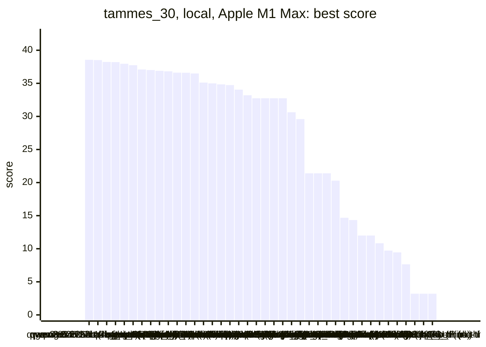
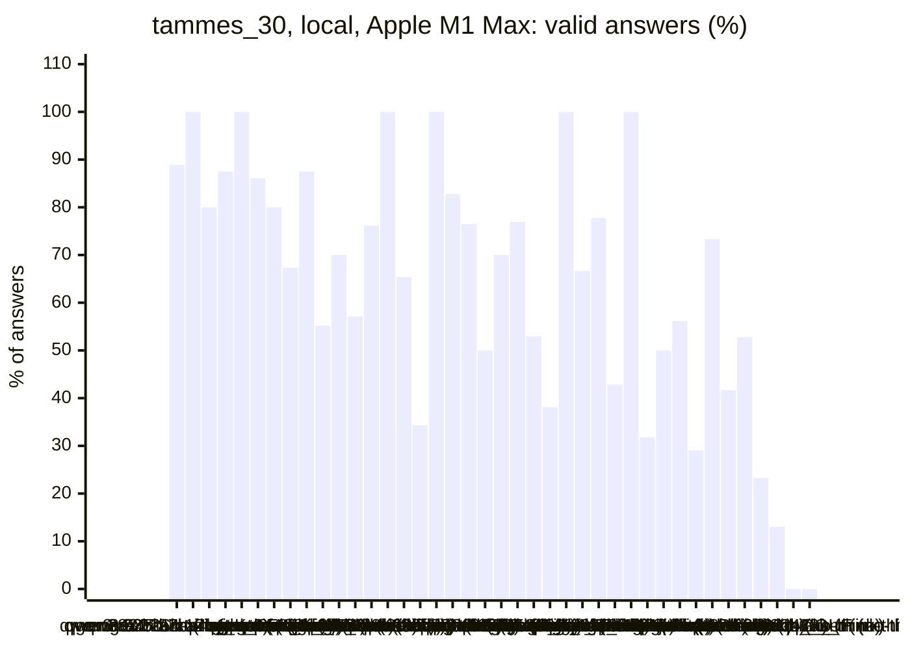
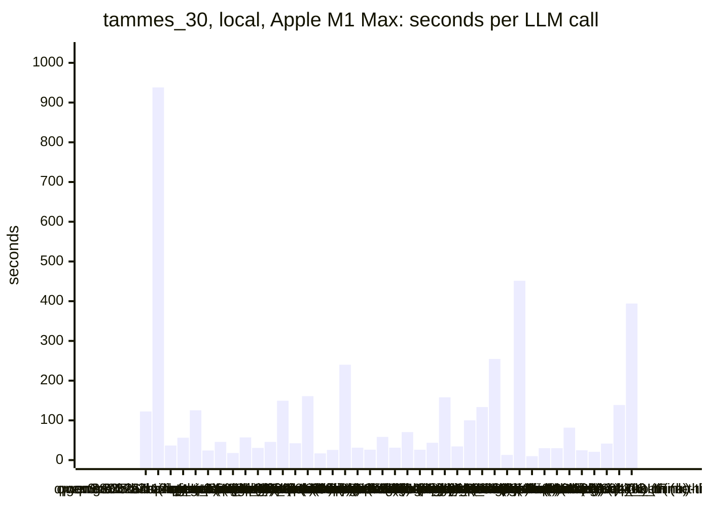
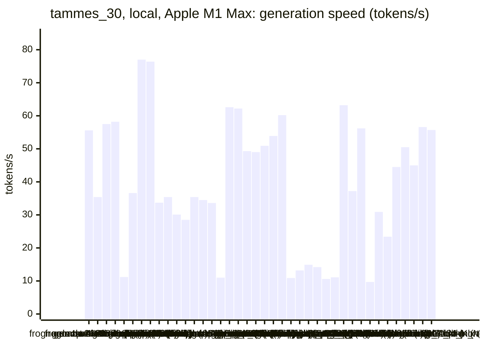
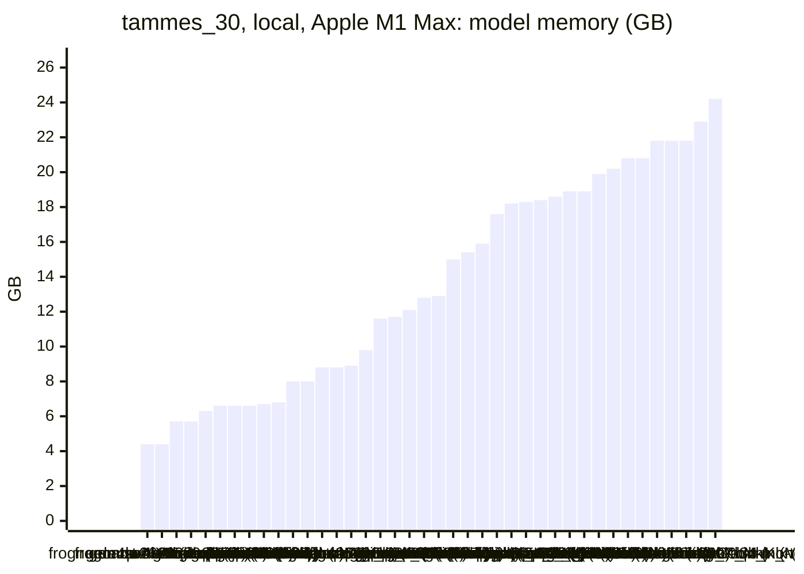
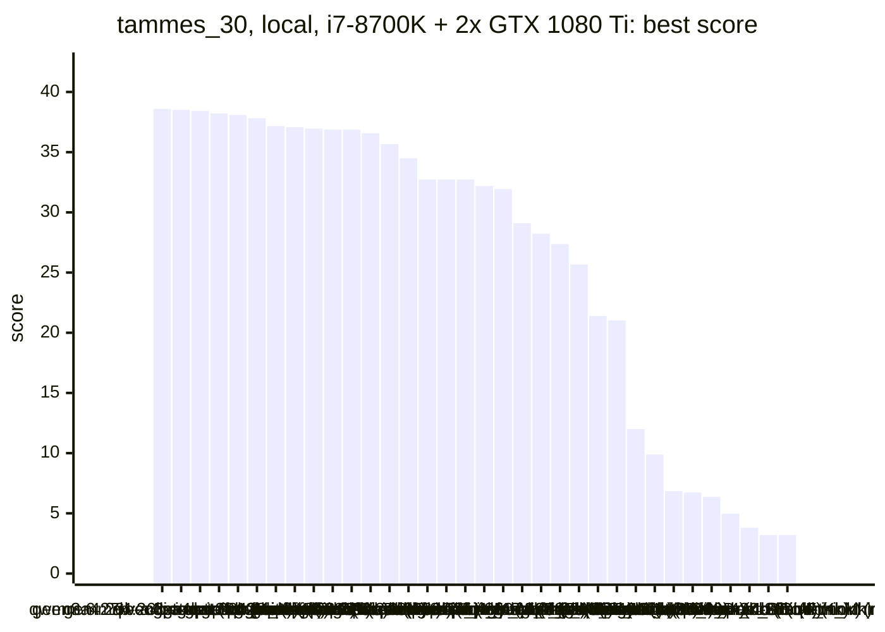
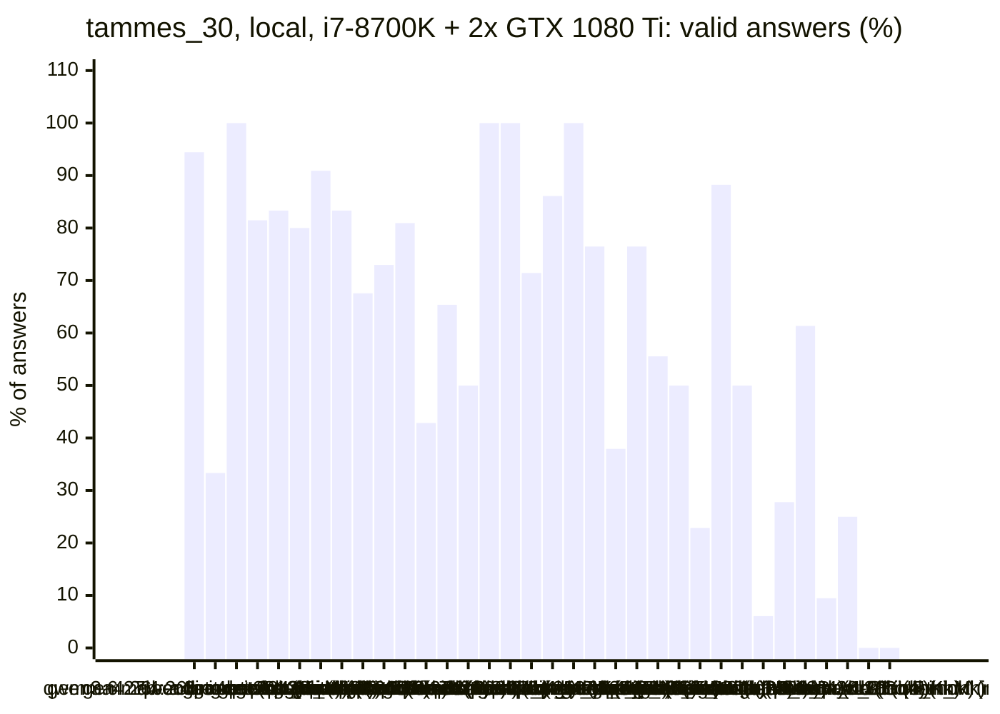
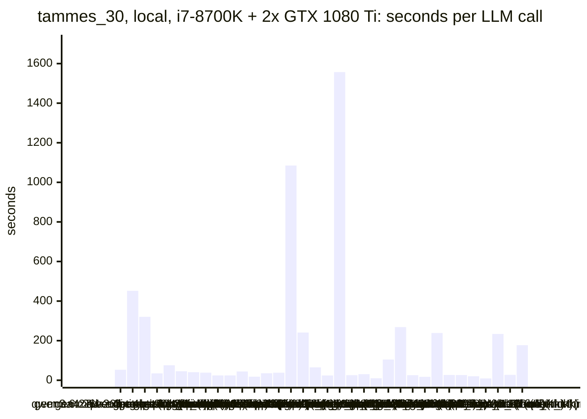
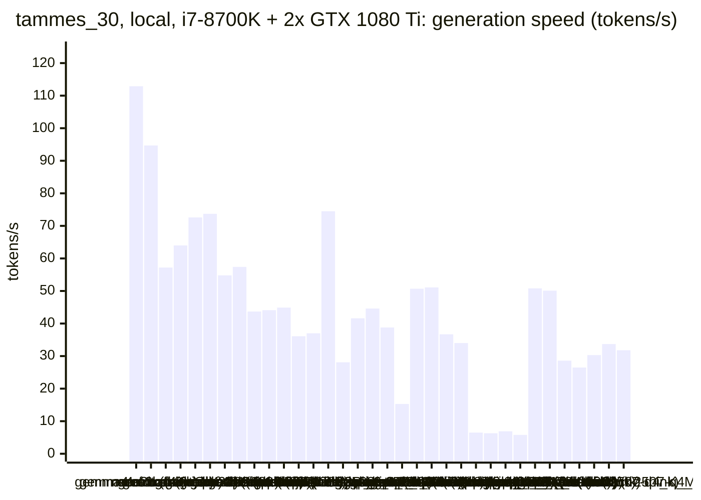
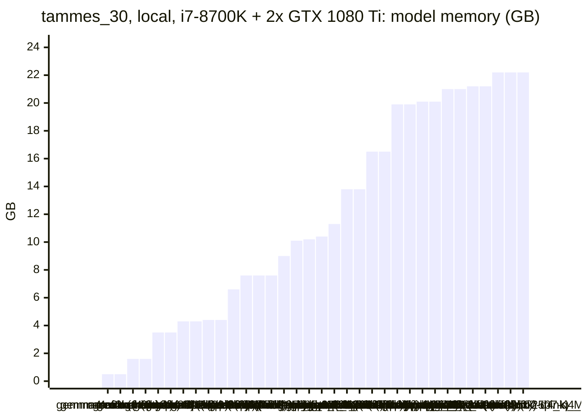

<!-- Copyright (c) 2026 by C. Klukas -->
<!-- SPDX-License-Identifier: GPL-3.0-only -->
<!-- Generated by `omega report` from bench/results/*.json. Do not edit by hand. -->

# tammes_30

45 models, 15 minutes each, one run per model. The [overall ranking](../benchmarks.md#overall-ranking) compares the models over all examples.

Machines: **Apple M1 Max**: Apple M1 Max (Mac13,1), 10 cores, 32 GB, 44 runs; **i7-8700K + 2x GTX 1080 Ti**: Intel(R) Core(TM) i7-8700K CPU @ 3.70GHz (MS-7A98), 12 cores, 64 GB, 2x NVIDIA GeForce GTX 1080 Ti, 11264 MiB, 35 runs.

## Local models on Apple M1 Max

Ollama on this machine.

| Model | Params | Initial | Best | Gain | LLM calls | s/call | Valid | New bests | Min to best |
|---|---|--:|--:|--:|--:|--:|--:|--:|--:|
| qwen3.5:27b (no-think) | 27.8B | 3.20136 | **38.5505** | ×12.04 | 9 | 122 | 89% | 5 | 15.0 |
| qwen3.8:27b-mtp-q4_K_M (think) | 27.3B | 3.20136 | **38.5061** | ×12.03 | 1 | 938 | 100% | 1 | 15.7 |
| gemma4:26b-a4b-it-qat (no-think) | 25.2B | 3.20136 | **38.2264** | ×11.94 | 25 | 37 | 80% | 4 | 8.1 |
| gemma4:12b-it-qat (no-think) | 11.9B | 3.20136 | **38.2018** | ×11.93 | 16 | 56 | 88% | 4 | 10.8 |
| qwen3.6:27b-coding-mtp-q4_K_M (no-think) | 27.3B | 3.20136 | **37.9644** | ×11.86 | 8 | 125 | 100% | 4 | 14.5 |
| qwen3:30b-a3b-instruct-2507-q4_K_M (no-think) | 30.5B | 3.20136 | **37.7428** | ×11.79 | 36 | 24 | 86% | 6 | 7.0 |
| gemma4:latest (think) |  | 3.20136 | **37.0936** | ×11.59 | 20 | 46 | 80% | 6 | 15.5 |
| gemma4:latest (no-think) |  | 3.20136 | **37.0129** | ×11.56 | 49 | 18 | 67% | 7 | 11.3 |
| gpt-oss:20b (no-think) | 20.9B | 3.20136 | **36.8947** | ×11.52 | 16 | 57 | 88% | 7 | 15.3 |
| qwen2.5-coder:7b (no-think) | 7.6B | 3.20136 | **36.8186** | ×11.50 | 29 | 31 | 55% | 7 | 9.5 |
| gemma4:e4b-it-qat (think) | 7.5B | 3.20136 | **36.6117** | ×11.44 | 20 | 46 | 70% | 3 | 6.0 |
| ingu627/exaone4.0:32b (no-think) | 32.0B | 3.20136 | **36.5970** | ×11.43 | 7 | 149 | 57% | 1 | 9.5 |
| gpt-oss:20b (think) | 20.9B | 3.20136 | **36.4916** | ×11.40 | 21 | 42 | 76% | 5 | 8.3 |
| muse-glimmer:30b (no-think) | 27.9B | 3.20136 | **35.1061** | ×10.97 | 6 | 161 | 100% | 3 | 14.3 |
| gemma4:e4b-it-qat (no-think) | 7.5B | 3.20136 | **34.9872** | ×10.93 | 52 | 17 | 65% | 5 | 14.2 |
| nemotron-3-nano:30b-a3b-mlx (no-think) |  | 3.20136 | **34.8429** | ×10.88 | 35 | 26 | 34% | 4 | 11.1 |
| qwen3.5:27b (think) | 27.8B | 3.20136 | **34.7277** | ×10.85 | 4 | 240 | 100% | 3 | 9.0 |
| qwen3-coder:30b (no-think) | 30.5B | 3.20136 | **34.0461** | ×10.63 | 29 | 31 | 83% | 4 | 14.3 |
| qwen3:30b-a3b-instruct-2507-q4_K_M (think) | 30.5B | 3.20136 | **33.1981** | ×10.37 | 34 | 26 | 76% | 6 | 9.4 |
| devstral-small-2:24b (no-think) | 24.0B | 3.20136 | **32.7402** | ×10.23 | 16 | 58 | 50% | 3 | 15.6 |
| qwen3.5:latest (no-think) | 9.7B | 3.20136 | **32.7402** | ×10.23 | 30 | 31 | 70% | 1 | 1.3 |
| qwen3.5:latest (think) | 9.7B | 3.20136 | **32.7402** | ×10.23 | 13 | 70 | 77% | 2 | 9.7 |
| richardyoung/frognano-4b-2609:latest (no-think) | 4.3B | 3.20136 | **32.7402** | ×10.23 | 34 | 26 | 53% | 3 | 1.1 |
| nemotron-3.5-lightning:30b-mlx (no-think) |  | 3.20136 | **30.6317** | ×9.57 | 21 | 44 | 38% | 1 | 5.0 |
| qwen3.8:27b-mtp-q4_K_M (no-think) | 27.3B | 3.20136 | **29.5856** | ×9.24 | 6 | 158 | 100% | 2 | 13.5 |
| glm-4.7-flash:latest (no-think) | 29.9B | 3.20136 | **21.4033** | ×6.69 | 27 | 34 | 67% | 2 | 2.5 |
| nemotron-3-nano:30b-a3b-mlx (think) |  | 3.20136 | **21.4033** | ×6.69 | 9 | 100 | 78% | 2 | 4.7 |
| underdog-saluki-27b:iq2-mix (no-think) | 26.9B | 3.20136 | **21.4033** | ×6.69 | 7 | 134 | 43% | 1 | 6.8 |
| glm-4.7-flash:latest (think) | 29.9B | 3.20136 | **20.2871** | ×6.34 | 4 | 254 | 100% | 3 | 11.8 |
| nemotron-3-nano:4b (no-think) |  | 3.20136 | **14.6767** | ×4.58 | 66 | 13 | 32% | 3 | 7.2 |
| gemma4:12b-it-qat (think) | 11.9B | 3.20136 | **14.3392** | ×4.48 | 2 | 452 | 50% | 1 | 5.2 |
| gemma4:e2b (no-think) | 5.1B | 3.20136 | **12.0000** | ×3.75 | 89 | 10 | 56% | 5 | 13.0 |
| nemotron-3-nano:4b (think) |  | 3.20136 | **12.0000** | ×3.75 | 31 | 30 | 29% | 1 | 2.3 |
| gemma4:e2b (think) | 5.1B | 3.20136 | **10.8343** | ×3.38 | 30 | 30 | 73% | 2 | 2.4 |
| richardyoung/frognano-4b-2609:latest (think) | 4.3B | 3.20136 | **9.72012** | ×3.04 | 12 | 82 | 42% | 1 | 9.2 |
| yandex/YandexGPT-5-Lite-8B-instruct-GGUF:latest (no-think) | 8.0B | 3.20136 | **9.44763** | ×2.95 | 36 | 25 | 53% | 3 | 8.8 |
| MichelRosselli/apertus:8b-instruct-2509-q4_k_m (no-think) | 8.1B | 3.20136 | **7.64645** | ×2.39 | 43 | 21 | 23% | 1 | 3.0 |
| gemma4:26b-a4b-it-qat (think) | 25.2B | | | | | | | | failed: all 3 model requests failed: gemma4:26b-a4b-it-qat: answer s |
| qwen3.6:27b-coding-mtp-q4_K_M (think) | 27.3B | | | | | | | | failed: all 1 model requests failed: qwen3.6:27b-coding-mtp-q4_K_M:  |
| llm-jp-4-8b-omega:q4_k_m (no-think) | 8.6B | 3.20136 | **3.20136** | ×1.00 | 23 | 42 | 13% | 0 | - |
| frob/sarvam:30b (no-think) | 32.2B | 3.20136 | **3.20136** | ×1.00 | 7 | 139 | 0% | 0 | - |
| muse-glimmer:30b (think) | 27.9B | | | | | | | | failed: all 1 model requests failed: muse-glimmer:30b: answer stoppe |
| frob/sarvam:30b (think) | 32.2B | 3.20136 | **3.20136** | ×1.00 | 3 | 394 | 0% | 0 | - |
| nemotron-3.5-lightning:30b-mlx (think) |  | | | | | | | | failed: all 4 model requests failed: nemotron-3.5-lightning:30b-mlx: |

### Inference speed and memory

RAM is what Ollama reports for the loaded model (weights, context cache and buffers; on Apple silicon this is shared memory). Load is the time to bring the model into memory. Prompt and generation speeds are tokens per second over all calls of the run.

| Model | Params | RAM GB | Load s | Prompt tok/s | Gen tok/s | Median s/call | p90 s/call | Tokens/answer | Stopped |
|---|---|--:|--:|--:|--:|--:|--:|--:|--:|
| richardyoung/frognano-4b-2609:latest (no-think) | 4.3B | 4.4 | 12 | 718 | 55.6 | 26 | 42 | 1173 | 1 |
| richardyoung/frognano-4b-2609:latest (think) | 4.3B | 4.4 | 12 | 760 | 35.4 | 83 | 100 | 2758 | 1 |
| gemma4:e4b-it-qat (think) | 7.5B | 5.7 | 98 | 694 | 57.5 | 40 | 78 | 2107 | 0 |
| gemma4:e4b-it-qat (no-think) | 7.5B | 5.7 | 55 | 688 | 58.2 | 14 | 31 | 653 | 0 |
| devstral-small-2:24b (no-think) | 24.0B | 6.3 | 48 | 136 | 11.2 | 57 | 63 | 419 | 0 |
| qwen2.5-coder:7b (no-think) | 7.6B | 6.6 | 48 | 420 | 36.6 | 30 | 52 | 756 | 0 |
| gemma4:e2b (no-think) | 5.1B | 6.6 | 33 | 1034 | 77.0 | 7 | 22 | 485 | 0 |
| gemma4:e2b (think) | 5.1B | 6.6 | 47 | 1016 | 76.4 | 27 | 48 | 1943 | 0 |
| qwen3.5:latest (think) | 9.7B | 6.7 | 57 | 339 | 33.7 | 48 | 107 | 1965 | 0 |
| qwen3.5:latest (no-think) | 9.7B | 6.8 | 29 | 409 | 35.4 | 21 | 63 | 839 | 0 |
| gemma4:12b-it-qat (no-think) | 11.9B | 8.0 | 65 | 227 | 30.1 | 61 | 96 | 1055 | 0 |
| gemma4:12b-it-qat (think) | 11.9B | 8.0 | 88 | 264 | 28.5 | 589 | 589 | 11448 | 0 |
| yandex/YandexGPT-5-Lite-8B-instruct-GGUF:latest (no-think) | 8.0B | 8.8 | 15 | 459 | 35.4 | 24 | 36 | 641 | 0 |
| llm-jp-4-8b-omega:q4_k_m (no-think) | 8.6B | 8.8 | 16 | 529 | 34.5 | 35 | 63 | 1224 | 0 |
| MichelRosselli/apertus:8b-instruct-2509-q4_k_m (no-think) | 8.1B | 8.9 | 15 | 424 | 33.6 | 18 | 39 | 453 | 0 |
| underdog-saluki-27b:iq2-mix (no-think) | 26.9B | 9.8 | 2 | 119 | 11.0 | 170 | 187 | 1277 | 0 |
| nemotron-3-nano:4b (no-think) |  | 11.6 | 9 | 719 | 62.6 | 10 | 25 | 506 | 1 |
| nemotron-3-nano:4b (think) |  | 11.7 | 8 | 727 | 62.2 | 25 | 54 | 1666 | 0 |
| gemma4:latest (think) |  | 12.1 | 103 | 911 | 49.3 | 39 | 90 | 1812 | 0 |
| gpt-oss:20b (think) | 20.9B | 12.8 | 108 | 519 | 49.0 | 39 | 54 | 1560 | 0 |
| gpt-oss:20b (no-think) | 20.9B | 12.9 | 56 | 629 | 50.9 | 54 | 96 | 2401 | 0 |
| gemma4:latest (no-think) |  | 15.0 | 103 | 984 | 53.9 | 16 | 29 | 662 | 0 |
| gemma4:26b-a4b-it-qat (no-think) | 25.2B | 15.4 | 196 | 565 | 60.2 | 29 | 46 | 1226 | 0 |
| muse-glimmer:30b (no-think) | 27.9B | 15.9 | 56 | 105 | 10.9 | 187 | 205 | 1450 | 0 |
| qwen3.8:27b-mtp-q4_K_M (think) | 27.3B | 17.6 | 321 | 92 | 13.2 | 938 | 938 | 7946 | 0 |
| qwen3.6:27b-coding-mtp-q4_K_M (no-think) | 27.3B | 18.2 | 242 | 100 | 14.9 | 131 | 284 | 1011 | 0 |
| qwen3.8:27b-mtp-q4_K_M (no-think) | 27.3B | 18.3 | 236 | 102 | 14.2 | 149 | 379 | 1280 | 0 |
| qwen3.5:27b (think) | 27.8B | 18.4 | 161 | 107 | 10.6 | 264 | 421 | 1941 | 0 |
| qwen3.5:27b (no-think) | 27.8B | 18.6 | 130 | 113 | 11.1 | 111 | 243 | 917 | 0 |
| frob/sarvam:30b (no-think) | 32.2B | 18.9 | 55 | 1229 | 63.2 | 131 | 185 | 8192 | 0 |
| frob/sarvam:30b (think) | 32.2B | 18.9 | 124 | 743 | 37.2 | 428 | 461 | 11251 | 2 |
| nemotron-3-nano:30b-a3b-mlx (think) |  | 19.9 | 114 | 354 | 56.2 | 84 | 226 | 4511 | 0 |
| ingu627/exaone4.0:32b (no-think) | 32.0B | 20.2 | 49 | 75 | 9.7 | 143 | 197 | 1113 | 0 |
| glm-4.7-flash:latest (no-think) | 29.9B | 20.8 | 48 | 463 | 30.9 | 30 | 58 | 794 | 1 |
| glm-4.7-flash:latest (think) | 29.9B | 20.8 | 54 | 499 | 23.4 | 311 | 405 | 5545 | 0 |
| qwen3:30b-a3b-instruct-2507-q4_K_M (no-think) | 30.5B | 21.8 | 156 | 602 | 44.5 | 19 | 46 | 504 | 0 |
| qwen3-coder:30b (no-think) | 30.5B | 21.8 | 4 | 659 | 50.5 | 17 | 37 | 669 | 0 |
| qwen3:30b-a3b-instruct-2507-q4_K_M (think) | 30.5B | 21.8 | 145 | 600 | 45.0 | 16 | 50 | 570 | 1 |
| nemotron-3.5-lightning:30b-mlx (no-think) |  | 22.9 | 122 | 442 | 56.6 | 39 | 53 | 1471 | 3 |
| nemotron-3-nano:30b-a3b-mlx (no-think) |  | 24.2 | 100 | 591 | 55.7 | 24 | 36 | 868 | 2 |

### Best score over time

| Model | 3.75 min | 7.5 min | 11.25 min | 15 min |
|---|--:|--:|--:|--:|
| qwen3.5:27b (no-think) | 3.20136 | 35.2597 | 38.3056 | 38.5505 |
| qwen3.8:27b-mtp-q4_K_M (think) | 3.20136 | 3.20136 | 3.20136 | 3.20136 |
| gemma4:26b-a4b-it-qat (no-think) | 3.20136 | 38.2264 | 38.2264 | 38.2264 |
| gemma4:12b-it-qat (no-think) | 36.7966 | 36.9197 | 38.2018 | 38.2018 |
| qwen3.6:27b-coding-mtp-q4_K_M (no-think) | 3.20136 | 35.6391 | 36.8341 | 37.9644 |
| qwen3:30b-a3b-instruct-2507-q4_K_M (no-think) | 32.7418 | 37.7428 | 37.7428 | 37.7428 |
| gemma4:latest (think) | 10.0205 | 31.6055 | 37.0208 | 37.0224 |
| gemma4:latest (no-think) | 9.55566 | 23.4258 | 35.5187 | 37.0129 |
| gpt-oss:20b (no-think) | 35.7780 | 36.3292 | 36.5496 | 36.8716 |
| qwen2.5-coder:7b (no-think) | 9.72012 | 36.8186 | 36.8186 | 36.8186 |
| gemma4:e4b-it-qat (think) | 9.72012 | 36.6117 | 36.6117 | 36.6117 |
| ingu627/exaone4.0:32b (no-think) | 3.20136 | 3.20136 | 36.5970 | 36.5970 |
| gpt-oss:20b (think) | 34.6963 | 34.8291 | 36.4916 | 36.4916 |
| muse-glimmer:30b (no-think) | 10.4945 | 32.7402 | 32.7402 | 35.1061 |
| gemma4:e4b-it-qat (no-think) | 21.0395 | 21.0395 | 25.0180 | 34.9872 |
| nemotron-3-nano:30b-a3b-mlx (no-think) | 34.6860 | 34.6860 | 34.8429 | 34.8429 |
| qwen3.5:27b (think) | 3.20136 | 32.7402 | 34.7277 | 34.7277 |
| qwen3-coder:30b (no-think) | 3.20136 | 21.4033 | 32.7402 | 34.0461 |
| qwen3:30b-a3b-instruct-2507-q4_K_M (think) | 33.1587 | 33.1924 | 33.1981 | 33.1981 |
| devstral-small-2:24b (no-think) | 21.4033 | 32.7402 | 32.7402 | 32.7402 |
| qwen3.5:latest (no-think) | 32.7402 | 32.7402 | 32.7402 | 32.7402 |
| qwen3.5:latest (think) | 32.7402 | 32.7402 | 32.7402 | 32.7402 |
| richardyoung/frognano-4b-2609:latest (no-think) | 32.7402 | 32.7402 | 32.7402 | 32.7402 |
| nemotron-3.5-lightning:30b-mlx (no-think) | 3.20136 | 30.6317 | 30.6317 | 30.6317 |
| qwen3.8:27b-mtp-q4_K_M (no-think) | 3.20136 | 25.7584 | 25.7584 | 29.5856 |
| glm-4.7-flash:latest (no-think) | 21.4033 | 21.4033 | 21.4033 | 21.4033 |
| nemotron-3-nano:30b-a3b-mlx (think) | 3.20136 | 21.4033 | 21.4033 | 21.4033 |
| underdog-saluki-27b:iq2-mix (no-think) | 3.20136 | 21.4033 | 21.4033 | 21.4033 |
| glm-4.7-flash:latest (think) | 3.20136 | 4.51391 | 19.1843 | 20.2871 |
| nemotron-3-nano:4b (no-think) | 10.6854 | 14.6767 | 14.6767 | 14.6767 |
| gemma4:12b-it-qat (think) | 3.20136 | 14.3392 | 14.3392 | 14.3392 |
| gemma4:e2b (no-think) | 11.9340 | 11.9340 | 11.9340 | 12.0000 |
| nemotron-3-nano:4b (think) | 12.0000 | 12.0000 | 12.0000 | 12.0000 |
| gemma4:e2b (think) | 10.8343 | 10.8343 | 10.8343 | 10.8343 |
| richardyoung/frognano-4b-2609:latest (think) | 3.20136 | 3.20136 | 9.72012 | 9.72012 |
| yandex/YandexGPT-5-Lite-8B-instruct-GGUF:latest (no-think) | 4.93144 | 4.93144 | 9.44763 | 9.44763 |
| MichelRosselli/apertus:8b-instruct-2509-q4_k_m (no-think) | 7.64645 | 7.64645 | 7.64645 | 7.64645 |
| llm-jp-4-8b-omega:q4_k_m (no-think) | 3.20136 | 3.20136 | 3.20136 | 3.20136 |
| frob/sarvam:30b (no-think) | 3.20136 | 3.20136 | 3.20136 | 3.20136 |
| frob/sarvam:30b (think) | 3.20136 | 3.20136 | 3.20136 | 3.20136 |

### Outcome of the LLM answers

| Model | duplicate | edit error | invalid | llm error | ok | timeout |
|---|--:|--:|--:|--:|--:|--:|
| qwen3.5:27b (no-think) | 1 | 0 | 0 | 0 | 8 | 0 |
| qwen3.8:27b-mtp-q4_K_M (think) | 0 | 0 | 0 | 0 | 1 | 0 |
| gemma4:26b-a4b-it-qat (no-think) | 0 | 2 | 3 | 0 | 20 | 0 |
| gemma4:12b-it-qat (no-think) | 0 | 1 | 1 | 0 | 14 | 0 |
| qwen3.6:27b-coding-mtp-q4_K_M (no-think) | 0 | 0 | 0 | 0 | 8 | 0 |
| qwen3:30b-a3b-instruct-2507-q4_K_M (no-think) | 1 | 3 | 1 | 0 | 31 | 0 |
| gemma4:latest (think) | 0 | 0 | 4 | 0 | 16 | 0 |
| gemma4:latest (no-think) | 1 | 4 | 11 | 0 | 33 | 0 |
| gpt-oss:20b (no-think) | 1 | 1 | 0 | 0 | 14 | 0 |
| qwen2.5-coder:7b (no-think) | 3 | 0 | 10 | 0 | 16 | 0 |
| gemma4:e4b-it-qat (think) | 2 | 1 | 3 | 0 | 14 | 0 |
| ingu627/exaone4.0:32b (no-think) | 0 | 1 | 2 | 0 | 4 | 0 |
| gpt-oss:20b (think) | 0 | 2 | 3 | 0 | 16 | 0 |
| muse-glimmer:30b (no-think) | 0 | 0 | 0 | 0 | 6 | 0 |
| gemma4:e4b-it-qat (no-think) | 5 | 2 | 11 | 0 | 34 | 0 |
| nemotron-3-nano:30b-a3b-mlx (no-think) | 0 | 15 | 6 | 2 | 12 | 0 |
| qwen3.5:27b (think) | 0 | 0 | 0 | 0 | 4 | 0 |
| qwen3-coder:30b (no-think) | 5 | 0 | 0 | 0 | 24 | 0 |
| qwen3:30b-a3b-instruct-2507-q4_K_M (think) | 1 | 3 | 3 | 1 | 26 | 0 |
| devstral-small-2:24b (no-think) | 8 | 0 | 0 | 0 | 8 | 0 |
| qwen3.5:latest (no-think) | 1 | 1 | 7 | 0 | 21 | 0 |
| qwen3.5:latest (think) | 0 | 0 | 3 | 0 | 10 | 0 |
| richardyoung/frognano-4b-2609:latest (no-think) | 0 | 6 | 8 | 1 | 18 | 1 |
| nemotron-3.5-lightning:30b-mlx (no-think) | 2 | 6 | 2 | 3 | 8 | 0 |
| qwen3.8:27b-mtp-q4_K_M (no-think) | 0 | 0 | 0 | 0 | 6 | 0 |
| glm-4.7-flash:latest (no-think) | 2 | 1 | 5 | 1 | 18 | 0 |
| nemotron-3-nano:30b-a3b-mlx (think) | 0 | 2 | 0 | 0 | 7 | 0 |
| underdog-saluki-27b:iq2-mix (no-think) | 0 | 2 | 2 | 0 | 3 | 0 |
| glm-4.7-flash:latest (think) | 0 | 0 | 0 | 0 | 4 | 0 |
| nemotron-3-nano:4b (no-think) | 3 | 31 | 10 | 1 | 21 | 0 |
| gemma4:12b-it-qat (think) | 0 | 1 | 0 | 0 | 1 | 0 |
| gemma4:e2b (no-think) | 10 | 18 | 11 | 0 | 50 | 0 |
| nemotron-3-nano:4b (think) | 8 | 6 | 8 | 0 | 9 | 0 |
| gemma4:e2b (think) | 0 | 7 | 1 | 0 | 22 | 0 |
| richardyoung/frognano-4b-2609:latest (think) | 0 | 2 | 4 | 1 | 5 | 0 |
| yandex/YandexGPT-5-Lite-8B-instruct-GGUF:latest (no-think) | 7 | 2 | 8 | 0 | 19 | 0 |
| MichelRosselli/apertus:8b-instruct-2509-q4_k_m (no-think) | 2 | 16 | 15 | 0 | 10 | 0 |
| llm-jp-4-8b-omega:q4_k_m (no-think) | 0 | 11 | 9 | 0 | 3 | 0 |
| frob/sarvam:30b (no-think) | 0 | 6 | 1 | 0 | 0 | 0 |
| frob/sarvam:30b (think) | 0 | 1 | 0 | 2 | 0 | 0 |

### Best idea per model

- **qwen3.5:27b (no-think)**: tuned n_polish=4000, polish_step=0.05, polish_decay=0.999 on top of: Add a dedicated "max-min polish" phase that targets only the closest pairs to push them apart, as the feedback …
- **qwen3.8:27b-mtp-q4_K_M (think)**: edit: import math as _math / import random as _random
- **gemma4:26b-a4b-it-qat (no-think)**: Implement a Fibonacci spiral initialization followed by a repulsion-based gradient descent optimization to maximize the minimum distance.
- **gemma4:12b-it-qat (no-think)**: tuned S_POWER=4, GLOBAL_ITER=400, REFINEMENT_STEP=0.02 on top of: Introduce a larger initial repulsion stage with higher power and more iterations, followed by a more aggressive …
- **qwen3.6:27b-coding-mtp-q4_K_M (no-think)**: Add a local search polish phase that explicitly pushes apart the closest pairs with a shrinking step size to maximize the minimum angle directly, rather than relying solely on the …
- **qwen3:30b-a3b-instruct-2507-q4_K_M (no-think)**: tuned golden_angle=2.345, cooling_rate=0.9903, initial_step_size=0.003163, margin=0.0001434 on top of: Expose the golden angle, cooling rate, and final polish step size as tunable …
- **gemma4:latest (think)**: tuned MAX_ITER=9800, STEP_SIZE=0.002065, FORCE_EXPONENT=4, MIN_DIST_SQ=6.564e-09 on top of: Expose the core optimization parameters (MAX_ITER, STEP_SIZE, FORCE_EXPONENT …
- **gemma4:latest (no-think)**: tuned S=8, STEPS=2000, STEP_SCALE=7.776e-05 on top of: Promote the heuristic parameters (S, STEPS, STEP_SCALE) to constants to allow the evolutionary search to tune the repulsion …
- **gpt-oss:20b (no-think)**: tuned POST_RELAX_STEPS=3, POST_RELAX_EPSILON=0.001 on top of: Add a short post‑polish Coulomb relaxation with a smaller step size to fine‑tune the configuration after the max‑min …
- **qwen2.5-coder:7b (no-think)**: Increase the number of iterations in the gradient descent optimization to allow for more refinement of the initial Fibonacci spiral configuration.
- **gemma4:e4b-it-qat (think)**: Implement the Fibonacci spiral initial configuration followed by a gradient descent optimization routine to maximize the minimum angular separation between all points.
- **ingu627/exaone4.0:32b (no-think)**: Use a Fibonacci spiral initial placement for better uniformity and then optimize using repulsion with increasing s values to maximize the minimum angle.
- **gpt-oss:20b (think)**: tuned STEP_SIZE=0.009105, ITERATIONS=23, FORCE_EXP=4, REPEL_STRENGTH=1.683 on top of: Expose the step size, iteration count, force exponent, and repulsion strength as tunable …
- **muse-glimmer:30b (no-think)**: replace the random uniform start with a deterministic Fibonacci golden-spiral initialization followed by stochastic hill-climbing on the minimum angle, perturbing points on the …
- **gemma4:e4b-it-qat (no-think)**: Implement Simulated Annealing (SA) starting from the Fibonacci configuration and iteratively minimize the repulsive energy $E = \sum_{i<j} 1/d_{ij}^2$ projected onto the tangent …
- **nemotron-3-nano:30b-a3b-mlx (no-think)**: Reduce gradient step size and increase iterations to fine‑tune repulsion convergence for better angle spread.
- **qwen3.5:27b (think)**: Add a gradient-based repulsion optimization to push points apart and increase the minimum angle, as the current Fibonacci-only initialization has no optimization step.
- **qwen3-coder:30b (no-think)**: Replace Lloyd relaxation with a gradient-based energy minimization using simulated annealing on the minimum angle to escape local minima and achieve better uniformity.
- **qwen3:30b-a3b-instruct-2507-q4_K_M (think)**: tuned golden_angle=2.411 on top of: Replace the fixed golden_angle with a swept parameter to find a more optimal spiral distribution that maximizes the minimum angle, as prior …
- **devstral-small-2:24b (no-think)**: tuned GOLDEN_OFFSET=-0.1 on top of: Replace the fixed golden angle with a tunable offset to better space points around the sphere and improve the minimum angle.
- **qwen3.5:latest (no-think)**: Replace the random initialization with a deterministic Fibonacci lattice on the sphere to ensure uniform initial spacing, avoiding local minima caused by random clustering.
- **qwen3.5:latest (think)**: Replace random initialization with Fibonacci golden-spiral lattice and add local optimization loop to push closest pairs apart, achieving uniform spherical coverage
- **richardyoung/frognano-4b-2609:latest (no-think)**: Replace the random uniform initialization with a deterministic Fibonacci sphere distribution to provide a uniform initial spread, which significantly increases the starting …
- **nemotron-3.5-lightning:30b-mlx (no-think)**: Replace random uniform initialization with a Fibonacci (golden-spiral) sphere for well-separated starting points, then apply repulsion energy minimization with a step size tuned …
- **qwen3.8:27b-mtp-q4_K_M (no-think)**: tuned ANNEAL_EXPO=6, POLISH_MARGIN=0.05, POLISH_STEP=0.02 on top of: The current push-apart polish uses a broken tangent formula (garbage `break`/`ax/ay/az` terms) that barely …
- **glm-4.7-flash:latest (no-think)**: Replace the random initialization strategy with a Fibonacci (golden-spiral) lattice to ensure points start well distributed, avoiding the low minimum angle caused by random …
- **nemotron-3-nano:30b-a3b-mlx (think)**: Replace the random uniform sampling with a deterministic Fibonacci lattice to generate a more evenly spaced initial set of points, which raises the minimum angular distance.
- **underdog-saluki-27b:iq2-mix (no-think)**: Replace the uniform-random start with a deterministic 30-point Fibonacci (golden-spiral) sphere to get a much more uniform initial configuration, which should dramatically raise …
- **glm-4.7-flash:latest (think)**: tuned ITERATIONS=10, STEP=0.001 on top of: Replace the random initialization with the Fibonacci lattice and gradient descent repulsion optimization (Thomson problem) as found in …
- **nemotron-3-nano:4b (no-think)**: Replace the deterministic golden-ratio spiral with a dual of a 27-point kissing sphere construction to leverage known optimal spherical packing geometry for 30 points.
- **gemma4:12b-it-qat (think)**: Use a Fibonacci sphere for initialization and then perform gradient descent to maximize the minimum distance.
- **gemma4:e2b (no-think)**: The `math.acos` argument must be constrained to the domain $[-1, 1]$ to avoid the `ValueError`, which is fixed by using $\min(1.0, \max(-1.0, ...))$ to ensure the argument remains …
- **nemotron-3-nano:4b (think)**: Replace the random uniform construction with an even‑spacing arrangement on the equator to raise the minimum angle.
- **gemma4:e2b (think)**: Replace the purely random initialization with a deterministic placement based on the Fibonacci spiral principle to achieve a structured, potentially better initial configuration.
- **richardyoung/frognano-4b-2609:latest (think)**: Fix the Fibonacci sphere generation to produce exactly n points (the nested loop bug generates too many), and remove duplicate run() function
- **yandex/YandexGPT-5-Lite-8B-instruct-GGUF:latest (no-think)**: Improve the distribution by slightly perturbing points after the Fibonacci spiral initialization to better separate them, and optimize the perturbation range to maximize the …
- **MichelRosselli/apertus:8b-instruct-2509-q4_k_m (no-think)**: Use a uniform distribution of points (Fibonacci lattice) as the initial configuration and optimize using gradient descent with repulsion energy to minimize the smallest angle …
- **llm-jp-4-8b-omega:q4_k_m (no-think)**: initial program
- **frob/sarvam:30b (no-think)**: initial program
- **frob/sarvam:30b (think)**: initial program

## Local models on i7-8700K + 2x GTX 1080 Ti

Ollama on this machine.

| Model | Params | Initial | Best | Gain | LLM calls | s/call | Valid | New bests | Min to best |
|---|---|--:|--:|--:|--:|--:|--:|--:|--:|
| gemma4:26b-a4b-it-qat (no-think) | 25.2B | 3.20136 | **38.5925** | ×12.06 | 18 | 53 | 94% | 9 | 12.2 |
| gemma4:26b-a4b-it-qat (think) | 25.2B | 3.20136 | **38.5160** | ×12.03 | 3 | 452 | 33% | 1 | 7.5 |
| qwen3.6:27b-coding-mtp-q4_K_M (no-think) | 27.3B | 3.20136 | **38.4313** | ×12.00 | 3 | 321 | 100% | 1 | 5.2 |
| qwen3-coder:30b (no-think) | 30.5B | 3.20136 | **38.2228** | ×11.94 | 27 | 35 | 81% | 9 | 14.2 |
| gpt-oss:20b (no-think) | 20.9B | 3.20136 | **38.1013** | ×11.90 | 12 | 76 | 83% | 6 | 11.7 |
| gpt-oss:20b (think) | 20.9B | 3.20136 | **37.8105** | ×11.81 | 20 | 46 | 80% | 9 | 15.2 |
| gemma4:12b-it-qat (no-think) | 11.9B | 3.20136 | **37.1703** | ×11.61 | 22 | 41 | 91% | 4 | 8.2 |
| gemma4:latest (think) | 7.5B | 3.20136 | **37.0841** | ×11.58 | 24 | 38 | 83% | 4 | 7.9 |
| gemma4:e4b-it-qat (no-think) | 7.5B | 3.20136 | **36.9563** | ×11.54 | 37 | 24 | 68% | 5 | 14.7 |
| richardyoung/frognano-4b-2609:latest (no-think) | 4.3B | 3.20136 | **36.8824** | ×11.52 | 37 | 24 | 73% | 7 | 12.6 |
| gemma4:e4b-it-qat (think) | 7.5B | 3.20136 | **36.8798** | ×11.52 | 21 | 44 | 81% | 4 | 13.6 |
| qwen2.5-coder:7b (no-think) | 7.6B | 3.20136 | **36.5738** | ×11.42 | 49 | 18 | 43% | 2 | 6.7 |
| glm-4.7-flash:latest (no-think) | 29.9B | 3.20136 | **35.6749** | ×11.14 | 26 | 35 | 65% | 3 | 13.1 |
| richardyoung/frognano-4b-2609:latest (think) | 4.3B | 3.20136 | **34.4914** | ×10.77 | 24 | 38 | 50% | 3 | 14.6 |
| qwen3.6:27b-coding-mtp-q4_K_M (think) | 27.3B | 3.20136 | **32.7402** | ×10.23 | 1 | 1085 | 100% | 2 | 18.3 |
| qwen3.8:27b-mtp-q4_K_M (no-think) | 27.3B | 3.20136 | **32.7402** | ×10.23 | 4 | 241 | 100% | 1 | 11.6 |
| qwen3.5:latest (think) | 9.0B | 3.20136 | **32.7402** | ×10.23 | 14 | 65 | 71% | 1 | 0.8 |
| qwen3:30b-a3b-instruct-2507-q4_K_M (no-think) | 30.5B | 3.20136 | **32.1880** | ×10.05 | 36 | 24 | 86% | 12 | 14.8 |
| qwen3.8:27b-mtp-q4_K_M (think) | 27.3B | 3.20136 | **31.9274** | ×9.97 | 1 | 1557 | 100% | 1 | 26.1 |
| qwen3:30b-a3b-instruct-2507-q4_K_M (think) | 30.5B | 3.20136 | **29.1042** | ×9.09 | 34 | 26 | 76% | 4 | 15.6 |
| qwen3.5:latest (no-think) | 9.0B | 3.20136 | **28.2314** | ×8.82 | 29 | 30 | 38% | 3 | 10.4 |
| gemma4:latest (no-think) | 7.5B | 3.20136 | **27.3605** | ×8.55 | 85 | 10 | 76% | 4 | 10.5 |
| underdog-saluki-27b:iq2-mix (no-think) | 26.9B | 3.20136 | **25.6685** | ×8.02 | 9 | 104 | 56% | 3 | 14.8 |
| glm-4.7-flash:latest (think) | 29.9B | 3.20136 | **21.4033** | ×6.69 | 4 | 269 | 50% | 1 | 12.1 |
| nemotron-3-nano:4b (think) | 4.0B | 3.20136 | **21.0183** | ×6.57 | 35 | 26 | 23% | 3 | 11.6 |
| gemma4:e2b (think) | 4.6B | 3.20136 | **12.0000** | ×3.75 | 51 | 17 | 88% | 3 | 14.2 |
| gemma4:e2b (no-think) | 4.6B | 3.20136 | **9.8788** | ×3.09 | 4 | 239 | 50% | 1 | 0.6 |
| llm-jp-4-8b-omega:q4_k_m (no-think) | 8.6B | 3.20136 | **6.84728** | ×2.14 | 33 | 27 | 6% | 1 | 1.6 |
| MichelRosselli/apertus:8b-instruct-2509-q4_k_m (no-think) | 8.1B | 3.20136 | **6.73066** | ×2.10 | 36 | 26 | 28% | 1 | 6.5 |
| yandex/YandexGPT-5-Lite-8B-instruct-GGUF:latest (no-think) | 8.0B | 3.20136 | **6.36826** | ×1.99 | 44 | 20 | 61% | 1 | 4.9 |
| nemotron-3-nano:4b (no-think) | 4.0B | 3.20136 | **4.96929** | ×1.55 | 95 | 9 | 9% | 1 | 14.2 |
| frob/sarvam:30b (think) | 32.2B | 3.20136 | **3.79933** | ×1.19 | 4 | 234 | 25% | 1 | 7.2 |
| Bored/GigaChat3.1-10B-A1.8B-q4_K_M:latest (no-think) | 10.7B | 3.20136 | **3.20136** | ×1.00 | 33 | 27 | 0% | 0 | - |
| frob/sarvam:30b (no-think) | 32.2B | 3.20136 | **3.20136** | ×1.00 | 6 | 177 | 0% | 0 | - |
| gemma4:12b-it-qat (think) | 11.9B | | | | | | | | failed: all 2 model requests failed: gemma4:12b-it-qat: answer stopp |

### Inference speed and memory

RAM is what Ollama reports for the loaded model (weights, context cache and buffers; on Apple silicon this is shared memory). Load is the time to bring the model into memory. Prompt and generation speeds are tokens per second over all calls of the run.

| Model | Params | RAM GB | Load s | Prompt tok/s | Gen tok/s | Median s/call | p90 s/call | Tokens/answer | Stopped |
|---|---|--:|--:|--:|--:|--:|--:|--:|--:|
| gemma4:e2b (think) | 4.6B | 0.5 | 18 | 2233 | 112.9 | 17 | 22 | 1531 | 0 |
| gemma4:e2b (no-think) | 4.6B | 0.5 | 20 | 1952 | 94.7 | 34 | 902 | 583 | 1 |
| gemma4:latest (think) | 7.5B | 1.6 | 25 | 1320 | 57.2 | 36 | 60 | 1875 | 0 |
| gemma4:latest (no-think) | 7.5B | 1.6 | 31 | 1374 | 64.0 | 8 | 16 | 318 | 0 |
| nemotron-3-nano:4b (think) | 4.0B | 3.5 | 10 | 1773 | 72.6 | 25 | 38 | 1560 | 0 |
| nemotron-3-nano:4b (no-think) | 4.0B | 3.5 | 11 | 1965 | 73.7 | 8 | 13 | 362 | 3 |
| richardyoung/frognano-4b-2609:latest (no-think) | 4.3B | 4.3 | 13 | 1676 | 54.8 | 24 | 44 | 1062 | 1 |
| richardyoung/frognano-4b-2609:latest (think) | 4.3B | 4.3 | 12 | 1778 | 57.4 | 36 | 68 | 1871 | 2 |
| gemma4:e4b-it-qat (no-think) | 7.5B | 4.4 | 20 | 1671 | 43.7 | 24 | 41 | 869 | 0 |
| gemma4:e4b-it-qat (think) | 7.5B | 4.4 | 20 | 1757 | 44.1 | 38 | 76 | 1735 | 0 |
| qwen2.5-coder:7b (no-think) | 7.6B | 6.6 | 14 | 1335 | 44.9 | 19 | 28 | 561 | 1 |
| qwen3.5:latest (think) | 9.0B | 7.6 | 20 | 1144 | 36.1 | 48 | 117 | 1569 | 1 |
| qwen3.5:latest (no-think) | 9.0B | 7.6 | 20 | 1121 | 37.0 | 26 | 69 | 864 | 1 |
| Bored/GigaChat3.1-10B-A1.8B-q4_K_M:latest (no-think) | 10.7B | 7.6 | 0 | 957 | 74.5 | 26 | 38 | 1402 | 3 |
| gemma4:12b-it-qat (no-think) | 11.9B | 9.0 | 21 | 709 | 28.1 | 41 | 52 | 863 | 0 |
| MichelRosselli/apertus:8b-instruct-2509-q4_k_m (no-think) | 8.1B | 10.1 | 15 | 1714 | 41.6 | 19 | 49 | 618 | 4 |
| yandex/YandexGPT-5-Lite-8B-instruct-GGUF:latest (no-think) | 8.0B | 10.2 | 14 | 1550 | 44.6 | 20 | 29 | 693 | 0 |
| llm-jp-4-8b-omega:q4_k_m (no-think) | 8.6B | 10.4 | 17 | 1733 | 38.8 | 22 | 50 | 847 | 2 |
| underdog-saluki-27b:iq2-mix (no-think) | 26.9B | 11.3 | 0 | 384 | 15.3 | 120 | 141 | 1430 | 1 |
| gpt-oss:20b (no-think) | 20.9B | 13.8 | 43 | 1582 | 50.7 | 60 | 133 | 3453 | 0 |
| gpt-oss:20b (think) | 20.9B | 13.8 | 38 | 1668 | 51.1 | 41 | 78 | 2013 | 0 |
| gemma4:26b-a4b-it-qat (no-think) | 25.2B | 16.5 | 84 | 972 | 36.7 | 46 | 109 | 1522 | 0 |
| gemma4:26b-a4b-it-qat (think) | 25.2B | 16.5 | 56 | 967 | 34.0 | 451 | 489 | 14594 | 0 |
| qwen3.6:27b-coding-mtp-q4_K_M (no-think) | 27.3B | 19.9 | 55 | 199 | 6.5 | 309 | 510 | 1886 | 0 |
| qwen3.6:27b-coding-mtp-q4_K_M (think) | 27.3B | 19.9 | 56 | 164 | 6.3 | 1085 | 1085 | 6434 | 0 |
| qwen3.8:27b-mtp-q4_K_M (no-think) | 27.3B | 20.1 | 58 | 178 | 6.9 | 271 | 341 | 1479 | 0 |
| qwen3.8:27b-mtp-q4_K_M (think) | 27.3B | 20.1 | 55 | 159 | 5.8 | 1557 | 1557 | 8697 | 0 |
| frob/sarvam:30b (think) | 32.2B | 21.0 | 0 | 1643 | 50.8 | 272 | 280 | 7528 | 3 |
| frob/sarvam:30b (no-think) | 32.2B | 21.0 | 64 | 1632 | 50.1 | 168 | 229 | 8192 | 0 |
| glm-4.7-flash:latest (no-think) | 29.9B | 21.2 | 61 | 465 | 28.6 | 35 | 57 | 740 | 0 |
| glm-4.7-flash:latest (think) | 29.9B | 21.2 | 58 | 583 | 26.5 | 302 | 349 | 6597 | 0 |
| qwen3-coder:30b (no-think) | 30.5B | 22.2 | 53 | 617 | 30.3 | 37 | 63 | 709 | 0 |
| qwen3:30b-a3b-instruct-2507-q4_K_M (no-think) | 30.5B | 22.2 | 54 | 661 | 33.7 | 20 | 47 | 456 | 0 |
| qwen3:30b-a3b-instruct-2507-q4_K_M (think) | 30.5B | 22.2 | 53 | 702 | 31.8 | 19 | 58 | 507 | 0 |

### Best score over time

| Model | 3.75 min | 7.5 min | 11.25 min | 15 min |
|---|--:|--:|--:|--:|
| gemma4:26b-a4b-it-qat (no-think) | 36.2321 | 36.3561 | 38.5871 | 38.5925 |
| gemma4:26b-a4b-it-qat (think) | 3.20136 | 3.20136 | 38.5160 | 38.5160 |
| qwen3.6:27b-coding-mtp-q4_K_M (no-think) | 3.20136 | 38.4313 | 38.4313 | 38.4313 |
| qwen3-coder:30b (no-think) | 36.9424 | 36.9424 | 36.9424 | 38.2228 |
| gpt-oss:20b (no-think) | 36.6697 | 36.7324 | 36.7324 | 38.1013 |
| gpt-oss:20b (think) | 35.0340 | 36.4146 | 37.3238 | 37.7204 |
| gemma4:12b-it-qat (no-think) | 10.7972 | 10.7972 | 37.1703 | 37.1703 |
| gemma4:latest (think) | 36.9417 | 36.9471 | 37.0841 | 37.0841 |
| gemma4:e4b-it-qat (no-think) | 21.4033 | 21.4033 | 36.0326 | 36.9563 |
| richardyoung/frognano-4b-2609:latest (no-think) | 21.4033 | 33.0471 | 36.7822 | 36.8824 |
| gemma4:e4b-it-qat (think) | 21.4033 | 36.8183 | 36.8183 | 36.8798 |
| qwen2.5-coder:7b (no-think) | 9.72012 | 36.5738 | 36.5738 | 36.5738 |
| glm-4.7-flash:latest (no-think) | 21.4033 | 21.4033 | 21.8741 | 35.6749 |
| richardyoung/frognano-4b-2609:latest (think) | 8.0973 | 8.0973 | 8.0973 | 34.4914 |
| qwen3.6:27b-coding-mtp-q4_K_M (think) | 3.20136 | 3.20136 | 3.20136 | 3.20136 |
| qwen3.8:27b-mtp-q4_K_M (no-think) | 3.20136 | 3.20136 | 3.20136 | 32.7402 |
| qwen3.5:latest (think) | 32.7402 | 32.7402 | 32.7402 | 32.7402 |
| qwen3:30b-a3b-instruct-2507-q4_K_M (no-think) | 23.4420 | 31.5031 | 31.5161 | 32.1880 |
| qwen3.8:27b-mtp-q4_K_M (think) | 3.20136 | 3.20136 | 3.20136 | 3.20136 |
| qwen3:30b-a3b-instruct-2507-q4_K_M (think) | 21.4033 | 21.4033 | 21.4033 | 23.4871 |
| qwen3.5:latest (no-think) | 17.7692 | 17.7692 | 28.2314 | 28.2314 |
| gemma4:latest (no-think) | 21.4033 | 21.4033 | 27.3605 | 27.3605 |
| underdog-saluki-27b:iq2-mix (no-think) | 3.20136 | 24.3002 | 24.3002 | 25.6685 |
| glm-4.7-flash:latest (think) | 3.20136 | 3.20136 | 3.20136 | 21.4033 |
| nemotron-3-nano:4b (think) | 3.52566 | 18.0000 | 18.0000 | 21.0183 |
| gemma4:e2b (think) | 11.9340 | 11.9340 | 11.9340 | 12.0000 |
| gemma4:e2b (no-think) | 9.8788 | 9.8788 | 9.8788 | 9.8788 |
| llm-jp-4-8b-omega:q4_k_m (no-think) | 6.84728 | 6.84728 | 6.84728 | 6.84728 |
| MichelRosselli/apertus:8b-instruct-2509-q4_k_m (no-think) | 3.20136 | 6.73066 | 6.73066 | 6.73066 |
| yandex/YandexGPT-5-Lite-8B-instruct-GGUF:latest (no-think) | 3.20136 | 6.36826 | 6.36826 | 6.36826 |
| nemotron-3-nano:4b (no-think) | 3.20136 | 3.20136 | 3.20136 | 4.96929 |
| frob/sarvam:30b (think) | 3.20136 | 3.79933 | 3.79933 | 3.79933 |
| Bored/GigaChat3.1-10B-A1.8B-q4_K_M:latest (no-think) | 3.20136 | 3.20136 | 3.20136 | 3.20136 |
| frob/sarvam:30b (no-think) | 3.20136 | 3.20136 | 3.20136 | 3.20136 |

### Outcome of the LLM answers

| Model | duplicate | edit error | invalid | llm error | ok | timeout |
|---|--:|--:|--:|--:|--:|--:|
| gemma4:26b-a4b-it-qat (no-think) | 0 | 0 | 1 | 0 | 17 | 0 |
| gemma4:26b-a4b-it-qat (think) | 0 | 1 | 1 | 0 | 1 | 0 |
| qwen3.6:27b-coding-mtp-q4_K_M (no-think) | 0 | 0 | 0 | 0 | 3 | 0 |
| qwen3-coder:30b (no-think) | 5 | 0 | 0 | 0 | 22 | 0 |
| gpt-oss:20b (no-think) | 1 | 1 | 0 | 0 | 10 | 0 |
| gpt-oss:20b (think) | 1 | 1 | 2 | 0 | 16 | 0 |
| gemma4:12b-it-qat (no-think) | 0 | 0 | 2 | 0 | 20 | 0 |
| gemma4:latest (think) | 2 | 0 | 2 | 0 | 20 | 0 |
| gemma4:e4b-it-qat (no-think) | 1 | 2 | 9 | 0 | 25 | 0 |
| richardyoung/frognano-4b-2609:latest (no-think) | 0 | 3 | 6 | 1 | 27 | 0 |
| gemma4:e4b-it-qat (think) | 1 | 0 | 3 | 0 | 17 | 0 |
| qwen2.5-coder:7b (no-think) | 6 | 1 | 20 | 1 | 21 | 0 |
| glm-4.7-flash:latest (no-think) | 0 | 0 | 9 | 0 | 17 | 0 |
| richardyoung/frognano-4b-2609:latest (think) | 2 | 1 | 7 | 2 | 12 | 0 |
| qwen3.6:27b-coding-mtp-q4_K_M (think) | 0 | 0 | 0 | 0 | 1 | 0 |
| qwen3.8:27b-mtp-q4_K_M (no-think) | 0 | 0 | 0 | 0 | 4 | 0 |
| qwen3.5:latest (think) | 1 | 0 | 2 | 1 | 10 | 0 |
| qwen3:30b-a3b-instruct-2507-q4_K_M (no-think) | 2 | 2 | 1 | 0 | 31 | 0 |
| qwen3.8:27b-mtp-q4_K_M (think) | 0 | 0 | 0 | 0 | 1 | 0 |
| qwen3:30b-a3b-instruct-2507-q4_K_M (think) | 1 | 3 | 4 | 0 | 26 | 0 |
| qwen3.5:latest (no-think) | 3 | 3 | 11 | 1 | 11 | 0 |
| gemma4:latest (no-think) | 2 | 1 | 17 | 0 | 65 | 0 |
| underdog-saluki-27b:iq2-mix (no-think) | 0 | 2 | 1 | 1 | 5 | 0 |
| glm-4.7-flash:latest (think) | 0 | 0 | 2 | 0 | 2 | 0 |
| nemotron-3-nano:4b (think) | 1 | 18 | 8 | 0 | 8 | 0 |
| gemma4:e2b (think) | 2 | 1 | 3 | 0 | 45 | 0 |
| gemma4:e2b (no-think) | 0 | 0 | 0 | 2 | 2 | 0 |
| llm-jp-4-8b-omega:q4_k_m (no-think) | 0 | 8 | 21 | 2 | 2 | 0 |
| MichelRosselli/apertus:8b-instruct-2509-q4_k_m (no-think) | 3 | 14 | 5 | 4 | 10 | 0 |
| yandex/YandexGPT-5-Lite-8B-instruct-GGUF:latest (no-think) | 6 | 3 | 8 | 0 | 27 | 0 |
| nemotron-3-nano:4b (no-think) | 0 | 61 | 22 | 3 | 9 | 0 |
| frob/sarvam:30b (think) | 0 | 0 | 0 | 3 | 1 | 0 |
| Bored/GigaChat3.1-10B-A1.8B-q4_K_M:latest (no-think) | 1 | 11 | 17 | 3 | 0 | 1 |
| frob/sarvam:30b (no-think) | 0 | 6 | 0 | 0 | 0 | 0 |

### Best idea per model

- **gemma4:26b-a4b-it-qat (no-think)**: tuned RESTART_COUNT=2, STAGE1_STEPS=300, POWER=6, STAGE2_STEPS=2000 on top of: Implement a multi-restart strategy to avoid local minima and use the high-power repulsion method …
- **gemma4:26b-a4b-it-qat (think)**: Use a Fibonacci spiral for initialization and then perform a force-directed optimization where each point is repeatedly pushed away from its nearest neighbor with a decaying step …
- **qwen3.6:27b-coding-mtp-q4_K_M (no-think)**: Replace random initialization with a Fibonacci sphere layout and add a gradient-based optimization loop that maximizes the minimum angle by pushing closest pairs apart, which …
- **qwen3-coder:30b (no-think)**: Replace random initialization with Fibonacci spiral layout, use adaptive step size gradient descent with energy minimization, and add a final max-min polishing phase to improve …
- **gpt-oss:20b (no-think)**: tuned ITER_GD=800, STEP_START=0.02, POLISH_ITER=300, PUSH_STEP=0.005 on top of: Add a final polish loop that pushes apart the closest pair iteratively, and sweep key refinement …
- **gpt-oss:20b (think)**: tuned ITER=200, STEP=0.015, POLISH_ITER=40, POLISH_STEP=0.02 on top of: Expose repulsive gradient‑descent and polishing parameters as named constants and sweep them to improve the …
- **gemma4:12b-it-qat (no-think)**: tuned INITIAL_LR=0.01, ITERATIONS=300, S_END=5 on top of: Implement a multi-stage optimization by increasing the repulsion power $s$ over time to focus on the minimum distance …
- **gemma4:latest (think)**: Increase the number of iterations significantly to allow the relaxation process more time to settle into a highly symmetric, low-energy configuration, which should improve …
- **gemma4:e4b-it-qat (no-think)**: tuned s_energy=2, initial_learning_rate=0.5, iterations=20000 on top of: Introduce a robust energy minimization loop with a dynamic learning rate schedule and a chosen repulsion …
- **richardyoung/frognano-4b-2609:latest (no-think)**: tuned REPU_POWER=5, BASE_STEP=0.0005, MAX_ITER=2000 on top of: Refactor the optimization loop to use a fixed, proven high-power repulsion (s=4) with a very small adaptive step …
- **gemma4:e4b-it-qat (think)**: tuned S_EXP=4, LR=0.005, ITERS=1000 on top of: Expose the optimization parameters S_EXP, LR, and ITERS as named constants to allow the automated evolutionary search to discover …
- **qwen2.5-coder:7b (no-think)**: Implement a simple repulsion force optimization to improve the initial Fibonacci spiral configuration.
- **glm-4.7-flash:latest (no-think)**: Fix a list indexing bug in repulsion_optimize where grad is initialized as a flat list instead of a list of lists, preventing point updates.
- **richardyoung/frognano-4b-2609:latest (think)**: tuned REPULSION_EXPONENT=3, STEP_SIZE=0.004821, MAX_ITERATIONS=149 on top of: Increase repulsion exponent to s=2.0 for better max-min focus, add gradient projection onto tangent …
- **qwen3.6:27b-coding-mtp-q4_K_M (think)**: tuned OPT_STEPS=5000, EXP_END=50, LR_START=0.2, PERTURB=0 on top of: Replace random initialization with a Fibonacci lattice and optimize using gradient descent on a repulsion …
- **qwen3.8:27b-mtp-q4_K_M (no-think)**: edit: Uses a Fibonacci (golden-ratio) spiral to place points as uniformly as / possible on the sphere.
- **qwen3.5:latest (think)**: Replace random initialization with Fibonacci golden-spiral sphere packing, which gives near-uniform distribution from the start
- **qwen3:30b-a3b-instruct-2507-q4_K_M (no-think)**: tuned GOLDEN_ANGLE=2.432, POLE_THRESHOLD=0.9707 on top of: Replace the static golden spiral with a gradient-descent optimization step to refine point positions and increase the …
- **qwen3.8:27b-mtp-q4_K_M (think)**: Replace the random-point initialization with a Fibonacci-sphere start followed by Thomson repulsion (s=2) and a max-min polish phase that iteratively pushes apart the closest …
- **qwen3:30b-a3b-instruct-2507-q4_K_M (think)**: tuned HEMISPHERE_SHIFT=0.01 on top of: Replace the fixed golden spiral with a symmetry-breaking perturbation that adjusts radial spacing in hemispheres to escape local optima …
- **qwen3.5:latest (no-think)**: Add a physics-based energy minimization step using soft repulsive potentials to push points apart from their uniform Fibonacci initialization, converging them to a configuration …
- **gemma4:latest (no-think)**: tuned Z_SCALE=1.5 on top of: Expose the scaling factor used in the Z coordinate calculation as a constant to allow sweeping over different projection parameterizations for better …
- **underdog-saluki-27b:iq2-mix (no-think)**: The current program just returns the Fibonacci spiral; add a deterministic nearest-pair push-apart polish (no randomness) that repeatedly moves only the globally closest pair …
- **glm-4.7-flash:latest (think)**: Replace random sampling with a Fibonacci (golden-spiral) sphere initialization to ensure a much more uniform distribution, which typically yields a significantly larger minimum …
- **nemotron-3-nano:4b (think)**: tuned LAT_ANGLE=0.3668, LON_ANGLE=1.046 on top of: expose the latitude and longitude angular step as independent named constants and sweep both to discover a better regular grid …
- **gemma4:e2b (think)**: Decouple the polar and azimuthal angle progressions by using the golden ratio for the polar angle and uniform spacing for the azimuthal angle to achieve a more isotropic …
- **gemma4:e2b (no-think)**: Implement a precise Fibonacci sphere construction as the starting point instead of random points to achieve a better initial configuration.
- **llm-jp-4-8b-omega:q4_k_m (no-think)**: Replace the uniform‑random generator with a deterministic golden‑spiral placement (Fibonacci lattice) – this gives far larger minimum angles than random sampling because points …
- **MichelRosselli/apertus:8b-instruct-2509-q4_k_m (no-think)**: Add a small repulsive force for neighboring points and optimize to minimize it.
- **yandex/YandexGPT-5-Lite-8B-instruct-GGUF:latest (no-think)**: Improve the distribution by using a more systematic method to place points along the Fibonacci spiral, ensuring better initial uniformity, followed by energy minimization to …
- **nemotron-3-nano:4b (no-think)**: Use 6 equally spaced poles as seeds and distribute remaining 24 points via Fibonacci z-values in a band, then add small random rotations to break symmetry and improve minimum angle
- **frob/sarvam:30b (think)**: Add a repulsion-based local optimization to increase the minimum angle.
- **Bored/GigaChat3.1-10B-A1.8B-q4_K_M:latest (no-think)**: initial program
- **frob/sarvam:30b (no-think)**: initial program
