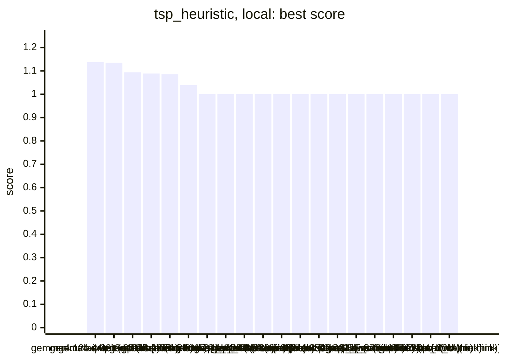
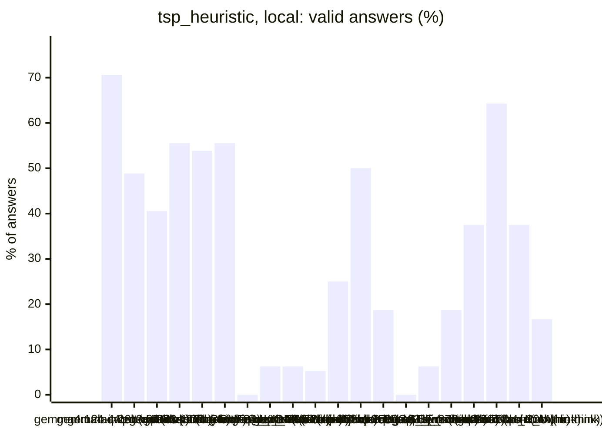
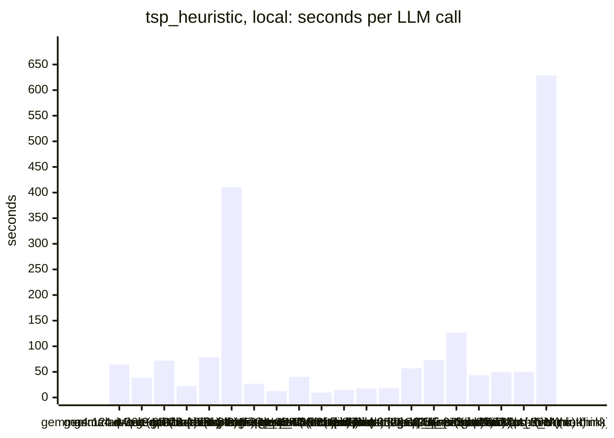
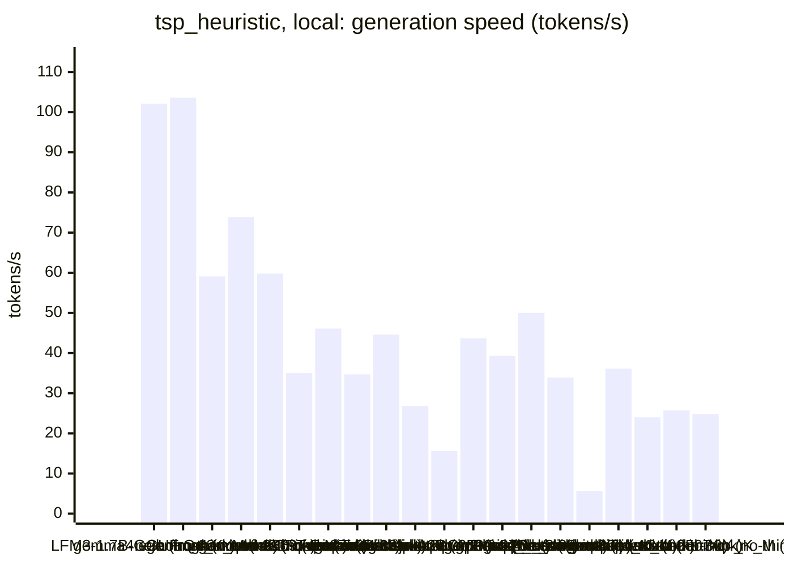
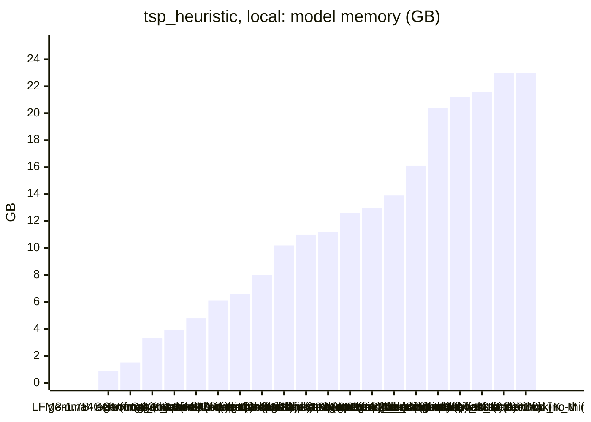
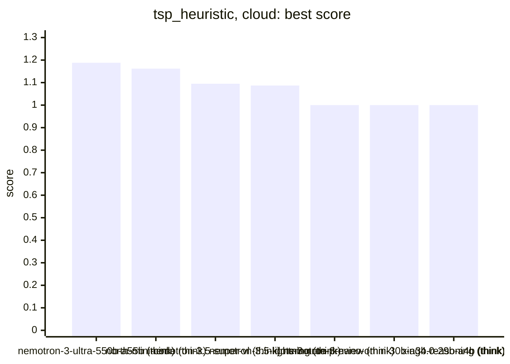
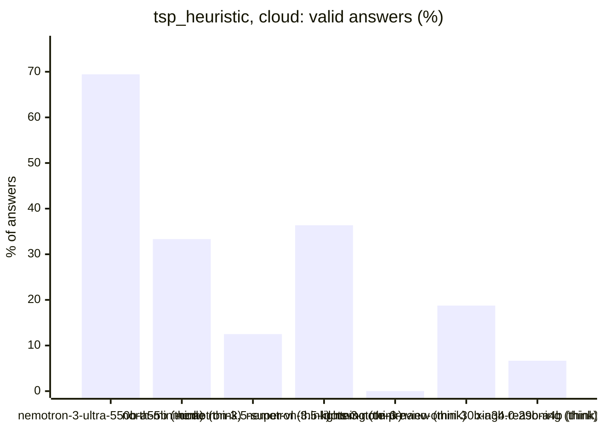
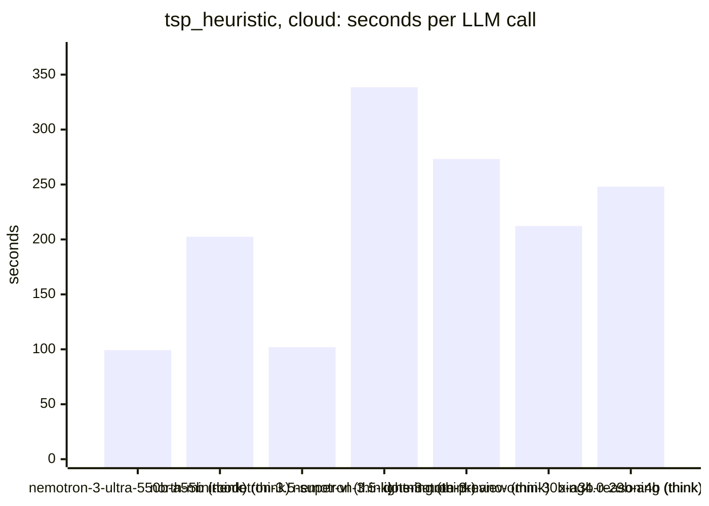
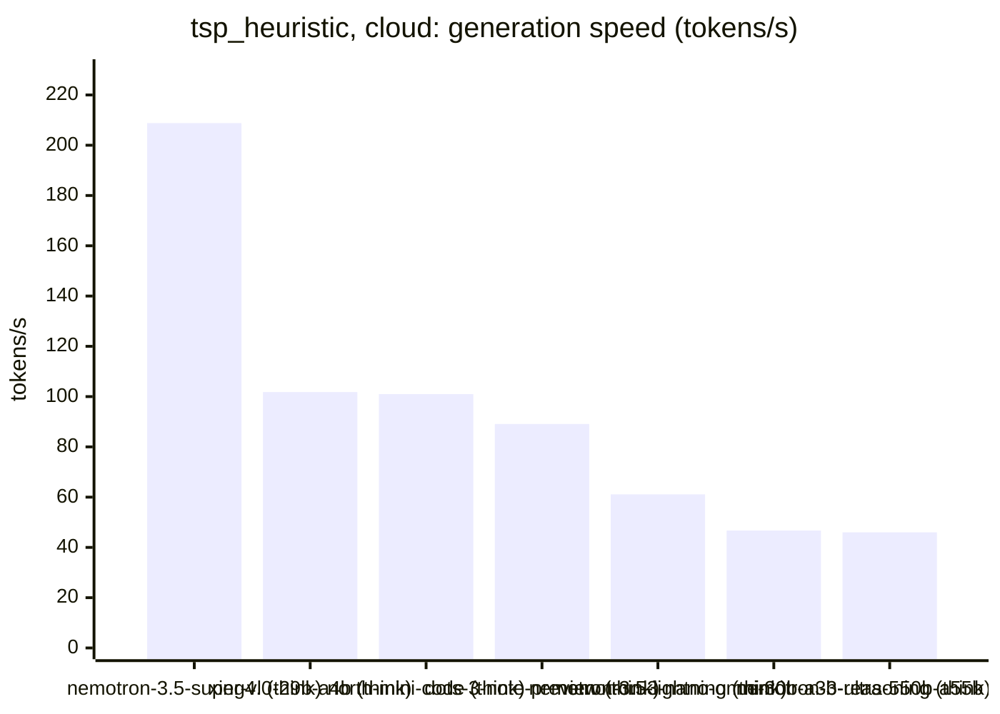

<!-- Copyright (c) 2026 by C. Klukas -->
<!-- SPDX-License-Identifier: GPL-3.0-only -->
<!-- Generated by `omega report` from bench/results/*.json. Do not edit by hand. -->

# tsp_heuristic

35 models, each run at most 60 minutes, ended earlier after 15 answers in a row without progress; one run per model. The [overall ranking](../benchmarks.md#overall-ranking) compares the models over all examples.

Machine: Intel(R) Core(TM) i7-8700K CPU @ 3.70GHz (MS-7A98), 12 cores, 64 GB, 2x NVIDIA GeForce GTX 1080 Ti, 11264 MiB.

## Local models

Ollama on this machine.

| Model | Params | Initial | Best | Gain | LLM calls | s/call | Valid | New bests | Min to best | Minutes | Stopped by |
|---|---|--:|--:|--:|--:|--:|--:|--:|--:|--:|---|
| gemma4:12b-it-qat (no-think) | 11.9B | 1 | **1.13768** | ×1.14 | 17 | 64 | 71% | 2 | 3.2 | 18.8 | no progress |
| gemma4:e4b-it-qat (no-think) | 7.5B | 1 | **1.13508** | ×1.14 | 43 | 39 | 49% | 5 | 19.5 | 28.9 | no progress |
| gemma4:26b-a4b-it-qat (no-think) | 25.2B | 1 | **1.09374** | ×1.09 | 37 | 72 | 41% | 7 | 38.1 | 45.6 | no progress |
| gemma4:latest (no-think) | 7.5B | 1 | **1.08936** | ×1.09 | 36 | 22 | 56% | 4 | 7.7 | 14.1 | no progress |
| gpt-oss:20b (no-think) | 20.9B | 1 | **1.08584** | ×1.09 | 26 | 78 | 54% | 5 | 19.8 | 34.8 | no progress |
| qwen3.6:27b-coding-mtp-q4_K_M (no-think) | 27.3B | 1 | **1.03857** | ×1.04 | 9 | 410 | 56% | 1 | 25.8 | 62.0 | time limit |
| hf.co/LiquidAI/LFM3-1.7B-GGUF:Q4_K_M (no-think) | 1.73B | 1 | **1** | ×1.00 | 16 | 27 | 0% | 0 | - | 7.4 | no progress |
| nemotron-3-nano:4b (no-think) | 4.0B | 1 | **1** | ×1.00 | 16 | 13 | 6% | 0 | - | 3.6 | no progress |
| richardyoung/frognano-4b-2609:latest (no-think) | 4.3B | 1 | **1** | ×1.00 | 16 | 40 | 6% | 0 | - | 11.1 | no progress |
| gemma4:e2b (no-think) | 4.6B | 1 | **1** | ×1.00 | 19 | 10 | 5% | 0 | - | 4.2 | no progress |
| qwen2.5-coder:7b (no-think) | 7.6B | 1 | **1** | ×1.00 | 16 | 15 | 25% | 0 | - | 4.4 | no progress |
| yandex/YandexGPT-5-Lite-8B-instruct-GGUF:latest (no-think) | 8.0B | 1 | **1** | ×1.00 | 16 | 18 | 50% | 0 | - | 5.1 | no progress |
| MichelRosselli/apertus:8b-instruct-2509-q4_k_m (no-think) | 8.1B | 1 | **1** | ×1.00 | 16 | 18 | 19% | 0 | - | 5.0 | no progress |
| llm-jp-4-8b-omega:q4_k_m (no-think) | 8.6B | 1 | **1** | ×1.00 | 16 | 57 | 0% | 0 | - | 15.7 | no progress |
| qwen3.5:latest (no-think) | 9.0B | 1 | **1** | ×1.00 | 16 | 73 | 6% | 0 | - | 19.9 | no progress |
| underdog-saluki-27b:iq2-mix (no-think) | 26.9B | 1 | **1** | ×1.00 | 16 | 126 | 19% | 0 | - | 34.7 | no progress |
| qwen3:30b-a3b-instruct-2507-q4_K_M (no-think) | 30.5B | 1 | **1** | ×1.00 | 16 | 43 | 38% | 0 | - | 11.9 | no progress |
| qwen3-coder:30b (no-think) | 30.5B | 1 | **1** | ×1.00 | 14 | 50 | 64% | 0 | - | 12.0 | no progress |
| glm-4.7-flash:latest (no-think) | 29.9B | 1 | **1** | ×1.00 | 16 | 49 | 38% | 0 | - | 13.6 | no progress |
| frob/sarvam:30b (no-think) | 32.2B | 1 | **1** | ×1.00 | 6 | 628 | 17% | 0 | - | 63.2 | time limit |

### Inference speed and memory

RAM is what Ollama reports for the loaded model (weights, context cache and buffers; on Apple silicon this is shared memory). Load is the time to bring the model into memory. Prompt and generation speeds are tokens per second over all calls of the run.

| Model | Params | RAM GB | Load s | Prompt tok/s | Gen tok/s | Median s/call | p90 s/call | Tokens/answer | Stopped |
|---|---|--:|--:|--:|--:|--:|--:|--:|--:|
| gemma4:e2b (no-think) | 4.6B | 0.9 | 20 | 3159 | 102.1 | 10 | 13 | 607 | 0 |
| hf.co/LiquidAI/LFM3-1.7B-GGUF:Q4_K_M (no-think) | 1.73B | 1.5 | 0 | 4206 | 103.6 | 23 | 63 | 1546 | 8 |
| gemma4:latest (no-think) | 7.5B | 3.3 | 32 | 1202 | 59.1 | 24 | 38 | 931 | 0 |
| nemotron-3-nano:4b (no-think) | 4.0B | 3.9 | 10 | 1714 | 73.9 | 9 | 23 | 614 | 0 |
| richardyoung/frognano-4b-2609:latest (no-think) | 4.3B | 4.8 | 0 | 1780 | 59.8 | 32 | 86 | 1215 | 9 |
| gemma4:e4b-it-qat (no-think) | 7.5B | 6.1 | 23 | 1431 | 35.0 | 37 | 61 | 994 | 0 |
| qwen2.5-coder:7b (no-think) | 7.6B | 6.6 | 17 | 1735 | 46.1 | 13 | 22 | 477 | 0 |
| qwen3.5:latest (no-think) | 9.0B | 8.0 | 30 | 1254 | 34.7 | 52 | 125 | 2320 | 0 |
| yandex/YandexGPT-5-Lite-8B-instruct-GGUF:latest (no-think) | 8.0B | 10.2 | 18 | 1525 | 44.6 | 16 | 25 | 568 | 0 |
| gemma4:12b-it-qat (no-think) | 11.9B | 11.0 | 78 | 571 | 26.8 | 65 | 94 | 1302 | 0 |
| underdog-saluki-27b:iq2-mix (no-think) | 26.9B | 11.2 | 30 | 372 | 15.6 | 113 | 197 | 1749 | 0 |
| MichelRosselli/apertus:8b-instruct-2509-q4_k_m (no-think) | 8.1B | 12.6 | 17 | 1448 | 43.7 | 20 | 36 | 575 | 0 |
| llm-jp-4-8b-omega:q4_k_m (no-think) | 8.6B | 13.0 | 18 | 1435 | 39.3 | 49 | 76 | 1423 | 0 |
| gpt-oss:20b (no-think) | 20.9B | 13.9 | 62 | 1393 | 50.0 | 67 | 128 | 3324 | 0 |
| gemma4:26b-a4b-it-qat (no-think) | 25.2B | 16.1 | 2 | 760 | 33.9 | 53 | 119 | 1385 | 6 |
| qwen3.6:27b-coding-mtp-q4_K_M (no-think) | 27.3B | 20.4 | 60 | 182 | 5.6 | 367 | 757 | 2172 | 0 |
| frob/sarvam:30b (no-think) | 32.2B | 21.2 | 69 | 1423 | 36.1 | 678 | 787 | 22149 | 0 |
| glm-4.7-flash:latest (no-think) | 29.9B | 21.6 | 70 | 530 | 24.0 | 40 | 99 | 939 | 0 |
| qwen3:30b-a3b-instruct-2507-q4_K_M (no-think) | 30.5B | 23.0 | 65 | 729 | 25.7 | 36 | 83 | 861 | 0 |
| qwen3-coder:30b (no-think) | 30.5B | 23.0 | 72 | 679 | 24.8 | 50 | 68 | 906 | 1 |

### Best score over time

| Model | 15 min | 30 min | 45 min | 60 min |
|---|--:|--:|--:|--:|
| gemma4:12b-it-qat (no-think) | 1.13768 | 1.13768 | 1.13768 | 1.13768 |
| gemma4:e4b-it-qat (no-think) | 1.0886 | 1.13508 | 1.13508 | 1.13508 |
| gemma4:26b-a4b-it-qat (no-think) | 1.08424 | 1.08486 | 1.09374 | 1.09374 |
| gemma4:latest (no-think) | 1.08936 | 1.08936 | 1.08936 | 1.08936 |
| gpt-oss:20b (no-think) | 1.08457 | 1.08584 | 1.08584 | 1.08584 |
| qwen3.6:27b-coding-mtp-q4_K_M (no-think) | 1 | 1.03857 | 1.03857 | 1.03857 |
| hf.co/LiquidAI/LFM3-1.7B-GGUF:Q4_K_M (no-think) | 1 | 1 | 1 | 1 |
| nemotron-3-nano:4b (no-think) | 1 | 1 | 1 | 1 |
| richardyoung/frognano-4b-2609:latest (no-think) | 1 | 1 | 1 | 1 |
| gemma4:e2b (no-think) | 1 | 1 | 1 | 1 |
| qwen2.5-coder:7b (no-think) | 1 | 1 | 1 | 1 |
| yandex/YandexGPT-5-Lite-8B-instruct-GGUF:latest (no-think) | 1 | 1 | 1 | 1 |
| MichelRosselli/apertus:8b-instruct-2509-q4_k_m (no-think) | 1 | 1 | 1 | 1 |
| llm-jp-4-8b-omega:q4_k_m (no-think) | 1 | 1 | 1 | 1 |
| qwen3.5:latest (no-think) | 1 | 1 | 1 | 1 |
| underdog-saluki-27b:iq2-mix (no-think) | 1 | 1 | 1 | 1 |
| qwen3:30b-a3b-instruct-2507-q4_K_M (no-think) | 1 | 1 | 1 | 1 |
| qwen3-coder:30b (no-think) | 1 | 1 | 1 | 1 |
| glm-4.7-flash:latest (no-think) | 1 | 1 | 1 | 1 |
| frob/sarvam:30b (no-think) | 1 | 1 | 1 | 1 |

### Outcome of the LLM answers

| Model | duplicate | edit error | invalid | llm error | ok | timeout |
|---|--:|--:|--:|--:|--:|--:|
| gemma4:12b-it-qat (no-think) | 0 | 4 | 1 | 0 | 12 | 0 |
| gemma4:e4b-it-qat (no-think) | 0 | 3 | 13 | 0 | 21 | 6 |
| gemma4:26b-a4b-it-qat (no-think) | 1 | 10 | 2 | 6 | 15 | 3 |
| gemma4:latest (no-think) | 0 | 1 | 15 | 0 | 20 | 0 |
| gpt-oss:20b (no-think) | 0 | 6 | 4 | 1 | 14 | 1 |
| qwen3.6:27b-coding-mtp-q4_K_M (no-think) | 0 | 0 | 4 | 0 | 5 | 0 |
| hf.co/LiquidAI/LFM3-1.7B-GGUF:Q4_K_M (no-think) | 0 | 5 | 3 | 8 | 0 | 0 |
| nemotron-3-nano:4b (no-think) | 0 | 11 | 4 | 0 | 1 | 0 |
| richardyoung/frognano-4b-2609:latest (no-think) | 0 | 3 | 3 | 9 | 1 | 0 |
| gemma4:e2b (no-think) | 0 | 2 | 13 | 0 | 1 | 3 |
| qwen2.5-coder:7b (no-think) | 7 | 0 | 5 | 0 | 4 | 0 |
| yandex/YandexGPT-5-Lite-8B-instruct-GGUF:latest (no-think) | 0 | 0 | 8 | 0 | 8 | 0 |
| MichelRosselli/apertus:8b-instruct-2509-q4_k_m (no-think) | 2 | 8 | 3 | 0 | 3 | 0 |
| llm-jp-4-8b-omega:q4_k_m (no-think) | 0 | 8 | 5 | 0 | 0 | 3 |
| qwen3.5:latest (no-think) | 0 | 4 | 10 | 0 | 1 | 1 |
| underdog-saluki-27b:iq2-mix (no-think) | 0 | 5 | 5 | 0 | 3 | 3 |
| qwen3:30b-a3b-instruct-2507-q4_K_M (no-think) | 3 | 0 | 5 | 0 | 6 | 2 |
| qwen3-coder:30b (no-think) | 0 | 0 | 3 | 1 | 9 | 1 |
| glm-4.7-flash:latest (no-think) | 1 | 0 | 9 | 0 | 6 | 0 |
| frob/sarvam:30b (no-think) | 0 | 5 | 0 | 0 | 1 | 0 |

### Best idea per model

- **gemma4:12b-it-qat (no-think)**: Implement a greedy tour construction that chooses the best starting city (nearest neighbors) and then performs a 2-opt local search to improve the tour.
- **gemma4:e4b-it-qat (no-think)**: Implement an iterative improvement strategy by restarting the 2-opt search from the beginning after any improvement is found, instead of breaking out of the inner loops …
- **gemma4:26b-a4b-it-qat (no-think)**: tuned K_NEIGHBORS=7 on top of: Implement a grid-based candidate list to restrict 2-opt search to nearby nodes and use a position array for efficient $O(1)$ segment access and …
- **gemma4:latest (no-think)**: Implement a basic 2-opt local search on the initial nearest neighbor tour to improve the tour length, which is expected to reduce the score ratio away from 1.0.
- **gpt-oss:20b (no-think)**: Increase the time margin to 0.98 and add a single random double‑bridge perturbation after building the initial tour to help escape local optima on larger instances.
- **qwen3.6:27b-coding-mtp-q4_K_M (no-think)**: Replace nearest-neighbor construction with a greedy edge-adding heuristic (sorting edges by length and building a forest of paths, then concatenating them) and add a fast 2-opt …
- **hf.co/LiquidAI/LFM3-1.7B-GGUF:Q4_K_M (no-think)**: initial program
- **nemotron-3-nano:4b (no-think)**: initial program
- **richardyoung/frognano-4b-2609:latest (no-think)**: initial program
- **gemma4:e2b (no-think)**: initial program
- **qwen2.5-coder:7b (no-think)**: initial program
- **yandex/YandexGPT-5-Lite-8B-instruct-GGUF:latest (no-think)**: initial program
- **MichelRosselli/apertus:8b-instruct-2509-q4_k_m (no-think)**: initial program
- **llm-jp-4-8b-omega:q4_k_m (no-think)**: initial program
- **qwen3.5:latest (no-think)**: initial program
- **underdog-saluki-27b:iq2-mix (no-think)**: initial program
- **qwen3:30b-a3b-instruct-2507-q4_K_M (no-think)**: initial program
- **qwen3-coder:30b (no-think)**: initial program
- **glm-4.7-flash:latest (no-think)**: initial program
- **frob/sarvam:30b (no-think)**: initial program

## Cloud models (OpenRouter)

Free OpenRouter models; times include the network and the provider's queue.

| Model | Params | Initial | Best | Gain | LLM calls | s/call | Valid | New bests | Min to best | Minutes | Stopped by |
|---|---|--:|--:|--:|--:|--:|--:|--:|--:|--:|---|
| nvidia/nemotron-3-ultra-550b-a55b:free (think) |  | 1 | **1.18849** | ×1.19 | 36 | 99 | 69% | 9 | 60.5 | 60.7 | time limit |
| cohere/north-mini-code:free (think) |  | 1 | **1.16178** | ×1.16 | 18 | 202 | 33% | 2 | 33.6 | 60.8 | time limit |
| nvidia/nemotron-3.5-super-vl:free (think) |  | 1 | **1.09539** | ×1.10 | 16 | 102 | 12% | 1 | 27.3 | 27.4 | no progress |
| nvidia/nemotron-3.5-lightning:free (think) |  | 1 | **1.08723** | ×1.09 | 11 | 338 | 36% | 2 | 28.2 | 62.1 | time limit |
| cohere/north-mini-code:free (no-think) |  | | | | | | | | | | failed: all 6 model requests failed: cohere/north-mini-code:free: ra |
| nvidia/nemotron-3.5-super-vl:free (no-think) |  | | | | | | | | | | failed: all 6 model requests failed: nvidia/nemotron-3.5-super-vl:fr |
| nvidia/nemotron-3-ultra-550b-a55b:free (no-think) |  | | | | | | | | | | failed: all 6 model requests failed: nvidia/nemotron-3-ultra-550b-a5 |
| dots-studio/dots-3-note-preview:free (no-think) |  | | | | | | | | | | failed: all 6 model requests failed: dots-studio/dots-3-note-preview |
| nvidia/nemotron-3.5-lightning:free (no-think) |  | | | | | | | | | | failed: all 6 model requests failed: nvidia/nemotron-3.5-lightning:f |
| nvidia/nemotron-3-nano-omni-30b-a3b-reasoning:free (no-think) |  | | | | | | | | | | failed: all 6 model requests failed: nvidia/nemotron-3-nano-omni-30b |
| xingchen-agi/xing4.0-29b-a4b:free (no-think) |  | | | | | | | | | | failed: all 6 model requests failed: xingchen-agi/xing4.0-29b-a4b:fr |
| dots-studio/dots-3-note-preview:free (think) |  | 1 | **1** | ×1.00 | 14 | 273 | 0% | 0 | - | 63.8 | time limit |
| nvidia/nemotron-3-nano-omni-30b-a3b-reasoning:free (think) |  | 1 | **1** | ×1.00 | 16 | 212 | 19% | 0 | - | 56.8 | no progress |
| xingchen-agi/xing4.0-29b-a4b:free (think) |  | 1 | **1** | ×1.00 | 15 | 248 | 7% | 0 | - | 62.1 | time limit |
| recursive/flint-v1.0:free (think) |  | | | | | | | | | | failed: all 6 model requests failed: recursive/flint-v1.0:free: requ |

### Inference speed and cost

Generation speed is measured from the first to the last streamed token; the time to the first token is counted as prompt time. Cost is what OpenRouter charged for the run.

| Model | Gen tok/s | Median s/call | p90 s/call | Tokens/answer | Stopped | Cost $ |
|---|--:|--:|--:|--:|--:|--:|
| nvidia/nemotron-3.5-super-vl:free (think) | 208.8 | 113 | 136 | 21165 | 0 | 0.000 |
| xingchen-agi/xing4.0-29b-a4b:free (think) | 101.8 | 257 | 374 | 10956 | 8 | 0.000 |
| cohere/north-mini-code:free (think) | 101.0 | 196 | 322 | 19197 | 0 | 0.000 |
| dots-studio/dots-3-note-preview:free (think) | 89.1 | 280 | 295 | 24153 | 0 | 0.000 |
| nvidia/nemotron-3.5-lightning:free (think) | 61.1 | 342 | 505 | 20647 | 0 | 0.000 |
| nvidia/nemotron-3-nano-omni-30b-a3b-reasoning:free (think) | 46.7 | 135 | 409 | 9881 | 0 | 0.000 |
| nvidia/nemotron-3-ultra-550b-a55b:free (think) | 46.0 | 60 | 231 | 4497 | 0 | 0.000 |

### Best score over time

| Model | 15 min | 30 min | 45 min | 60 min |
|---|--:|--:|--:|--:|
| nvidia/nemotron-3-ultra-550b-a55b:free (think) | 1.15451 | 1.15451 | 1.17746 | 1.18663 |
| cohere/north-mini-code:free (think) | 1 | 1.1608 | 1.16178 | 1.16178 |
| nvidia/nemotron-3.5-super-vl:free (think) | 1 | 1.09539 | 1.09539 | 1.09539 |
| nvidia/nemotron-3.5-lightning:free (think) | 1.08706 | 1.08723 | 1.08723 | 1.08723 |
| dots-studio/dots-3-note-preview:free (think) | 1 | 1 | 1 | 1 |
| nvidia/nemotron-3-nano-omni-30b-a3b-reasoning:free (think) | 1 | 1 | 1 | 1 |
| xingchen-agi/xing4.0-29b-a4b:free (think) | 1 | 1 | 1 | 1 |

### Outcome of the LLM answers

| Model | duplicate | edit error | invalid | llm error | ok |
|---|--:|--:|--:|--:|--:|
| nvidia/nemotron-3-ultra-550b-a55b:free (think) | 3 | 0 | 8 | 0 | 25 |
| cohere/north-mini-code:free (think) | 1 | 8 | 2 | 1 | 6 |
| nvidia/nemotron-3.5-super-vl:free (think) | 0 | 12 | 2 | 0 | 2 |
| nvidia/nemotron-3.5-lightning:free (think) | 0 | 7 | 0 | 0 | 4 |
| dots-studio/dots-3-note-preview:free (think) | 0 | 14 | 0 | 0 | 0 |
| nvidia/nemotron-3-nano-omni-30b-a3b-reasoning:free (think) | 0 | 10 | 3 | 0 | 3 |
| xingchen-agi/xing4.0-29b-a4b:free (think) | 0 | 2 | 1 | 11 | 1 |

### Best idea per model

- **nvidia/nemotron-3-ultra-550b-a55b:free (think)**: Replace the full-tour 2-opt reoptimization after each kick with a localized 2-opt that only examines edges incident to the perturbed segment and their neighbors, dramatically …
- **cohere/north-mini-code:free (think)**: Replace the O(n^2) global nearest‑neighbour candidate construction with a fast grid‑based local candidate selection (K=24, neighbor radius 2) to improve locality and reduce …
- **nvidia/nemotron-3.5-super-vl:free (think)**: Replace the plain nearest-neighbour return with a greedy nearest-neighbour start plus candidate-list 2-opt local search (don't-look bits, shorter-side reversal, position array) …
- **nvidia/nemotron-3.5-lightning:free (think)**: Add 2-opt local search after nearest-neighbor construction to iteratively improve the tour by reversing segments that reduce total length, using precomputed coordinate lists for …
- **dots-studio/dots-3-note-preview:free (think)**: initial program
- **nvidia/nemotron-3-nano-omni-30b-a3b-reasoning:free (think)**: initial program
- **xingchen-agi/xing4.0-29b-a4b:free (think)**: initial program
