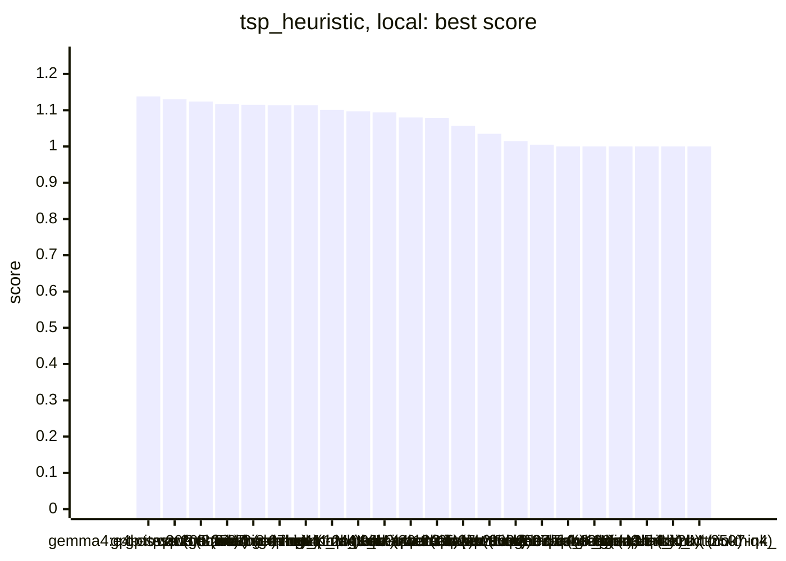
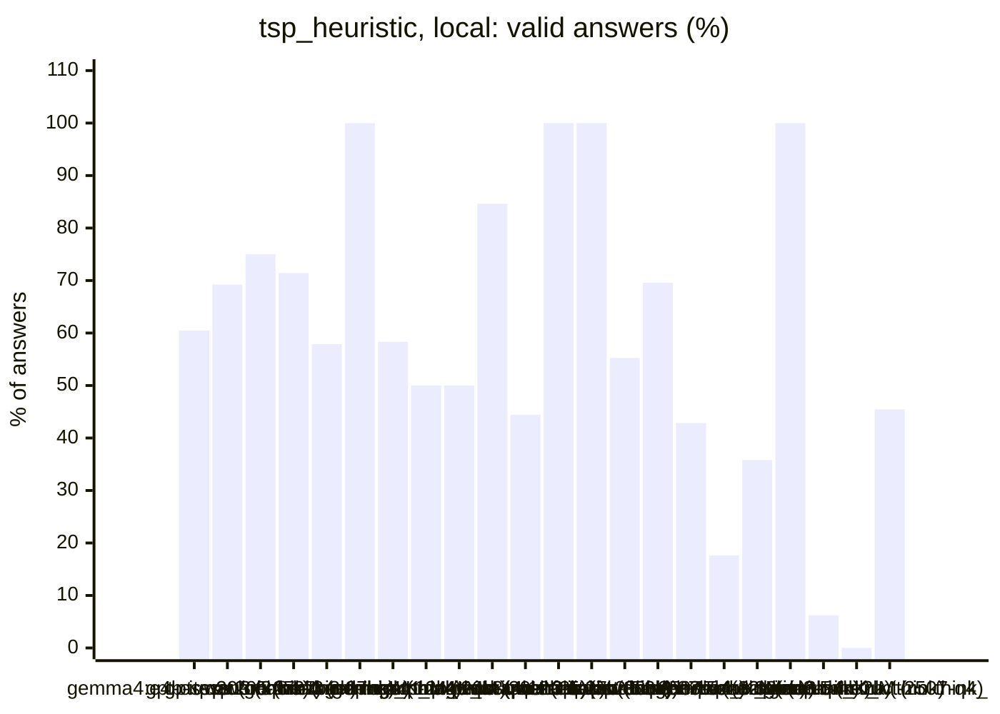
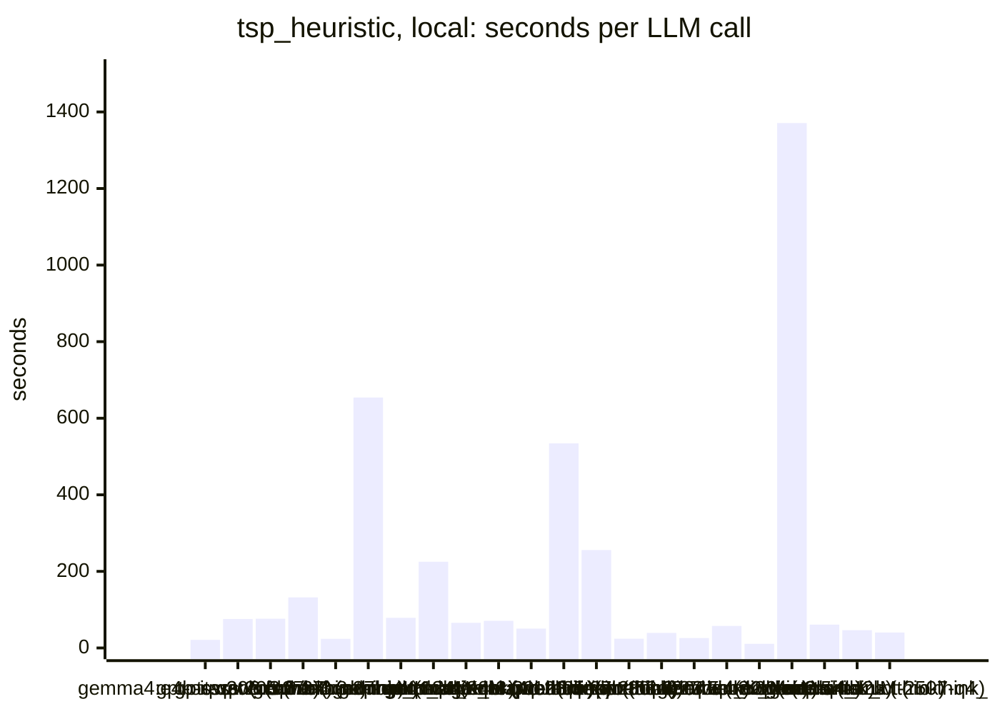
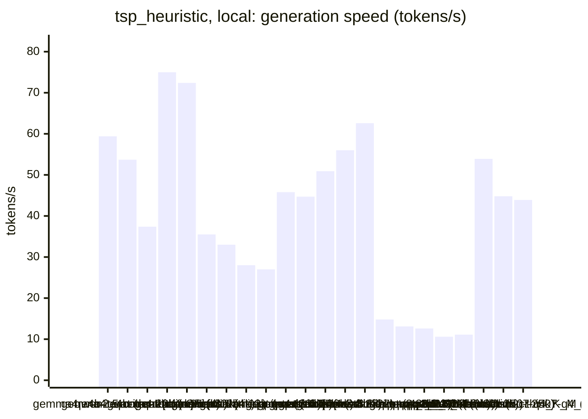
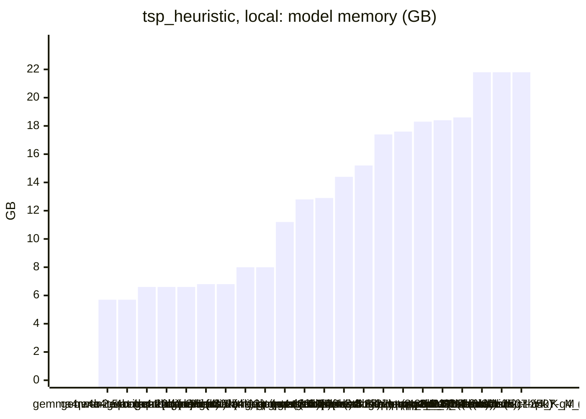

<!-- Copyright (c) 2026 by C. Klukas -->
<!-- SPDX-License-Identifier: GPL-3.0-only -->
<!-- Generated by `omega report` from bench/results/*.json. Do not edit by hand. -->

# tsp_heuristic

24 models, 15 minutes each, latest run per model. The [overall ranking](../benchmarks.md#overall-ranking) compares the models over all examples.

Machine: Apple M1 Max (Mac13,1), 10 cores, 32 GB.

## Local models

Ollama on this machine.

| Model | Params | Initial | Best | Gain | LLM calls | s/call | Valid | New bests | Min to best |
|---|---|--:|--:|--:|--:|--:|--:|--:|--:|
| gemma4:e4b-it-qat (no-think) | 7.5B | 1 | **1.13768** | ×1.14 | 43 | 21 | 60% | 4 | 7.4 |
| gpt-oss:20b (think) | 20.9B | 1 | **1.12957** | ×1.13 | 13 | 76 | 69% | 3 | 13.8 |
| gpt-oss:20b (no-think) | 20.9B | 1 | **1.12373** | ×1.12 | 12 | 76 | 75% | 3 | 6.5 |
| qwen3.5:27b (no-think) | 27.8B | 1 | **1.11744** | ×1.12 | 7 | 132 | 71% | 1 | 7.6 |
| gemma4:latest (no-think) |  | 1 | **1.11505** | ×1.12 | 38 | 24 | 58% | 3 | 13.3 |
| qwen3.8:27b-mtp-q4_K_M (think) | 27.3B | 1 | **1.1141** | ×1.11 | 2 | 654 | 100% | 3 | 21.8 |
| gemma4:latest (think) |  | 1 | **1.11397** | ×1.11 | 12 | 79 | 58% | 4 | 13.2 |
| qwen3.8:27b-mtp-q4_K_M (no-think) | 27.3B | 1 | **1.10094** | ×1.10 | 4 | 225 | 50% | 1 | 11.4 |
| gemma4:12b-it-qat (no-think) | 11.9B | 1 | **1.0975** | ×1.10 | 14 | 66 | 50% | 3 | 15.4 |
| gemma4:e4b-it-qat (think) | 7.5B | 1 | **1.09408** | ×1.09 | 13 | 71 | 85% | 1 | 2.5 |
| gemma4:26b-a4b-it-qat (no-think) | 25.2B | 1 | **1.08016** | ×1.08 | 18 | 50 | 44% | 3 | 10.8 |
| gemma4:12b-it-qat (think) | 11.9B | 1 | **1.07929** | ×1.08 | 2 | 534 | 100% | 1 | 9.7 |
| qwen3.5:27b (think) | 27.8B | 1 | **1.05746** | ×1.06 | 4 | 256 | 100% | 2 | 9.7 |
| qwen3-coder:30b (no-think) | 30.5B | 1 | **1.03514** | ×1.04 | 38 | 24 | 55% | 1 | 12.8 |
| qwen3:30b-a3b-instruct-2507-q4_K_M (no-think) | 30.5B | 1 | **1.0154** | ×1.02 | 23 | 39 | 70% | 1 | 3.0 |
| qwen2.5-coder:7b (no-think) | 7.6B | 1 | **1.00546** | ×1.01 | 35 | 26 | 43% | 1 | 3.0 |
| qwen3.5:latest (no-think) | 9.7B | 1 | **1** | ×1.00 | 17 | 58 | 18% | 0 | - |
| gemma4:e2b (no-think) | 5.1B | 1 | **1** | ×1.00 | 81 | 11 | 36% | 0 | - |
| qwen3.6:27b-coding-mtp-q4_K_M (no-think) | 27.3B | 1 | **1** | ×1.00 | 1 | 1371 | 100% | 0 | - |
| qwen3.5:latest (think) | 9.7B | 1 | **1** | ×1.00 | 16 | 61 | 6% | 0 | - |
| gemma4:e2b (think) | 5.1B | 1 | **1** | ×1.00 | 20 | 46 | 0% | 0 | - |
| gemma4:26b-a4b-it-qat (think) | 25.2B | | | | | | | | failed: all 2 model requests failed: gemma4:26b-a4b-it-qat: answer s |
| qwen3.6:27b-coding-mtp-q4_K_M (think) | 27.3B | | | | | | | | failed: all 1 model requests failed: qwen3.6:27b-coding-mtp-q4_K_M:  |
| qwen3:30b-a3b-instruct-2507-q4_K_M (think) | 30.5B | 1 | **1** | ×1.00 | 22 | 40 | 45% | 0 | - |

### Inference speed and memory

RAM is what Ollama reports for the loaded model (weights, context cache and buffers; on Apple silicon this is shared memory). Load is the time to bring the model into memory. Prompt and generation speeds are tokens per second over all calls of the run.

| Model | Params | RAM GB | Load s | Prompt tok/s | Gen tok/s | Median s/call | p90 s/call | Tokens/answer | Stopped |
|---|---|--:|--:|--:|--:|--:|--:|--:|--:|
| gemma4:e4b-it-qat (no-think) | 7.5B | 5.7 | 94 | 600 | 59.4 | 16 | 35 | 624 | 1 |
| gemma4:e4b-it-qat (think) | 7.5B | 5.7 | 98 | 617 | 53.7 | 65 | 94 | 3047 | 0 |
| qwen2.5-coder:7b (no-think) | 7.6B | 6.6 | 79 | 462 | 37.4 | 24 | 35 | 639 | 0 |
| gemma4:e2b (no-think) | 5.1B | 6.6 | 33 | 1066 | 75.0 | 8 | 19 | 540 | 0 |
| gemma4:e2b (think) | 5.1B | 6.6 | 0 | 1428 | 72.4 | 46 | 69 | 3025 | 1 |
| qwen3.5:latest (no-think) | 9.7B | 6.8 | 29 | 477 | 35.5 | 56 | 100 | 1564 | 3 |
| qwen3.5:latest (think) | 9.7B | 6.8 | 62 | 440 | 33.0 | 58 | 99 | 1708 | 0 |
| gemma4:12b-it-qat (no-think) | 11.9B | 8.0 | 127 | 230 | 28.0 | 58 | 84 | 1127 | 0 |
| gemma4:12b-it-qat (think) | 11.9B | 8.0 | 118 | 268 | 27.0 | 576 | 576 | 12660 | 0 |
| gemma4:latest (think) |  | 11.2 | 117 | 891 | 45.8 | 65 | 144 | 2971 | 0 |
| gpt-oss:20b (think) | 20.9B | 12.8 | 125 | 530 | 44.7 | 52 | 134 | 2685 | 0 |
| gpt-oss:20b (no-think) | 20.9B | 12.9 | 103 | 681 | 50.9 | 63 | 142 | 3200 | 0 |
| gemma4:latest (no-think) |  | 14.4 | 111 | 974 | 56.0 | 21 | 36 | 916 | 0 |
| gemma4:26b-a4b-it-qat (no-think) | 25.2B | 15.2 | 200 | 550 | 62.6 | 31 | 89 | 1629 | 4 |
| qwen3.6:27b-coding-mtp-q4_K_M (no-think) | 27.3B | 17.4 | 309 | 94 | 14.8 | 1371 | 1371 | 1457 | 0 |
| qwen3.8:27b-mtp-q4_K_M (think) | 27.3B | 17.6 | 317 | 138 | 13.1 | 874 | 874 | 6305 | 0 |
| qwen3.8:27b-mtp-q4_K_M (no-think) | 27.3B | 18.3 | 227 | 108 | 12.6 | 218 | 405 | 1919 | 0 |
| qwen3.5:27b (think) | 27.8B | 18.4 | 185 | 108 | 10.6 | 248 | 424 | 1995 | 0 |
| qwen3.5:27b (no-think) | 27.8B | 18.6 | 132 | 102 | 11.1 | 118 | 278 | 985 | 0 |
| qwen3-coder:30b (no-think) | 30.5B | 21.8 | 142 | 733 | 53.9 | 20 | 30 | 847 | 0 |
| qwen3:30b-a3b-instruct-2507-q4_K_M (no-think) | 30.5B | 21.8 | 152 | 587 | 44.8 | 35 | 54 | 1115 | 0 |
| qwen3:30b-a3b-instruct-2507-q4_K_M (think) | 30.5B | 21.8 | 259 | 585 | 43.9 | 25 | 55 | 964 | 0 |

### Best score over time

| Model | 3.75 min | 7.5 min | 11.25 min | 15 min |
|---|--:|--:|--:|--:|
| gemma4:e4b-it-qat (no-think) | 1.13508 | 1.13768 | 1.13768 | 1.13768 |
| gpt-oss:20b (think) | 1 | 1.08015 | 1.12954 | 1.12957 |
| gpt-oss:20b (no-think) | 1.02576 | 1.12373 | 1.12373 | 1.12373 |
| qwen3.5:27b (no-think) | 1 | 1 | 1.11744 | 1.11744 |
| gemma4:latest (no-think) | 1.09463 | 1.11437 | 1.11437 | 1.11505 |
| qwen3.8:27b-mtp-q4_K_M (think) | 1 | 1 | 1 | 1.08464 |
| gemma4:latest (think) | 1.10038 | 1.11211 | 1.11211 | 1.11397 |
| qwen3.8:27b-mtp-q4_K_M (no-think) | 1 | 1 | 1 | 1.10094 |
| gemma4:12b-it-qat (no-think) | 1.05633 | 1.05633 | 1.05633 | 1.05965 |
| gemma4:e4b-it-qat (think) | 1.09408 | 1.09408 | 1.09408 | 1.09408 |
| gemma4:26b-a4b-it-qat (no-think) | 1 | 1.07588 | 1.08016 | 1.08016 |
| gemma4:12b-it-qat (think) | 1 | 1 | 1.07929 | 1.07929 |
| qwen3.5:27b (think) | 1 | 1.03779 | 1.05746 | 1.05746 |
| qwen3-coder:30b (no-think) | 1 | 1 | 1 | 1.03514 |
| qwen3:30b-a3b-instruct-2507-q4_K_M (no-think) | 1.0154 | 1.0154 | 1.0154 | 1.0154 |
| qwen2.5-coder:7b (no-think) | 1.00546 | 1.00546 | 1.00546 | 1.00546 |
| qwen3.5:latest (no-think) | 1 | 1 | 1 | 1 |
| gemma4:e2b (no-think) | 1 | 1 | 1 | 1 |
| qwen3.6:27b-coding-mtp-q4_K_M (no-think) | 1 | 1 | 1 | 1 |
| qwen3.5:latest (think) | 1 | 1 | 1 | 1 |
| gemma4:e2b (think) | 1 | 1 | 1 | 1 |
| qwen3:30b-a3b-instruct-2507-q4_K_M (think) | 1 | 1 | 1 | 1 |

### Outcome of the LLM answers

| Model | duplicate | edit error | invalid | llm error | ok | timeout |
|---|--:|--:|--:|--:|--:|--:|
| gemma4:e4b-it-qat (no-think) | 0 | 4 | 12 | 1 | 26 | 0 |
| gpt-oss:20b (think) | 0 | 4 | 0 | 0 | 9 | 0 |
| gpt-oss:20b (no-think) | 0 | 3 | 0 | 0 | 9 | 0 |
| qwen3.5:27b (no-think) | 0 | 2 | 0 | 0 | 5 | 0 |
| gemma4:latest (no-think) | 0 | 5 | 8 | 0 | 22 | 3 |
| qwen3.8:27b-mtp-q4_K_M (think) | 0 | 0 | 0 | 0 | 2 | 0 |
| gemma4:latest (think) | 0 | 1 | 4 | 0 | 7 | 0 |
| qwen3.8:27b-mtp-q4_K_M (no-think) | 0 | 0 | 2 | 0 | 2 | 0 |
| gemma4:12b-it-qat (no-think) | 0 | 4 | 3 | 0 | 7 | 0 |
| gemma4:e4b-it-qat (think) | 0 | 0 | 2 | 0 | 11 | 0 |
| gemma4:26b-a4b-it-qat (no-think) | 1 | 5 | 0 | 4 | 8 | 0 |
| gemma4:12b-it-qat (think) | 0 | 0 | 0 | 0 | 2 | 0 |
| qwen3.5:27b (think) | 0 | 0 | 0 | 0 | 4 | 0 |
| qwen3-coder:30b (no-think) | 10 | 0 | 7 | 0 | 21 | 0 |
| qwen3:30b-a3b-instruct-2507-q4_K_M (no-think) | 0 | 6 | 1 | 0 | 16 | 0 |
| qwen2.5-coder:7b (no-think) | 5 | 0 | 14 | 0 | 15 | 1 |
| qwen3.5:latest (no-think) | 0 | 3 | 7 | 3 | 3 | 1 |
| gemma4:e2b (no-think) | 12 | 14 | 23 | 0 | 29 | 3 |
| qwen3.6:27b-coding-mtp-q4_K_M (no-think) | 0 | 0 | 0 | 0 | 1 | 0 |
| qwen3.5:latest (think) | 0 | 2 | 11 | 0 | 1 | 2 |
| gemma4:e2b (think) | 0 | 4 | 13 | 1 | 0 | 2 |
| qwen3:30b-a3b-instruct-2507-q4_K_M (think) | 6 | 3 | 2 | 0 | 10 | 1 |

### Best idea per model

- **gemma4:e4b-it-qat (no-think)**: Replace the greedy first-improvement strategy in 2-opt with a full pass iteration (iteratively improving until no local improvement is found in one pass) to avoid premature …
- **gpt-oss:20b (think)**: tuned MAX_TIME_FACTOR=0.95 on top of: Allow more time for the 2‑opt loop by introducing a tunable time‑limit factor so the search can perform additional passes and potentially …
- **gpt-oss:20b (no-think)**: Switch the 2‑opt loop to a best‑improvement strategy and use squared distances for speed, which yields tighter local optima for large instances while staying within the time limit.
- **qwen3.5:27b (no-think)**: Implement a 2-opt local search to iteratively remove crossing edges, which is the standard and most effective first step to significantly shorten a tour compared to the initial …
- **gemma4:latest (no-think)**: Introduce a limited 2-opt local search after the initial nearest-neighbour construction, incorporating time checks to prevent timeouts and improve the tour length.
- **qwen3.8:27b-mtp-q4_K_M (think)**: Replace the plain nearest-neighbour with NN construction + precomputed distance matrix + 2-opt local search, which should improve the tour by 15-25% over NN on all instances.
- **gemma4:latest (think)**: Implement a greedy 2-opt local search after the initial nearest-neighbour construction to iteratively reverse segments that reduce the total tour length, significantly improving …
- **qwen3.8:27b-mtp-q4_K_M (no-think)**: Replace the plain NN construction with a nearest-neighbour initial tour (no set) plus a grid-restricted 2-opt local search using don't-look bits, which should yield a 1.2-1.25x …
- **gemma4:12b-it-qat (no-think)**: Implement a more robust 2-opt search with a spatially-informed candidate list for the 1000-city instance, avoiding the slow global search while maintaining coverage.
- **gemma4:e4b-it-qat (think)**: Implement a standard 2-opt local search algorithm immediately following the nearest-neighbor tour construction to iteratively improve the tour length by swapping edges …
- **gemma4:26b-a4b-it-qat (no-think)**: Implement a more efficient 2-opt by using a 2D grid to restrict neighbor searches to nearby cities, significantly increasing the number of iterations possible within the time …
- **gemma4:12b-it-qat (think)**: Implement a first-improvement 2-opt local search starting from the nearest-neighbour tour, using a precomputed distance matrix to speed up the evaluation of edge swaps.
- **qwen3.5:27b (think)**: Add a 2-opt local search phase after the initial nearest-neighbour construction to eliminate crossing edges and significantly reduce tour length.
- **qwen3-coder:30b (no-think)**: Replace the Hilbert curve initialization with a greedy edge matching heuristic followed by 2-opt local search, which has proven more reliable than space-filling curves for TSP …
- **qwen3:30b-a3b-instruct-2507-q4_K_M (no-think)**: tuned grid_size=0.04154 on top of: Replace the slow O(n²) nearest neighbor search with a greedy construction using a grid-based spatial index to quickly find the nearest unvisited …
- **qwen2.5-coder:7b (no-think)**: Improve the efficiency of the 2-opt local search by limiting the number of candidate neighbors to the 10 nearest cities of each city, found using a grid of cells, and use a …
- **qwen3.5:latest (no-think)**: initial program
- **gemma4:e2b (no-think)**: initial program
- **qwen3.6:27b-coding-mtp-q4_K_M (no-think)**: initial program
- **qwen3.5:latest (think)**: initial program
- **gemma4:e2b (think)**: initial program
- **qwen3:30b-a3b-instruct-2507-q4_K_M (think)**: initial program
