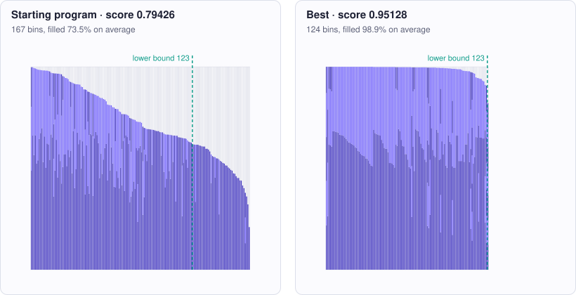

<!-- Copyright (c) 2026 by C. Klukas -->
<!-- SPDX-License-Identifier: GPL-3.0-only -->
<!-- Generated by `omega docs` from examples/bin_packing/ and bench/results/*.json. Do not edit by hand. -->

# bin_packing

Algorithms and heuristics · python · problem `bin_packing_1d` · [all examples](../examples.md)

## The problem

Write a heuristic for one-dimensional bin packing. pack(sizes, capacity) gets a list of integer item sizes (each between 1 and capacity) and the integer bin capacity (1000) and must return a list of bins, each a list of item indices: every index exactly once, the sizes in each bin summing to at most capacity, no empty bins. The goal is to use as FEW BINS as possible. It is run on three fixed instances: 300 items of size 100-700, 1000 items of size 150-450, and 1000 items of size 250-500 (mostly three items per bin, hard for simple greedy rules). The time limit is 2.0 CPU seconds per instance, measured with time.process_time() around the call; using more than 1.5 x the limit (3.0 s) makes the program invalid, so check time.process_time() regularly and return the best packing found when time runs out. Only the Python standard library may be used (no numpy).

- **Score:** score = mean over the three instances of (lower bound / bins used), where the lower bound is ceil(sum(sizes) / capacity). Higher is better; 1.0 would meet the bound on every instance (it may not be reachable everywhere). The initial next-fit program scores about 0.8, first-fit decreasing about 0.95. Metrics per instance: <name>_bins, <name>_lower_bound, <name>_ratio, <name>_cpu_s.
- **Files:** `examples/bin_packing/omega.toml`, the program `initial.py`, evaluator stages: main

### Why this is a hard problem

Bin packing asks how to fit items of different sizes into as few equal containers as possible: parcels into trucks, files onto disks, jobs onto machines, pieces cut from stock lengths of steel. It was studied systematically in the early 1970s, notably in David S. Johnson's [1973 doctoral thesis at MIT](https://dspace.mit.edu/handle/1721.1/57819), which analysed simple rules such as first fit decreasing. The problem is NP-hard: no known method finds the optimum quickly for every input.

The starting program uses next fit: it takes the items in the given order and opens a new bin whenever the next item does not fit, so every closed bin keeps its leftover space for good (score about 0.79). Sorting the items from large to small and putting each into the first bin with room (first fit decreasing) reaches about 0.95 at once. The limit of 1.0 is the lower bound: the total size divided by the capacity, the number of bins needed if they could be filled without any gap.

The rest is hard because whether a bin ends up full depends on which combination of items shares it, and a greedy rule never revisits a decision. In the third instance no item is smaller than 250, so a gap of 240 can never be filled; meeting the bound would need almost every bin filled to 99.9 % by well-matched triples, and first fit decreasing ends 43 bins above it. Moving single items between bins rarely helps: a bin is saved only when all of its items find fitting gaps elsewhere at the same time. The bound itself may be out of reach, so nobody knows how much is left to gain.

Run it with:

```bash
python3 -m omega_transform run examples/bin_packing --minutes 15
```

## The starting program

The model may change only the code between the `OMEGA-BLOCK` markers.

```python
# Copyright (c) 2026 by C. Klukas
# SPDX-License-Identifier: MIT
"""One-dimensional bin packing: pack integer item sizes into as few bins as possible.

The evaluator calls pack(sizes, capacity) on three fixed instances (300 to 1000 items,
capacity 1000) and scores the number of bins used against the lower bound.
"""
import math
import random
import time

# OMEGA-BLOCK-START
def pack(sizes, capacity):
    """Return a list of bins; each bin is a list of item indices into sizes.

    sizes: list of ints, each between 1 and capacity; capacity: int bin capacity.
    Every item index must appear in exactly one bin and the sizes in a bin must sum
    to at most capacity. Fewer bins is better. The call has a CPU time limit of 2.0 s
    (time.process_time(); more than 1.5 x the limit makes the program invalid).
    Only the Python standard library may be used.

    Current method: next fit (open a new bin whenever the next item does not fit).
    """
    bins = []
    current, load = [], 0
    for i, s in enumerate(sizes):
        if load + s > capacity:
            bins.append(current)
            current, load = [], 0
        current.append(i)
        load += s
    if current:
        bins.append(current)
    return bins
# OMEGA-BLOCK-END
```

## Benchmark results

The best result so far comes from **poolside/laguna-s-2.1:free (no-think)**, run through OpenRouter on 2026-10-30: a score of **0.9637** (×1.21 the starting program's 0.79426), reached after 3.9 of 60 minutes with 20 model requests.

What the starting program produces (left) and what the best program by poolside/laguna-s-2.1:free (no-think) produces (right), drawn for the instance `u300`:



### How it got there

The best program's ancestry, from the starting program on. "Edit" and "rewrite" are the model's changes; a parameter sweep is the engine trying values for the constants the model exposed.

| Step | Minute | Score | Kind | Idea |
|--:|--:|--:|---|---|
| 0 | 0.0 | 0.79426 | start | initial program |
| 1 | 1.5 | 0.95128 | edit | Replace next-fit with first-fit decreasing (FFD), which sorts items largest-first and places each into the first bin that fits, dramatically reducing wasted space and bin count. |
| 2 | 3.9 | 0.9637 | rewrite | Add a bounded local-search improvement phase after FFD that repeatedly empties the least-filled bin and re-inserts its items via best-fit, then performs 1-1 and 1-2 swaps to reduce wasted space and bin count. |

### The best program

What changed compared with the starting program:

```diff
--- initial
+++ best
@@ -10,6 +10,8 @@
 import time
 
 # OMEGA-BLOCK-START
+MAX_IMPROVE_ITERS = 4000
+SWAP_GAIN = False
 def pack(sizes, capacity):
     """Return a list of bins; each bin is a list of item indices into sizes.
 
@@ -19,17 +21,132 @@
     (time.process_time(); more than 1.5 x the limit makes the program invalid).
     Only the Python standard library may be used.
 
-    Current method: next fit (open a new bin whenever the next item does not fit).
+    Method: first-fit decreasing (FFD) followed by a bounded local-search improvement
+    that empties the least-filled bin and re-inserts its items via best-fit, then
+    performs 1-1 and 1-2 swaps to reduce wasted space and bin count.
     """
-    bins = []
-    current, load = [], 0
-    for i, s in enumerate(sizes):
-        if load + s > capacity:
-            bins.append(current)
-            current, load = [], 0
-        current.append(i)
-        load += s
-    if current:
-        bins.append(current)
+    n = len(sizes)
+    order = sorted(range(n), key=lambda i: sizes[i], reverse=True)
+    bins, loads = [], []
+    for i in order:
+        s = sizes[i]
+        placed = False
+        for b in range(len(bins)):
+            if loads[b] + s <= capacity:
+                bins[b].append(i)
+                loads[b] += s
+                placed = True
+                break
+        if not placed:
+            bins.append([i])
+            loads.append(s)
+    _improve(bins, loads, sizes, capacity)
     return bins
+
+def _best_fit_insert(item, bins, loads, capacity):
+    bi, bs = -1, capacity + 1
+    for b in range(len(bins)):
+        s = sizes_local[item]
+        if loads[b] + s <= capacity and loads[b] + s > capacity - bs:
+            bi, bs = b, loads[b] + s
+    return bi
+
+def _improve(bins, loads, sizes, capacity):
+    sizes_local = sizes
+    t0 = time.process_time()
+    iters = 0
+    while iters < MAX_IMPROVE_ITERS:
+        iters += 1
+        if time.process_time() - t0 > 1.5:
+            break
+        # find least-filled bin
+        m = len(loads)
+        if m <= 1:
+            break
+        lo = loads[0]
+        li = 0
+        for b in range(1, m):
+            if loads[b] < lo:
+                lo, li = loads[b], b
+        if lo == 0:
+            break
+        # empty least-filled bin
+        items = bins[li]
+        bins[li] = []
+        loads[li] = 0
+        # best-fit reinsert each item
+        ok = True
+        for it in items:
+            s = sizes[it]
+            bi, bl = -1, capacity + 1
+            for b in range(m):
+                if b == li:
+                    continue
+                if loads[b] + s <= capacity and loads[b] + s < bl:
+                    bl = loads[b] + s
+                    bi = b
+            if bi == -1:
+                # no existing bin fits; put back in emptied bin
+                bins[li].append(it)
+                loads[li] += s
+                if loads[li] > capacity:
+                    ok = False
+            else:
+                bins[bi].append(it)
+                loads[bi] += s
+        if not ok:
+            break
+        # if emptied bin now empty, remove it
+        if not bins[li]:
+            bins[li] = bins[-1]
+            loads[li] = loads[-1]
+            bins.pop()
+            loads.pop()
+            continue
+        # try to reduce bin count: move items to fill emptied bin or merge
+        # perform 1-1 swaps: move item from a bin into emptied bin if it reduces slack
+        # perform 1-2 swaps: two small items from different bins replace one large item
+        _swap_pass(bins, loads, sizes, capacity)
+    # remove any empty bins
+    new_bins = []
+    new_loads = []
+    for b in range(len(bins)):
+        if loads[b] > 0:
+            new_bins.append(bins[b])
+            new_loads.append(loads[b])
+    bins[:] = new_bins
+    loads[:] = new_loads
+
+def _swap_pass(bins, loads, sizes, capacity):
+    m = len(loads)
+    for a in range(m):
+        la = loads[a]
+        if la == 0:
+            continue
+        for x in bins[a]:
+            sx = sizes[x]
+            for c in range(m):
+                if c == a or loads[c] == 0:
+                    continue
+                for y in bins[c]:
+                    if y == x:
+                        continue
+                    sy = sizes[y]
+                    # 1-1 swap: item x (from a) into bin c, item y (from c) into bin a
+                    if la - sx + sy <= capacity and loads[c] - sy + sx <= capacity:
+                        if SWAP_GAIN and (la - sx + sy) > la:
+                            pass
+                        loads[a] = la - sx + sy
+                        loads[c] = loads[c] - sy + sx
+                        bins[a].remove(x)
+                        bins[a].append(y)
+                        bins[c].remove(y)
+                        bins[c].append(x)
+                        break
+                else:
+                    continue
+                break
+            else:
+                continue
+            break
 # OMEGA-BLOCK-END
```

### All models

One run per model and reasoning mode; the [model benchmarks](../benchmarks/bin_packing_1d.md) page has speed, memory and progress over time.

| Model | Where | Best | Gain | Minutes to best | New bests |
|---|---|--:|--:|--:|--:|
| poolside/laguna-s-2.1:free (no-think) | cloud | 0.9637 | ×1.21 | 3.9 | 2 |
| qwen3.6:27b-coding-mtp-q4_K_M (no-think) | local | 0.95304 | ×1.20 | 8.6 | 2 |
| nvidia/nemotron-3-ultra-550b-a55b:free (no-think) | cloud | 0.95271 | ×1.20 | 5.3 | 3 |
| gemma4:e2b (no-think) | local | 0.95128 | ×1.20 | 0.7 | 2 |
| gemma4:e4b-it-qat (no-think) | local | 0.95128 | ×1.20 | 0.5 | 1 |
| qwen3.5:latest (no-think) | local | 0.95128 | ×1.20 | 1.7 | 2 |
| gemma4:latest (no-think) | local | 0.95128 | ×1.20 | 0.7 | 1 |
| gemma4:12b-it-qat (no-think) | local | 0.95128 | ×1.20 | 0.6 | 1 |
| gpt-oss:20b (no-think) | local | 0.95128 | ×1.20 | 1.6 | 1 |
| gemma4:26b-a4b-it-qat (no-think) | local | 0.95128 | ×1.20 | 1.4 | 1 |
| qwen3:30b-a3b-instruct-2507-q4_K_M (no-think) | local | 0.95128 | ×1.20 | 1.1 | 1 |
| glm-4.7-flash:latest (no-think) | local | 0.95128 | ×1.20 | 1.7 | 1 |
| cohere/north-mini-code:free (no-think) | cloud | 0.95128 | ×1.20 | 1.7 | 1 |
| nvidia/nemotron-3.5-super-vl:free (no-think) | cloud | 0.95128 | ×1.20 | 0.2 | 1 |
| llm-jp-4-8b-omega:q4_k_m (no-think) | local | 0.95128 | ×1.20 | 1.1 | 1 |
| underdog-saluki-27b:iq2-mix (no-think) | local | 0.95128 | ×1.20 | 2.1 | 1 |
| dots-studio/dots-3-note-preview:free (no-think) | cloud | 0.95128 | ×1.20 | 0.1 | 1 |
| qwen3-coder:30b (no-think) | local | 0.95128 | ×1.20 | 1.6 | 1 |
| poolside/laguna-xs-2.1:free (no-think) | cloud | 0.95128 | ×1.20 | 2.4 | 1 |
| frob/sarvam:30b (no-think) | local | 0.95128 | ×1.20 | 12.8 | 1 |
| nvidia/nemotron-3-nano-omni-30b-a3b-reasoning:free (no-think) | cloud | 0.95128 | ×1.20 | 0.1 | 1 |
| nvidia/nemotron-3.5-lightning:free (no-think) | cloud | 0.94863 | ×1.19 | 3.7 | 1 |
| qwen2.5-coder:7b (no-think) | local | 0.92325 | ×1.16 | 1.3 | 1 |
| yandex/YandexGPT-5-Lite-8B-instruct-GGUF:latest (no-think) | local | 0.79587 | ×1.00 | 1.3 | 1 |
| richardyoung/frognano-4b-2609:latest (no-think) | local | 0.79587 | ×1.00 | 1.1 | 1 |
| nemotron-3-nano:4b (no-think) | local | 0.79426 | ×1.00 | - | 0 |
| MichelRosselli/apertus:8b-instruct-2509-q4_k_m (no-think) | local | 0.79426 | ×1.00 | - | 0 |
| hf.co/LiquidAI/LFM3-1.7B-GGUF:Q4_K_M (no-think) | local | 0.79426 | ×1.00 | - | 0 |
| xingchen-agi/xing4.0-29b-a4b:free (no-think) | cloud | | | | failed: all 7 model requests failed … |
| google/gemma-4-26b-a4b-it:free (no-think) | cloud | | | | failed: all 6 model requests failed … |
| google/gemma-4-31b-it:free (no-think) | cloud | | | | failed: all 6 model requests failed: google/gemma-4-31b-it:free … |
