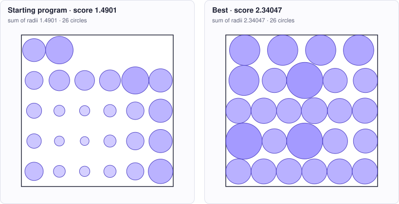

<!-- Copyright (c) 2026 by C. Klukas -->
<!-- SPDX-License-Identifier: GPL-3.0-only -->
<!-- Generated by `omega docs` from examples/circle_packing/ and bench/results/*.json. Do not edit by hand. -->

# circle_packing

Mathematical constructions · python · problem `circle_packing_26` · [all examples](../examples.md)

## The problem

Place 26 non-overlapping circles inside the unit square [0,1]x[0,1] so that the SUM OF THEIR RADII is as large as possible. run() returns construct_packing(26): a list of 26 (x, y, r) tuples. Circles must lie fully inside the square and must not overlap (tolerance 1e-9). The best known value is about 2.635. The program may use numpy if it is installed, may run an optimization (for example on the centers with radii derived from them), but must finish within the time limit.

- **Score:** score = sum of radii. Metrics: ratio_to_best_known (1.0 = the best known 2.635), min_radius/max_radius, seconds = CPU time of construct_packing.
- **Files:** `examples/circle_packing/omega.toml`, the program `initial.py`, evaluator stages: main

### Why this is a hard problem

Packing circles is one of the oldest questions of geometry: Johannes Kepler asked in 1611 how densely spheres can be stacked, and the packing of equal circles in a square has been studied since Leo Moser's question of 1960, which J. Schaer and A. Meir [answered for 8 circles in 1965](https://doi.org/10.4153/cmb-1965-004-x). This example uses a newer variant: the circles may have different sizes, and the sum of their radii is to be as large as possible. No formula gives the answer; the best known value for 26 circles, about 2.635, comes from computer searches and is not proven optimal.

The starting program places the circles on a 6 × 5 grid and gives each the largest radius the walls and its neighbours allow. Equal circles in a grid score only about 1.49; the best known packings mix large circles in the interior with small ones that fill the corners and gaps.

It is hard because every circle's best size depends on all its neighbours: growing one circle pushes others, which push others in turn. The best layouts are rigid, with many circles touching each other and the walls at once, and there are countless locally optimal layouts. To get from a good one to a better one, circles often have to change places or sizes in ways that small improving steps cannot reach.

Run it with:

```bash
python3 -m omega_transform run examples/circle_packing --minutes 15
```

## The starting program

The model may change only the code between the `OMEGA-BLOCK` markers.

```python
# Copyright (c) 2026 by C. Klukas
# SPDX-License-Identifier: MIT
"""Pack 26 non-overlapping circles in the unit square, maximizing the sum of radii.

The best known values for n = 26 are about 2.635 to 2.6359.
"""
import math

# OMEGA-BLOCK-START
def construct_packing(n=26):
    """Return a list of n circles (x, y, r) inside the unit square without overlaps."""
    cols = math.ceil(math.sqrt(n))
    rows = math.ceil(n / cols)
    centers = []
    for k in range(n):
        i, j = k % cols, k // cols
        centers.append(((i + 0.5) / cols, (j + 0.5) / rows))
    radii = max_radii(centers)
    return [(x, y, r) for (x, y), r in zip(centers, radii)]


def max_radii(centers):
    """Largest radii for fixed centers: limit by walls, then shrink overlapping pairs."""
    radii = [min(x, y, 1 - x, 1 - y) for x, y in centers]
    for a in range(len(centers)):
        for b in range(a + 1, len(centers)):
            d = math.dist(centers[a], centers[b])
            if radii[a] + radii[b] > d:
                s = d / (radii[a] + radii[b])
                radii[a] *= s
                radii[b] *= s
    return radii
# OMEGA-BLOCK-END


def run():
    return construct_packing(26)
```

## Benchmark results

The best result so far comes from **nvidia/nemotron-3.5-super-vl:free (think)**, run through OpenRouter on 2026-11-06: a score of **2.53716** (×1.70 the starting program's 1.4901), reached after 26.78 of 60 minutes with 24 model requests.

What the starting program produces (left) and what the best program by nvidia/nemotron-3.5-super-vl:free (think) produces (right):



### How it got there

The best program's ancestry, from the starting program on. "Edit" and "rewrite" are the model's changes; a parameter sweep is the engine trying values for the constants the model exposed.

| Step | Minute | Score | Kind | Idea |
|--:|--:|--:|---|---|
| 0 | 0.0 | 1.4901 | start | initial program |
| 1 | 15.4 | 1.65934 | edit | Replace the square grid + naive pairwise shrink with a hexagonal initial layout, multiple jittered restarts, and Gauss-Seidel radius projection over several vertex orderings to extract much larger feasible radii. |
| 2 | 22.3 | 2.46132 | edit | Replace the fixed-hex-center radius-only projection with a penalty-based joint gradient ascent on centers and radii (momentum + clipped steps), then an exact multi-ordering feasible-radius projection over jittered warm-started restarts, directly optimizing … |
| 3 | 22.3 | 2.53507 | parameter sweep | tuned OPT_ITERS=5000, OPT_STEP=0.015, RESTARTS=4, JITTER=0.03 on top of: Replace the fixed-hex-center radius-only projection with a penalty-based joint gradient ascent on centers and radii (momentum + clipped steps), then an exact multi-ordering … |
| 4 | 26.8 | 2.53507 | edit | Add a center-polishing phase after the penalty optimization: greedily move each circle away from its binding constraint (wall or neighbor), re-project exact radii after every sweep, and keep the best layout. This directly improves the center layout found by … |
| 5 | 26.8 | 2.53716 | parameter sweep | tuned POLISH_ROUNDS=6, POLISH_STEP=0.004 on top of: Add a center-polishing phase after the penalty optimization: greedily move each circle away from its binding constraint (wall or neighbor), re-project exact radii after every sweep, and keep the best layout. … |

### The best program

What changed compared with the starting program:

```diff
--- initial
+++ best
@@ -7,29 +7,368 @@
 import math
 
 # OMEGA-BLOCK-START
+OPT_ITERS = 5000
+OPT_STEP = 0.015
+RESTARTS = 4
+RHO0 = 1.0
+RHO_GROWTH = 1.5
+JITTER = 0.03
+LR_DECAY = 0.9995
+MOMENTUM = 0.5
+POLISH_ROUNDS = 6
+POLISH_STEP = 0.004
+
+
 def construct_packing(n=26):
-    """Return a list of n circles (x, y, r) inside the unit square without overlaps."""
+    """Pack n circles in the unit square maximizing the sum of radii.
+
+    Penalty-based joint gradient ascent on centers and radii, then an exact
+    feasible-radius projection; best result over jittered warm-started
+    restarts is kept.
+    """
+    best = None
+    best_sum = -1.0
+    best_centers = None
+    for seed in range(RESTARTS):
+        if best_centers is None:
+            centers = _hex_init(n, jitter=JITTER, seed=seed)
+        else:
+            centers = _warm_start(best_centers, JITTER, seed)
+        xs = [c[0] for c in centers]
+        ys = [c[1] for c in centers]
+        r = [min(x, 1.0 - x, y, 1.0 - y) for (x, y) in centers]
+        pairs = [(i, j) for i in range(n) for j in range(i + 1, n)]
+        vx = [0.0] * n
+        vy = [0.0] * n
+        vr = [0.0] * n
+        rho = RHO0
+        lr = OPT_STEP
+        for _ in range(OPT_ITERS):
+            gr = [1.0] * n
+            gx = [0.0] * n
+            gy = [0.0] * n
+            for i in range(n):
+                ri = r[i]
+                xi = xs[i]
+                yi = ys[i]
+                v = ri - xi
+                if v > 0.0:
+                    t = 2.0 * rho * v
+                    gr[i] -= t
+                    gx[i] += t
+                w = ri - (1.0 - xi)
+                if w > 0.0:
+                    t = 2.0 * rho * w
+                    gr[i] -= t
+                    gx[i] -= t
+                c = ri - yi
+                if c > 0.0:
+                    t = 2.0 * rho * c
+                    gr[i] -= t
+                    gy[i] += t
+                z = ri - (1.0 - yi)
+                if z > 0.0:
+                    t = 2.0 * rho * z
+                    gr[i] -= t
+                    gy[i] -= t
+            for (i, j) in pairs:
+                dx = xs[i] - xs[j]
+                dy = ys[i] - ys[j]
+                dd = dx * dx + dy * dy
+                if dd <= 0.0:
+                    d = 1e-12
+                else:
+                    d = math.sqrt(dd)
+                viol = r[i] + r[j] - d
+                if viol > 0.0:
+                    term = 2.0 * rho * viol
+                    inv_d = 1.0 / d
+                    gr[i] -= term
+                    gr[j] -= term
+                    gx[i] += term * dx * inv_d
+                    gx[j] -= term * dx * inv_d
+                    gy[i] += term * dy * inv_d
+                    gy[j] -= term * dy * inv_d
+            for i in range(n):
+                g = gr[i]
+                if g > 2.0:
+                    g = 2.0
+                elif g < -2.0:
+                    g = -2.0
+                vr[i] = MOMENTUM * vr[i] + lr * g
+                r[i] += vr[i]
+                if r[i] < 0.0:
+                    r[i] = 0.0
+                g = gx[i]
+                if g > 2.0:
+                    g = 2.0
+                elif g < -2.0:
+                    g = -2.0
+                vx[i] = MOMENTUM * vx[i] + lr * g
+                xs[i] += vx[i]
+                if xs[i] < 0.0:
+                    xs[i] = 0.0
+                elif xs[i] > 1.0:
+                    xs[i] = 1.0
+                g = gy[i]
+                if g > 2.0:
+                    g = 2.0
+                elif g < -2.0:
+                    g = -2.0
+                vy[i] = MOMENTUM * vy[i] + lr * g
+                ys[i] += vy[i]
+                if ys[i] < 0.0:
+                    ys[i] = 0.0
+                elif ys[i] > 1.0:
+                    ys[i] = 1.0
+            rho *= RHO_GROWTH
+            if rho > 1e6:
+                rho = 1e6
+            lr *= LR_DECAY
+        centers = list(zip(xs, ys))
+        best_centers = centers
+        rproj = _project_radii(centers, num_orders=4)
+        pol_centers, pol_radii = _polish_centers(centers, rproj,
+                                                 rounds=POLISH_ROUNDS,
+                                                 step=POLISH_STEP)
+        total = 0.0
+        for v in pol_radii:
+            total += v
+        if total > best_sum:
+            best_sum = total
+            best = [(pol_centers[i][0], pol_centers[i][1], pol_radii[i])
+                    for i in range(n)]
+    return best
+
+
+def _hex_init(n, jitter, seed):
     cols = math.ceil(math.sqrt(n))
-    rows = math.ceil(n / cols)
-    centers = []
-    for k in range(n):
-        i, j = k % cols, k // cols
-        centers.append(((i + 0.5) / cols, (j + 0.5) / rows))
-    radii = max_radii(centers)
-    return [(x, y, r) for (x, y), r in zip(centers, radii)]
-
-
-def max_radii(centers):
-    """Largest radii for fixed centers: limit by walls, then shrink overlapping pairs."""
-    radii = [min(x, y, 1 - x, 1 - y) for x, y in centers]
-    for a in range(len(centers)):
-        for b in range(a + 1, len(centers)):
-            d = math.dist(centers[a], centers[b])
-            if radii[a] + radii[b] > d:
-                s = d / (radii[a] + radii[b])
-                radii[a] *= s
-                radii[b] *= s
-    return radii
+    rows = (n + cols - 1) // cols
+    margin = 0.06
+    sx = (1.0 - 2.0 * margin) / (cols - 1) if cols > 1 else 1.0
+    sy = sx * math.sqrt(3.0) / 2.0
+    if rows > 1 and (rows - 1) * sy > 1.0 - 2.0 * margin:
+        sy = (1.0 - 2.0 * margin) / (rows - 1)
+        sx = sy * 2.0 / math.sqrt(3.0)
+    pts = []
+    idx = 0
+    for j in range(rows):
+        y = margin + j * sy
+        off = sx * 0.5 if (j % 2 == 1) else 0.0
+        for i in range(cols):
+            if idx >= n:
+                break
+            x = margin + i * sx + off
+            if jitter:
+                x += jitter * math.sin(idx * 1.7 + seed * 0.31)
+                y += jitter * math.cos(idx * 2.3 + seed * 0.47)
+            if x < 0.0:
+                x = 0.0
+            elif x > 1.0:
+                x = 1.0
+            if y < 0.0:
+                y = 0.0
+            elif y > 1.0:
+                y = 1.0
+            pts.append((x, y))
+            idx += 1
+        if idx >= n:
+            break
+    return pts
+
+
+def _warm_start(centers, jitter, seed):
+    """Start the next restart from the incumbent best, perturbed by jitter."""
+    pts = []
+    for k, (x, y) in enumerate(centers):
+        x += jitter * math.sin(k * 1.7 + seed * 0.31)
+        y += jitter * math.cos(k * 2.3 + seed * 0.47)
+        if x < 0.0:
+            x = 0.0
+        elif x > 1.0:
+            x = 1.0
+        if y < 0.0:
+            y = 0.0
+        elif y > 1.0:
+            y = 1.0
+        pts.append((x, y))
+    return pts
+
+
+def _project_radii(centers, num_orders=4):
+    """Largest feasible radii for fixed centers, trying several vertex orderings."""
+    n = len(centers)
+    wall = [min(x, 1.0 - x, y, 1.0 - y) for (x, y) in centers]
+    dist = [[0.0] * n for _ in range(n)]
+    for i in range(n):
+        xi, yi = centers[i]
+        for j in range(i + 1, n):
+            d = math.hypot(xi - centers[j][0], yi - centers[j][1])
+            dist[i][j] = d
+            dist[j][i] = d
+
+    def relax(order, r):
+        for _ in range(200):
+            changed = False
+            for i in order:
+                best = wall[i]
+                for j in range(n):
+                    if j != i:
+                        v = dist[i][j] - r[j]
+                        if v < best:
+                            best = v
+                if best < 0.0:
+                    best = 0.0
+                if best != r[i]:
+                    changed = True
+                    r[i] = best
+            if not changed:
+                break
+
+    orders = [list(range(n)), list(range(n - 1, -1, -1))]
+    for k in range(2, max(0, num_orders)):
+        order = list(range(n))
+        for i in range(n - 1, 0, -1):
+            j = ((k * 1009 + i * 3) * 2654435761) % (i + 1)
+            order[i], order[j] = order[j], order[i]
+        orders.append(order)
+    orders = orders[:num_orders]
+
+    best_r = list(wall)
+    best_sum = -1.0
+    for order in orders:
+        r = list(wall)
+        relax(order, r)
+        s = sum(r)
+        if s > best_sum:
+            best_sum = s
+            best_r = r
+
+    # Safety: remove any tiny overlap left by floating point.
+    for _ in range(30):
+        viol = False
+        for i in range(n):
+            for j in range(i + 1, n):
+                s = best_r[i] + best_r[j]
+                d = dist[i][j]
+                if s > d + 1e-12:
+                    f = d / s
+                    best_r[i] *= f
+                    best_r[j] *= f
+                    viol = True
+        if not viol:
+            break
+    for i in range(n):
+        if best_r[i] > wall[i]:
+            best_r[i] = wall[i]
+        elif best_r[i] < 0.0:
+            best_r[i] = 0.0
+    return best_r
+
+
+def _polish_centers(centers, radii, rounds=12, step=0.008):
+    """Improve center positions by moving each circle away from its binding
+    constraint, re-projecting exact radii after every sweep."""
+    n = len(centers)
+    pts = [[c[0], c[1]] for c in centers]
+    rs = list(radii)
+
+    def dist_mat():
+        d = [[0.0] * n for _ in range(n)]
+        for i in range(n):
+            xi, yi = pts[i]
+            for j in range(i + 1, n):
+                dij = math.hypot(xi - pts[j][0], yi - pts[j][1])
+                d[i][j] = d[j][i] = dij
+        return d
+
+    def walls():
+        return [min(x, 1.0 - x, y, 1.0 - y) for (x, y) in pts]
+
+    best_pts = [p[:] for p in pts]
+    best_rs = list(rs)
+    best_sum = sum(rs)
+
+    dm = dist_mat()
+    wl = walls()
+
+    for _ in range(rounds):
+        rs = _project_radii(pts, num_orders=2)
+        s = sum(rs)
+        if s > best_sum:
+            best_sum = s
+            best_pts = [p[:] for p in pts]
+            best_rs = list(rs)
+        dm = dist_mat()
+        wl = walls()
+
+        moved = False
+        for i in range(n):
+            xi, yi = pts[i]
+            best_limit = wl[i]
+            btype = 'wall'
+            bdx, bdy = 0.0, 0.0
+
+            if abs(xi - best_limit) <= 1e-9:
+                btype = 'wall_left'
+            if abs(1.0 - xi - best_limit) <= 1e-9:
+                btype = 'wall_right'
+            if abs(yi - best_limit) <= 1e-9:
+                btype = 'wall_bottom'
+            if abs(1.0 - yi - best_limit) <= 1e-9:
+                btype = 'wall_top'
+            for j in range(n):
+                if j == i:
+                    continue
+                lim = dm[i][j] - rs[j]
+                if lim < best_limit - 1e-12:
+                    best_limit = lim
+                    btype = 'circle'
+                    bdx = xi - pts[j][0]
+                    bdy = yi - pts[j][1]
+
+            mx, my = 0.0, 0.0
+            if btype == 'wall_left':
+                mx = step
+            elif btype == 'wall_right':
+                mx = -step
+            elif btype == 'wall_bottom':
+                my = step
+            elif btype == 'wall_top':
+                my = -step
+            elif btype == 'circle':
+                dd = math.hypot(bdx, bdy)
+                if dd > 1e-12:
+                    mx = step * bdx / dd
+                    my = step * bdy / dd
+
+            nx = xi + mx
+            ny = yi + my
+            if nx < 0.0:
+                nx = 0.0
+            elif nx > 1.0:
+                nx = 1.0
+            if ny < 0.0:
+                ny = 0.0
+            elif ny > 1.0:
+                ny = 1.0
+
+            if abs(nx - xi) > 1e-14 or abs(ny - yi) > 1e-14:
+                pts[i][0] = nx
+                pts[i][1] = ny
+                moved = True
+
+        if not moved:
+            break
+
+    rs = _project_radii(pts, num_orders=4)
+    s = sum(rs)
+    if s > best_sum:
+        best_sum = s
+        best_pts = [p[:] for p in pts]
+        best_rs = list(rs)
+
+    return best_pts, best_rs
 # OMEGA-BLOCK-END
```

### All models

One run per model and reasoning mode; the [model benchmarks](../benchmarks/circle_packing_26.md) page has speed, memory and progress over time.

| Model | Where | Best | Gain | Minutes to best | New bests |
|---|---|--:|--:|--:|--:|
| nvidia/nemotron-3.5-super-vl:free (think) | cloud | 2.53716 | ×1.70 | 26.8 | 5 |
| qwen3.6:27b-coding-mtp-q4_K_M (think) | local | 2.46327 | ×1.65 | 55.7 | 3 |
| gpt-oss:20b (no-think) | local | 2.34047 | ×1.57 | 20.1 | 2 |
| gemma4:26b-a4b-it-qat (no-think) | local | 2.33505 | ×1.57 | 54.5 | 12 |
| gemma4:26b-a4b-it-qat (think) | local | 2.26317 | ×1.52 | 28.9 | 1 |
| recursive/flint-v1.0:free (think) | cloud | 2.2181 | ×1.49 | 34.2 | 6 |
| gemma4:12b-it-qat (no-think) | local | 2.16667 | ×1.45 | 5.8 | 2 |
| gpt-oss:20b (think) | local | 2.16667 | ×1.45 | 2.1 | 1 |
| gemma4:12b-it-qat (think) | local | 2.16667 | ×1.45 | 33.3 | 2 |
| nvidia/nemotron-3.5-super-vl:free (no-think) | cloud | 2.07195 | ×1.39 | 7.6 | 12 |
| qwen3.6:27b-coding-mtp-q4_K_M (no-think) | local | 2.06524 | ×1.39 | 27.0 | 2 |
| nvidia/nemotron-3-nano-omni-30b-a3b-reasoning:free (think) | cloud | 2 | ×1.34 | 31.0 | 3 |
| hf.co/LiquidAI/LFM3-1.7B-GGUF:Q4_K_M (think) | local | 1.97211 | ×1.32 | 59.3 | 2 |
| qwen3.5:latest (no-think) | local | 1.95644 | ×1.31 | 5.1 | 2 |
| cohere/north-mini-code:free (no-think) | cloud | 1.93214 | ×1.30 | 3.1 | 3 |
| underdog-saluki-27b:iq2-mix (no-think) | local | 1.896 | ×1.27 | 30.5 | 2 |
| richardyoung/frognano-4b-2609:latest (no-think) | local | 1.88223 | ×1.26 | 6.1 | 2 |
| nvidia/nemotron-3.5-lightning:free (no-think) | cloud | 1.85011 | ×1.24 | 4.4 | 4 |
| qwen3-coder:30b (no-think) | local | 1.83699 | ×1.23 | 24.2 | 2 |
| glm-4.7-flash:latest (think) | local | 1.7724 | ×1.19 | 19.3 | 1 |
| nvidia/nemotron-3-ultra-550b-a55b:free (think) | cloud | 1.76951 | ×1.19 | 24.9 | 3 |
| qwen3:30b-a3b-instruct-2507-q4_K_M (think) | local | 1.68971 | ×1.13 | 17.1 | 6 |
| richardyoung/frognano-4b-2609:latest (think) | local | 1.61875 | ×1.09 | 5.1 | 2 |
| nvidia/nemotron-3-nano-omni-30b-a3b-reasoning:free (no-think) | cloud | 1.60406 | ×1.08 | 0.6 | 1 |
| qwen2.5-coder:7b (no-think) | local | 1.60406 | ×1.08 | 1.2 | 1 |
| frob/sarvam:30b (no-think) | local | 1.60406 | ×1.08 | 36.1 | 1 |
| dots-studio/dots-3-note-preview:free (think) | cloud | 1.59016 | ×1.07 | 49.9 | 1 |
| yandex/YandexGPT-5-Lite-8B-instruct-GGUF:latest (no-think) | local | 1.58032 | ×1.06 | 3.0 | 2 |
| glm-4.7-flash:latest (no-think) | local | 1.50813 | ×1.01 | 1.3 | 1 |
| qwen3:30b-a3b-instruct-2507-q4_K_M (no-think) | local | 1.49777 | ×1.01 | 6.1 | 2 |
| nvidia/nemotron-3.5-lightning:free (think) | cloud | 1.4946 | ×1.00 | 10.9 | 1 |
| xingchen-agi/xing4.0-29b-a4b:free (no-think) | cloud | 1.4901 | ×1.00 | - | 0 |
| nvidia/nemotron-3-ultra-550b-a55b:free (no-think) | cloud | 1.4901 | ×1.00 | - | 0 |
| dots-studio/dots-3-note-preview:free (no-think) | cloud | 1.4901 | ×1.00 | - | 0 |
| hf.co/LiquidAI/LFM3-1.7B-GGUF:Q4_K_M (no-think) | local | 1.4901 | ×1.00 | - | 0 |
| nemotron-3-nano:4b (no-think) | local | 1.4901 | ×1.00 | - | 0 |
| gemma4:e2b (no-think) | local | 1.4901 | ×1.00 | - | 0 |
| MichelRosselli/apertus:8b-instruct-2509-q4_k_m (no-think) | local | 1.4901 | ×1.00 | - | 0 |
| llm-jp-4-8b-omega:q4_k_m (no-think) | local | 1.4901 | ×1.00 | - | 0 |
| gemma4:e4b-it-qat (no-think) | local | 1.4901 | ×1.00 | - | 0 |
| gemma4:latest (no-think) | local | 1.4901 | ×1.00 | - | 0 |
| cohere/north-mini-code:free (think) | cloud | 1.4901 | ×1.00 | - | 0 |
| xingchen-agi/xing4.0-29b-a4b:free (think) | cloud | 1.4901 | ×1.00 | - | 0 |
| nemotron-3-nano:4b (think) | local | 1.4901 | ×1.00 | - | 0 |
| gemma4:e2b (think) | local | 1.4901 | ×1.00 | - | 0 |
| gemma4:e4b-it-qat (think) | local | 1.4901 | ×1.00 | - | 0 |
| qwen3.5:latest (think) | local | 1.4901 | ×1.00 | - | 0 |
| gemma4:latest (think) | local | 1.4901 | ×1.00 | - | 0 |
| underdog-saluki-27b:iq2-mix (think) | local | 1.4901 | ×1.00 | - | 0 |
| frob/sarvam:30b (think) | local | 1.4901 | ×1.00 | - | 0 |
