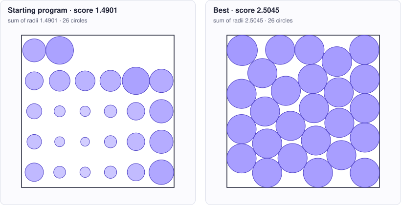

<!-- Copyright (c) 2026 by C. Klukas -->
<!-- SPDX-License-Identifier: GPL-3.0-only -->
<!-- Generated by `omega docs` from examples/circle_packing/ and bench/results/*.json. Do not edit by hand. -->

# circle_packing

Mathematical constructions · python · problem `circle_packing_26` · [all examples](../examples.md)

## The problem

Place 26 non-overlapping circles inside the unit square [0,1]x[0,1] so that the SUM OF THEIR RADII is as large as possible. run() returns construct_packing(26): a list of 26 (x, y, r) tuples. Circles must lie fully inside the square and must not overlap (tolerance 1e-9). The best known value is about 2.635. The program may use numpy if it is installed, may run an optimization (for example on the centers with radii derived from them), but must finish within the time limit.

- **Score:** score = sum of radii. Metrics: ratio_to_best_known (1.0 = the best known 2.635), min_radius/max_radius, seconds = CPU time of construct_packing.
- **Files:** `examples/circle_packing/omega.toml`, the program `initial.py`, evaluator stages: main

### Why this is a hard problem

Packing circles is one of the oldest questions of geometry: Johannes Kepler asked in 1611 how densely spheres can be stacked, and the packing of equal circles in a square has been studied since Leo Moser's question of 1960, which J. Schaer and A. Meir [answered for 8 circles in 1965](https://doi.org/10.4153/cmb-1965-004-x). This example uses a newer variant: the circles may have different sizes, and the sum of their radii is to be as large as possible. No formula gives the answer; the best known value for 26 circles, about 2.635, comes from computer searches and is not proven optimal.

The starting program places the circles on a 6 × 5 grid and gives each the largest radius the walls and its neighbours allow. Equal circles in a grid score only about 1.49; the best known packings mix large circles in the interior with small ones that fill the corners and gaps.

It is hard because every circle's best size depends on all its neighbours: growing one circle pushes others, which push others in turn. The best layouts are rigid, with many circles touching each other and the walls at once, and there are countless locally optimal layouts. To get from a good one to a better one, circles often have to change places or sizes in ways that small improving steps cannot reach.

Run it with:

```bash
python3 -m omega_transform run examples/circle_packing --minutes 15
```

## The starting program

The model may change only the code between the `OMEGA-BLOCK` markers.

```python
# Copyright (c) 2026 by C. Klukas
# SPDX-License-Identifier: MIT
"""Pack 26 non-overlapping circles in the unit square, maximizing the sum of radii.

The best known values for n = 26 are about 2.635 to 2.6359.
"""
import math

# OMEGA-BLOCK-START
def construct_packing(n=26):
    """Return a list of n circles (x, y, r) inside the unit square without overlaps."""
    cols = math.ceil(math.sqrt(n))
    rows = math.ceil(n / cols)
    centers = []
    for k in range(n):
        i, j = k % cols, k // cols
        centers.append(((i + 0.5) / cols, (j + 0.5) / rows))
    radii = max_radii(centers)
    return [(x, y, r) for (x, y), r in zip(centers, radii)]


def max_radii(centers):
    """Largest radii for fixed centers: limit by walls, then shrink overlapping pairs."""
    radii = [min(x, y, 1 - x, 1 - y) for x, y in centers]
    for a in range(len(centers)):
        for b in range(a + 1, len(centers)):
            d = math.dist(centers[a], centers[b])
            if radii[a] + radii[b] > d:
                s = d / (radii[a] + radii[b])
                radii[a] *= s
                radii[b] *= s
    return radii
# OMEGA-BLOCK-END


def run():
    return construct_packing(26)
```

## Benchmark results

The best result so far comes from **nvidia/nemotron-3-super-120b-a12b:free (think)**, run through OpenRouter on 2026-10-10: a score of **2.5045** (×1.68 the starting program's 1.4901), reached after 10.66 of 15 minutes with 23 model requests.

What the starting program produces (left) and what the best program by nvidia/nemotron-3-super-120b-a12b:free (think) produces (right):



### How it got there

The best program's ancestry, from the starting program on. "Edit" and "rewrite" are the model's changes; a parameter sweep is the engine trying values for the constants the model exposed.

| Step | Minute | Score | Kind | Idea |
|--:|--:|--:|---|---|
| 0 | 0.0 | 1.4901 | start | initial program |
| 1 | 3.6 | 2.46819 | rewrite | Use deterministic hill climbing where each circle moves away from its closest constraint (wall or nearest neighbor) to increase its radius, iterating with decreasing step size to reach a locally optimal non‑overlapping packing that should yield a higher sum … |
| 2 | 7.9 | 2.46819 | edit | Expose hill‑climbing step size, decay, minimum step, and wall‑vs‑neighbour balance as sweepable constants to let the optimizer find better parameters for higher sum of radii. |
| 3 | 10.7 | 2.46819 | edit | Expose the initial offset of the grid points as a tunable constant to allow the optimizer to find a better starting layout that can increase the sum of radii. |
| 4 | 10.7 | 2.5045 | parameter sweep | tuned INITIAL_STEP=0.07883, STEP_DECAY=0.9843, MIN_STEP=0.0001, INITIAL_OFFSET=0.09298 on top of: Expose the initial offset of the grid points as a tunable constant to allow the optimizer to find a better starting layout that can increase the sum of radii. |

### The best program

What changed compared with the starting program:

```diff
--- initial
+++ best
@@ -5,16 +5,103 @@
 import math
 
 # OMEGA-BLOCK-START
+import math
+import random
+
+# hill‑climbing parameters (can be swept)
+INITIAL_STEP = 0.07883083297290819
+STEP_DECAY = 0.9843098851016777
+MIN_STEP = 0.0001
+WALL_NN_FACTOR = 0.5
+INITIAL_OFFSET = 0.09298369605234769
+
 def construct_packing(n=26):
     """Return a list of n circles (x, y, r) inside the unit square without overlaps."""
+    # deterministic seed for reproducibility
+    random.seed(42)
+    # initialise points on a grid
     cols = math.ceil(math.sqrt(n))
     rows = math.ceil(n / cols)
-    centers = []
+    pts = []
     for k in range(n):
         i, j = k % cols, k // cols
-        centers.append(((i + 0.5) / cols, (j + 0.5) / rows))
-    radii = max_radii(centers)
-    return [(x, y, r) for (x, y), r in zip(centers, radii)]
+        pts.append([((i + INITIAL_OFFSET) / cols), ((j + INITIAL_OFFSET) / rows)])
+    
+    # hill‑climbing parameters (can be swept)
+    
+    step = INITIAL_STEP
+    while step > MIN_STEP:
+        for p in pts:
+            x, y = p
+            # distance to walls
+            d_left = x
+            d_right = 1.0 - x
+            d_bottom = y
+            d_top = 1.0 - y
+            d_wall = min(d_left, d_right, d_bottom, d_top)
+            # wall giving the minimum
+            if d_wall == d_left:
+                wall_dir = (1.0, 0.0)   # move right
+            elif d_wall == d_right:
+                wall_dir = (-1.0, 0.0)  # move left
+            elif d_wall == d_bottom:
+                wall_dir = (0.0, 1.0)   # move up
+            else:
+                wall_dir = (0.0, -1.0)  # move down
+            
+            # distance to nearest neighbour
+            nn_dist = float('inf')
+            nn_vec = (0.0, 0.0)
+            for q in pts:
+                if q is p:
+                    continue
+                dx = p[0] - q[0]
+                dy = p[1] - q[1]
+                d = math.hypot(dx, dy)
+                if d < nn_dist:
+                    nn_dist = d
+                    nn_vec = (dx, dy)
+            if nn_dist == float('inf'):  # only one point
+                nn_dist = float('inf')
+                nn_dir = (0.0, 0.0)
+            else:
+                nn_dir = (nn_vec[0] / nn_dist, nn_vec[1] / nn_dist)  # away from neighbour
+            
+            # decide which constraint is active
+            if d_wall <= WALL_NN_FACTOR * nn_dist:
+                gx, gy = wall_dir
+            else:
+                gx, gy = nn_dir
+            
+            # take a step
+            p[0] += gx * step
+            p[1] += gy * step
+            # keep inside [0,1]
+            if p[0] < 0.0:
+                p[0] = 0.0
+            elif p[0] > 1.0:
+                p[0] = 1.0
+            if p[1] < 0.0:
+                p[1] = 0.0
+            elif p[1] > 1.0:
+                p[1] = 1.0
+        step *= STEP_DECAY
+    
+    # compute final radii
+    radii = [0.0] * n
+    for i in range(n):
+        x, y = pts[i]
+        d_wall = min(x, 1.0 - x, y, 1.0 - y)
+        d_nn = float('inf')
+        for j in range(n):
+            if i == j:
+                continue
+            d = math.dist(pts[i], pts[j])
+            if d < d_nn:
+                d_nn = d
+        radii[i] = min(d_wall, 0.5 * d_nn)
+    
+    return [(pts[i][0], pts[i][1], radii[i]) for i in range(n)]
 
 
 def max_radii(centers):
@@ -28,6 +115,10 @@
                 radii[a] *= s
                 radii[b] *= s
     return radii
+
+
+def run():
+    return construct_packing(26)
 # OMEGA-BLOCK-END
```

### All models

One run per model and reasoning mode; the [model benchmarks](../benchmarks/circle_packing_26.md) page has speed, memory and progress over time.

| Model | Where | Machine | Best | Gain | Minutes to best | New bests |
|---|---|---|--:|--:|--:|--:|
| nvidia/nemotron-3-super-120b-a12b:free (think) | cloud | Apple M1 Max | 2.5045 | ×1.68 | 10.7 | 4 |
| gpt-oss:20b (think) | local | Apple M1 Max | 2.46941 | ×1.66 | 10.1 | 6 |
| nvidia/nemotron-3-ultra-550b-a55b:free (think) | cloud | Apple M1 Max | 2.40507 | ×1.61 | 13.0 | 2 |
| gemma4:26b-a4b-it-qat (no-think) | local | i7-8700K + 2x GTX 1080 Ti | 2.38516 | ×1.60 | 17.0 | 6 |
| gpt-oss:20b (no-think) | local | i7-8700K + 2x GTX 1080 Ti | 2.36418 | ×1.59 | 16.1 | 4 |
| underdog-saluki-27b:iq2-mix (no-think) | local | Apple M1 Max | 2.33171 | ×1.56 | 13.4 | 2 |
| gemma4:26b-a4b-it-qat (no-think) | local | Apple M1 Max | 2.26342 | ×1.52 | 10.2 | 2 |
| gemma4:26b-a4b-it-qat (think) | local | i7-8700K + 2x GTX 1080 Ti | 2.25597 | ×1.51 | 19.0 | 3 |
| gpt-oss:20b (think) | local | i7-8700K + 2x GTX 1080 Ti | 2.23356 | ×1.50 | 15.1 | 5 |
| nemotron-3-nano:30b-a3b-mlx (think) | local | Apple M1 Max | 2.21898 | ×1.49 | 15.1 | 6 |
| muse-glimmer:30b (think) | local | Apple M1 Max | 2.17695 | ×1.46 | 28.9 | 2 |
| richardyoung/frognano-4b-2609:latest (no-think) | local | Apple M1 Max | 2.16667 | ×1.45 | 1.4 | 1 |
| nemotron-3-nano:4b (think) | local | Apple M1 Max | 2.16667 | ×1.45 | 13.7 | 1 |
| gemma4:e2b (no-think) | local | i7-8700K + 2x GTX 1080 Ti | 2.16667 | ×1.45 | 6.7 | 2 |
| nemotron-3-nano:4b (think) | local | i7-8700K + 2x GTX 1080 Ti | 2.16667 | ×1.45 | 11.1 | 2 |
| qwen3.5:latest (think) | local | i7-8700K + 2x GTX 1080 Ti | 2.128 | ×1.43 | 18.6 | 3 |
| muse-glimmer:30b (no-think) | local | Apple M1 Max | 2.10507 | ×1.41 | 18.5 | 3 |
| yandex/YandexGPT-5-Lite-8B-instruct-GGUF:latest (no-think) | local | Apple M1 Max | 2.07584 | ×1.39 | 11.5 | 3 |
| gemma4:26b-a4b-it-qat (think) | local | Apple M1 Max | 2.01811 | ×1.35 | 15.2 | 1 |
| nvidia/nemotron-3-super-120b-a12b:free (no-think) | cloud | Apple M1 Max | 2.01309 | ×1.35 | 15.0 | 13 |
| gemma4:latest (no-think) | local | Apple M1 Max | 1.95098 | ×1.31 | 14.3 | 3 |
| qwen3:30b-a3b-instruct-2507-q4_K_M (no-think) | local | Apple M1 Max | 1.92574 | ×1.29 | 9.2 | 2 |
| qwen3.5:latest (no-think) | local | Apple M1 Max | 1.88064 | ×1.26 | 6.2 | 1 |
| gemma4:12b-it-qat (no-think) | local | i7-8700K + 2x GTX 1080 Ti | 1.8536 | ×1.24 | 13.9 | 3 |
| yandex/YandexGPT-5-Lite-8B-instruct-GGUF:latest (no-think) | local | i7-8700K + 2x GTX 1080 Ti | 1.83712 | ×1.23 | 8.5 | 6 |
| qwen3:30b-a3b-instruct-2507-q4_K_M (think) | local | Apple M1 Max | 1.81593 | ×1.22 | 14.3 | 15 |
| qwen3:30b-a3b-instruct-2507-q4_K_M (think) | local | i7-8700K + 2x GTX 1080 Ti | 1.8129 | ×1.22 | 14.1 | 2 |
| nemotron-3-nano:30b-a3b-mlx (no-think) | local | Apple M1 Max | 1.8089 | ×1.21 | 13.3 | 5 |
| devstral-small-2:24b (no-think) | local | Apple M1 Max | 1.79999 | ×1.21 | 9.9 | 2 |
| gemma4:12b-it-qat (no-think) | local | Apple M1 Max | 1.77142 | ×1.19 | 11.8 | 2 |
| cohere/north-mini-code:free (no-think) | cloud | Apple M1 Max | 1.75953 | ×1.18 | 14.6 | 7 |
| glm-4.7-flash:latest (think) | local | Apple M1 Max | 1.7339 | ×1.16 | 13.9 | 3 |
| qwen3-coder:30b (no-think) | local | i7-8700K + 2x GTX 1080 Ti | 1.70388 | ×1.14 | 13.2 | 2 |
| frob/sarvam:30b (think) | local | i7-8700K + 2x GTX 1080 Ti | 1.68922 | ×1.13 | 15.1 | 1 |
| gemma4:latest (think) | local | Apple M1 Max | 1.67672 | ×1.13 | 14.3 | 3 |
| gemma4:e4b-it-qat (think) | local | Apple M1 Max | 1.64644 | ×1.10 | 14.5 | 2 |
| gemma4:latest (no-think) | local | i7-8700K + 2x GTX 1080 Ti | 1.64472 | ×1.10 | 10.6 | 1 |
| poolside/laguna-s-2.1:free (no-think) | cloud | Apple M1 Max | 1.63899 | ×1.10 | 12.3 | 1 |
| qwen3-coder:30b (no-think) | local | Apple M1 Max | 1.62233 | ×1.09 | 15.4 | 2 |
| gemma4:e2b (no-think) | local | Apple M1 Max | 1.60406 | ×1.08 | 6.6 | 1 |
| qwen3.8:27b-mtp-q4_K_M (no-think) | local | Apple M1 Max | 1.60406 | ×1.08 | 8.0 | 1 |
| nemotron-3-nano:4b (no-think) | local | Apple M1 Max | 1.60406 | ×1.08 | 1.6 | 1 |
| MichelRosselli/apertus:8b-instruct-2509-q4_k_m (no-think) | local | i7-8700K + 2x GTX 1080 Ti | 1.60406 | ×1.08 | 5.8 | 1 |
| qwen3:30b-a3b-instruct-2507-q4_K_M (no-think) | local | i7-8700K + 2x GTX 1080 Ti | 1.59877 | ×1.07 | 1.7 | 2 |
| richardyoung/frognano-4b-2609:latest (think) | local | Apple M1 Max | 1.56387 | ×1.05 | 10.6 | 2 |
| glm-4.7-flash:latest (no-think) | local | Apple M1 Max | 1.54556 | ×1.04 | 8.7 | 1 |
| gemma4:e4b-it-qat (no-think) | local | i7-8700K + 2x GTX 1080 Ti | 1.52133 | ×1.02 | 5.9 | 2 |
| gemma4:e4b-it-qat (think) | local | i7-8700K + 2x GTX 1080 Ti | 1.4973 | ×1.00 | 16.4 | 1 |
| qwen3.6:27b-coding-mtp-q4_K_M (no-think) | local | Apple M1 Max | 1.49537 | ×1.00 | 8.6 | 1 |
| richardyoung/frognano-4b-2609:latest (no-think) | local | i7-8700K + 2x GTX 1080 Ti | 1.49537 | ×1.00 | 0.8 | 1 |
| gemma4:e2b (think) | local | i7-8700K + 2x GTX 1080 Ti | 1.49537 | ×1.00 | 3.4 | 1 |
| glm-4.7-flash:latest (think) | local | i7-8700K + 2x GTX 1080 Ti | 1.49537 | ×1.00 | 17.2 | 1 |
| gemma4:latest (think) | local | i7-8700K + 2x GTX 1080 Ti | 1.4948 | ×1.00 | 12.5 | 5 |
| nvidia/nemotron-3-ultra-550b-a55b:free (no-think) | cloud | Apple M1 Max | | | | failed: all 3 model requests failed … |
| cohere/north-mini-code:free (think) | cloud | Apple M1 Max | 1.4901 | ×1.00 | - | 0 |
| poolside/laguna-s-2.1:free (think) | cloud | Apple M1 Max | 1.4901 | ×1.00 | - | 0 |
| qwen2.5-coder:7b (no-think) | local | Apple M1 Max | 1.4901 | ×1.00 | - | 0 |
| gemma4:e4b-it-qat (no-think) | local | Apple M1 Max | 1.4901 | ×1.00 | - | 0 |
| gpt-oss:20b (no-think) | local | Apple M1 Max | 1.4901 | ×1.00 | - | 0 |
| qwen3.5:27b (no-think) | local | Apple M1 Max | 1.4901 | ×1.00 | - | 0 |
| qwen3.5:latest (think) | local | Apple M1 Max | 1.4901 | ×1.00 | - | 0 |
| gemma4:12b-it-qat (think) | local | Apple M1 Max | 1.4901 | ×1.00 | - | 0 |
| gemma4:e2b (think) | local | Apple M1 Max | 1.4901 | ×1.00 | - | 0 |
| qwen3.5:27b (think) | local | Apple M1 Max | 1.4901 | ×1.00 | - | 0 |
| qwen3.8:27b-mtp-q4_K_M (think) | local | Apple M1 Max | 1.4901 | ×1.00 | - | 0 |
| qwen3.6:27b-coding-mtp-q4_K_M (think) | local | Apple M1 Max | 1.4901 | ×1.00 | - | 0 |
| frob/sarvam:30b (think) | local | Apple M1 Max | 1.4901 | ×1.00 | - | 0 |
| MichelRosselli/apertus:8b-instruct-2509-q4_k_m (no-think) | local | Apple M1 Max | 1.4901 | ×1.00 | - | 0 |
| llm-jp-4-8b-omega:q4_k_m (no-think) | local | Apple M1 Max | 1.4901 | ×1.00 | - | 0 |
| ingu627/exaone4.0:32b (no-think) | local | Apple M1 Max | 1.4901 | ×1.00 | - | 0 |
| frob/sarvam:30b (no-think) | local | Apple M1 Max | 1.4901 | ×1.00 | - | 0 |
| nemotron-3.5-lightning:30b-mlx (no-think) | local | Apple M1 Max | 1.4901 | ×1.00 | - | 0 |
| nemotron-3.5-lightning:30b-mlx (think) | local | Apple M1 Max | | | | failed: all 4 model requests failed … |
| nemotron-3-nano:4b (no-think) | local | i7-8700K + 2x GTX 1080 Ti | 1.4901 | ×1.00 | - | 0 |
| qwen2.5-coder:7b (no-think) | local | i7-8700K + 2x GTX 1080 Ti | 1.4901 | ×1.00 | - | 0 |
| llm-jp-4-8b-omega:q4_k_m (no-think) | local | i7-8700K + 2x GTX 1080 Ti | 1.4901 | ×1.00 | - | 0 |
| Bored/GigaChat3.1-10B-A1.8B-q4_K_M:latest (no-think) | local | i7-8700K + 2x GTX 1080 Ti | 1.4901 | ×1.00 | - | 0 |
| qwen3.5:latest (no-think) | local | i7-8700K + 2x GTX 1080 Ti | 1.4901 | ×1.00 | - | 0 |
| qwen3.8:27b-mtp-q4_K_M (no-think) | local | i7-8700K + 2x GTX 1080 Ti | 1.4901 | ×1.00 | - | 0 |
| qwen3.6:27b-coding-mtp-q4_K_M (no-think) | local | i7-8700K + 2x GTX 1080 Ti | 1.4901 | ×1.00 | - | 0 |
| frob/sarvam:30b (no-think) | local | i7-8700K + 2x GTX 1080 Ti | 1.4901 | ×1.00 | - | 0 |
| glm-4.7-flash:latest (no-think) | local | i7-8700K + 2x GTX 1080 Ti | 1.4901 | ×1.00 | - | 0 |
| richardyoung/frognano-4b-2609:latest (think) | local | i7-8700K + 2x GTX 1080 Ti | 1.4901 | ×1.00 | - | 0 |
| gemma4:12b-it-qat (think) | local | i7-8700K + 2x GTX 1080 Ti | 1.4901 | ×1.00 | - | 0 |
| qwen3.8:27b-mtp-q4_K_M (think) | local | i7-8700K + 2x GTX 1080 Ti | | | | failed: all 1 model requests failed: qwen3.8:27b-mtp-q4_K_M: an … |
| qwen3.6:27b-coding-mtp-q4_K_M (think) | local | i7-8700K + 2x GTX 1080 Ti | 1.4901 | ×1.00 | - | 0 |
| underdog-saluki-27b:iq2-mix (think) | local | Apple M1 Max | | | | failed: all 1 model requests failed: underdog-saluki-27b:iq2-mix … |
