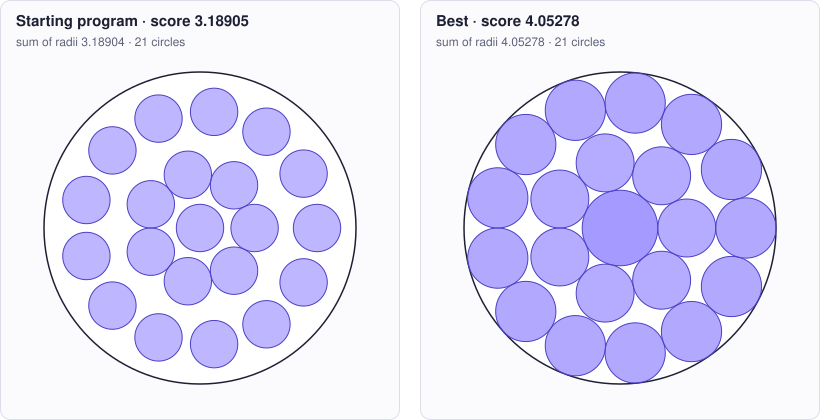

<!-- Copyright (c) 2026 by C. Klukas -->
<!-- SPDX-License-Identifier: GPL-3.0-only -->
<!-- Generated by `omega docs` from examples/circles_in_circle/ and bench/results/*.json. Do not edit by hand. -->

# circles_in_circle

Mathematical constructions · python · problem `circles_in_circle_21` · [all examples](../examples.md)

## The problem

Place 21 non-overlapping circles inside the unit circle (center (0,0), radius 1) so that the SUM OF THEIR RADII is as large as possible. run() returns construct(21): a list of 21 (x, y, r) tuples. Each circle must lie fully inside the container, sqrt(x^2 + y^2) + r <= 1, no two circles may overlap, radii must be >= 0 and all values finite (tolerance 1e-9). Only the Python standard library is available (numpy may be missing). The program may run an optimization (for example on the centers, with radii derived from them), but must finish well within the time limit (aim for at most 60 seconds of CPU time).

- **Score:** score = sum of radii (higher is better). Metrics: min_radius/max_radius; area_fraction = sum of r^2, the fraction of the container covered; seconds = CPU time of construct(21).
- **Files:** `examples/circles_in_circle/omega.toml`, the program `initial.py`, evaluator stages: main

### Why this is a hard problem

This is the same family of problems as circle packing in a square, with a round container. Eckard Specht's [Packomania](https://packomania.com/) website collects the best known packings of circles in a circle, for equal circles and for several families of unequal ones, many found by computer searches over the years. Here the circles may have different sizes and the sum of their radii counts, a variant for which the best layouts are only known from computer searches.

The starting program puts one circle in the centre and rings of 7 and 13 around it, all of the same radius (score about 3.19). A simple upper limit follows from area: the circles cover at most the container, so the sum of the squared radii is at most 1, and therefore the sum of 21 radii is at most the square root of 21, about 4.58. That limit cannot be reached, because round circles always leave gaps.

It is hard because two kinds of decisions are mixed: how many circles of which size go where (a combinatorial choice), and their exact positions (a continuous optimization with 210 pairwise no-overlap conditions and 21 wall conditions). The gaps between circles and the curved wall have awkward shapes, the best layouts are rigid with many contacts, and only the Python standard library is available, so the optimizer has to be written by hand and be fast.

Run it with:

```bash
python3 -m omega_transform run examples/circles_in_circle --minutes 15
```

## The starting program

The model may change only the code between the `OMEGA-BLOCK` markers.

```python
# Copyright (c) 2026 by C. Klukas
# SPDX-License-Identifier: MIT
"""Pack 21 non-overlapping circles inside the unit circle, maximizing the sum of radii."""
import math

# OMEGA-BLOCK-START
def construct(n=21):
    """Return a list of n circles (x, y, r) inside the unit circle (center (0,0),
    radius 1) without overlaps.

    This start places one circle at the center and two concentric rings of 7 and
    13 circles, all with the same radius: the largest one that keeps every pair
    apart and every circle inside the container.
    """
    centers = [(0.0, 0.0)]
    for count, ring in ((7, 0.35), (n - 8, 0.75)):
        centers += [(ring * math.cos(2 * math.pi * k / count),
                     ring * math.sin(2 * math.pi * k / count)) for k in range(count)]
    r = min(1.0 - math.hypot(x, y) for x, y in centers)
    for a in range(n):
        for b in range(a + 1, n):
            r = min(r, math.dist(centers[a], centers[b]) / 2)
    r *= 1 - 1e-12  # stay strictly feasible despite rounding
    return [(x, y, r) for x, y in centers]
# OMEGA-BLOCK-END


def run():
    return construct(21)
```

## Benchmark results

The best result so far comes from **gpt-oss:20b (no-think)**, run locally with Ollama on 2026-10-14: a score of **4.05278** (×1.27 the starting program's 3.18905), reached after 10.35 of 15 minutes with 8 model requests.

What the starting program produces (left) and what the best program by gpt-oss:20b (no-think) produces (right):



### How it got there

The best program's ancestry, from the starting program on. "Edit" and "rewrite" are the model's changes; a parameter sweep is the engine trying values for the constants the model exposed.

| Step | Minute | Score | Kind | Idea |
|--:|--:|--:|---|---|
| 0 | 0.0 | 3.18905 | start | initial program |
| 1 | 10.3 | 4.05278 | edit | Replace the equal‑radius construction with an analytic solution that computes distinct radii for the center, inner ring, and outer ring using sin(pi/7) and sin(pi/13), yielding a sum of radii ≈ 4.05. |

### The best program

What changed compared with the starting program:

```diff
--- initial
+++ best
@@ -8,20 +8,29 @@
     """Return a list of n circles (x, y, r) inside the unit circle (center (0,0),
     radius 1) without overlaps.
 
-    This start places one circle at the center and two concentric rings of 7 and
-    13 circles, all with the same radius: the largest one that keeps every pair
-    apart and every circle inside the container.
+    Uses analytic radii for center, inner, and outer rings based on sin(pi/7)
+    and sin(pi/13), yielding a sum of radii ≈ 4.05.
     """
+    # sin factors for the rings
+    sin_s = math.sin(math.pi/7)   # inner ring chord factor
+    sin_t = math.sin(math.pi/13)  # outer ring chord factor
+    # outer ring center radius
+    b = 1.0 / (1.0 + sin_t)
+    r_outer = 1.0 - b
+    # inner ring center radius
+    a = (2.0 * b - 1.0) / (1.0 + sin_s)
+    r_inner = a * sin_s
+    r_center = a - r_inner
+    # construct centers
     centers = [(0.0, 0.0)]
-    for count, ring in ((7, 0.35), (n - 8, 0.75)):
-        centers += [(ring * math.cos(2 * math.pi * k / count),
-                     ring * math.sin(2 * math.pi * k / count)) for k in range(count)]
-    r = min(1.0 - math.hypot(x, y) for x, y in centers)
-    for a in range(n):
-        for b in range(a + 1, n):
-            r = min(r, math.dist(centers[a], centers[b]) / 2)
-    r *= 1 - 1e-12  # stay strictly feasible despite rounding
-    return [(x, y, r) for x, y in centers]
+    for k in range(7):
+        centers.append((a * math.cos(2 * math.pi * k / 7),
+                        a * math.sin(2 * math.pi * k / 7)))
+    for k in range(13):
+        centers.append((b * math.cos(2 * math.pi * k / 13),
+                        b * math.sin(2 * math.pi * k / 13)))
+    radii = [r_center] + [r_inner] * 7 + [r_outer] * 13
+    return [(x, y, r) for (x, y), r in zip(centers, radii)]
 # OMEGA-BLOCK-END
```

### All models

One run per model and reasoning mode; the [model benchmarks](../benchmarks/circles_in_circle_21.md) page has speed, memory and progress over time.

| Model | Where | Best | Gain | Minutes to best | New bests |
|---|---|--:|--:|--:|--:|
| gpt-oss:20b (no-think) | local | 4.05278 | ×1.27 | 10.3 | 2 |
| qwen3:30b-a3b-instruct-2507-q4_K_M (no-think) | local | 4.05117 | ×1.27 | 15.2 | 8 |
| qwen3:30b-a3b-instruct-2507-q4_K_M (think) | local | 4.05042 | ×1.27 | 9.8 | 5 |
| muse-glimmer:30b (think) | local | 4.04125 | ×1.27 | 19.8 | 1 |
| gemma4:e4b-it-qat (think) | local | 4.03803 | ×1.27 | 11.6 | 5 |
| gemma4:26b-a4b-it-qat (no-think) | local | 3.9964 | ×1.25 | 10.4 | 3 |
| qwen3.8:27b-mtp-q4_K_M (no-think) | local | 3.99294 | ×1.25 | 14.7 | 2 |
| gpt-oss:20b (think) | local | 3.99 | ×1.25 | 7.6 | 1 |
| qwen3-coder:30b (no-think) | local | 3.96005 | ×1.24 | 10.3 | 3 |
| muse-glimmer:30b (no-think) | local | 3.94425 | ×1.24 | 10.2 | 3 |
| gemma4:e4b-it-qat (no-think) | local | 3.9302 | ×1.23 | 13.6 | 3 |
| gemma4:12b-it-qat (no-think) | local | 3.9302 | ×1.23 | 11.4 | 2 |
| gemma4:latest (no-think) | local | 3.90376 | ×1.22 | 14.4 | 4 |
| nemotron-3-nano:30b-a3b-mlx (no-think) | local | 3.78 | ×1.19 | 12.1 | 3 |
| gemma4:e2b (no-think) | local | 3.70711 | ×1.16 | 8.2 | 2 |
| glm-4.7-flash:latest (no-think) | local | 3.64462 | ×1.14 | 14.2 | 1 |
| ingu627/exaone4.0:32b (no-think) | local | 3.64462 | ×1.14 | 6.2 | 1 |
| gemma4:latest (think) | local | 3.57552 | ×1.12 | 11.8 | 3 |
| nemotron-3-nano:4b (no-think) | local | 3.57134 | ×1.12 | 7.9 | 1 |
| nemotron-3-nano:30b-a3b-mlx (think) | local | 3.54494 | ×1.11 | 10.6 | 2 |
| qwen3.5:27b (think) | local | 3.41478 | ×1.07 | 10.3 | 2 |
| richardyoung/frognano-4b-2609:latest (think) | local | 3.39955 | ×1.07 | 15.2 | 3 |
| qwen2.5-coder:7b (no-think) | local | 3.18905 | ×1.00 | - | 0 |
| qwen3.5:latest (no-think) | local | 3.18905 | ×1.00 | - | 0 |
| qwen3.5:27b (no-think) | local | 3.18905 | ×1.00 | - | 0 |
| qwen3.6:27b-coding-mtp-q4_K_M (no-think) | local | 3.18905 | ×1.00 | - | 0 |
| qwen3.5:latest (think) | local | 3.18905 | ×1.00 | - | 0 |
| gemma4:12b-it-qat (think) | local | | | | failed: all 2 model requests failed: gemma4:12b-it-qat: answer … |
| gemma4:e2b (think) | local | 3.18905 | ×1.00 | - | 0 |
| gemma4:26b-a4b-it-qat (think) | local | 3.18905 | ×1.00 | - | 0 |
| qwen3.8:27b-mtp-q4_K_M (think) | local | | | | failed: all 1 model requests failed: qwen3.8:27b-mtp-q4_K_M: answer … |
| qwen3.6:27b-coding-mtp-q4_K_M (think) | local | 3.18905 | ×1.00 | - | 0 |
| richardyoung/frognano-4b-2609:latest (no-think) | local | 3.18905 | ×1.00 | - | 0 |
| yandex/YandexGPT-5-Lite-8B-instruct-GGUF:latest (no-think) | local | 3.18905 | ×1.00 | - | 0 |
| MichelRosselli/apertus:8b-instruct-2509-q4_k_m (no-think) | local | 3.18905 | ×1.00 | - | 0 |
| llm-jp-4-8b-omega:q4_k_m (no-think) | local | 3.18905 | ×1.00 | - | 0 |
| devstral-small-2:24b (no-think) | local | 3.18905 | ×1.00 | - | 0 |
| frob/sarvam:30b (no-think) | local | 3.18905 | ×1.00 | - | 0 |
| glm-4.7-flash:latest (think) | local | 3.18905 | ×1.00 | - | 0 |
| frob/sarvam:30b (think) | local | 3.18905 | ×1.00 | - | 0 |
| nemotron-3.5-lightning:30b-mlx (no-think) | local | 3.18905 | ×1.00 | - | 0 |
| nemotron-3-nano:4b (think) | local | 3.18905 | ×1.00 | - | 0 |
| nemotron-3.5-lightning:30b-mlx (think) | local | | | | failed: all 4 model requests failed … |
