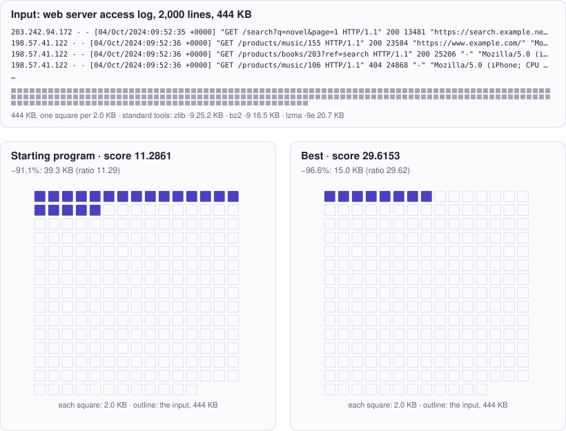

<!-- Copyright (c) 2026 by C. Klukas -->
<!-- SPDX-License-Identifier: GPL-3.0-only -->
<!-- Generated by `omega docs` from examples/compressor/ and bench/results/*.json. Do not edit by hand. -->

# compressor

Data and modelling · python · problem `log_compressor` · [all examples](../examples.md)

## The problem

Write a LOSSLESS compressor for web-server access logs. The program defines compress(data: bytes) -> bytes and decompress(blob: bytes) -> bytes. The evaluator compresses a fixed ~440 KB access log (2000 lines, Apache "combined" format): IP - - [DD/Mon/YYYY:HH:MM:SS +0000] "METHOD PATH HTTP/1.1" STATUS SIZE "REFERER" "USER-AGENT" Timestamps increase, clients come in sessions (the same IP and user agent for several consecutive lines), a few hundred IPs and about ten user agents with skewed popularity, paths like /static/..., /products/<category>/<id>, /search?q=..&page=.., /api/v1/cart/<id>. decompress(compress(d)) must equal d EXACTLY, byte for byte. This is also checked on other inputs (b"", random bytes, a repetitive string, a log made with another seed), so the code must handle ANY bytes: a field-aware format needs a safe fallback (for example a flag byte plus plain lzma) for input that does not parse or does not round-trip. Compress plus decompress of the main log must take at most 20 CPU seconds (time.process_time in the program's process). Only the Python standard library may be used (zlib, lzma, bz2, struct, re, ...; no numpy).

- **Score:** score = compression ratio = original bytes / compressed bytes of the main log (higher is better). The initial zlib level 1 reaches about 11. Reference ratios of general-purpose compressors on the same log: zlib9_ratio, bz2_ratio and lzma_ratio (strong field-aware schemes should beat all three). other_log_ratio = your ratio on the small log made with another seed (not scored). compress_cpu_s / decompress_cpu_s = CPU time on the main log.
- **Files:** `examples/compressor/omega.toml`, the program `initial.py`, evaluator stages: main

### Why this is a hard problem

Lossless compression stores data in fewer bytes so that the original can be restored exactly. Claude Shannon founded its theory at Bell Labs [in 1948](https://doi.org/10.1002/j.1538-7305.1948.tb01338.x): data can be compressed only as far as they are predictable. Practical compressors build on Jacob Ziv and Abraham Lempel ([Technion, 1977](https://doi.org/10.1109/TIT.1977.1055714)), who replaced repeated text by references to earlier occurrences, and on David Huffman's codes ([MIT, 1952](https://doi.org/10.1109/JRPROC.1952.273898)), which give frequent symbols short codes. zlib combines both.

The starting program calls zlib at its fastest level and shrinks the 440 KB log about 11 times. The general-purpose compressors at their best settings (zlib 9, bz2, lzma) are given as references. There is no fixed upper limit: the limit is how much real information the log contains, and that is unknown.

It is hard because general-purpose compressors see only bytes and repeated strings. They do not know that the timestamp grows by a few seconds per line or that the same visitor sends several requests in a row. Using such knowledge needs a model of the format: split the lines into columns, store differences instead of values, replace repeated values by short indices. Every trick must be exactly reversible, for any input and not only for well-formed logs, so the program needs a safe fallback, and a single wrong byte makes it invalid.

Run it with:

```bash
python3 -m omega_transform run examples/compressor --minutes 15
```

## The starting program

The model may change only the code between the `OMEGA-BLOCK` markers.

```python
# Copyright (c) 2026 by C. Klukas
# SPDX-License-Identifier: MIT
"""Lossless compressor for web-server access logs: maximize the compression ratio.

The evaluator calls compress() on a fixed ~300 KB access log (Apache "combined"
format) and checks that decompress() restores it exactly. It also round-trips a few
other inputs (empty, random bytes, repetitive text, a log made with another seed), so
both functions must work for ANY bytes.
"""
import zlib

# OMEGA-BLOCK-START
def compress(data: bytes) -> bytes:
    """Compress arbitrary bytes losslessly and return the compressed blob.

    decompress(compress(data)) must equal data exactly for EVERY input, including
    b"" and non-text bytes. The main input is an access log, one request per line:
      IP - - [DD/Mon/YYYY:HH:MM:SS +0000] "METHOD PATH HTTP/1.1" STATUS SIZE "REFERER" "USER-AGENT"
    Only the Python standard library may be used (zlib, lzma, bz2, struct, re, ...).
    Compress plus decompress of the main input must stay within 20 CPU seconds.

    Current method: plain zlib at level 1.
    """
    return zlib.compress(data, 1)


def decompress(blob: bytes) -> bytes:
    """Invert compress() exactly."""
    return zlib.decompress(blob)
# OMEGA-BLOCK-END


def roundtrip(data: bytes) -> tuple[bytes, bytes]:
    blob = compress(data)
    return blob, decompress(blob)
```

## Benchmark results

The best result so far comes from **gpt-oss:20b (think)**, run locally with Ollama on 2026-10-25: a score of **27.3727** (×2.43 the starting program's 11.2861), reached after 8.55 of 15 minutes with 15 model requests.

What the starting program produces (left) and what the best program by gpt-oss:20b (think) produces (right):



### How it got there

The best program's ancestry, from the starting program on. "Edit" and "rewrite" are the model's changes; a parameter sweep is the engine trying values for the constants the model exposed.

| Step | Minute | Score | Kind | Idea |
|--:|--:|--:|---|---|
| 0 | 0.0 | 11.2861 | start | initial program |
| 1 | 1.1 | 21.4903 | edit | Replace the trivial zlib level‑1 compressor with lzma in extreme mode to achieve a higher compression ratio while still handling all byte sequences. |
| 2 | 2.6 | 21.5518 | edit | Switch to raw LZMA with a filter list to eliminate container headers and improve compression ratio for the log format. |
| 3 | 8.6 | 27.3727 | edit | Replace the raw LZMA compressor with a lightweight log‑field aware format that parses the Apache log, stores each column separately (IP, request, status, size, referer, user‑agent, first timestamp, timestamp deltas), compresses each column with raw LZMA, and … |

### The best program

What changed compared with the starting program:

```diff
--- initial
+++ best
@@ -10,6 +10,24 @@
 import zlib
 
 # OMEGA-BLOCK-START
+import lzma
+import struct
+import re
+import datetime
+
+# LZMA2 preset and filter configuration for raw format
+FILTERS = [{"id": lzma.FILTER_LZMA2, "preset": 9 | lzma.PRESET_EXTREME}]
+
+# Constants for custom log format
+MAGIC = b'LOGC'          # 4‑byte magic
+NUM_COLS = 8             # number of columns
+
+# Regex to parse Apache combined log lines
+LOG_RE = re.compile(
+    r'^(?P<ip>\S+) \S+ \S+ \[(?P<ts>[^\]]+)\] "(?P<req>[^"]*)" '
+    r'(?P<status>\S+) (?P<size>\S+) "(?P<ref>[^"]*)" "(?P<ua>[^"]*)"'
+)
+
 def compress(data: bytes) -> bytes:
     """Compress arbitrary bytes losslessly and return the compressed blob.
 
@@ -19,14 +37,114 @@
     Only the Python standard library may be used (zlib, lzma, bz2, struct, re, ...).
     Compress plus decompress of the main input must stay within 20 CPU seconds.
 
-    Current method: plain zlib at level 1.
+    This implementation parses the log, stores each column separately, compresses
+    each with raw LZMA, and prefixes a small header. Non‑log data falls back to
+    raw LZMA of the whole blob.
     """
-    return zlib.compress(data, 1)
+    # Detect if input is likely a log; fall back otherwise
+    try:
+        lines = data.splitlines()
+        if not lines:
+            return lzma.compress(data, format=lzma.FORMAT_RAW, filters=FILTERS)
+        decoded = [line.decode('utf-8') for line in lines]
+    except Exception:
+        return lzma.compress(data, format=lzma.FORMAT_RAW, filters=FILTERS)
+
+    ips = []
+    requests = []
+    statuses = []
+    sizes = []
+    referers = []
+    useragents = []
+    deltas = []
+    first_ts_str = None
+
+    prev_ts = None
+    for i, line in enumerate(decoded):
+        m = LOG_RE.match(line)
+        if not m:
+            return lzma.compress(data, format=lzma.FORMAT_RAW, filters=FILTERS)
+        ips.append(m.group('ip'))
+        requests.append(m.group('req'))
+        statuses.append(m.group('status'))
+        sizes.append(m.group('size'))
+        referers.append(m.group('ref'))
+        useragents.append(m.group('ua'))
+
+        ts_str = m.group('ts')
+        if i == 0:
+            first_ts_str = ts_str
+            prev_ts = datetime.datetime.strptime(ts_str, '%d/%b/%Y:%H:%M:%S %z')
+        else:
+            curr_ts = datetime.datetime.strptime(ts_str, '%d/%b/%Y:%H:%M:%S %z')
+            deltas.append(int((curr_ts - prev_ts).total_seconds()))
+            prev_ts = curr_ts
+
+    N = len(ips)
+
+    def join_strs(lst):
+        return '\n'.join(lst).encode('utf-8')
+
+    cols = [
+        join_strs(ips),                     # 0: IPs
+        join_strs(requests),                # 1: Requests
+        join_strs(statuses),                # 2: Statuses
+        join_strs(sizes),                   # 3: Sizes
+        join_strs(referers),                # 4: Referers
+        join_strs(useragents),              # 5: User‑Agents
+        first_ts_str.encode('utf-8'),       # 6: First timestamp string
+        b''.join(struct.pack('>I', d) for d in deltas)  # 7: Timestamp deltas
+    ]
+
+    comp_cols = [lzma.compress(c, format=lzma.FORMAT_RAW, filters=FILTERS) for c in cols]
+
+    # Header: magic, flag (1 if original ended with newline), number of lines
+    flag = 1 if data.endswith(b'\n') else 0
+    header = MAGIC + bytes([flag]) + struct.pack('>I', N)
+
+    lengths = b''.join(struct.pack('>I', len(c)) for c in comp_cols)
+    body = b''.join(comp_cols)
+    return header + lengths + body
 
 
 def decompress(blob: bytes) -> bytes:
     """Invert compress() exactly."""
-    return zlib.decompress(blob)
+    # Try custom format first
+    if len(blob) >= 9 and blob[:4] == MAGIC:
+        try:
+            flag = blob[4]
+            N = struct.unpack('>I', blob[5:9])[0]
+            lengths = [struct.unpack('>I', blob[9 + i*4:13 + i*4])[0] for i in range(NUM_COLS)]
+            offset = 9 + NUM_COLS * 4
+            comp_cols = [blob[offset + sum(lengths[:i]): offset + sum(lengths[:i]) + lengths[i]] for i in range(NUM_COLS)]
+            cols = [lzma.decompress(c, format=lzma.FORMAT_RAW, filters=FILTERS) for c in comp_cols]
+
+            # Decode string columns
+            strs = [c.decode('utf-8').split('\n') for c in cols[:6]]
+            first_ts_str = cols[6].decode('utf-8')
+            deltas_bytes = cols[7]
+            deltas = [struct.unpack('>I', deltas_bytes[i*4:(i+1)*4])[0] for i in range(len(deltas_bytes) // 4)]
+
+            # Reconstruct timestamps
+            ts_list = [datetime.datetime.strptime(first_ts_str, '%d/%b/%Y:%H:%M:%S %z')]
+            for d in deltas:
+                ts_list.append(ts_list[-1] + datetime.timedelta(seconds=d))
+
+            lines = []
+            for i in range(N):
+                ts_formatted = ts_list[i].strftime('%d/%b/%Y:%H:%M:%S %z')
+                line = f'{strs[0][i]} - - [{ts_formatted}] "{strs[1][i]}" {strs[2][i]} {strs[3][i]} "{strs[4][i]}" "{strs[5][i]}"'
+                lines.append(line)
+
+            result = '\n'.join(lines).encode('utf-8')
+            if flag:
+                result += b'\n'
+            return result
+        except Exception:
+            # Fallback if anything goes wrong
+            return lzma.decompress(blob, format=lzma.FORMAT_RAW, filters=FILTERS)
+    else:
+        return lzma.decompress(blob, format=lzma.FORMAT_RAW, filters=FILTERS)
 # OMEGA-BLOCK-END
```

### All models

One run per model and reasoning mode; the [model benchmarks](../benchmarks/log_compressor.md) page has speed, memory and progress over time.

| Model | Where | Machine | Best | Gain | Minutes to best | New bests |
|---|---|---|--:|--:|--:|--:|
| gpt-oss:20b (think) | local | i7-8700K + 2x GTX 1080 Ti | 27.3727 | ×2.43 | 8.6 | 3 |
| qwen3.5:latest (no-think) | local | Apple M1 Max | 26.8544 | ×2.38 | 7.6 | 2 |
| gemma4:latest (think) | local | Apple M1 Max | 26.8544 | ×2.38 | 10.7 | 3 |
| richardyoung/frognano-4b-2609:latest (think) | local | Apple M1 Max | 26.8544 | ×2.38 | 6.2 | 3 |
| gemma4:latest (no-think) | local | i7-8700K + 2x GTX 1080 Ti | 26.8544 | ×2.38 | 3.9 | 2 |
| gemma4:12b-it-qat (no-think) | local | i7-8700K + 2x GTX 1080 Ti | 26.8544 | ×2.38 | 11.8 | 3 |
| gpt-oss:20b (no-think) | local | i7-8700K + 2x GTX 1080 Ti | 26.8544 | ×2.38 | 10.1 | 4 |
| gemma4:e4b-it-qat (think) | local | i7-8700K + 2x GTX 1080 Ti | 26.8544 | ×2.38 | 14.7 | 3 |
| muse-glimmer:30b (think) | local | Apple M1 Max | 24.9412 | ×2.21 | 18.2 | 1 |
| muse-glimmer:30b (no-think) | local | Apple M1 Max | 24.7493 | ×2.19 | 5.8 | 1 |
| gemma4:26b-a4b-it-qat (no-think) | local | Apple M1 Max | 21.7984 | ×1.93 | 8.9 | 3 |
| gpt-oss:20b (think) | local | Apple M1 Max | 21.5518 | ×1.91 | 14.5 | 5 |
| qwen3.6:27b-coding-mtp-q4_K_M (no-think) | local | Apple M1 Max | 21.5508 | ×1.91 | 11.4 | 1 |
| gpt-oss:20b (no-think) | local | Apple M1 Max | 21.5163 | ×1.91 | 13.3 | 3 |
| MichelRosselli/apertus:8b-instruct-2509-q4_k_m (no-think) | local | Apple M1 Max | 21.4903 | ×1.90 | 2.5 | 1 |
| ingu627/exaone4.0:32b (no-think) | local | Apple M1 Max | 21.4903 | ×1.90 | 6.6 | 1 |
| gemma4:26b-a4b-it-qat (no-think) | local | i7-8700K + 2x GTX 1080 Ti | 21.4892 | ×1.90 | 6.9 | 2 |
| gemma4:e4b-it-qat (no-think) | local | Apple M1 Max | 21.4570 | ×1.90 | 4.0 | 2 |
| gemma4:12b-it-qat (no-think) | local | Apple M1 Max | 21.4570 | ×1.90 | 11.3 | 3 |
| gemma4:e2b (no-think) | local | Apple M1 Max | 21.4570 | ×1.90 | 1.8 | 2 |
| gemma4:latest (no-think) | local | Apple M1 Max | 21.4570 | ×1.90 | 4.3 | 2 |
| gemma4:e4b-it-qat (think) | local | Apple M1 Max | 21.4570 | ×1.90 | 6.9 | 1 |
| gemma4:e2b (no-think) | local | i7-8700K + 2x GTX 1080 Ti | 21.4570 | ×1.90 | 1.6 | 1 |
| qwen2.5-coder:7b (no-think) | local | i7-8700K + 2x GTX 1080 Ti | 21.4570 | ×1.90 | 14.4 | 1 |
| gemma4:e2b (think) | local | i7-8700K + 2x GTX 1080 Ti | 21.4570 | ×1.90 | 11.0 | 2 |
| gemma4:latest (think) | local | i7-8700K + 2x GTX 1080 Ti | 21.4570 | ×1.90 | 11.1 | 2 |
| richardyoung/frognano-4b-2609:latest (think) | local | i7-8700K + 2x GTX 1080 Ti | 19.7019 | ×1.75 | 3.0 | 1 |
| qwen3:30b-a3b-instruct-2507-q4_K_M (no-think) | local | Apple M1 Max | 19.6626 | ×1.74 | 8.4 | 1 |
| nemotron-3-nano:4b (no-think) | local | Apple M1 Max | 19.6626 | ×1.74 | 10.3 | 2 |
| gemma4:e4b-it-qat (no-think) | local | i7-8700K + 2x GTX 1080 Ti | 19.6626 | ×1.74 | 9.2 | 3 |
| glm-4.7-flash:latest (no-think) | local | i7-8700K + 2x GTX 1080 Ti | 19.6626 | ×1.74 | 5.5 | 1 |
| qwen3:30b-a3b-instruct-2507-q4_K_M (think) | local | Apple M1 Max | 19.6617 | ×1.74 | 8.8 | 1 |
| qwen3:30b-a3b-instruct-2507-q4_K_M (no-think) | local | i7-8700K + 2x GTX 1080 Ti | 19.6617 | ×1.74 | 7.2 | 1 |
| qwen3:30b-a3b-instruct-2507-q4_K_M (think) | local | i7-8700K + 2x GTX 1080 Ti | 19.6617 | ×1.74 | 6.4 | 1 |
| qwen3.5:latest (think) | local | Apple M1 Max | 17.6320 | ×1.56 | 2.2 | 1 |
| richardyoung/frognano-4b-2609:latest (no-think) | local | Apple M1 Max | 17.6320 | ×1.56 | 14.6 | 1 |
| yandex/YandexGPT-5-Lite-8B-instruct-GGUF:latest (no-think) | local | Apple M1 Max | 17.6320 | ×1.56 | 1.2 | 1 |
| devstral-small-2:24b (no-think) | local | Apple M1 Max | 17.6320 | ×1.56 | 6.5 | 1 |
| richardyoung/frognano-4b-2609:latest (no-think) | local | i7-8700K + 2x GTX 1080 Ti | 17.6320 | ×1.56 | 6.0 | 1 |
| yandex/YandexGPT-5-Lite-8B-instruct-GGUF:latest (no-think) | local | i7-8700K + 2x GTX 1080 Ti | 17.6320 | ×1.56 | 11.7 | 1 |
| llm-jp-4-8b-omega:q4_k_m (no-think) | local | i7-8700K + 2x GTX 1080 Ti | 17.6320 | ×1.56 | 8.5 | 1 |
| qwen3.6:27b-coding-mtp-q4_K_M (no-think) | local | i7-8700K + 2x GTX 1080 Ti | 17.6320 | ×1.56 | 9.6 | 1 |
| qwen3.5:latest (think) | local | i7-8700K + 2x GTX 1080 Ti | 17.6320 | ×1.56 | 6.6 | 1 |
| qwen3-coder:30b (no-think) | local | i7-8700K + 2x GTX 1080 Ti | 17.6313 | ×1.56 | 6.8 | 1 |
| qwen3-coder:30b (no-think) | local | Apple M1 Max | 17.6292 | ×1.56 | 11.3 | 1 |
| qwen2.5-coder:7b (no-think) | local | Apple M1 Max | 11.2861 | ×1.00 | - | 0 |
| qwen3.5:27b (no-think) | local | Apple M1 Max | 11.2861 | ×1.00 | - | 0 |
| qwen3.8:27b-mtp-q4_K_M (no-think) | local | Apple M1 Max | 11.2861 | ×1.00 | - | 0 |
| gemma4:12b-it-qat (think) | local | Apple M1 Max | | | | failed: all 2 model requests failed: gemma4:12b-it-qat: answer … |
| gemma4:e2b (think) | local | Apple M1 Max | 11.2861 | ×1.00 | - | 0 |
| gemma4:26b-a4b-it-qat (think) | local | Apple M1 Max | 11.2861 | ×1.00 | - | 0 |
| qwen3.5:27b (think) | local | Apple M1 Max | 11.2861 | ×1.00 | - | 0 |
| qwen3.8:27b-mtp-q4_K_M (think) | local | Apple M1 Max | 11.2861 | ×1.00 | - | 0 |
| qwen3.6:27b-coding-mtp-q4_K_M (think) | local | Apple M1 Max | 11.2861 | ×1.00 | - | 0 |
| llm-jp-4-8b-omega:q4_k_m (no-think) | local | Apple M1 Max | 11.2861 | ×1.00 | - | 0 |
| glm-4.7-flash:latest (no-think) | local | Apple M1 Max | 11.2861 | ×1.00 | - | 0 |
| frob/sarvam:30b (no-think) | local | Apple M1 Max | 11.2861 | ×1.00 | - | 0 |
| glm-4.7-flash:latest (think) | local | Apple M1 Max | 11.2861 | ×1.00 | - | 0 |
| frob/sarvam:30b (think) | local | Apple M1 Max | 11.2861 | ×1.00 | - | 0 |
| nemotron-3-nano:30b-a3b-mlx (no-think) | local | Apple M1 Max | 11.2861 | ×1.00 | - | 0 |
| nemotron-3.5-lightning:30b-mlx (no-think) | local | Apple M1 Max | 11.2861 | ×1.00 | - | 0 |
| nemotron-3-nano:4b (think) | local | Apple M1 Max | 11.2861 | ×1.00 | - | 0 |
| nemotron-3-nano:30b-a3b-mlx (think) | local | Apple M1 Max | 11.2861 | ×1.00 | - | 0 |
| nemotron-3.5-lightning:30b-mlx (think) | local | Apple M1 Max | | | | failed: all 5 model requests failed … |
| nemotron-3-nano:4b (no-think) | local | i7-8700K + 2x GTX 1080 Ti | 11.2861 | ×1.00 | - | 0 |
| MichelRosselli/apertus:8b-instruct-2509-q4_k_m (no-think) | local | i7-8700K + 2x GTX 1080 Ti | 11.2861 | ×1.00 | - | 0 |
| Bored/GigaChat3.1-10B-A1.8B-q4_K_M:latest (no-think) | local | i7-8700K + 2x GTX 1080 Ti | 11.2861 | ×1.00 | - | 0 |
| qwen3.5:latest (no-think) | local | i7-8700K + 2x GTX 1080 Ti | 11.2861 | ×1.00 | - | 0 |
| qwen3.8:27b-mtp-q4_K_M (no-think) | local | i7-8700K + 2x GTX 1080 Ti | 11.2861 | ×1.00 | - | 0 |
| frob/sarvam:30b (no-think) | local | i7-8700K + 2x GTX 1080 Ti | 11.2861 | ×1.00 | - | 0 |
| nemotron-3-nano:4b (think) | local | i7-8700K + 2x GTX 1080 Ti | 11.2861 | ×1.00 | - | 0 |
| gemma4:12b-it-qat (think) | local | i7-8700K + 2x GTX 1080 Ti | 11.2861 | ×1.00 | - | 0 |
| gemma4:26b-a4b-it-qat (think) | local | i7-8700K + 2x GTX 1080 Ti | | | | failed: all 2 model requests failed: gemma4:26b-a4b-it-qat: answer … |
| qwen3.8:27b-mtp-q4_K_M (think) | local | i7-8700K + 2x GTX 1080 Ti | | | | failed: all 1 model requests failed: qwen3.8:27b-mtp-q4_K_M: answer … |
| qwen3.6:27b-coding-mtp-q4_K_M (think) | local | i7-8700K + 2x GTX 1080 Ti | 11.2861 | ×1.00 | - | 0 |
| glm-4.7-flash:latest (think) | local | i7-8700K + 2x GTX 1080 Ti | 11.2861 | ×1.00 | - | 0 |
| frob/sarvam:30b (think) | local | i7-8700K + 2x GTX 1080 Ti | | | | failed: all 4 model requests failed: frob/sarvam:30b: answer … |
| underdog-saluki-27b:iq2-mix (no-think) | local | Apple M1 Max | | | | failed: all 3 model requests failed: underdog-saluki-27b:iq2-mix … |
| underdog-saluki-27b:iq2-mix (think) | local | Apple M1 Max | | | | failed: all 1 model requests failed: underdog-saluki-27b:iq2-mix … |
