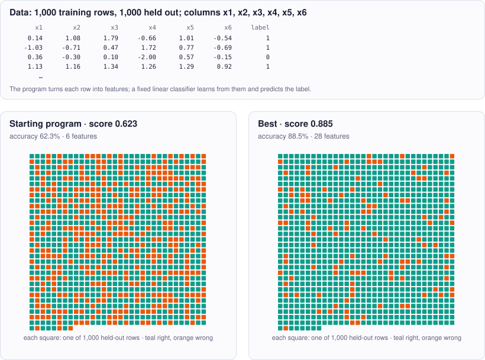

<!-- Copyright (c) 2026 by C. Klukas -->
<!-- SPDX-License-Identifier: GPL-3.0-only -->
<!-- Generated by `omega docs` from examples/feature_engineering/ and bench/results/*.json. Do not edit by hand. -->

# feature_engineering

Data and modelling · python · problem `feature_engineering` · [all examples](../examples.md)

## The problem

Design features for a FIXED linear classifier. The program defines features(row) -> list of floats. row is [x1, x2, x3, x4, x5, x6]: x1, x2, x6 are standard-normal-like, x3 is positive and right-skewed (lognormal-like), x4 and x5 are uniform in [-2, 2]. The binary label is a hidden NONLINEAR function of some of the inputs plus noise; not every input matters. The evaluator computes the features of 2000 fixed rows and trains its own model, which cannot be changed: features standardized with the training mean and standard deviation, a bias added, then a ridge-regularized least-squares classifier (targets -1/+1) fitted on the first 1000 rows; the prediction is the sign of the weighted sum. Score = accuracy on the other 1000 rows. Rules: 1 to 30 features, the same number for every row, all finite (guard logs, divisions and powers); computing all features takes at most 5 CPU seconds. Only the Python standard library (no numpy).

- **Score:** score = test accuracy of the fixed classifier on 1000 held-out rows (0..1, higher is better). The raw inputs reach about 0.62; the classes are balanced (majority_baseline about 0.51) and the label noise limits the best possible accuracy to roughly 0.97. Metrics: train_accuracy (a large gap to test means overfitting), num_features, feature_cpu_s. The feedback lists the largest standardized weights (f0 = first feature); features with near-zero weight carry no usable signal for the linear model.
- **Files:** `examples/feature_engineering/omega.toml`, the program `initial.py`, evaluator stages: main

### Why this is a hard problem

A linear classifier separates two classes with a straight line (in more dimensions, a flat plane) through the data. In their 1969 book [Perceptrons](https://doi.org/10.7551/mitpress/11301.001.0001), Marvin Minsky and Seymour Papert (MIT) showed that such a model cannot learn even a rule as simple as "exactly one of two inputs is positive" (XOR). The classical remedy is feature engineering: compute new inputs such as products, squares, logarithms or thresholds, in which the hidden rule becomes a straight line. Choosing them was much of the craft of applied machine learning before deep networks learned features themselves.

Here the classifier is fixed (ridge regression, the regularized least squares of Arthur Hoerl and Robert Kennard, [1970](https://doi.org/10.1080/00401706.1970.10488634)) and only the features can change. The starting program passes the six raw inputs and reaches about 62 % accuracy, against 51 % for always guessing the more common class. Noise in the labels limits the best possible accuracy to about 97 %.

It is hard because the rule is hidden and the only feedback is the accuracy. Not every input matters, and the right transformations must be guessed: is the boundary a circle, a quadrant, a step? Adding many speculative features does not help: with 1000 training rows, each useless feature lets the model fit noise, so the training accuracy rises while the test accuracy falls.

Run it with:

```bash
python3 -m omega_transform run examples/feature_engineering --minutes 15
```

## The starting program

The model may change only the code between the `OMEGA-BLOCK` markers.

```python
# Copyright (c) 2026 by C. Klukas
# SPDX-License-Identifier: MIT
"""Feature engineering for a fixed linear classifier: maximize held-out accuracy.

The evaluator maps every row of a fixed binary-classification dataset (6 raw numeric
inputs) through features(row), trains its own fixed linear classifier on 1000 rows,
and scores the accuracy on 1000 held-out rows. Only the features can be changed.
"""
import math

# OMEGA-BLOCK-START
def features(row):
    """Return the feature vector (a list of at most 30 finite floats) for one row.

    row: list of 6 floats [x1, x2, x3, x4, x5, x6]. Roughly: x1, x2, x6 are
    standard-normal-like, x3 is positive and right-skewed (lognormal-like), x4 and x5
    lie in [-2, 2]. The label is a hidden NONLINEAR function of the inputs plus noise.
    Every row must give the same number of features. The classifier is linear in the
    features (they are standardized and a bias is added), so nonlinear structure only
    helps if a feature expresses it. Only the Python standard library may be used.

    Current method: the raw inputs.
    """
    return list(row)
# OMEGA-BLOCK-END
```

## Benchmark results

The best result so far comes from **gpt-oss:20b (think)**, run locally with Ollama on 2026-10-16: a score of **0.94** (×1.51 the starting program's 0.623), reached after 11.81 of 15 minutes with 16 model requests.

What the starting program produces (left) and what the best program by gpt-oss:20b (think) produces (right):



### How it got there

The best program's ancestry, from the starting program on. "Edit" and "rewrite" are the model's changes; a parameter sweep is the engine trying values for the constants the model exposed.

| Step | Minute | Score | Kind | Idea |
|--:|--:|--:|---|---|
| 0 | 0.0 | 0.623 | start | initial program |
| 1 | 2.5 | 0.833 | edit | Add nonlinear transformations and indicator features (products, log, radius, quadrant sign, and thresholds) to capture hidden interactions and step-like behaviors, increasing the linear separability of the underlying rule. |
| 2 | 3.8 | 0.827 | edit | Add a radius threshold indicator, the x4*x5 interaction, and squares of x1 and x2 to capture higher‑order nonlinearities that may help separate the hidden rule. |
| 3 | 3.8 | 0.864 | parameter sweep | tuned THRESH_RADIUS=3 on top of: Add a radius threshold indicator, the x4*x5 interaction, and squares of x1 and x2 to capture higher‑order nonlinearities that may help separate the hidden rule. |
| 4 | 11.8 | 0.94 | edit | Add sign(x1*x2), x6>0 indicator, cross terms x4*x6 and x5*x6, and sqrt(radius) to give the linear model more expressive power for interactions involving the normal‑like features. |

### The best program

What changed compared with the starting program:

```diff
--- initial
+++ best
@@ -9,17 +9,43 @@
 import math
 
 # OMEGA-BLOCK-START
+THRESH_X3 = 1.0
+THRESH_RADIUS = 3.0
+
 def features(row):
     """Return the feature vector (a list of at most 30 finite floats) for one row.
 
-    row: list of 6 floats [x1, x2, x3, x4, x5, x6]. Roughly: x1, x2, x6 are
-    standard-normal-like, x3 is positive and right-skewed (lognormal-like), x4 and x5
-    lie in [-2, 2]. The label is a hidden NONLINEAR function of the inputs plus noise.
-    Every row must give the same number of features. The classifier is linear in the
-    features (they are standardized and a bias is added), so nonlinear structure only
-    helps if a feature expresses it. Only the Python standard library may be used.
-
-    Current method: the raw inputs.
+    row: list of 6 floats [x1, x2, x3, x4, x5, x6].
+    Includes raw inputs, interactions, log, radius, quadrant, thresholds,
+    and higher‑order terms to improve linear separability.
     """
-    return list(row)
+    x1, x2, x3, x4, x5, x6 = row
+    features = [
+        x1,
+        x2,
+        x3,
+        x4,
+        x5,
+        x6,
+        x1 * x2,
+        x1 * x3,
+        x2 * x3,
+        math.log(x3),
+        x4 * x4 + x5 * x5,
+        x4 * x5,
+        (1 if x4 >= 0 else -1) * (1 if x5 >= 0 else -1),
+        abs(x4) - abs(x5),
+        1.0 if x3 > THRESH_X3 else 0.0,
+        1.0 if x4 > 0 else 0.0,
+        1.0 if x5 > 0 else 0.0,
+        1.0 if (x4 * x4 + x5 * x5) > THRESH_RADIUS else 0.0,
+        x1 * x1,
+        x2 * x2,
+        1.0 if x1 * x2 > 0 else -1.0,
+        1.0 if x6 > 0 else 0.0,
+        x4 * x6,
+        x5 * x6,
+        math.sqrt(x4 * x4 + x5 * x5),
+    ]
+    return features
 # OMEGA-BLOCK-END
```

### All models

One run per model and reasoning mode; the [model benchmarks](../benchmarks/feature_engineering.md) page has speed, memory and progress over time.

| Model | Where | Machine | Best | Gain | Minutes to best | New bests |
|---|---|---|--:|--:|--:|--:|
| gpt-oss:20b (think) | local | Apple M1 Max | 0.94 | ×1.51 | 11.8 | 3 |
| qwen3.6:27b-coding-mtp-q4_K_M (no-think) | local | i7-8700K + 2x GTX 1080 Ti | 0.934 | ×1.50 | 8.9 | 3 |
| gemma4:26b-a4b-it-qat (no-think) | local | i7-8700K + 2x GTX 1080 Ti | 0.932 | ×1.50 | 14.4 | 4 |
| qwen3.8:27b-mtp-q4_K_M (think) | local | Apple M1 Max | 0.931 | ×1.49 | 22.6 | 3 |
| nemotron-3-nano:30b-a3b-mlx (think) | local | Apple M1 Max | 0.93 | ×1.49 | 10.4 | 3 |
| gpt-oss:20b (think) | local | i7-8700K + 2x GTX 1080 Ti | 0.93 | ×1.49 | 1.8 | 1 |
| muse-glimmer:30b (think) | local | Apple M1 Max | 0.926 | ×1.49 | 20.6 | 2 |
| qwen3.5:latest (think) | local | i7-8700K + 2x GTX 1080 Ti | 0.922 | ×1.48 | 15.8 | 6 |
| gemma4:e4b-it-qat (no-think) | local | Apple M1 Max | 0.891 | ×1.43 | 12.4 | 10 |
| gemma4:latest (no-think) | local | Apple M1 Max | 0.889 | ×1.43 | 12.1 | 11 |
| qwen3.6:27b-coding-mtp-q4_K_M (think) | local | i7-8700K + 2x GTX 1080 Ti | 0.886 | ×1.42 | 15.1 | 1 |
| qwen3-coder:30b (no-think) | local | Apple M1 Max | 0.88 | ×1.41 | 7.6 | 4 |
| richardyoung/frognano-4b-2609:latest (think) | local | Apple M1 Max | 0.877 | ×1.41 | 6.2 | 3 |
| glm-4.7-flash:latest (think) | local | Apple M1 Max | 0.873 | ×1.40 | 24.8 | 2 |
| nemotron-3.5-lightning:30b-mlx (think) | local | Apple M1 Max | 0.873 | ×1.40 | 9.8 | 2 |
| qwen3.8:27b-mtp-q4_K_M (no-think) | local | i7-8700K + 2x GTX 1080 Ti | 0.872 | ×1.40 | 7.2 | 2 |
| nemotron-3-nano:4b (no-think) | local | Apple M1 Max | 0.87 | ×1.40 | 8.8 | 3 |
| gemma4:e4b-it-qat (think) | local | i7-8700K + 2x GTX 1080 Ti | 0.867 | ×1.39 | 10.0 | 3 |
| gemma4:26b-a4b-it-qat (no-think) | local | Apple M1 Max | 0.859 | ×1.38 | 8.9 | 4 |
| qwen3.6:27b-coding-mtp-q4_K_M (no-think) | local | Apple M1 Max | 0.859 | ×1.38 | 5.5 | 1 |
| gpt-oss:20b (no-think) | local | Apple M1 Max | 0.858 | ×1.38 | 8.1 | 4 |
| gemma4:latest (no-think) | local | i7-8700K + 2x GTX 1080 Ti | 0.838 | ×1.35 | 13.3 | 8 |
| qwen3:30b-a3b-instruct-2507-q4_K_M (no-think) | local | i7-8700K + 2x GTX 1080 Ti | 0.838 | ×1.35 | 15.7 | 5 |
| qwen2.5-coder:7b (no-think) | local | Apple M1 Max | 0.837 | ×1.34 | 14.6 | 4 |
| glm-4.7-flash:latest (no-think) | local | Apple M1 Max | 0.836 | ×1.34 | 1.9 | 2 |
| devstral-small-2:24b (no-think) | local | Apple M1 Max | 0.835 | ×1.34 | 13.7 | 2 |
| gpt-oss:20b (no-think) | local | i7-8700K + 2x GTX 1080 Ti | 0.834 | ×1.34 | 15.9 | 5 |
| qwen3-coder:30b (no-think) | local | i7-8700K + 2x GTX 1080 Ti | 0.834 | ×1.34 | 3.9 | 2 |
| richardyoung/frognano-4b-2609:latest (no-think) | local | i7-8700K + 2x GTX 1080 Ti | 0.828 | ×1.33 | 14.9 | 4 |
| gemma4:e2b (no-think) | local | i7-8700K + 2x GTX 1080 Ti | 0.827 | ×1.33 | 8.8 | 9 |
| qwen3.5:latest (think) | local | Apple M1 Max | 0.825 | ×1.32 | 9.7 | 3 |
| qwen2.5-coder:7b (no-think) | local | i7-8700K + 2x GTX 1080 Ti | 0.825 | ×1.32 | 12.1 | 8 |
| frob/sarvam:30b (no-think) | local | Apple M1 Max | 0.824 | ×1.32 | 2.9 | 1 |
| qwen3.5:latest (no-think) | local | Apple M1 Max | 0.82 | ×1.32 | 9.0 | 4 |
| gemma4:12b-it-qat (no-think) | local | i7-8700K + 2x GTX 1080 Ti | 0.82 | ×1.32 | 3.2 | 4 |
| qwen3.5:latest (no-think) | local | i7-8700K + 2x GTX 1080 Ti | 0.814 | ×1.31 | 8.5 | 4 |
| gemma4:12b-it-qat (no-think) | local | Apple M1 Max | 0.813 | ×1.30 | 13.3 | 2 |
| ingu627/exaone4.0:32b (no-think) | local | Apple M1 Max | 0.813 | ×1.30 | 6.2 | 3 |
| nemotron-3.5-lightning:30b-mlx (no-think) | local | Apple M1 Max | 0.813 | ×1.30 | 15.7 | 2 |
| yandex/YandexGPT-5-Lite-8B-instruct-GGUF:latest (no-think) | local | Apple M1 Max | 0.812 | ×1.30 | 1.2 | 2 |
| muse-glimmer:30b (no-think) | local | Apple M1 Max | 0.809 | ×1.30 | 8.3 | 2 |
| qwen3:30b-a3b-instruct-2507-q4_K_M (no-think) | local | Apple M1 Max | 0.805 | ×1.29 | 15.0 | 6 |
| underdog-saluki-27b:iq2-mix (no-think) | local | i7-8700K + 2x GTX 1080 Ti | 0.802 | ×1.29 | 15.8 | 4 |
| richardyoung/frognano-4b-2609:latest (think) | local | i7-8700K + 2x GTX 1080 Ti | 0.801 | ×1.29 | 3.2 | 2 |
| richardyoung/frognano-4b-2609:latest (no-think) | local | Apple M1 Max | 0.8 | ×1.28 | 0.4 | 1 |
| gemma4:latest (think) | local | i7-8700K + 2x GTX 1080 Ti | 0.8 | ×1.28 | 15.4 | 5 |
| gemma4:12b-it-qat (think) | local | i7-8700K + 2x GTX 1080 Ti | 0.8 | ×1.28 | 20.8 | 2 |
| gemma4:12b-it-qat (think) | local | Apple M1 Max | 0.799 | ×1.28 | 18.3 | 3 |
| gemma4:e4b-it-qat (think) | local | Apple M1 Max | 0.793 | ×1.27 | 7.0 | 6 |
| gemma4:26b-a4b-it-qat (think) | local | Apple M1 Max | 0.793 | ×1.27 | 17.3 | 2 |
| gemma4:26b-a4b-it-qat (think) | local | i7-8700K + 2x GTX 1080 Ti | 0.791 | ×1.27 | 14.4 | 2 |
| llm-jp-4-8b-omega:q4_k_m (no-think) | local | Apple M1 Max | 0.784 | ×1.26 | 12.8 | 4 |
| gemma4:e2b (no-think) | local | Apple M1 Max | 0.774 | ×1.24 | 14.2 | 8 |
| glm-4.7-flash:latest (think) | local | i7-8700K + 2x GTX 1080 Ti | 0.774 | ×1.24 | 4.9 | 2 |
| qwen3.8:27b-mtp-q4_K_M (no-think) | local | Apple M1 Max | 0.765 | ×1.23 | 13.7 | 3 |
| qwen3:30b-a3b-instruct-2507-q4_K_M (think) | local | Apple M1 Max | 0.764 | ×1.23 | 10.5 | 2 |
| gemma4:e4b-it-qat (no-think) | local | i7-8700K + 2x GTX 1080 Ti | 0.764 | ×1.23 | 11.5 | 12 |
| qwen3.8:27b-mtp-q4_K_M (think) | local | i7-8700K + 2x GTX 1080 Ti | 0.762 | ×1.22 | 16.3 | 2 |
| gemma4:latest (think) | local | Apple M1 Max | 0.761 | ×1.22 | 10.4 | 4 |
| yandex/YandexGPT-5-Lite-8B-instruct-GGUF:latest (no-think) | local | i7-8700K + 2x GTX 1080 Ti | 0.761 | ×1.22 | 10.3 | 7 |
| glm-4.7-flash:latest (no-think) | local | i7-8700K + 2x GTX 1080 Ti | 0.761 | ×1.22 | 14.7 | 4 |
| qwen3.6:27b-coding-mtp-q4_K_M (think) | local | Apple M1 Max | 0.76 | ×1.22 | 13.4 | 2 |
| nemotron-3-nano:4b (no-think) | local | i7-8700K + 2x GTX 1080 Ti | 0.76 | ×1.22 | 7.9 | 4 |
| qwen3.5:27b (think) | local | Apple M1 Max | 0.756 | ×1.21 | 17.5 | 3 |
| qwen3:30b-a3b-instruct-2507-q4_K_M (think) | local | i7-8700K + 2x GTX 1080 Ti | 0.744 | ×1.19 | 1.5 | 1 |
| Bored/GigaChat3.1-10B-A1.8B-q4_K_M:latest (no-think) | local | i7-8700K + 2x GTX 1080 Ti | 0.741 | ×1.19 | 6.0 | 3 |
| MichelRosselli/apertus:8b-instruct-2509-q4_k_m (no-think) | local | Apple M1 Max | 0.738 | ×1.18 | 15.1 | 3 |
| nemotron-3-nano:4b (think) | local | i7-8700K + 2x GTX 1080 Ti | 0.738 | ×1.18 | 15.3 | 5 |
| gemma4:e2b (think) | local | i7-8700K + 2x GTX 1080 Ti | 0.738 | ×1.18 | 15.2 | 4 |
| MichelRosselli/apertus:8b-instruct-2509-q4_k_m (no-think) | local | i7-8700K + 2x GTX 1080 Ti | 0.736 | ×1.18 | 7.5 | 2 |
| llm-jp-4-8b-omega:q4_k_m (no-think) | local | i7-8700K + 2x GTX 1080 Ti | 0.736 | ×1.18 | 12.7 | 2 |
| qwen3.5:27b (no-think) | local | Apple M1 Max | 0.732 | ×1.17 | 15.2 | 4 |
| gemma4:e2b (think) | local | Apple M1 Max | 0.732 | ×1.17 | 1.2 | 2 |
| nemotron-3-nano:4b (think) | local | Apple M1 Max | 0.73 | ×1.17 | 13.0 | 4 |
| nemotron-3-nano:30b-a3b-mlx (no-think) | local | Apple M1 Max | 0.72 | ×1.16 | 15.1 | 4 |
| frob/sarvam:30b (think) | local | Apple M1 Max | 0.706 | ×1.13 | 12.5 | 1 |
| frob/sarvam:30b (no-think) | local | i7-8700K + 2x GTX 1080 Ti | 0.678 | ×1.09 | 17.0 | 1 |
| frob/sarvam:30b (think) | local | i7-8700K + 2x GTX 1080 Ti | | | | failed: all 4 model requests failed: frob/sarvam:30b: answer … |
| underdog-saluki-27b:iq2-mix (think) | local | Apple M1 Max | | | | failed: all 1 model requests failed: underdog-saluki-27b:iq2-mix … |
