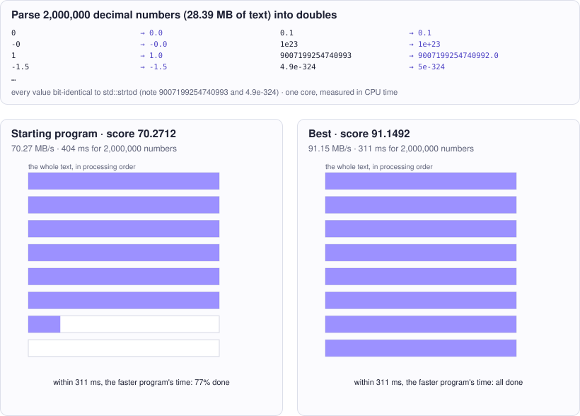

<!-- Copyright (c) 2026 by C. Klukas -->
<!-- SPDX-License-Identifier: GPL-3.0-only -->
<!-- Generated by `omega docs` from examples/float_parse_cpp/ and bench/results/*.json. Do not edit by hand. -->

# float_parse_cpp

Performance (C++) · cpp · problem `float_parse_single_thread` · [all examples](../examples.md)

## The problem

Make the C++ function parse_doubles(buf, len, out), which parses a text of decimal numbers into doubles and returns how many it found, use as little CPU time as possible on ONE core of this machine (Apple Silicon, ARM NEON available via <arm_neon.h>). The time is measured with the process CPU clock, so extra threads do not help: their CPU time adds up. Input: buf[0..len) holds numbers, each followed by exactly one '\n'; buf[len] is '\0'. A number is: an optional '-', one or more digits, optionally '.' and one or more digits, optionally 'e' or 'E' with an optional '+' or '-' and one or more digits. There are no spaces, no leading '+', no inf/nan/hex. Mantissas may have more than 19 significant digits and leading zeros; values range from subnormals (about 5e-324) to near 1.8e308. out has room for exactly the number of numbers in the text. Correctness is EXACT: every value must be bit-identical to what std::strtod returns (the correctly rounded double, round-half-to-even), including -0.0, subnormals and long mantissas exactly halfway between two doubles. Approximate results such as mantissa * pow(10, exp) are wrong for many inputs and make the program invalid. The benchmark text has 2'000'000 numbers (about 28 MB) in mixed formats: integers, fixed decimals, prices, %.17g and %.15g output, scientific notation like 1.5e-7 or -4.10331589e+168, and some long mantissas.

- **Score:** score = MB of text parsed per CPU-second on the 2'000'000-number text (best of 7 runs). ns_per_number is the same time per number. Correctness is checked first on texts of 0, 1, 7, 30, 1001 and 20011 numbers (the hard cases come first in every text), and on every benchmark run; one value that is not bit-identical to std::strtod, a wrong count, or a write past the end of out makes the program invalid.
- **Files:** `examples/float_parse_cpp/omega.toml`, the program `parse.cpp`, evaluator stages: check, bench; new bests are re-measured

### Why this is a hard problem

Converting text such as "0.1" into a binary floating-point number looks trivial but is a well-known hard corner of computing: most decimal fractions have no exact binary form, and the result must be exactly the nearest representable double. William Clinger ([1990](https://doi.org/10.1145/93542.93557)) and David Gay (Bell Labs, [1990](https://ampl.com/_archive/first-website/REFS/rounding.pdf)) published the first correct and efficient methods; Gay's code became the strtod of many C libraries. Around 2020 Daniel Lemire (TÉLUQ, Université du Québec), building on an idea of Michael Eisel, published a [much faster method](https://doi.org/10.1002/spe.2984) (the Eisel-Lemire algorithm of the fast_float library).

The starting program calls the C library's std::strtod for every number: always correct, about 316 MB per second. The limit is the speed of one core reading the text once; fast parsers spend only a few nanoseconds per number.

It is hard because correctness is exact, bit for bit. A number can lie extremely close to the midpoint between two doubles, and deciding which way to round may need all of its digits, sometimes hundreds. Quick formulas such as "mantissa times a power of ten" are right for most inputs and wrong for some, and the tests put such cases first. A fast parser therefore needs a provably correct fast path, a fallback for the rare hard cases, and careful low-level work on every byte.

Run it with:

```bash
python3 -m omega_transform run examples/float_parse_cpp --minutes 15
```

## The starting program

The model may change only the code between the `OMEGA-BLOCK` markers.

```cpp
// Copyright (c) 2026 by C. Klukas
// SPDX-License-Identifier: MIT
// Single-threaded parsing of newline-separated decimal numbers into doubles,
// scored by CPU time rather than wall-clock time, so the score stays comparable
// while other programs run on the machine.
//
// This file is compiled on its own and linked with harness.cpp, which generates
// a text of numbers in mixed formats, times parse_doubles with the process CPU
// clock and checks every value bit for bit against std::strtod. Extra threads do
// not help: their CPU time adds up. Only the OMEGA-BLOCK region evolves; it may
// define only parse_doubles as a global symbol (helpers must be static or in an
// anonymous namespace).
#include <algorithm>
#include <cmath>
#include <cstdint>
#include <cstdio>
#include <cstdlib>
#include <cstring>
#include <ctime>
#include <string>
#include <vector>
#if defined(__ARM_NEON)
#include <arm_neon.h>
#endif

// OMEGA-BLOCK-START
// Parses the numbers in buf[0..len) into out[0..) and returns how many there are.
// Every number is followed by exactly one '\n'; buf[len] is '\0'. Grammar of a
// number: optional '-', one or more digits, optionally '.' and one or more digits,
// optionally 'e' or 'E', an optional '+' or '-', and one or more digits. No
// spaces, no '+' sign on the mantissa, no inf/nan/hex. Every value must be
// bit-identical to std::strtod (correctly rounded, round-half-to-even).
extern "C" size_t parse_doubles(const char* buf, size_t len, double* out) {
    const char* p = buf;
    const char* end = buf + len;
    size_t count = 0;
    while (p < end) {
        char* next;
        out[count++] = std::strtod(p, &next);
        p = next;
        while (p < end && *p == '\n') ++p;
    }
    return count;
}
// OMEGA-BLOCK-END
```

## Benchmark results

The best result so far comes from **hf.co/Colby/apertus-v1.5-8b-text-Q4_K_M-GGUF:Q4_K_M (no-think)**, run locally with Ollama on 2026-11-12: a score of **82.4858** (×1.00 the starting program's 82.4858), reached after no improvement with 16 model requests.

What the starting program produces; no model improved on it:



No model improved on the starting program.

### All models

One run per model and reasoning mode; the [model benchmarks](../benchmarks/float_parse_single_thread.md) page has speed, memory and progress over time.

| Model | Where | Best | Gain | Minutes to best | New bests |
|---|---|--:|--:|--:|--:|
| hf.co/Colby/apertus-v1.5-8b-text-Q4_K_M-GGUF:Q4_K_M (no-think) | local | 82.4858 | ×1.00 | - | 0 |
| hf.co/mmnga-o/Qwen3-Swallow-30B-A3B-RL-v0.2-gguf:Q4_K_M (no-think) | local | 82.2411 | ×1.03 | 30.8 | 1 |
| hf.co/llm-jp/llm-jp-4.1-32b-a3b-thinking-gguf:Q4_K_M (no-think) | local | 80.2061 | ×1.00 | - | 0 |
| hf.co/mmnga-o/Qwen3-Swallow-30B-A3B-RL-v0.2-gguf:Q4_K_M (think) | local | 80.0436 | ×1.00 | - | 0 |
| nvidia/nemotron-3-ultra-550b-a55b:free (no-think) | cloud | 77.5919 | ×1.44 | 4.8 | 3 |
| qwen3-coder:30b (no-think) | local | 76.3399 | ×1.12 | 50.0 | 5 |
| gpt-oss:20b (no-think) | local | 75.2210 | ×1.23 | 12.0 | 1 |
| gemma4:latest (think) | local | 73.6088 | ×1.00 | - | 0 |
| hf.co/LiquidAI/LFM3-1.7B-GGUF:Q4_K_M (think) | local | 73.0324 | ×1.00 | - | 0 |
| gemma4:e4b-it-qat (think) | local | 72.8022 | ×1.00 | - | 0 |
| frob/sarvam:30b (think) | local | 72.7228 | ×1.00 | - | 0 |
| dots-studio/dots-3-note-preview:free (no-think) | cloud | 71.5623 | ×1.27 | 16.4 | 7 |
| gemma4:26b-a4b-it-qat (think) | local | 70.6776 | ×1.00 | - | 0 |
| qwen3.6:27b-coding-mtp-q4_K_M (think) | local | 70.2712 | ×1.00 | - | 0 |
| gpt-oss:20b (think) | local | 70.0098 | ×1.01 | 15.6 | 1 |
| qwen3.6:27b-coding-mtp-q4_K_M (no-think) | local | 69.7649 | ×1.24 | 39.3 | 1 |
| gemma4:12b-it-qat (think) | local | 68.9567 | ×1.00 | - | 0 |
| richardyoung/frognano-4b-2609:latest (think) | local | 68.6061 | ×1.00 | - | 0 |
| qwen3:30b-a3b-instruct-2507-q4_K_M (think) | local | 68.4966 | ×1.00 | - | 0 |
| hf.co/LiquidAI/LFM3-1.7B-GGUF:Q4_K_M (no-think) | local | | | | failed: all 16 model requests failed … |
| glm-4.7-flash:latest (think) | local | 66.8787 | ×1.00 | - | 0 |
| nvidia/nemotron-3-nano-omni-30b-a3b-reasoning:free (think) | cloud | | | | failed: all 6 model requests failed … |
| recursive/flint-v1.0:free (think) | cloud | 66.7858 | ×1.35 | 18.3 | 2 |
| llm-jp-4-8b-omega:q4_k_m (no-think) | local | 66.4300 | ×1.00 | - | 0 |
| frob/sarvam:30b (no-think) | local | 66.0620 | ×1.00 | - | 0 |
| gemma4:e4b-it-qat (no-think) | local | 65.7656 | ×1.00 | - | 0 |
| nemotron-3-nano:4b (think) | local | 65.7118 | ×1.00 | - | 0 |
| cohere/north-mini-code:free (think) | cloud | | | | failed: all 6 model requests failed: cohere/north-mini-code:free … |
| qwen3.5:latest (think) | local | 65.5734 | ×1.00 | - | 0 |
| underdog-saluki-27b:iq2-mix (think) | local | 65.5567 | ×1.00 | - | 0 |
| richardyoung/frognano-4b-2609:latest (no-think) | local | 65.2254 | ×1.00 | - | 0 |
| qwen3.5:latest (no-think) | local | 64.9445 | ×1.00 | - | 0 |
| gemma4:e2b (think) | local | 64.9351 | ×1.00 | - | 0 |
| nvidia/nemotron-3-ultra-550b-a55b:free (think) | cloud | | | | failed: all 6 model requests failed … |
| nvidia/nemotron-3.5-super-vl:free (think) | cloud | | | | failed: all 5 model requests failed … |
| dots-studio/dots-3-note-preview:free (think) | cloud | | | | failed: all 6 model requests failed … |
| nvidia/nemotron-3.5-lightning:free (think) | cloud | | | | failed: all 6 model requests failed … |
| xingchen-agi/xing4.0-29b-a4b:free (think) | cloud | | | | failed: all 16 model requests failed … |
| gemma4:e2b (no-think) | local | 62.2964 | ×1.00 | - | 0 |
| glm-4.7-flash:latest (no-think) | local | 62.0608 | ×1.00 | - | 0 |
| nemotron-3-nano:4b (no-think) | local | 60.7376 | ×1.00 | - | 0 |
| qwen2.5-coder:7b (no-think) | local | 60.5379 | ×1.00 | 11.8 | 1 |
| MichelRosselli/apertus:8b-instruct-2509-q4_k_m (no-think) | local | 59.8966 | ×1.02 | 3.8 | 1 |
| gemma4:12b-it-qat (no-think) | local | 59.8440 | ×1.00 | - | 0 |
| qwen3:30b-a3b-instruct-2507-q4_K_M (no-think) | local | 58.9552 | ×1.00 | - | 0 |
| yandex/YandexGPT-5-Lite-8B-instruct-GGUF:latest (no-think) | local | 58.4558 | ×1.00 | - | 0 |
| gemma4:26b-a4b-it-qat (no-think) | local | 56.7909 | ×1.03 | 10.6 | 1 |
| cohere/north-mini-code:free (no-think) | cloud | 56.1693 | ×1.07 | 5.8 | 1 |
| nvidia/nemotron-3.5-super-vl:free (no-think) | cloud | 55.7267 | ×1.02 | 8.4 | 1 |
| gemma4:latest (no-think) | local | 55.7216 | ×1.00 | - | 0 |
| xingchen-agi/xing4.0-29b-a4b:free (no-think) | cloud | 55.1384 | ×1.00 | - | 0 |
| nvidia/nemotron-3.5-lightning:free (no-think) | cloud | 53.8589 | ×1.00 | - | 0 |
| nvidia/nemotron-3-nano-omni-30b-a3b-reasoning:free (no-think) | cloud | 51.9664 | ×1.00 | - | 0 |
| underdog-saluki-27b:iq2-mix (no-think) | local | 50.0479 | ×1.00 | - | 0 |
