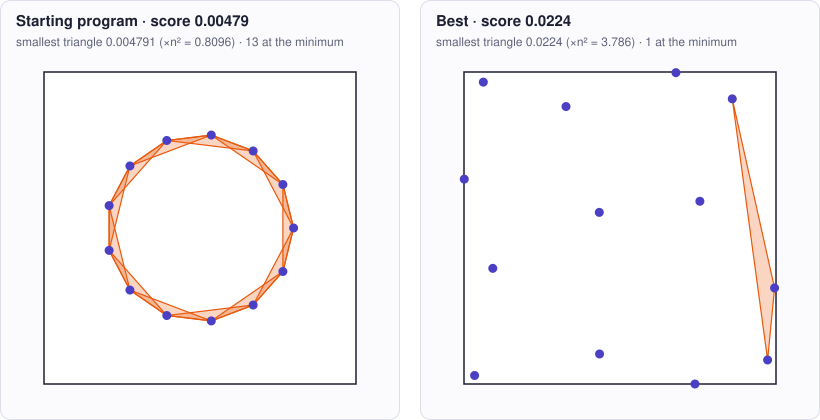

<!-- Copyright (c) 2026 by C. Klukas -->
<!-- SPDX-License-Identifier: GPL-3.0-only -->
<!-- Generated by `omega docs` from examples/heilbronn/ and bench/results/*.json. Do not edit by hand. -->

# heilbronn

Mathematical constructions · python · problem `heilbronn_13` · [all examples](../examples.md)

## The problem

Heilbronn triangle problem: place 13 points in the closed unit square [0,1]x[0,1] so that the SMALLEST AREA among all 286 triangles formed by 3 of the points is as large as possible. run() returns construct(13): a list of 13 (x, y) tuples. Every point must be finite and inside the square (tolerance 1e-12). Only the Python standard library is available (numpy may be missing). The program may run an optimization, but must finish well within the time limit (aim for at most 60 seconds of CPU time).

- **Score:** score = min_area, the smallest triangle area (higher is better). Metrics: normalized_min_area_n2 = min_area * 13^2; near_min_triangles = how many triangles are within a relative 1e-6 of the minimum (good configurations balance many of them); min_point_distance = closest pair of points; bounding_box_area = area of the box spanned by the points; seconds = CPU time of construct(13). The feedback names the smallest triangle and the next smallest areas.
- **Files:** `examples/heilbronn/omega.toml`, the program `initial.py`, evaluator stages: main

### Why this is a hard problem

In the late 1940s the number theorist Hans Heilbronn asked how to place n points in a square so that the smallest triangle formed by any three of them is as large as possible; Klaus Roth [first published it in 1951](https://doi.org/10.1112/jlms/s1-26.3.198). Heilbronn conjectured that this smallest area shrinks like 1/n² as n grows; in 1982 János Komlós, János Pintz and Endre Szemerédi [disproved this](https://doi.org/10.1112/jlms/s2-25.1.13). Optimal layouts are proven only for a few small n; for 13 points the best known layouts come from computer searches.

The starting program puts the 13 points on a regular polygon around the centre. No three points are on a line, but three neighbours form a thin triangle, and the corners of the square stay unused (smallest area about 0.0048).

It is hard because 13 points form 286 triangles and only the smallest one counts. Moving one point changes 66 triangles at once, enlarging some and shrinking others. Good layouts balance many triangles at nearly the same smallest area, and there are many locally optimal layouts that small moves cannot leave.

Run it with:

```bash
python3 -m omega_transform run examples/heilbronn --minutes 15
```

## The starting program

The model may change only the code between the `OMEGA-BLOCK` markers.

```python
# Copyright (c) 2026 by C. Klukas
# SPDX-License-Identifier: MIT
"""Heilbronn triangle problem: place 13 points in the unit square so that the
smallest triangle formed by any 3 of them has the largest possible area."""
import math

# OMEGA-BLOCK-START
def construct(n=13):
    """Return a list of n points (x, y) inside the closed unit square [0,1]^2.

    The score is the smallest area among all triangles with corners at three of
    the points, so no three points may be (nearly) collinear. This start puts
    the points on a regular polygon on a small circle around the center, which
    avoids collinear triples but wastes most of the square.
    """
    radius = 0.3
    return [(0.5 + radius * math.cos(2 * math.pi * k / n),
             0.5 + radius * math.sin(2 * math.pi * k / n)) for k in range(n)]
# OMEGA-BLOCK-END


def run():
    return construct(13)
```

## Benchmark results

The best result so far comes from **nvidia/nemotron-3-ultra-550b-a55b:free (think)**, run through OpenRouter on 2026-11-01: a score of **0.0224** (×4.68 the starting program's 0.00479), reached after 38.54 of 60 minutes with 35 model requests.

What the starting program produces (left) and what the best program by nvidia/nemotron-3-ultra-550b-a55b:free (think) produces (right):



### How it got there

The best program's ancestry, from the starting program on. "Edit" and "rewrite" are the model's changes; a parameter sweep is the engine trying values for the constants the model exposed.

| Step | Minute | Score | Kind | Idea |
|--:|--:|--:|---|---|
| 0 | 0.0 | 0.00479 | start | initial program |
| 1 | 2.2 | 0.00627 | edit | Replace the circle-based construction with a symmetric boundary-interior layout and add simulated annealing optimization to maximize the minimum triangle area. |
| 2 | 38.5 | 0.01294 | rewrite | Replace simulated annealing with Differential Evolution (population-based evolutionary optimization) using a soft-min objective with annealed sharpness, multiple restarts, and a final greedy polish on the worst triangles; this explores the search space more … |
| 3 | 38.5 | 0.0224 | parameter sweep | tuned POP_SIZE=12, MAX_GENERATIONS=800, DE_F=0.6, BETA_END=5000 on top of: Replace simulated annealing with Differential Evolution (population-based evolutionary optimization) using a soft-min objective with annealed sharpness, multiple restarts, and a final … |

### The best program

What changed compared with the starting program:

```diff
--- initial
+++ best
@@ -5,17 +5,238 @@
 import math
 
 # OMEGA-BLOCK-START
+import random
+
+# Differential Evolution parameters
+POP_SIZE = 12
+MAX_GENERATIONS = 800
+DE_F = 0.6          # mutation scale factor
+DE_CR = 0.85        # crossover probability
+NUM_RESTARTS = 6
+
+# Soft-min annealing schedule
+BETA_START = 20.0
+BETA_END = 5000
+
+# Polish phase
+POLISH_ITERATIONS = 800
+POLISH_STEP = 0.015
+
+# Triangle cache (indices of all 286 triangles for n=13)
+TRIANGLES_13 = [(i, j, k) for i in range(13) for j in range(i+1, 13) for k in range(j+1, 13)]
+
+def triangle_area(p1, p2, p3):
+    """Return the absolute area of triangle formed by three points."""
+    return abs((p1[0]*(p2[1]-p3[1]) + p2[0]*(p3[1]-p1[1]) + p3[0]*(p1[1]-p2[1])) * 0.5)
+
+def all_areas(points):
+    """Return list of all triangle areas for given points."""
+    return [triangle_area(points[i], points[j], points[k]) for i, j, k in TRIANGLES_13]
+
+def softmin_objective(points, beta):
+    """Smooth approximation of min area: -1/beta * log(sum(exp(-beta * area)))."""
+    areas = all_areas(points)
+    # Log-sum-exp trick for numerical stability
+    max_val = max(-beta * a for a in areas)
+    s = sum(math.exp(-beta * a - max_val) for a in areas)
+    return -(math.log(s) + max_val) / beta
+
+def min_area(points):
+    """Return the true minimum triangle area."""
+    return min(all_areas(points))
+
+def clamp_point(p):
+    """Clamp point coordinates to [0, 1]."""
+    return (max(0.0, min(1.0, p[0])), max(0.0, min(1.0, p[1])))
+
+def clamp_points(pts):
+    return [clamp_point(p) for p in pts]
+
+def initial_layout_13():
+    """Symmetric boundary-interior layout for 13 points (point-symmetric about center)."""
+    pts = []
+    # 4 corners
+    pts += [(0.0, 0.0), (1.0, 0.0), (1.0, 1.0), (0.0, 1.0)]
+    # 4 edge midpoints
+    pts += [(0.5, 0.0), (1.0, 0.5), (0.5, 1.0), (0.0, 0.5)]
+    # 4 symmetric interior points (45-degree axes)
+    r = 0.22
+    for k in range(4):
+        angle = math.pi/4 + k * math.pi/2
+        pts.append((0.5 + r*math.cos(angle), 0.5 + r*math.sin(angle)))
+    # 1 center point
+    pts.append((0.5, 0.5))
+    return pts
+
+def random_symmetric_config(seed):
+    """Generate a random point-symmetric configuration (pairs + center)."""
+    random.seed(seed)
+    pts = [(0.5, 0.5)]  # center fixed
+    # 6 symmetric pairs
+    for _ in range(6):
+        x = random.random()
+        y = random.random()
+        pts.append((x, y))
+        pts.append((1.0-x, 1.0-y))
+    return pts
+
+def mutate_individual(target, a, b, c, f):
+    """DE/rand/1 mutation: a + F*(b - c)."""
+    mutated = []
+    for d in range(26):  # 13 points * 2 coordinates
+        mutated.append(a[d] + f * (b[d] - c[d]))
+    return mutated
+
+def crossover(target, mutant, cr):
+    """Binomial crossover."""
+    trial = []
+    for d in range(26):
+        if random.random() < cr or d == random.randrange(26):
+            trial.append(mutant[d])
+        else:
+            trial.append(target[d])
+    return trial
+
+def vector_to_points(vec):
+    """Flattened 26-vector -> list of 13 (x,y) tuples, clamped."""
+    pts = []
+    for i in range(13):
+        x = max(0.0, min(1.0, vec[2*i]))
+        y = max(0.0, min(1.0, vec[2*i+1]))
+        pts.append((x, y))
+    return pts
+
+def points_to_vector(pts):
+    """List of 13 (x,y) tuples -> flattened 26-vector."""
+    vec = []
+    for x, y in pts:
+        vec.append(x)
+        vec.append(y)
+    return vec
+
+def differential_evolution_restart(seed):
+    """Run one DE restart, return best points and its soft-min score at final beta."""
+    random.seed(seed)
+    
+    # Initialize population
+    pop = []
+    # 1: symmetric boundary-interior layout + noise
+    base = initial_layout_13()
+    for _ in range(POP_SIZE // 3):
+        noisy = [(x + random.uniform(-0.05, 0.05), y + random.uniform(-0.05, 0.05)) for x, y in base]
+        pop.append(points_to_vector(clamp_points(noisy)))
+    # 2: random symmetric configs
+    for i in range(POP_SIZE // 3):
+        pop.append(points_to_vector(random_symmetric_config(seed*100 + i)))
+    # 3: fully random
+    for _ in range(POP_SIZE - 2*(POP_SIZE//3)):
+        pop.append(points_to_vector([(random.random(), random.random()) for _ in range(13)]))
+    
+    # Evaluate initial population at starting beta
+    beta = BETA_START
+    fitness = [softmin_objective(vector_to_points(ind), beta) for ind in pop]
+    
+    best_idx = max(range(POP_SIZE), key=lambda i: fitness[i])
+    best_ind = pop[best_idx][:]
+    best_fit = fitness[best_idx]
+    
+    for gen in range(MAX_GENERATIONS):
+        # Anneal beta
+        t = gen / MAX_GENERATIONS
+        beta = BETA_START * (BETA_END / BETA_START) ** t
+        
+        for i in range(POP_SIZE):
+            # Select 3 distinct individuals != i
+            idxs = list(range(POP_SIZE))
+            idxs.remove(i)
+            a_idx, b_idx, c_idx = random.sample(idxs, 3)
+            
+            # Mutation
+            mutant = mutate_individual(pop[i], pop[a_idx], pop[b_idx], pop[c_idx], DE_F)
+            
+            # Crossover
+            trial = crossover(pop[i], mutant, DE_CR)
+            
+            # Selection
+            trial_pts = vector_to_points(trial)
+            trial_fit = softmin_objective(trial_pts, beta)
+            
+            if trial_fit > fitness[i]:
+                pop[i] = trial
+                fitness[i] = trial_fit
+                if trial_fit > best_fit:
+                    best_fit = trial_fit
+                    best_ind = trial[:]
+    
+    best_pts = vector_to_points(best_ind)
+    return best_pts, best_fit
+
+def greedy_polish(points):
+    """Local improvement: repeatedly move vertices of worst triangles to increase min area."""
+    pts = [list(p) for p in points]
+    n = 13
+    
+    for _ in range(POLISH_ITERATIONS):
+        areas = all_areas(pts)
+        min_a = min(areas)
+        # Collect triangles within 2% of minimum
+        threshold = min_a * 1.02
+        worst = []
+        for idx, (i, j, k) in enumerate(TRIANGLES_13):
+            if areas[idx] <= threshold:
+                worst.append((i, j, k))
+        if not worst:
+            break
+        
+        # Pick a random worst triangle and a random vertex from it
+        i, j, k = random.choice(worst)
+        idx = random.choice([i, j, k])
+        
+        old_x, old_y = pts[idx]
+        best_local_min = min_a
+        best_move = (old_x, old_y)
+        
+        # Try several random moves, keep the best
+        for _ in range(12):
+            nx = max(0.0, min(1.0, old_x + random.uniform(-POLISH_STEP, POLISH_STEP)))
+            ny = max(0.0, min(1.0, old_y + random.uniform(-POLISH_STEP, POLISH_STEP)))
+            pts[idx] = [nx, ny]
+            new_min = min(all_areas(pts))
+            if new_min > best_local_min:
+                best_local_min = new_min
+                best_move = (nx, ny)
+            pts[idx] = [old_x, old_y]
+        
+        if best_move != (old_x, old_y):
+            pts[idx] = list(best_move)
+        else:
+            # No improvement found, try a tiny random nudge anyway (escape plateaus)
+            nx = max(0.0, min(1.0, old_x + random.uniform(-POLISH_STEP*0.3, POLISH_STEP*0.3)))
+            ny = max(0.0, min(1.0, old_y + random.uniform(-POLISH_STEP*0.3, POLISH_STEP*0.3)))
+            pts[idx] = [nx, ny]
+    
+    return [(p[0], p[1]) for p in pts]
+
 def construct(n=13):
-    """Return a list of n points (x, y) inside the closed unit square [0,1]^2.
-
-    The score is the smallest area among all triangles with corners at three of
-    the points, so no three points may be (nearly) collinear. This start puts
-    the points on a regular polygon on a small circle around the center, which
-    avoids collinear triples but wastes most of the square.
-    """
-    radius = 0.3
-    return [(0.5 + radius * math.cos(2 * math.pi * k / n),
-             0.5 + radius * math.sin(2 * math.pi * k / n)) for k in range(n)]
+    """Return optimized 13-point configuration for Heilbronn problem."""
+    if n != 13:
+        radius = 0.3
+        return [(0.5 + radius * math.cos(2 * math.pi * k / n),
+                 0.5 + radius * math.sin(2 * math.pi * k / n)) for k in range(n)]
+    
+    best_overall = None
+    best_score = -1.0
+    
+    for restart in range(NUM_RESTARTS):
+        points, score = differential_evolution_restart(restart * 1000 + 42)
+        # Polish the DE result
+        points = greedy_polish(points)
+        final_score = min_area(points)  # true min area for final ranking
+        if final_score > best_score:
+            best_score = final_score
+            best_overall = points
+    
+    return best_overall
 # OMEGA-BLOCK-END
```

### All models

One run per model and reasoning mode; the [model benchmarks](../benchmarks/heilbronn_13.md) page has speed, memory and progress over time.

| Model | Where | Best | Gain | Minutes to best | New bests |
|---|---|--:|--:|--:|--:|
| nvidia/nemotron-3-ultra-550b-a55b:free (think) | cloud | 0.0224 | ×4.68 | 38.5 | 6 |
| nvidia/nemotron-3-ultra-550b-a55b:free (no-think) | cloud | 0.02194 | ×4.58 | 2.8 | 1 |
| dots-studio/dots-3-note-preview:free (think) | cloud | 0.02114 | ×4.41 | 23.1 | 2 |
| gemma4:26b-a4b-it-qat (think) | local | 0.02092 | ×4.37 | 14.2 | 1 |
| gemma4:12b-it-qat (think) | local | 0.02055 | ×4.29 | 49.5 | 4 |
| qwen3:30b-a3b-instruct-2507-q4_K_M (no-think) | local | 0.01957 | ×4.09 | 18.7 | 6 |
| nvidia/nemotron-3.5-super-vl:free (think) | cloud | 0.01909 | ×3.99 | 37.8 | 4 |
| nvidia/nemotron-3.5-super-vl:free (no-think) | cloud | 0.0186 | ×3.88 | 6.5 | 4 |
| gemma4:12b-it-qat (no-think) | local | 0.01815 | ×3.79 | 14.8 | 6 |
| gemma4:26b-a4b-it-qat (no-think) | local | 0.01517 | ×3.17 | 15.0 | 6 |
| cohere/north-mini-code:free (think) | cloud | 0.0137 | ×2.86 | 20.9 | 2 |
| qwen3.6:27b-coding-mtp-q4_K_M (think) | local | 0.01345 | ×2.81 | 27.9 | 1 |
| yandex/YandexGPT-5-Lite-8B-instruct-GGUF:latest (no-think) | local | 0.01331 | ×2.78 | 13.8 | 6 |
| gpt-oss:20b (no-think) | local | 0.01331 | ×2.78 | 16.6 | 2 |
| glm-4.7-flash:latest (no-think) | local | 0.01331 | ×2.78 | 2.0 | 3 |
| cohere/north-mini-code:free (no-think) | cloud | 0.01331 | ×2.78 | 3.0 | 3 |
| richardyoung/frognano-4b-2609:latest (no-think) | local | 0.01331 | ×2.78 | 3.5 | 1 |
| gemma4:e2b (no-think) | local | 0.01331 | ×2.78 | 0.8 | 2 |
| qwen2.5-coder:7b (no-think) | local | 0.01331 | ×2.78 | 3.9 | 2 |
| MichelRosselli/apertus:8b-instruct-2509-q4_k_m (no-think) | local | 0.01331 | ×2.78 | 7.9 | 3 |
| gemma4:latest (no-think) | local | 0.01331 | ×2.78 | 3.6 | 3 |
| underdog-saluki-27b:iq2-mix (no-think) | local | 0.01331 | ×2.78 | 10.9 | 1 |
| frob/sarvam:30b (no-think) | local | 0.01331 | ×2.78 | 13.8 | 1 |
| nvidia/nemotron-3.5-lightning:free (think) | cloud | 0.01331 | ×2.78 | 18.8 | 1 |
| nvidia/nemotron-3-nano-omni-30b-a3b-reasoning:free (think) | cloud | 0.01331 | ×2.78 | 1.6 | 1 |
| recursive/flint-v1.0:free (think) | cloud | 0.01331 | ×2.78 | 3.3 | 2 |
| hf.co/LiquidAI/LFM3-1.7B-GGUF:Q4_K_M (think) | local | 0.01331 | ×2.78 | 6.9 | 2 |
| nemotron-3-nano:4b (think) | local | 0.01331 | ×2.78 | 2.4 | 1 |
| gemma4:e2b (think) | local | 0.01331 | ×2.78 | 2.6 | 3 |
| gemma4:e4b-it-qat (think) | local | 0.01331 | ×2.78 | 2.1 | 1 |
| gemma4:latest (think) | local | 0.01331 | ×2.78 | 1.4 | 1 |
| gpt-oss:20b (think) | local | 0.01331 | ×2.78 | 2.4 | 1 |
| hf.co/mmnga-o/Qwen3-Swallow-30B-A3B-RL-v0.2-gguf:Q4_K_M (no-think) | local | 0.01331 | ×2.78 | 2.8 | 1 |
| hf.co/llm-jp/llm-jp-4.1-32b-a3b-thinking-gguf:Q4_K_M (no-think) | local | 0.01331 | ×2.78 | 3.6 | 2 |
| hf.co/mmnga-o/Qwen3-Swallow-30B-A3B-RL-v0.2-gguf:Q4_K_M (think) | local | 0.01331 | ×2.78 | 6.3 | 1 |
| qwen3-coder:30b (no-think) | local | 0.00852 | ×1.78 | 5.9 | 1 |
| dots-studio/dots-3-note-preview:free (no-think) | cloud | 0.00595 | ×1.24 | 1.6 | 1 |
| nvidia/nemotron-3.5-lightning:free (no-think) | cloud | 0.00479 | ×1.00 | - | 0 |
| nvidia/nemotron-3-nano-omni-30b-a3b-reasoning:free (no-think) | cloud | 0.00479 | ×1.00 | - | 0 |
| hf.co/LiquidAI/LFM3-1.7B-GGUF:Q4_K_M (no-think) | local | 0.00479 | ×1.00 | - | 0 |
| nemotron-3-nano:4b (no-think) | local | 0.00479 | ×1.00 | - | 0 |
| llm-jp-4-8b-omega:q4_k_m (no-think) | local | 0.00479 | ×1.00 | - | 0 |
| gemma4:e4b-it-qat (no-think) | local | 0.00479 | ×1.00 | - | 0 |
| qwen3.5:latest (no-think) | local | 0.00479 | ×1.00 | - | 0 |
| qwen3.6:27b-coding-mtp-q4_K_M (no-think) | local | 0.00479 | ×1.00 | - | 0 |
| xingchen-agi/xing4.0-29b-a4b:free (think) | cloud | 0.00479 | ×1.00 | - | 0 |
| xingchen-agi/xing4.0-29b-a4b:free (no-think) | cloud | 0.00479 | ×1.00 | - | 0 |
| richardyoung/frognano-4b-2609:latest (think) | local | 0.00479 | ×1.00 | - | 0 |
| qwen3.5:latest (think) | local | 0.00479 | ×1.00 | - | 0 |
| underdog-saluki-27b:iq2-mix (think) | local | 0.00479 | ×1.00 | - | 0 |
| qwen3:30b-a3b-instruct-2507-q4_K_M (think) | local | 0.00479 | ×1.00 | - | 0 |
| glm-4.7-flash:latest (think) | local | 0.00479 | ×1.00 | - | 0 |
| frob/sarvam:30b (think) | local | 0.00479 | ×1.00 | - | 0 |
| hf.co/Colby/apertus-v1.5-8b-text-Q4_K_M-GGUF:Q4_K_M (no-think) | local | 0.00479 | ×1.00 | - | 0 |
