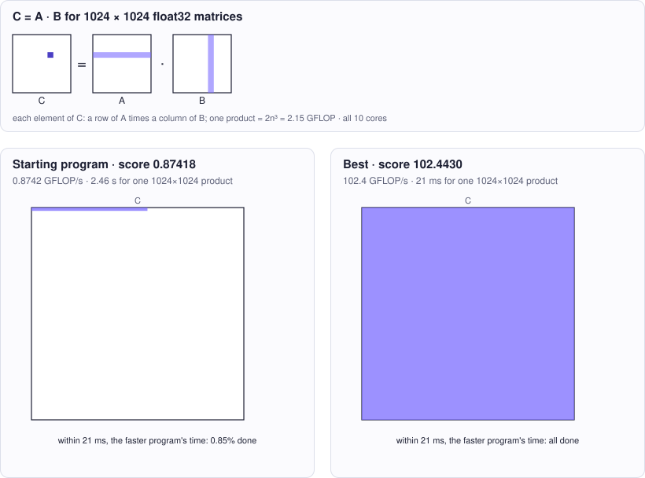

<!-- Copyright (c) 2026 by C. Klukas -->
<!-- SPDX-License-Identifier: GPL-3.0-only -->
<!-- Generated by `omega docs` from examples/matmul_cpp/ and bench/results/*.json. Do not edit by hand. -->

# matmul_cpp

Performance (C++) · cpp · problem `matmul_f32` · [all examples](../examples.md)

## The problem

Make the C++ function matmul(n, A, B, C) (single precision, row-major, C = A*B) as FAST as possible on this machine (Apple Silicon, 10 cores, ARM NEON available via <arm_neon.h>). It must stay correct for every n from 1 to 2048, including sizes that are not multiples of any block size, and must write every element of C.

- **Score:** score = GFLOPS at n = 1024 (best of 3 runs). Correctness is checked first on n = 1, 7, 64, 131, 257; any wrong result makes the program invalid.
- **Files:** `examples/matmul_cpp/omega.toml`, the program `matmul.cpp`, evaluator stages: check, bench (timed alone); new bests are re-measured

### Why this is a hard problem

Matrix multiplication is the core of scientific computing, graphics and neural networks. The textbook method needs n³ multiply-adds, about two billion operations for n = 1024. Volker Strassen [showed in 1969](https://doi.org/10.1007/BF02165411) that fewer are possible in principle, but in practice speed is a question of memory: fast libraries ([BLAS](https://doi.org/10.1145/355841.355847) since 1979, and Kazushige Goto's GotoBLAS, described with Robert van de Geijn at UT Austin [in 2008](https://doi.org/10.1145/1356052.1356053)) do the same arithmetic in an order that reuses data from the caches and registers.

The starting program is the textbook triple loop, about 1.6 GFLOPS. Its inner loop walks down a column of B, jumping 4 KB in memory per step, so nearly every access misses the cache and the processor mostly waits. The limit is the hardware: every core can do several 4-wide vector multiply-adds per cycle, and the machine has 10 cores, a peak of several hundred GFLOPS.

It is hard because reaching that peak needs several layers of restructuring at once: blocks that fit the caches, a small tile of C kept in registers, vector instructions, copying panels of A and B into contiguous buffers, and splitting the work over the cores without them competing for memory bandwidth. All of it must stay exactly right for every size from 1 to 2048, including sizes that do not divide into blocks.

Run it with:

```bash
python3 -m omega_transform run examples/matmul_cpp --minutes 15
```

## The starting program

The model may change only the code between the `OMEGA-BLOCK` markers.

```cpp
// Copyright (c) 2026 by C. Klukas
// SPDX-License-Identifier: MIT
// Single-precision square matrix multiply C = A * B (row-major, n x n).
//
// This file is compiled on its own and linked with harness.cpp, which times
// matmul (wall-clock) and checks the result against a double-precision
// reference. Only the OMEGA-BLOCK region evolves; it may define only matmul as
// a global symbol (helpers must be static or in an anonymous namespace).
#include <algorithm>
#include <chrono>
#include <cmath>
#include <cstdio>
#include <cstdlib>
#include <cstring>
#include <thread>
#include <vector>
#if defined(__ARM_NEON)
#include <arm_neon.h>
#endif

// OMEGA-BLOCK-START
// Computes C = A * B. C is NOT zeroed by the caller. Any number of threads may be
// used (std::thread is available); n is any size from 1 to 2048.
extern "C" void matmul(int n, const float* A, const float* B, float* C) {
    for (int i = 0; i < n; ++i)
        for (int j = 0; j < n; ++j) {
            float s = 0.0f;
            for (int k = 0; k < n; ++k) s += A[i * n + k] * B[k * n + j];
            C[i * n + j] = s;
        }
}
// OMEGA-BLOCK-END
```

## Benchmark results

The best result so far comes from **nvidia/nemotron-3.5-super-vl:free (think)**, run through OpenRouter on 2026-11-03: a score of **102.4430** (×117.19 the starting program's 0.87418), reached after 63.48 of 60 minutes with 31 model requests.

What the starting program produces (left) and what the best program by nvidia/nemotron-3.5-super-vl:free (think) produces (right):



### How it got there

The best program's ancestry, from the starting program on. "Edit" and "rewrite" are the model's changes; a parameter sweep is the engine trying values for the constants the model exposed.

| Step | Minute | Score | Kind | Idea |
|--:|--:|--:|---|---|
| 0 | 0.0 | 0.87418 | start | initial program |
| 1 | 32.3 | 48.5997 | rewrite | Replace the naive i-j-k triple loop with a parallel i-k-j implementation: zero C once, split row blocks across std::thread workers, stream rows of B and C, and vectorize the inner j-loop with NEON FMA (vld1q/vfmaq/vst1q) with a scalar tail for … |
| 2 | 63.5 | 89.4677 | edit | Add k-cache blocking (BK=64) to the parallel i-k-j matmul by reordering loops to k-block → i → k → j, so B rows in a k-block are reused across all i rows in a thread's row range instead of being reloaded for every i. This matches the best-known approach … |
| 3 | 63.5 | 102.4430 | parameter sweep | tuned BK=16 on top of: Add k-cache blocking (BK=64) to the parallel i-k-j matmul by reordering loops to k-block → i → k → j, so B rows in a k-block are reused across all i rows in a thread's row range instead of being reloaded for every i. This matches the … |

### The best program

What changed compared with the starting program:

```diff
--- initial
+++ best
@@ -19,14 +19,63 @@
 #endif
 
 // OMEGA-BLOCK-START
-// Computes C = A * B. C is NOT zeroed by the caller. Any number of threads may be
-// used (std::thread is available); n is any size from 1 to 2048.
+#if defined(__ARM_NEON)
+#include <arm_neon.h>
+#endif
+
+namespace {
+
+constexpr int BK = 16;  // k-cache block size; swept for best L2 reuse
+
+void matmul_rows(int n, int i0, int i1, const float* A, const float* B, float* C) {
+    for (int k0 = 0; k0 < n; k0 += BK) {
+        int k1 = k0 + BK;
+        if (k1 > n) k1 = n;
+        for (int i = i0; i < i1; ++i) {
+            float* Ci = C + static_cast<size_t>(i) * n;
+            const float* Ai = A + static_cast<size_t>(i) * n;
+            for (int k = k0; k < k1; ++k) {
+                float a = Ai[k];
+                const float* Bk = B + static_cast<size_t>(k) * n;
+                int j = 0;
+#if defined(__ARM_NEON)
+                for (; j + 3 < n; j += 4) {
+                    float32x4_t va = vdupq_n_f32(a);
+                    float32x4_t vb = vld1q_f32(Bk + j);
+                    float32x4_t vc = vld1q_f32(Ci + j);
+                    vc = vfmaq_f32(vc, va, vb);
+                    vst1q_f32(Ci + j, vc);
+                }
+#endif
+                for (; j < n; ++j) {
+                    Ci[j] += a * Bk[j];
+                }
+            }
+        }
+    }
+}
+
+}  // namespace
+
 extern "C" void matmul(int n, const float* A, const float* B, float* C) {
-    for (int i = 0; i < n; ++i)
-        for (int j = 0; j < n; ++j) {
-            float s = 0.0f;
-            for (int k = 0; k < n; ++k) s += A[i * n + k] * B[k * n + j];
-            C[i * n + j] = s;
-        }
+    if (n <= 0) return;
+    std::fill(C, C + static_cast<size_t>(n) * n, 0.0f);
+    int threads = static_cast<int>(std::thread::hardware_concurrency());
+    if (threads < 1 || threads > 16) threads = 8;
+    if (threads > n) threads = n;
+    if (threads <= 1) {
+        matmul_rows(n, 0, n, A, B, C);
+        return;
+    }
+    std::vector<std::thread> ts;
+    ts.reserve(static_cast<size_t>(threads));
+    int rows_per = n / threads;
+    int start = 0;
+    for (int t = 0; t < threads; ++t) {
+        int end = (t == threads - 1) ? n : start + rows_per;
+        ts.emplace_back(matmul_rows, n, start, end, A, B, C);
+        start = end;
+    }
+    for (auto& t : ts) t.join();
 }
 // OMEGA-BLOCK-END
```

### All models

One run per model and reasoning mode; the [model benchmarks](../benchmarks/matmul_f32.md) page has speed, memory and progress over time.

| Model | Where | Best | Gain | Minutes to best | New bests |
|---|---|--:|--:|--:|--:|
| nvidia/nemotron-3.5-super-vl:free (think) | cloud | 102.4430 | ×117.19 | 63.5 | 4 |
| gemma4:26b-a4b-it-qat (no-think) | local | 66.5591 | ×66.87 | 25.5 | 5 |
| qwen3.6:27b-coding-mtp-q4_K_M (no-think) | local | 60.6579 | ×60.13 | 63.3 | 2 |
| gpt-oss:20b (no-think) | local | 36.8454 | ×42.50 | 66.5 | 3 |
| gemma4:12b-it-qat (no-think) | local | 10.4955 | ×10.51 | 20.8 | 4 |
| qwen3:30b-a3b-instruct-2507-q4_K_M (no-think) | local | 9.08103 | ×9.10 | 7.3 | 1 |
| cohere/north-mini-code:free (think) | cloud | 4.56267 | ×6.64 | 52.2 | 1 |
| gemma4:latest (no-think) | local | 3.99021 | ×4.00 | 4.1 | 1 |
| qwen3-coder:30b (no-think) | local | 3.55835 | ×3.98 | 13.3 | 1 |
| gemma4:e4b-it-qat (no-think) | local | 3.3632 | ×3.78 | 14.4 | 4 |
| qwen2.5-coder:7b (no-think) | local | 2.65919 | ×3.01 | 6.8 | 2 |
| yandex/YandexGPT-5-Lite-8B-instruct-GGUF:latest (no-think) | local | 1.17805 | ×1.48 | 28.5 | 7 |
| glm-4.7-flash:latest (no-think) | local | 1.03308 | ×1.02 | 8.5 | 1 |
| frob/sarvam:30b (no-think) | local | 1.00103 | ×1.00 | - | 0 |
| llm-jp-4-8b-omega:q4_k_m (no-think) | local | 0.96008 | ×1.00 | - | 0 |
| nemotron-3-nano:4b (no-think) | local | 0.94288 | ×1.00 | - | 0 |
| google/gemma-4-26b-a4b-it:free (no-think) | cloud | | | | failed: all 6 model requests failed … |
| underdog-saluki-27b:iq2-mix (no-think) | local | 0.90643 | ×1.00 | - | 0 |
| richardyoung/frognano-4b-2609:latest (no-think) | local | 0.89914 | ×1.00 | - | 0 |
| MichelRosselli/apertus:8b-instruct-2509-q4_k_m (no-think) | local | 0.89458 | ×1.08 | 6.3 | 2 |
| google/gemma-4-31b-it:free (no-think) | cloud | | | | failed: all 6 model requests failed: google/gemma-4-31b-it:free … |
| xingchen-agi/xing4.0-29b-a4b:free (no-think) | cloud | 0.88057 | ×1.00 | - | 0 |
| nvidia/nemotron-3-ultra-550b-a55b:free (no-think) | cloud | | | | failed: all 6 model requests failed … |
| gemma4:e2b (no-think) | local | 0.85306 | ×1.00 | - | 0 |
| nvidia/nemotron-3.5-super-vl:free (no-think) | cloud | | | | failed: all 6 model requests failed … |
| nvidia/nemotron-3-nano-omni-30b-a3b-reasoning:free (no-think) | cloud | | | | failed: all 6 model requests failed … |
| dots-studio/dots-3-note-preview:free (no-think) | cloud | | | | failed: all 6 model requests failed … |
| nvidia/nemotron-3.5-lightning:free (no-think) | cloud | | | | failed: all 6 model requests failed … |
| cohere/north-mini-code:free (no-think) | cloud | | | | failed: all 6 model requests failed: cohere/north-mini-code:free … |
| qwen3.5:latest (no-think) | local | 0.8137 | ×1.00 | - | 0 |
| hf.co/LiquidAI/LFM3-1.7B-GGUF:Q4_K_M (no-think) | local | 0.81259 | ×1.00 | - | 0 |
| poolside/laguna-s-2.1:free (no-think) | cloud | | | | failed: RuntimeError: OpenRouter has no model … |
| poolside/laguna-xs-2.1:free (no-think) | cloud | | | | failed: RuntimeError: OpenRouter has no model … |
