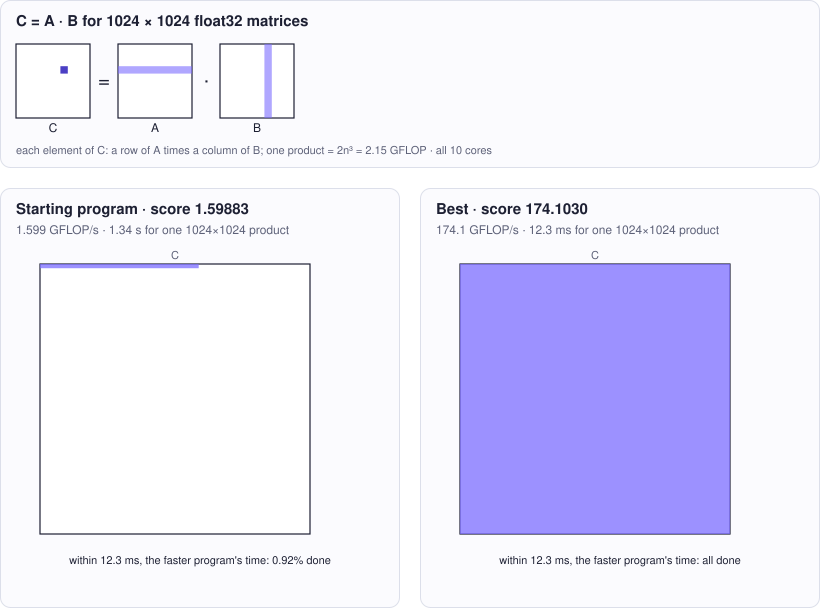

<!-- Copyright (c) 2026 by C. Klukas -->
<!-- SPDX-License-Identifier: GPL-3.0-only -->
<!-- Generated by `omega docs` from examples/matmul_cpp/ and bench/results/*.json. Do not edit by hand. -->

# matmul_cpp

Performance (C++) · cpp · problem `matmul_f32` · [all examples](../examples.md)

## The problem

Make the C++ function matmul(n, A, B, C) (single precision, row-major, C = A*B) as FAST as possible on this machine (Apple Silicon, 10 cores, ARM NEON available via <arm_neon.h>). It must stay correct for every n from 1 to 2048, including sizes that are not multiples of any block size, and must write every element of C.

- **Score:** score = GFLOPS at n = 1024 (best of 3 runs). Correctness is checked first on n = 1, 7, 64, 131, 257; any wrong result makes the program invalid.
- **Files:** `examples/matmul_cpp/omega.toml`, the program `matmul.cpp`, evaluator stages: check, bench (timed alone); new bests are re-measured

### Why this is a hard problem

Matrix multiplication is the core of scientific computing, graphics and neural networks. The textbook method needs n³ multiply-adds, about two billion operations for n = 1024. Volker Strassen [showed in 1969](https://doi.org/10.1007/BF02165411) that fewer are possible in principle, but in practice speed is a question of memory: fast libraries ([BLAS](https://doi.org/10.1145/355841.355847) since 1979, and Kazushige Goto's GotoBLAS, described with Robert van de Geijn at UT Austin [in 2008](https://doi.org/10.1145/1356052.1356053)) do the same arithmetic in an order that reuses data from the caches and registers.

The starting program is the textbook triple loop, about 1.6 GFLOPS. Its inner loop walks down a column of B, jumping 4 KB in memory per step, so nearly every access misses the cache and the processor mostly waits. The limit is the hardware: every core can do several 4-wide vector multiply-adds per cycle, and the machine has 10 cores, a peak of several hundred GFLOPS.

It is hard because reaching that peak needs several layers of restructuring at once: blocks that fit the caches, a small tile of C kept in registers, vector instructions, copying panels of A and B into contiguous buffers, and splitting the work over the cores without them competing for memory bandwidth. All of it must stay exactly right for every size from 1 to 2048, including sizes that do not divide into blocks.

Run it with:

```bash
python3 -m omega_transform run examples/matmul_cpp --minutes 15
```

## The starting program

The model may change only the code between the `OMEGA-BLOCK` markers.

```cpp
// Copyright (c) 2026 by C. Klukas
// SPDX-License-Identifier: MIT
// Single-precision square matrix multiply C = A * B (row-major, n x n).
//
// This file is compiled on its own and linked with harness.cpp, which times
// matmul (wall-clock) and checks the result against a double-precision
// reference. Only the OMEGA-BLOCK region evolves; it may define only matmul as
// a global symbol (helpers must be static or in an anonymous namespace).
#include <algorithm>
#include <chrono>
#include <cmath>
#include <cstdio>
#include <cstdlib>
#include <cstring>
#include <thread>
#include <vector>
#if defined(__ARM_NEON)
#include <arm_neon.h>
#endif

// OMEGA-BLOCK-START
// Computes C = A * B. C is NOT zeroed by the caller. Any number of threads may be
// used (std::thread is available); n is any size from 1 to 2048.
extern "C" void matmul(int n, const float* A, const float* B, float* C) {
    for (int i = 0; i < n; ++i)
        for (int j = 0; j < n; ++j) {
            float s = 0.0f;
            for (int k = 0; k < n; ++k) s += A[i * n + k] * B[k * n + j];
            C[i * n + j] = s;
        }
}
// OMEGA-BLOCK-END
```

## Benchmark results

The best result so far comes from **gemma4:latest (think)**, run locally with Ollama on 2026-10-17: a score of **174.1030** (×108.89 the starting program's 1.59883), reached after 15.8 of 15 minutes with 17 model requests.

What the starting program produces (left) and what the best program by gemma4:latest (think) produces (right):



### How it got there

The best program's ancestry, from the starting program on. "Edit" and "rewrite" are the model's changes; a parameter sweep is the engine trying values for the constants the model exposed.

| Step | Minute | Score | Kind | Idea |
|--:|--:|--:|---|---|
| 0 | 0.0 | 1.59883 | start | initial program |
| 1 | 15.8 | 140.1360 | rewrite | Implement multi-threading over the row dimension (i) combined with the i-k-j loop order to maximize cache locality and leverage multiple cores. |
| 2 | 15.8 | 174.1030 | parameter sweep | tuned NUM_THREADS=30 on top of: Implement multi-threading over the row dimension (i) combined with the i-k-j loop order to maximize cache locality and leverage multiple cores. |

### The best program

What changed compared with the starting program:

```diff
--- initial
+++ best
@@ -19,14 +19,52 @@
 #endif
 
 // OMEGA-BLOCK-START
+#include <algorithm>
+#include <chrono>
+#include <cmath>
+#include <cstdio>
+#include <cstdlib>
+#include <cstring>
+#include <thread>
+#include <vector>
+#if defined(__ARM_NEON)
+#include <arm_neon.h>
+#endif
+
 // Computes C = A * B. C is NOT zeroed by the caller. Any number of threads may be
 // used (std::thread is available); n is any size from 1 to 2048.
 extern "C" void matmul(int n, const float* A, const float* B, float* C) {
-    for (int i = 0; i < n; ++i)
-        for (int j = 0; j < n; ++j) {
-            float s = 0.0f;
-            for (int k = 0; k < n; ++k) s += A[i * n + k] * B[k * n + j];
-            C[i * n + j] = s;
+    constexpr int NUM_THREADS = 30;
+    std::vector<std::thread> threads;
+    int rows_per_thread = (n + NUM_THREADS - 1) / NUM_THREADS;
+
+    auto worker = [&](int start_i, int end_i) {
+        for (int i = start_i; i < end_i; ++i) {
+            // Row initialization: C[i, j] = 0 for all j
+            for (int j = 0; j < n; ++j) {
+                C[i * n + j] = 0.0f;
+            }
+            
+            // i-k-j loop order (better locality for C and B)
+            for (int k = 0; k < n; ++k) {
+                float a_ik = A[i * n + k];
+                // Innermost loop over j
+                for (int j = 0; j < n; ++j) {
+                    C[i * n + j] += a_ik * B[k * n + j];
+                }
+            }
         }
+    };
+
+    for (int t = 0; t < NUM_THREADS; ++t) {
+        int start_i = t * rows_per_thread;
+        int end_i = std::min(n, (t + 1) * rows_per_thread);
+        if (start_i >= n) break;
+        threads.emplace_back(worker, start_i, end_i);
+    }
+
+    for (auto& t : threads) {
+        t.join();
+    }
 }
 // OMEGA-BLOCK-END
```

### All models

One run per model and reasoning mode; the [model benchmarks](../benchmarks/matmul_f32.md) page has speed, memory and progress over time.

| Model | Where | Machine | Best | Gain | Minutes to best | New bests |
|---|---|---|--:|--:|--:|--:|
| gemma4:latest (think) | local | Apple M1 Max | 174.1030 | ×108.89 | 15.8 | 8 |
| qwen3:30b-a3b-instruct-2507-q4_K_M (no-think) | local | Apple M1 Max | 167.9280 | ×102.91 | 15.2 | 2 |
| gemma4:26b-a4b-it-qat (no-think) | local | Apple M1 Max | 160.2310 | ×100.73 | 7.5 | 4 |
| qwen3.6:27b-coding-mtp-q4_K_M (no-think) | local | Apple M1 Max | 154.8540 | ×93.38 | 16.3 | 2 |
| gpt-oss:20b (no-think) | local | Apple M1 Max | 152.3910 | ×91.99 | 17.4 | 4 |
| gemma4:latest (no-think) | local | Apple M1 Max | 151.3840 | ×95.53 | 15.6 | 5 |
| muse-glimmer:30b (no-think) | local | Apple M1 Max | 151.2800 | ×91.68 | 16.7 | 2 |
| gpt-oss:20b (think) | local | Apple M1 Max | 144.0540 | ×88.08 | 15.3 | 5 |
| gemma4:e4b-it-qat (no-think) | local | Apple M1 Max | 140.1020 | ×85.54 | 15.5 | 6 |
| gemma4:e4b-it-qat (think) | local | Apple M1 Max | 126.0000 | ×82.93 | 15.5 | 4 |
| qwen3.8:27b-mtp-q4_K_M (no-think) | local | Apple M1 Max | 120.7810 | ×72.88 | 16.4 | 1 |
| gemma4:26b-a4b-it-qat (think) | local | i7-8700K + 2x GTX 1080 Ti | 117.0590 | ×82.75 | 19.1 | 1 |
| muse-glimmer:30b (think) | local | Apple M1 Max | 113.2980 | ×100.27 | 20.2 | 1 |
| gemma4:e4b-it-qat (think) | local | i7-8700K + 2x GTX 1080 Ti | 110.0340 | ×78.24 | 16.2 | 4 |
| qwen3.8:27b-mtp-q4_K_M (think) | local | Apple M1 Max | 109.8530 | ×71.24 | 18.3 | 1 |
| gemma4:latest (no-think) | local | i7-8700K + 2x GTX 1080 Ti | 108.6600 | ×77.40 | 12.2 | 3 |
| qwen3.8:27b-mtp-q4_K_M (no-think) | local | i7-8700K + 2x GTX 1080 Ti | 106.4650 | ×96.38 | 16.6 | 2 |
| gemma4:latest (think) | local | i7-8700K + 2x GTX 1080 Ti | 104.9710 | ×74.71 | 15.3 | 4 |
| gpt-oss:20b (no-think) | local | i7-8700K + 2x GTX 1080 Ti | 70.4953 | ×61.81 | 17.7 | 4 |
| gemma4:12b-it-qat (no-think) | local | Apple M1 Max | 68.4243 | ×41.57 | 15.4 | 1 |
| gemma4:12b-it-qat (think) | local | Apple M1 Max | 66.2698 | ×55.31 | 18.3 | 1 |
| gemma4:26b-a4b-it-qat (think) | local | Apple M1 Max | 41.8195 | ×27.48 | 15.7 | 1 |
| qwen3:30b-a3b-instruct-2507-q4_K_M (think) | local | i7-8700K + 2x GTX 1080 Ti | 37.7133 | ×26.37 | 16.2 | 3 |
| gemma4:e4b-it-qat (no-think) | local | i7-8700K + 2x GTX 1080 Ti | 26.6068 | ×19.02 | 15.3 | 4 |
| gpt-oss:20b (think) | local | i7-8700K + 2x GTX 1080 Ti | 25.6570 | ×18.12 | 15.8 | 3 |
| qwen3.5:27b (no-think) | local | Apple M1 Max | 25.6098 | ×15.46 | 16.8 | 3 |
| nemotron-3-nano:30b-a3b-mlx (think) | local | Apple M1 Max | 25.4002 | ×15.53 | 15.9 | 1 |
| qwen3:30b-a3b-instruct-2507-q4_K_M (think) | local | Apple M1 Max | 25.2873 | ×15.64 | 15.3 | 2 |
| gemma4:12b-it-qat (no-think) | local | i7-8700K + 2x GTX 1080 Ti | 21.1581 | ×15.00 | 11.0 | 4 |
| qwen3:30b-a3b-instruct-2507-q4_K_M (no-think) | local | i7-8700K + 2x GTX 1080 Ti | 18.6807 | ×17.99 | 10.7 | 1 |
| gemma4:26b-a4b-it-qat (no-think) | local | i7-8700K + 2x GTX 1080 Ti | 18.4288 | ×15.78 | 15.3 | 4 |
| gemma4:12b-it-qat (think) | local | i7-8700K + 2x GTX 1080 Ti | 14.7889 | ×10.56 | 23.1 | 2 |
| qwen2.5-coder:7b (no-think) | local | Apple M1 Max | 12.1382 | ×7.25 | 15.4 | 2 |
| qwen2.5-coder:7b (no-think) | local | i7-8700K + 2x GTX 1080 Ti | 11.0637 | ×9.02 | 17.2 | 3 |
| underdog-saluki-27b:iq2-mix (no-think) | local | Apple M1 Max | 10.6256 | ×6.25 | 17.3 | 1 |
| qwen3-coder:30b (no-think) | local | Apple M1 Max | 8.45239 | ×5.08 | 16.7 | 2 |
| qwen3.6:27b-coding-mtp-q4_K_M (no-think) | local | i7-8700K + 2x GTX 1080 Ti | 5.71206 | ×5.15 | 17.3 | 1 |
| gemma4:e2b (think) | local | i7-8700K + 2x GTX 1080 Ti | 3.78053 | ×2.70 | 12.1 | 1 |
| glm-4.7-flash:latest (no-think) | local | Apple M1 Max | 2.49095 | ×1.47 | 10.5 | 2 |
| nemotron-3-nano:4b (no-think) | local | Apple M1 Max | 1.70706 | ×1.01 | 16.4 | 2 |
| underdog-saluki-27b:iq2-mix (think) | local | Apple M1 Max | | | | failed: all 1 model requests failed: underdog-saluki-27b:iq2-mix … |
| nemotron-3-nano:30b-a3b-mlx (no-think) | local | Apple M1 Max | 1.70481 | ×1.00 | - | 0 |
| yandex/YandexGPT-5-Lite-8B-instruct-GGUF:latest (no-think) | local | Apple M1 Max | 1.70226 | ×1.01 | 16.4 | 1 |
| llm-jp-4-8b-omega:q4_k_m (no-think) | local | Apple M1 Max | 1.69985 | ×1.00 | - | 0 |
| ingu627/exaone4.0:32b (no-think) | local | Apple M1 Max | 1.69695 | ×1.00 | - | 0 |
| MichelRosselli/apertus:8b-instruct-2509-q4_k_m (no-think) | local | Apple M1 Max | 1.69487 | ×1.00 | - | 0 |
| gemma4:e2b (no-think) | local | Apple M1 Max | 1.68469 | ×1.05 | 15.8 | 3 |
| qwen3.5:latest (no-think) | local | Apple M1 Max | 1.6743 | ×1.00 | - | 0 |
| frob/sarvam:30b (think) | local | Apple M1 Max | | | | failed: all 3 model requests failed: frob/sarvam:30b: answer … |
| nemotron-3-nano:4b (think) | local | Apple M1 Max | 1.66861 | ×1.12 | 16.0 | 1 |
| nemotron-3.5-lightning:30b-mlx (think) | local | Apple M1 Max | | | | failed: all 4 model requests failed … |
| nemotron-3.5-lightning:30b-mlx (no-think) | local | Apple M1 Max | 1.66222 | ×1.00 | - | 0 |
| devstral-small-2:24b (no-think) | local | Apple M1 Max | 1.65728 | ×1.00 | - | 0 |
| qwen3-coder:30b (no-think) | local | i7-8700K + 2x GTX 1080 Ti | 1.61984 | ×1.52 | 13.5 | 1 |
| frob/sarvam:30b (no-think) | local | Apple M1 Max | 1.59209 | ×1.00 | - | 0 |
| gemma4:e2b (think) | local | Apple M1 Max | 1.53353 | ×1.58 | 10.1 | 4 |
| glm-4.7-flash:latest (think) | local | Apple M1 Max | 1.51016 | ×1.00 | - | 0 |
| richardyoung/frognano-4b-2609:latest (think) | local | Apple M1 Max | 1.45546 | ×1.00 | - | 0 |
| gemma4:e2b (no-think) | local | i7-8700K + 2x GTX 1080 Ti | 1.44041 | ×1.02 | 3.4 | 2 |
| glm-4.7-flash:latest (think) | local | i7-8700K + 2x GTX 1080 Ti | 1.43503 | ×1.00 | - | 0 |
| frob/sarvam:30b (think) | local | i7-8700K + 2x GTX 1080 Ti | 1.42672 | ×1.00 | - | 0 |
| nemotron-3-nano:4b (no-think) | local | i7-8700K + 2x GTX 1080 Ti | 1.42195 | ×1.01 | 4.4 | 1 |
| qwen3.8:27b-mtp-q4_K_M (think) | local | i7-8700K + 2x GTX 1080 Ti | 1.41926 | ×1.00 | - | 0 |
| qwen3.6:27b-coding-mtp-q4_K_M (think) | local | i7-8700K + 2x GTX 1080 Ti | 1.41433 | ×1.00 | - | 0 |
| qwen3.5:latest (no-think) | local | i7-8700K + 2x GTX 1080 Ti | 1.41048 | ×1.00 | - | 0 |
| richardyoung/frognano-4b-2609:latest (think) | local | i7-8700K + 2x GTX 1080 Ti | 1.40941 | ×1.00 | - | 0 |
| richardyoung/frognano-4b-2609:latest (no-think) | local | i7-8700K + 2x GTX 1080 Ti | 1.40714 | ×1.00 | - | 0 |
| nemotron-3-nano:4b (think) | local | i7-8700K + 2x GTX 1080 Ti | 1.40425 | ×1.00 | - | 0 |
| Bored/GigaChat3.1-10B-A1.8B-q4_K_M:latest (no-think) | local | i7-8700K + 2x GTX 1080 Ti | 1.39792 | ×1.00 | - | 0 |
| richardyoung/frognano-4b-2609:latest (no-think) | local | Apple M1 Max | 1.36704 | ×1.00 | - | 0 |
| qwen3.5:latest (think) | local | Apple M1 Max | 1.33259 | ×1.00 | - | 0 |
| qwen3.6:27b-coding-mtp-q4_K_M (think) | local | Apple M1 Max | 1.32423 | ×1.00 | - | 0 |
| qwen3.5:latest (think) | local | i7-8700K + 2x GTX 1080 Ti | 1.28638 | ×1.00 | - | 0 |
| MichelRosselli/apertus:8b-instruct-2509-q4_k_m (no-think) | local | i7-8700K + 2x GTX 1080 Ti | 1.25454 | ×1.00 | - | 0 |
| llm-jp-4-8b-omega:q4_k_m (no-think) | local | i7-8700K + 2x GTX 1080 Ti | 1.18595 | ×1.00 | - | 0 |
| yandex/YandexGPT-5-Lite-8B-instruct-GGUF:latest (no-think) | local | i7-8700K + 2x GTX 1080 Ti | 1.17412 | ×1.00 | - | 0 |
| qwen3.5:27b (think) | local | Apple M1 Max | | | | failed: all 1 model requests failed: qwen3.5:27b: answer stopped … |
| glm-4.7-flash:latest (no-think) | local | i7-8700K + 2x GTX 1080 Ti | 1.14888 | ×1.01 | 16.6 | 1 |
| frob/sarvam:30b (no-think) | local | i7-8700K + 2x GTX 1080 Ti | 1.07209 | ×1.00 | - | 0 |
