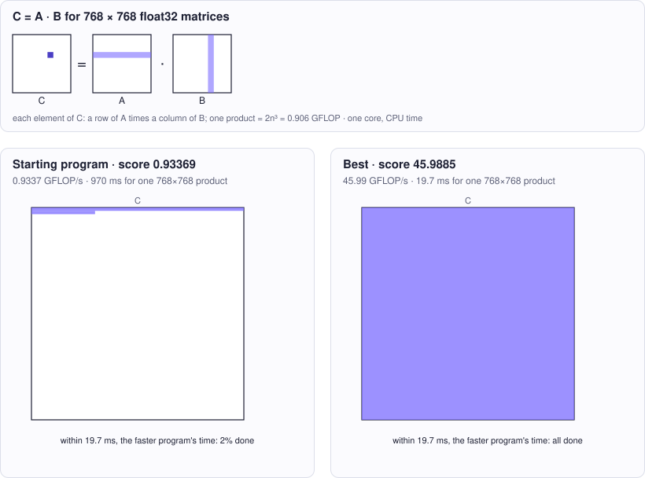

<!-- Copyright (c) 2026 by C. Klukas -->
<!-- SPDX-License-Identifier: GPL-3.0-only -->
<!-- Generated by `omega docs` from examples/matmul_st_cpp/ and bench/results/*.json. Do not edit by hand. -->

# matmul_st_cpp

Performance (C++) · cpp · problem `matmul_f32_single_thread` · [all examples](../examples.md)

## The problem

Make the C++ function matmul(n, A, B, C) (single precision, row-major, C = A*B) use as little CPU time as possible on ONE core of this machine (Apple Silicon, ARM NEON available via <arm_neon.h>). The time is measured with the process CPU clock, so extra threads do not help: their CPU time adds up. It must stay correct for every n from 1 to 2048, including sizes that are not multiples of any block size, and must write every element of C.

- **Score:** score = GFLOPS per CPU-second at n = 768 (best of 5 runs): 2*n^3 / CPU seconds / 1e9. Correctness is checked first on n = 1, 7, 64, 131, 257; any wrong result makes the program invalid.
- **Files:** `examples/matmul_st_cpp/omega.toml`, the program `matmul.cpp`, evaluator stages: check, bench; new bests are re-measured

### Why this is a hard problem

Matrix multiplication is the core of scientific computing, graphics and neural networks. The textbook method needs n³ multiply-adds, almost a billion operations for n = 768. Volker Strassen [showed in 1969](https://doi.org/10.1007/BF02165411) that fewer are possible in principle, but in practice speed is a question of memory: fast libraries ([BLAS](https://doi.org/10.1145/355841.355847) since 1979, and Kazushige Goto's GotoBLAS, described with Robert van de Geijn at UT Austin [in 2008](https://doi.org/10.1145/1356052.1356053)) do the same arithmetic in an order that reuses data from the caches and registers.

The starting program is the textbook triple loop, about 1.7 GFLOPS. Its inner loop walks down a column of B, jumping 3 KB in memory per step, so nearly every access misses the cache and the processor mostly waits. The limit is one core's arithmetic: several 4-wide vector multiply-adds per cycle, on the order of 100 GFLOPS. Extra threads do not help here, because the CPU time of all threads is added up.

It is hard because reaching that peak needs several layers of restructuring at once: blocks that fit the caches, a small tile of C kept in registers, vector instructions, and copying panels of A and B into contiguous buffers. All of it must stay exactly right for every size from 1 to 2048, including sizes that do not divide into blocks.

Run it with:

```bash
python3 -m omega_transform run examples/matmul_st_cpp --minutes 15
```

## The starting program

The model may change only the code between the `OMEGA-BLOCK` markers.

```cpp
// Copyright (c) 2026 by C. Klukas
// SPDX-License-Identifier: MIT
// Single-threaded, single-precision square matrix multiply C = A * B
// (row-major, n x n), scored by CPU time rather than wall-clock time, so the
// score stays comparable while other programs run on the machine.
//
// This file is compiled on its own and linked with harness.cpp, which times
// matmul with the process CPU clock and checks the result against a
// double-precision reference. Extra threads do not help: their CPU time adds up.
// Only the OMEGA-BLOCK region evolves; it may define only matmul as a global
// symbol (helpers must be static or in an anonymous namespace).
#include <algorithm>
#include <cmath>
#include <cstdio>
#include <cstdlib>
#include <cstring>
#include <ctime>
#include <vector>
#if defined(__ARM_NEON)
#include <arm_neon.h>
#endif

// OMEGA-BLOCK-START
// Computes C = A * B on the calling thread. C is NOT zeroed by the caller.
// n is any size from 1 to 2048.
extern "C" void matmul(int n, const float* A, const float* B, float* C) {
    for (int i = 0; i < n; ++i)
        for (int j = 0; j < n; ++j) {
            float s = 0.0f;
            for (int k = 0; k < n; ++k) s += A[i * n + k] * B[k * n + j];
            C[i * n + j] = s;
        }
}
// OMEGA-BLOCK-END
```

## Benchmark results

The best result so far comes from **nvidia/nemotron-3-ultra-550b-a55b:free (think)**, run through OpenRouter on 2026-11-06: a score of **45.9885** (×49.25 the starting program's 0.93369), reached after 52.95 of 60 minutes with 44 model requests.

What the starting program produces (left) and what the best program by nvidia/nemotron-3-ultra-550b-a55b:free (think) produces (right):



### How it got there

The best program's ancestry, from the starting program on. "Edit" and "rewrite" are the model's changes; a parameter sweep is the engine trying values for the constants the model exposed.

| Step | Minute | Score | Kind | Idea |
|--:|--:|--:|---|---|
| 0 | 0.0 | 0.93369 | start | initial program |
| 1 | 2.7 | 17.6372 | edit | Reorder loops to i-k-j for better memory access patterns and add cache blocking on k dimension to reuse A elements and stream B/C rows |
| 2 | 33.9 | 32.1413 | edit | Add i-dimension cache blocking (two-level tiling) to reuse B panels across multiple i rows, keeping C tiles hot in L1, and sweep both tile sizes TI and KB for optimal performance. |
| 3 | 39.8 | 30.0542 | edit | Add k-loop unrolling (UNROLL_K) to the existing two-level cache blocking (i-tiling + k-tiling) to keep C elements in registers across multiple k iterations, reducing C load/store traffic and improving ILP while maintaining B-panel reuse across i-tiles. |
| 4 | 39.8 | 38.2384 | parameter sweep | tuned TI=112, KB=48, UNROLL_K=4 on top of: Add k-loop unrolling (UNROLL_K) to the existing two-level cache blocking (i-tiling + k-tiling) to keep C elements in registers across multiple k iterations, reducing C load/store traffic and improving ILP while … |
| 5 | 53.0 | 29.5067 | edit | Increase UNROLL_K to 8 and adjust KB upward to better amortize unroll overhead, then sweep TI, KB, UNROLL_K together to find the optimal combination for the two-level blocked i-k-j kernel. |
| 6 | 53.0 | 45.9885 | parameter sweep | tuned TI=93, KB=64, UNROLL_K=8 on top of: Increase UNROLL_K to 8 and adjust KB upward to better amortize unroll overhead, then sweep TI, KB, UNROLL_K together to find the optimal combination for the two-level blocked i-k-j kernel. |

### The best program

What changed compared with the starting program:

```diff
--- initial
+++ best
@@ -23,12 +23,52 @@
 // OMEGA-BLOCK-START
 // Computes C = A * B on the calling thread. C is NOT zeroed by the caller.
 // n is any size from 1 to 2048.
-extern "C" void matmul(int n, const float* A, const float* B, float* C) {
-    for (int i = 0; i < n; ++i)
-        for (int j = 0; j < n; ++j) {
-            float s = 0.0f;
-            for (int k = 0; k < n; ++k) s += A[i * n + k] * B[k * n + j];
-            C[i * n + j] = s;
+extern "C" void matmul(int n, const float* __restrict A, const float* __restrict B, float* __restrict C) {
+    constexpr int TI = 93;      // blocking factor for i dimension (tile height)
+    constexpr int KB = 64;       // blocking factor for k dimension (tile depth)
+    constexpr int UNROLL_K = 8;  // unroll factor for inner k-loop
+    
+    // Zero C first
+    for (int i = 0; i < n * n; ++i) C[i] = 0.0f;
+    
+    for (int ii = 0; ii < n; ii += TI) {
+        int i_end = ii + TI < n ? ii + TI : n;
+        for (int kk = 0; kk < n; kk += KB) {
+            int k_end = kk + KB < n ? kk + KB : n;
+            for (int i = ii; i < i_end; ++i) {
+                const float* A_i = A + i * n;
+                float* C_i = C + i * n;
+                int k = kk;
+                // Unrolled k-loop: process UNROLL_K iterations at a time
+                for (; k <= k_end - UNROLL_K; k += UNROLL_K) {
+                    float a_ik[UNROLL_K];
+                    for (int u = 0; u < UNROLL_K; ++u) {
+                        a_ik[u] = A_i[k + u];
+                    }
+                    const float* B_k[UNROLL_K];
+                    for (int u = 0; u < UNROLL_K; ++u) {
+                        B_k[u] = B + (k + u) * n;
+                    }
+                    #pragma unroll
+                    for (int j = 0; j < n; ++j) {
+                        float sum = 0.0f;
+                        for (int u = 0; u < UNROLL_K; ++u) {
+                            sum += a_ik[u] * B_k[u][j];
+                        }
+                        C_i[j] += sum;
+                    }
+                }
+                // Remainder k iterations
+                for (; k < k_end; ++k) {
+                    float a_ik = A_i[k];
+                    const float* B_k = B + k * n;
+                    #pragma unroll(4)
+                    for (int j = 0; j < n; ++j) {
+                        C_i[j] += a_ik * B_k[j];
+                    }
+                }
+            }
         }
+    }
 }
 // OMEGA-BLOCK-END
```

### All models

One run per model and reasoning mode; the [model benchmarks](../benchmarks/matmul_f32_single_thread.md) page has speed, memory and progress over time.

| Model | Where | Best | Gain | Minutes to best | New bests |
|---|---|--:|--:|--:|--:|
| nvidia/nemotron-3-ultra-550b-a55b:free (think) | cloud | 45.9885 | ×49.25 | 53.0 | 11 |
| gemma4:26b-a4b-it-qat (no-think) | local | 43.3708 | ×30.70 | 40.4 | 9 |
| gemma4:latest (think) | local | 37.5840 | ×29.36 | 48.5 | 6 |
| gemma4:12b-it-qat (no-think) | local | 36.3552 | ×25.59 | 21.1 | 5 |
| gpt-oss:20b (no-think) | local | 33.1122 | ×24.49 | 23.4 | 6 |
| gemma4:26b-a4b-it-qat (think) | local | 29.1505 | ×17.26 | 41.2 | 2 |
| hf.co/mmnga-o/Qwen3-Swallow-30B-A3B-RL-v0.2-gguf:Q4_K_M (think) | local | 29.1143 | ×17.56 | 46.4 | 2 |
| gpt-oss:20b (think) | local | 28.3762 | ×19.23 | 3.2 | 2 |
| recursive/flint-v1.0:free (think) | cloud | 26.2322 | ×21.00 | 39.7 | 5 |
| gemma4:e4b-it-qat (think) | local | 26.1981 | ×17.23 | 2.5 | 2 |
| hf.co/mmnga-o/Qwen3-Swallow-30B-A3B-RL-v0.2-gguf:Q4_K_M (no-think) | local | 25.6758 | ×16.01 | 6.0 | 1 |
| gemma4:12b-it-qat (think) | local | 25.5805 | ×17.24 | 17.3 | 1 |
| qwen3.5:latest (no-think) | local | 25.5709 | ×20.49 | 10.3 | 1 |
| qwen3.5:latest (think) | local | 25.5570 | ×17.89 | 56.6 | 4 |
| dots-studio/dots-3-note-preview:free (no-think) | cloud | 25.3679 | ×19.71 | 4.5 | 1 |
| nvidia/nemotron-3.5-super-vl:free (think) | cloud | 24.7910 | ×26.48 | 25.8 | 3 |
| nvidia/nemotron-3-ultra-550b-a55b:free (no-think) | cloud | 23.8871 | ×21.89 | 10.0 | 5 |
| hf.co/LiquidAI/LFM3-1.7B-GGUF:Q4_K_M (think) | local | 23.1849 | ×16.96 | 50.9 | 2 |
| gemma4:latest (no-think) | local | 22.2128 | ×15.63 | 1.5 | 2 |
| cohere/north-mini-code:free (think) | cloud | 21.7794 | ×22.48 | 53.9 | 7 |
| qwen3.6:27b-coding-mtp-q4_K_M (no-think) | local | 21.2526 | ×15.53 | 19.8 | 3 |
| gemma4:e4b-it-qat (no-think) | local | 20.3136 | ×15.17 | 2.7 | 1 |
| nvidia/nemotron-3.5-lightning:free (think) | cloud | 16.8036 | ×13.74 | 10.4 | 1 |
| qwen3:30b-a3b-instruct-2507-q4_K_M (no-think) | local | 4.47988 | ×3.24 | 7.6 | 1 |
| glm-4.7-flash:latest (think) | local | 1.73101 | ×1.00 | - | 0 |
| qwen3:30b-a3b-instruct-2507-q4_K_M (think) | local | 1.70858 | ×1.00 | - | 0 |
| frob/sarvam:30b (think) | local | 1.70518 | ×1.00 | - | 0 |
| qwen3.6:27b-coding-mtp-q4_K_M (think) | local | 1.70016 | ×1.00 | - | 0 |
| hf.co/llm-jp/llm-jp-4.1-32b-a3b-thinking-gguf:Q4_K_M (no-think) | local | 1.65807 | ×1.00 | - | 0 |
| hf.co/Colby/apertus-v1.5-8b-text-Q4_K_M-GGUF:Q4_K_M (no-think) | local | 1.59606 | ×1.00 | - | 0 |
| nemotron-3-nano:4b (think) | local | 1.52592 | ×1.00 | - | 0 |
| underdog-saluki-27b:iq2-mix (think) | local | 1.49558 | ×1.00 | - | 0 |
| underdog-saluki-27b:iq2-mix (no-think) | local | 1.4541 | ×1.00 | - | 0 |
| yandex/YandexGPT-5-Lite-8B-instruct-GGUF:latest (no-think) | local | 1.41454 | ×1.00 | - | 0 |
| nemotron-3-nano:4b (no-think) | local | 1.39198 | ×1.00 | - | 0 |
| frob/sarvam:30b (no-think) | local | 1.37406 | ×1.00 | - | 0 |
| qwen3-coder:30b (no-think) | local | 1.36668 | ×1.00 | - | 0 |
| MichelRosselli/apertus:8b-instruct-2509-q4_k_m (no-think) | local | 1.36613 | ×1.00 | - | 0 |
| llm-jp-4-8b-omega:q4_k_m (no-think) | local | 1.36103 | ×1.00 | - | 0 |
| richardyoung/frognano-4b-2609:latest (no-think) | local | 1.36101 | ×1.00 | - | 0 |
| gemma4:e2b (think) | local | 1.35687 | ×1.00 | - | 0 |
| hf.co/LiquidAI/LFM3-1.7B-GGUF:Q4_K_M (no-think) | local | 1.35459 | ×1.00 | - | 0 |
| gemma4:e2b (no-think) | local | 1.31572 | ×1.00 | - | 0 |
| qwen2.5-coder:7b (no-think) | local | 1.31214 | ×1.00 | - | 0 |
| nvidia/nemotron-3-nano-omni-30b-a3b-reasoning:free (think) | cloud | 1.27118 | ×1.00 | - | 0 |
| glm-4.7-flash:latest (no-think) | local | 1.25269 | ×1.00 | - | 0 |
| richardyoung/frognano-4b-2609:latest (think) | local | 1.25221 | ×1.00 | - | 0 |
| nvidia/nemotron-3-nano-omni-30b-a3b-reasoning:free (no-think) | cloud | 1.21895 | ×1.00 | - | 0 |
| xingchen-agi/xing4.0-29b-a4b:free (no-think) | cloud | 1.2102 | ×1.00 | - | 0 |
| nvidia/nemotron-3.5-super-vl:free (no-think) | cloud | 1.19245 | ×1.00 | - | 0 |
| dots-studio/dots-3-note-preview:free (think) | cloud | 1.19046 | ×1.00 | - | 0 |
| nvidia/nemotron-3.5-lightning:free (no-think) | cloud | 1.18856 | ×1.00 | - | 0 |
| xingchen-agi/xing4.0-29b-a4b:free (think) | cloud | | | | failed: all 9 model requests failed … |
| cohere/north-mini-code:free (no-think) | cloud | 1.15687 | ×1.00 | - | 0 |
