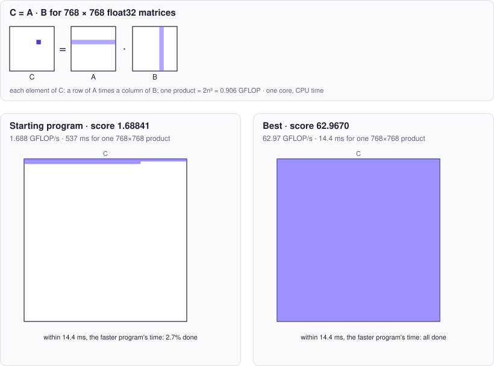

<!-- Copyright (c) 2026 by C. Klukas -->
<!-- SPDX-License-Identifier: GPL-3.0-only -->
<!-- Generated by `omega docs` from examples/matmul_st_cpp/ and bench/results/*.json. Do not edit by hand. -->

# matmul_st_cpp

Performance (C++) · cpp · problem `matmul_f32_single_thread` · [all examples](../examples.md)

## The problem

Make the C++ function matmul(n, A, B, C) (single precision, row-major, C = A*B) use as little CPU time as possible on ONE core of this machine (Apple Silicon, ARM NEON available via <arm_neon.h>). The time is measured with the process CPU clock, so extra threads do not help: their CPU time adds up. It must stay correct for every n from 1 to 2048, including sizes that are not multiples of any block size, and must write every element of C.

- **Score:** score = GFLOPS per CPU-second at n = 768 (best of 5 runs): 2*n^3 / CPU seconds / 1e9. Correctness is checked first on n = 1, 7, 64, 131, 257; any wrong result makes the program invalid.
- **Files:** `examples/matmul_st_cpp/omega.toml`, the program `matmul.cpp`, evaluator stages: check, bench; new bests are re-measured

### Why this is a hard problem

Matrix multiplication is the core of scientific computing, graphics and neural networks. The textbook method needs n³ multiply-adds, almost a billion operations for n = 768. Volker Strassen [showed in 1969](https://doi.org/10.1007/BF02165411) that fewer are possible in principle, but in practice speed is a question of memory: fast libraries ([BLAS](https://doi.org/10.1145/355841.355847) since 1979, and Kazushige Goto's GotoBLAS, described with Robert van de Geijn at UT Austin [in 2008](https://doi.org/10.1145/1356052.1356053)) do the same arithmetic in an order that reuses data from the caches and registers.

The starting program is the textbook triple loop, about 1.7 GFLOPS. Its inner loop walks down a column of B, jumping 3 KB in memory per step, so nearly every access misses the cache and the processor mostly waits. The limit is one core's arithmetic: several 4-wide vector multiply-adds per cycle, on the order of 100 GFLOPS. Extra threads do not help here, because the CPU time of all threads is added up.

It is hard because reaching that peak needs several layers of restructuring at once: blocks that fit the caches, a small tile of C kept in registers, vector instructions, and copying panels of A and B into contiguous buffers. All of it must stay exactly right for every size from 1 to 2048, including sizes that do not divide into blocks.

Run it with:

```bash
python3 -m omega_transform run examples/matmul_st_cpp --minutes 15
```

## The starting program

The model may change only the code between the `OMEGA-BLOCK` markers.

```cpp
// Copyright (c) 2026 by C. Klukas
// SPDX-License-Identifier: MIT
// Single-threaded, single-precision square matrix multiply C = A * B
// (row-major, n x n), scored by CPU time rather than wall-clock time, so the
// score stays comparable while other programs run on the machine.
//
// This file is compiled on its own and linked with harness.cpp, which times
// matmul with the process CPU clock and checks the result against a
// double-precision reference. Extra threads do not help: their CPU time adds up.
// Only the OMEGA-BLOCK region evolves; it may define only matmul as a global
// symbol (helpers must be static or in an anonymous namespace).
#include <algorithm>
#include <cmath>
#include <cstdio>
#include <cstdlib>
#include <cstring>
#include <ctime>
#include <vector>
#if defined(__ARM_NEON)
#include <arm_neon.h>
#endif

// OMEGA-BLOCK-START
// Computes C = A * B on the calling thread. C is NOT zeroed by the caller.
// n is any size from 1 to 2048.
extern "C" void matmul(int n, const float* A, const float* B, float* C) {
    for (int i = 0; i < n; ++i)
        for (int j = 0; j < n; ++j) {
            float s = 0.0f;
            for (int k = 0; k < n; ++k) s += A[i * n + k] * B[k * n + j];
            C[i * n + j] = s;
        }
}
// OMEGA-BLOCK-END
```

## Benchmark results

The best result so far comes from **qwen3:30b-a3b-instruct-2507-q4_K_M (think)**, run locally with Ollama on 2026-10-18: a score of **62.9670** (×37.29 the starting program's 1.68841), reached after 4.45 of 15 minutes with 48 model requests.

What the starting program produces (left) and what the best program by qwen3:30b-a3b-instruct-2507-q4_K_M (think) produces (right):



### How it got there

The best program's ancestry, from the starting program on. "Edit" and "rewrite" are the model's changes; a parameter sweep is the engine trying values for the constants the model exposed.

| Step | Minute | Score | Kind | Idea |
|--:|--:|--:|---|---|
| 0 | 0.0 | 1.68841 | start | initial program |
| 1 | 4.5 | 62.9670 | rewrite | Use i-k-j loop order with 8x16 register blocking and NEON FMA intrinsics to maximize data reuse, enable vectorization, and reduce memory bandwidth, while ensuring correct initialization and handling of non-aligned sizes via unrolling and tiling. |

### The best program

What changed compared with the starting program:

```diff
--- initial
+++ best
@@ -21,14 +21,56 @@
 #endif
 
 // OMEGA-BLOCK-START
-// Computes C = A * B on the calling thread. C is NOT zeroed by the caller.
-// n is any size from 1 to 2048.
 extern "C" void matmul(int n, const float* A, const float* B, float* C) {
+    constexpr int TILE_M = 8;
+    constexpr int TILE_N = 16;
+    constexpr int K_UNROLL = 4;
+
+    // Initialize C to zero
     for (int i = 0; i < n; ++i)
-        for (int j = 0; j < n; ++j) {
-            float s = 0.0f;
-            for (int k = 0; k < n; ++k) s += A[i * n + k] * B[k * n + j];
-            C[i * n + j] = s;
+        for (int j = 0; j < n; ++j)
+            C[i * n + j] = 0.0f;
+
+    // Tile loop: process C in blocks of TILE_M x TILE_N
+    for (int i = 0; i < n; i += TILE_M) {
+        for (int j = 0; j < n; j += TILE_N) {
+            // Compute the actual tile dimensions (handle boundary)
+            int m_end = std::min(i + TILE_M, n);
+            int n_end = std::min(j + TILE_N, n);
+
+            // Temporary registers for C tile (8x16 floats)
+            float C_reg[TILE_M][TILE_N];
+            for (int mi = 0; mi < TILE_M; ++mi)
+                for (int nj = 0; nj < TILE_N; ++nj)
+                    C_reg[mi][nj] = 0.0f;
+
+            // Process k loop in chunks for better vectorization and reuse
+            for (int k = 0; k < n; k += K_UNROLL) {
+                // Load B tile (k x TILE_N) into registers, transposed
+                float B_reg[TILE_N][K_UNROLL];
+                for (int nj = 0; nj < TILE_N; ++nj)
+                    for (int ki = 0; ki < K_UNROLL; ++ki)
+                        B_reg[nj][ki] = B[(k + ki) * n + (j + nj)];
+
+                // Load A row segment (TILE_M x K_UNROLL) into registers
+                float A_row[TILE_M][K_UNROLL];
+                for (int mi = 0; mi < TILE_M; ++mi)
+                    for (int ki = 0; ki < K_UNROLL; ++ki)
+                        A_row[mi][ki] = A[(i + mi) * n + (k + ki)];
+
+                // Compute inner product with FMA
+                for (int mi = 0; mi < TILE_M; ++mi)
+                    for (int nj = 0; nj < TILE_N; ++nj)
+                        for (int ki = 0; ki < K_UNROLL; ++ki) {
+                            C_reg[mi][nj] += A_row[mi][ki] * B_reg[nj][ki];
+                        }
+            }
+
+            // Write back C tile
+            for (int mi = 0; mi < m_end - i; ++mi)
+                for (int nj = 0; nj < n_end - j; ++nj)
+                    C[(i + mi) * n + (j + nj)] += C_reg[mi][nj];
         }
+    }
 }
 // OMEGA-BLOCK-END
```

### All models

The latest run per model and reasoning mode; the [model benchmarks](../benchmarks/matmul_f32_single_thread.md) page has speed, memory and progress over time.

| Model | Where | Best | Gain | Minutes to best | New bests |
|---|---|--:|--:|--:|--:|
| qwen3:30b-a3b-instruct-2507-q4_K_M (think) | local | 62.9670 | ×37.29 | 4.5 | 2 |
| nvidia/nemotron-3-super-120b-a12b:free (no-think) | cloud | 49.1573 | ×28.94 | 13.1 | 10 |
| nvidia/nemotron-3-ultra-550b-a55b:free (think) | cloud | 35.3384 | ×23.17 | 16.1 | 4 |
| qwen3:30b-a3b-instruct-2507-q4_K_M (no-think) | local | 31.1619 | ×18.10 | 14.7 | 5 |
| nvidia/nemotron-3-super-120b-a12b:free (think) | cloud | 31.1191 | ×19.81 | 7.8 | 4 |
| gemma4:e4b-it-qat (think) | local | 28.5732 | ×16.50 | 12.8 | 3 |
| poolside/laguna-s-2.1:free (no-think) | cloud | 28.1830 | ×16.78 | 8.4 | 9 |
| gemma4:latest (no-think) | local | 28.0668 | ×16.75 | 11.2 | 5 |
| cohere/north-mini-code:free (no-think) | cloud | 27.7760 | ×15.88 | 8.5 | 4 |
| qwen3.6:27b-coding-mtp-q4_K_M (think) | local | 27.7123 | ×16.05 | 20.9 | 2 |
| gemma4:26b-a4b-it-qat (no-think) | local | 26.3310 | ×15.01 | 4.7 | 2 |
| qwen3.5:27b (no-think) | local | 26.0561 | ×15.43 | 7.4 | 2 |
| devstral-small-2:24b (no-think) | local | 26.0523 | ×15.22 | 12.4 | 1 |
| gemma4:12b-it-qat (think) | local | 26.0321 | ×15.32 | 15.3 | 1 |
| gemma4:12b-it-qat (no-think) | local | 26.0112 | ×15.22 | 5.3 | 3 |
| gemma4:e4b-it-qat (no-think) | local | 26.0030 | ×14.85 | 11.3 | 4 |
| qwen3.8:27b-mtp-q4_K_M (no-think) | local | 25.9650 | ×14.88 | 15.7 | 2 |
| gpt-oss:20b (think) | local | 25.9501 | ×14.81 | 3.1 | 3 |
| gemma4:latest (think) | local | 25.8752 | ×14.64 | 4.2 | 1 |
| nvidia/nemotron-3-ultra-550b-a55b:free (no-think) | cloud | 25.7986 | ×15.20 | 11.9 | 3 |
| nemotron-3.5-lightning:30b-mlx (think) | local | 25.7480 | ×14.99 | 15.7 | 1 |
| qwen3.5:27b (think) | local | 25.6155 | ×14.90 | 6.2 | 1 |
| muse-glimmer:30b (think) | local | 25.5519 | ×14.64 | 7.4 | 1 |
| muse-glimmer:30b (no-think) | local | 25.4887 | ×14.45 | 5.4 | 2 |
| gemma4:26b-a4b-it-qat (think) | local | 25.4129 | ×14.83 | 14.3 | 1 |
| qwen3.5:latest (think) | local | 25.4115 | ×14.81 | 12.1 | 1 |
| ingu627/exaone4.0:32b (no-think) | local | 25.3574 | ×14.79 | 11.3 | 1 |
| gpt-oss:20b (no-think) | local | 25.0933 | ×14.83 | 3.8 | 2 |
| glm-4.7-flash:latest (no-think) | local | 25.0656 | ×14.94 | 14.1 | 1 |
| qwen3.6:27b-coding-mtp-q4_K_M (no-think) | local | 21.3526 | ×12.14 | 13.8 | 2 |
| nemotron-3-nano:30b-a3b-mlx (think) | local | 9.98314 | ×5.82 | 14.1 | 1 |
| qwen2.5-coder:7b (no-think) | local | 6.93427 | ×3.96 | 10.6 | 5 |
| qwen3-coder:30b (no-think) | local | 1.76048 | ×1.00 | - | 0 |
| MichelRosselli/apertus:8b-instruct-2509-q4_k_m (no-think) | local | 1.74731 | ×1.00 | - | 0 |
| richardyoung/frognano-4b-2609:latest (think) | local | 1.74596 | ×1.00 | - | 0 |
| nemotron-3-nano:4b (no-think) | local | 1.7407 | ×1.00 | - | 0 |
| gemma4:e2b (think) | local | 1.73554 | ×1.00 | - | 0 |
| nemotron-3-nano:30b-a3b-mlx (no-think) | local | 1.72661 | ×1.00 | - | 0 |
| qwen3.8:27b-mtp-q4_K_M (think) | local | 1.7263 | ×1.00 | - | 0 |
| yandex/YandexGPT-5-Lite-8B-instruct-GGUF:latest (no-think) | local | 1.71192 | ×1.00 | - | 0 |
| gemma4:e2b (no-think) | local | 1.71127 | ×1.02 | 12.0 | 2 |
| llm-jp-4-8b-omega:q4_k_m (no-think) | local | 1.7072 | ×1.00 | - | 0 |
| nemotron-3.5-lightning:30b-mlx (no-think) | local | 1.70521 | ×1.00 | - | 0 |
| nemotron-3-nano:4b (think) | local | 1.70483 | ×1.00 | - | 0 |
| frob/sarvam:30b (no-think) | local | 1.69148 | ×1.00 | - | 0 |
| frob/sarvam:30b (think) | local | 1.679 | ×1.00 | - | 0 |
| glm-4.7-flash:latest (think) | local | 1.67659 | ×1.00 | - | 0 |
| richardyoung/frognano-4b-2609:latest (no-think) | local | 1.6746 | ×1.04 | 9.5 | 2 |
| poolside/laguna-s-2.1:free (think) | cloud | 1.6705 | ×1.00 | - | 0 |
| qwen3.5:latest (no-think) | local | 1.59806 | ×1.00 | - | 0 |
| cohere/north-mini-code:free (think) | cloud | 1.54957 | ×1.00 | - | 0 |
