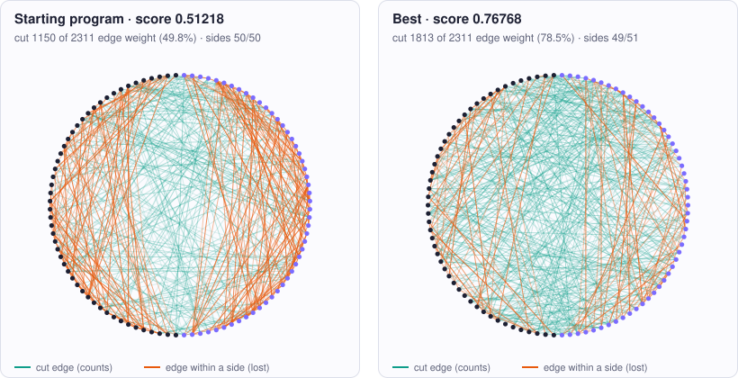

<!-- Copyright (c) 2026 by C. Klukas -->
<!-- SPDX-License-Identifier: GPL-3.0-only -->
<!-- Generated by `omega docs` from examples/max_cut/ and bench/results/*.json. Do not edit by hand. -->

# max_cut

Algorithms and heuristics · python · problem `max_cut` · [all examples](../examples.md)

## The problem

Write a heuristic for weighted max-cut. cut(n, edges) gets the number of nodes n and a list of edges (u, v, w) with 0 <= u < v < n, no duplicate pairs and integer weight 1 <= w <= 10, and must return a list of n sides, each the int 0 or 1. The cut weight is the sum of w over edges whose endpoints lie on different sides; the goal is the LARGEST cut. It is run on three fixed sparse random graphs: 100 nodes / 400 edges, 200 nodes / 1200 edges, 400 nodes / 1600 edges. The time limit is 2.0 CPU seconds per graph, measured with time.process_time() around the call; using more than 1.5 x the limit (3.0 s) makes the program invalid, so check time.process_time() regularly and return the best assignment found when time runs out. Only the Python standard library may be used (no numpy).

- **Score:** score = mean over the three graphs of (cut weight / total edge weight). Higher is better; a random or alternating split gets about 0.5 (the initial program scores about 0.51), simple one-flip local search about 0.7. Metrics per graph: <name>_cut, <name>_total, <name>_ratio, <name>_cpu_s.
- **Files:** `examples/max_cut/omega.toml`, the program `initial.py`, evaluator stages: main

### Why this is a hard problem

Max-cut splits the nodes of a network into two groups so that as much connection weight as possible runs between the groups. It appears in circuit layout, in physics (the lowest-energy states of magnetic spin glasses) and in clustering. It is one of the 21 problems Richard Karp (UC Berkeley) [proved NP-complete in 1972](https://doi.org/10.1007/978-1-4684-2001-2_9). Michel Goemans and David Williamson (MIT and IBM, [1995](https://doi.org/10.1145/227683.227684)) found a method guaranteed to reach at least 87.8 % of the optimum; under a widely believed conjecture, no fast method can guarantee more.

The starting program alternates the sides by node number and ignores the edges, so it cuts about half the weight, like a random split (score about 0.51). Moving single nodes to the side where they cut more reaches about 0.70. A score of 1.0 is impossible: in a triangle at most two of the three edges can be cut, and the sparse random graphs contain many such odd cycles. The true optimum is unknown.

It is hard because every node's best side depends on its neighbours' sides, which depend on theirs. Simple improvement gets stuck where no single move helps, and escaping needs deliberate worse moves (tabu search) or perturbations, with careful bookkeeping so that thousands of moves fit into two seconds of Python.

Run it with:

```bash
python3 -m omega_transform run examples/max_cut --minutes 15
```

## The starting program

The model may change only the code between the `OMEGA-BLOCK` markers.

```python
# Copyright (c) 2026 by C. Klukas
# SPDX-License-Identifier: MIT
"""Weighted max-cut: split the nodes of a graph into two sides to maximize the cut weight.

The evaluator calls cut(n, edges) on three fixed random graphs (100 to 400 nodes,
integer weights) and scores the weight of the edges between the two sides.
"""
import math
import random
import time

# OMEGA-BLOCK-START
def cut(n, edges):
    """Return a list of n values, side[i] in {0, 1} for node i.

    n: number of nodes (0..n-1); edges: list of (u, v, w) with 0 <= u < v < n, no
    duplicate pairs, integer weight 1 <= w <= 10. The cut weight is the sum of w over
    edges whose endpoints are on different sides; larger is better. The call has a CPU
    time limit of 2.0 s (time.process_time(); more than 1.5 x the limit makes the program
    invalid). Only the Python standard library may be used.

    Current method: alternate the sides by node index (ignores the edges entirely).
    """
    return [i % 2 for i in range(n)]
# OMEGA-BLOCK-END
```

## Benchmark results

The best result so far comes from **nvidia/nemotron-3-ultra-550b-a55b:free (think)**, run through OpenRouter on 2026-11-01: a score of **0.76768** (×1.50 the starting program's 0.51218), reached after 14.54 of 60 minutes with 16 model requests.

What the starting program produces (left) and what the best program by nvidia/nemotron-3-ultra-550b-a55b:free (think) produces (right), drawn for the instance `g100`:



### How it got there

The best program's ancestry, from the starting program on. "Edit" and "rewrite" are the model's changes; a parameter sweep is the engine trying values for the constants the model exposed.

| Step | Minute | Score | Kind | Idea |
|--:|--:|--:|---|---|
| 0 | 0.0 | 0.51218 | start | initial program |
| 1 | 2.6 | 0 | rewrite | Implement greedy randomized construction followed by iterative one-flip local search with random restarts, using adjacency lists and incremental gain updates, all bounded by a per-graph CPU time limit. |
| 2 | 5.4 | 0.7581 | rewrite | Fix the broken greedy construction by tracking placed nodes, replace simple local search with tabu search (proven in high-scoring program), and expose key parameters for sweeping to find optimal values. |
| 3 | 14.5 | 0.76578 | edit | Fix the critical bug where best_side tracks the current solution instead of the global best, update parameters to the best sweep values (TABU_TENURE_BASE=0.05, PERTURB_FRACTION=0.15), and fix the aspiration criterion to use global best. |
| 4 | 14.5 | 0.76768 | parameter sweep | tuned TABU_TENURE_BASE=0.07, TABU_RANDOM_RANGE=7, PERTURB_FRACTION=0.25, TIME_LIMIT=1.95 on top of: Fix the critical bug where best_side tracks the current solution instead of the global best, update parameters to the best sweep values (TABU_TENURE_BASE=0.05 … |

### The best program

What changed compared with the starting program:

```diff
--- initial
+++ best
@@ -10,16 +10,134 @@
 import time
 
 # OMEGA-BLOCK-START
+# Tunable parameters (will be swept)
+TABU_TENURE_BASE = 0.07      # base tenure as fraction of n (best from sweep)
+TABU_RANDOM_RANGE = 7        # random addition to tenure
+PERTURB_FRACTION = 0.25      # fraction of nodes to flip during perturbation (best from sweep)
+TIME_LIMIT = 1.95            # safety margin under 2.0s
+
 def cut(n, edges):
     """Return a list of n values, side[i] in {0, 1} for node i.
 
-    n: number of nodes (0..n-1); edges: list of (u, v, w) with 0 <= u < v < n, no
-    duplicate pairs, integer weight 1 <= w <= 10. The cut weight is the sum of w over
-    edges whose endpoints are on different sides; larger is better. The call has a CPU
-    time limit of 2.0 s (time.process_time(); more than 1.5 x the limit makes the program
-    invalid). Only the Python standard library may be used.
-
-    Current method: alternate the sides by node index (ignores the edges entirely).
+    Uses greedy construction + tabu search with random restarts.
     """
-    return [i % 2 for i in range(n)]
+    start_time = time.process_time()
+    
+    # Build adjacency list: adj[u] = list of (v, w)
+    adj = [[] for _ in range(n)]
+    total_weight = 0
+    for u, v, w in edges:
+        adj[u].append((v, w))
+        adj[v].append((u, w))
+        total_weight += w
+    
+    # Greedy construction: place nodes one by one on the side that cuts more weight
+    side = [0] * n
+    placed = [False] * n
+    # Start with a random node on side 0
+    order = list(range(n))
+    random.shuffle(order)
+    
+    for idx in order:
+        placed[idx] = True
+        gain0 = 0  # weight to side 0 (would be internal if we choose 0)
+        gain1 = 0  # weight to side 1 (would be internal if we choose 1)
+        for nb, w in adj[idx]:
+            if placed[nb]:
+                if side[nb] == 0:
+                    gain0 += w
+                else:
+                    gain1 += w
+        # Choose side that maximizes cut (minimizes internal weight)
+        side[idx] = 0 if gain0 <= gain1 else 1
+    
+    # Compute initial gains: gain[i] = weight to own side - weight to other side
+    # Positive gain means flipping improves the cut
+    gain = [0] * n
+    for u in range(n):
+        for v, w in adj[u]:
+            if side[u] == side[v]:
+                gain[u] += w
+            else:
+                gain[u] -= w
+    
+    def compute_cut_weight():
+        cw = 0
+        for u, v, w in edges:
+            if side[u] != side[v]:
+                cw += w
+        return cw
+    
+    best_side = side[:]
+    best_cut = compute_cut_weight()
+    global_best_side = side[:]
+    global_best_cut = best_cut
+    
+    # Tabu search with restarts
+    tabu = [0] * n  # iteration when node becomes free
+    iteration = 0
+    tenure_base = max(1, int(n * TABU_TENURE_BASE))
+    
+    while True:
+        # Check time
+        if time.process_time() - start_time > TIME_LIMIT:
+            break
+        
+        # Find best non-tabu move (or aspirating move)
+        best_gain = -10**9
+        best_node = -1
+        for i in range(n):
+            # Aspiration: allow tabu move if it beats global best
+            if tabu[i] <= iteration or (gain[i] > 0 and best_cut + gain[i] > global_best_cut):
+                if gain[i] > best_gain:
+                    best_gain = gain[i]
+                    best_node = i
+        
+        if best_node == -1:
+            # All tabu, pick least tabu
+            best_node = min(range(n), key=lambda i: tabu[i])
+            best_gain = gain[best_node]
+        
+        # Flip best_node
+        side[best_node] ^= 1
+        # Update gains of neighbors
+        for nb, w in adj[best_node]:
+            if side[nb] == side[best_node]:  # now same side
+                gain[nb] += 2 * w
+            else:  # now opposite side
+                gain[nb] -= 2 * w
+        gain[best_node] = -gain[best_node]
+        
+        # Set tabu
+        tabu[best_node] = iteration + tenure_base + random.randint(0, TABU_RANDOM_RANGE)
+        iteration += 1
+        
+        # Check current cut
+        current_cut = best_cut + best_gain
+        best_cut = current_cut
+        best_side = side[:]
+        
+        # Update global best
+        if current_cut > global_best_cut:
+            global_best_cut = current_cut
+            global_best_side = side[:]
+        
+        # Periodic perturbation to escape local optima
+        if iteration % (n * 2) == 0:
+            # Perturb: flip random fraction of nodes
+            num_flip = max(1, int(n * PERTURB_FRACTION))
+            flip_nodes = random.sample(range(n), num_flip)
+            for fn in flip_nodes:
+                side[fn] ^= 1
+                for nb, w in adj[fn]:
+                    if side[nb] == side[fn]:
+                        gain[nb] += 2 * w
+                    else:
+                        gain[nb] -= 2 * w
+                gain[fn] = -gain[fn]
+            # Recompute best_cut after perturbation
+            best_cut = compute_cut_weight()
+            best_side = side[:]
+    
+    return global_best_side
 # OMEGA-BLOCK-END
```

### All models

One run per model and reasoning mode; the [model benchmarks](../benchmarks/max_cut.md) page has speed, memory and progress over time.

| Model | Where | Machine | Best | Gain | Minutes to best | New bests |
|---|---|---|--:|--:|--:|--:|
| nvidia/nemotron-3-ultra-550b-a55b:free (think) | cloud | i7-8700K + 2x GTX 1080 Ti | 0.76768 | ×1.50 | 14.5 | 5 |
| dots-studio/dots-3-note-preview:free (no-think) | cloud | i7-8700K + 2x GTX 1080 Ti | 0.76761 | ×1.50 | 3.6 | 3 |
| dots-studio/dots-3-note-preview:free (think) | cloud | i7-8700K + 2x GTX 1080 Ti | 0.76752 | ×1.50 | 27.1 | 4 |
| nvidia/nemotron-3.5-super-vl:free (think) | cloud | i7-8700K + 2x GTX 1080 Ti | 0.76745 | ×1.50 | 6.7 | 4 |
| recursive/flint-v1.0:free (think) | cloud | i7-8700K + 2x GTX 1080 Ti | 0.76745 | ×1.50 | 30.3 | 10 |
| gpt-oss:20b (think) | local | i7-8700K + 2x GTX 1080 Ti | 0.76745 | ×1.50 | 14.3 | 7 |
| nvidia/nemotron-3-ultra-550b-a55b:free (no-think) | cloud | i7-8700K + 2x GTX 1080 Ti | 0.76741 | ×1.50 | 8.2 | 5 |
| gemma4:latest (think) | local | i7-8700K + 2x GTX 1080 Ti | 0.76631 | ×1.50 | 6.5 | 5 |
| gemma4:26b-a4b-it-qat (think) | local | i7-8700K + 2x GTX 1080 Ti | 0.76618 | ×1.50 | 46.0 | 2 |
| gpt-oss:20b (no-think) | local | i7-8700K + 2x GTX 1080 Ti | 0.76574 | ×1.50 | 13.8 | 5 |
| gemma4:12b-it-qat (think) | local | i7-8700K + 2x GTX 1080 Ti | 0.76535 | ×1.49 | 56.9 | 4 |
| gemma4:e4b-it-qat (no-think) | local | i7-8700K + 2x GTX 1080 Ti | 0.76471 | ×1.49 | 22.0 | 9 |
| gemma4:e4b-it-qat (think) | local | i7-8700K + 2x GTX 1080 Ti | 0.76424 | ×1.49 | 8.5 | 3 |
| gemma4:latest (no-think) | local | i7-8700K + 2x GTX 1080 Ti | 0.76345 | ×1.49 | 11.1 | 6 |
| nvidia/nemotron-3.5-lightning:free (no-think) | cloud | i7-8700K + 2x GTX 1080 Ti | 0.76162 | ×1.49 | 13.6 | 5 |
| qwen3:30b-a3b-instruct-2507-q4_K_M (no-think) | local | i7-8700K + 2x GTX 1080 Ti | 0.76007 | ×1.48 | 12.3 | 7 |
| cohere/north-mini-code:free (think) | cloud | i7-8700K + 2x GTX 1080 Ti | 0.75925 | ×1.48 | 7.6 | 4 |
| cohere/north-mini-code:free (no-think) | cloud | i7-8700K + 2x GTX 1080 Ti | 0.75332 | ×1.47 | 6.5 | 5 |
| xingchen-agi/xing4.0-29b-a4b:free (think) | cloud | i7-8700K + 2x GTX 1080 Ti | 0.75161 | ×1.47 | 15.0 | 1 |
| richardyoung/frognano-4b-2609:latest (think) | local | i7-8700K + 2x GTX 1080 Ti | 0.7503 | ×1.46 | 2.4 | 2 |
| qwen3.6:27b-coding-mtp-q4_K_M (no-think) | local | i7-8700K + 2x GTX 1080 Ti | 0.74898 | ×1.46 | 54.1 | 6 |
| underdog-saluki-27b:iq2-mix (no-think) | local | i7-8700K + 2x GTX 1080 Ti | 0.74766 | ×1.46 | 31.3 | 6 |
| nvidia/nemotron-3-nano-omni-30b-a3b-reasoning:free (think) | cloud | i7-8700K | 0.7393 | ×1.44 | 34.4 | 3 |
| hf.co/mmnga-o/Qwen3-Swallow-30B-A3B-RL-v0.2-gguf:Q4_K_M (no-think) | local | i7-8700K + 2x GTX 1080 Ti | 0.73547 | ×1.44 | 28.6 | 4 |
| qwen3:30b-a3b-instruct-2507-q4_K_M (think) | local | i7-8700K + 2x GTX 1080 Ti | 0.73531 | ×1.44 | 1.1 | 2 |
| qwen3.5:latest (no-think) | local | i7-8700K + 2x GTX 1080 Ti | 0.73495 | ×1.43 | 2.0 | 2 |
| hf.co/LiquidAI/LFM3-1.7B-GGUF:Q4_K_M (think) | local | i7-8700K + 2x GTX 1080 Ti | 0.73495 | ×1.43 | 9.8 | 1 |
| gemma4:e2b (think) | local | i7-8700K + 2x GTX 1080 Ti | 0.73495 | ×1.43 | 3.3 | 3 |
| nemotron-3-nano:4b (think) | local | i7-8700K + 2x GTX 1080 Ti | 0.7342 | ×1.43 | 9.5 | 4 |
| glm-4.7-flash:latest (no-think) | local | i7-8700K + 2x GTX 1080 Ti | 0.73215 | ×1.43 | 14.7 | 6 |
| xingchen-agi/xing4.0-29b-a4b:free (no-think) | cloud | i7-8700K + 2x GTX 1080 Ti | 0.73131 | ×1.43 | 14.1 | 1 |
| gemma4:e2b (no-think) | local | i7-8700K + 2x GTX 1080 Ti | 0.73068 | ×1.43 | 0.9 | 2 |
| frob/sarvam:30b (think) | local | i7-8700K + 2x GTX 1080 Ti | 0.72836 | ×1.42 | 38.6 | 2 |
| frob/sarvam:30b (no-think) | local | i7-8700K + 2x GTX 1080 Ti | 0.72422 | ×1.41 | 9.1 | 1 |
| nvidia/nemotron-3.5-super-vl:free (no-think) | cloud | i7-8700K + 2x GTX 1080 Ti | 0.71534 | ×1.40 | 11.1 | 4 |
| gemma4:12b-it-qat (no-think) | local | i7-8700K + 2x GTX 1080 Ti | 0.70701 | ×1.38 | 4.5 | 1 |
| qwen3-coder:30b (no-think) | local | i7-8700K + 2x GTX 1080 Ti | 0.70701 | ×1.38 | 5.6 | 1 |
| qwen2.5-coder:7b (no-think) | local | i7-8700K + 2x GTX 1080 Ti | 0.6981 | ×1.36 | 3.2 | 3 |
| glm-4.7-flash:latest (think) | local | i7-8700K + 2x GTX 1080 Ti | 0.62624 | ×1.22 | 50.4 | 2 |
| hf.co/llm-jp/llm-jp-4.1-32b-a3b-thinking-gguf:Q4_K_M (no-think) | local | i7-8700K + 2x GTX 1080 Ti | 0.51626 | ×1.01 | 55.6 | 1 |
| nvidia/nemotron-3-nano-omni-30b-a3b-reasoning:free (no-think) | cloud | i7-8700K + 2x GTX 1080 Ti | 0.51218 | ×1.00 | - | 0 |
| hf.co/LiquidAI/LFM3-1.7B-GGUF:Q4_K_M (no-think) | local | i7-8700K + 2x GTX 1080 Ti | 0.51218 | ×1.00 | - | 0 |
| nemotron-3-nano:4b (no-think) | local | i7-8700K + 2x GTX 1080 Ti | 0.51218 | ×1.00 | - | 0 |
| richardyoung/frognano-4b-2609:latest (no-think) | local | i7-8700K + 2x GTX 1080 Ti | 0.51218 | ×1.00 | - | 0 |
| yandex/YandexGPT-5-Lite-8B-instruct-GGUF:latest (no-think) | local | i7-8700K + 2x GTX 1080 Ti | 0.51218 | ×1.00 | - | 0 |
| MichelRosselli/apertus:8b-instruct-2509-q4_k_m (no-think) | local | i7-8700K + 2x GTX 1080 Ti | 0.51218 | ×1.00 | - | 0 |
| llm-jp-4-8b-omega:q4_k_m (no-think) | local | i7-8700K + 2x GTX 1080 Ti | 0.51218 | ×1.00 | - | 0 |
| gemma4:26b-a4b-it-qat (no-think) | local | i7-8700K + 2x GTX 1080 Ti | 0.51218 | ×1.00 | - | 0 |
| nvidia/nemotron-3.5-lightning:free (think) | cloud | i7-8700K + 2x GTX 1080 Ti | 0.51218 | ×1.00 | - | 0 |
| qwen3.5:latest (think) | local | i7-8700K + 2x GTX 1080 Ti | 0.51218 | ×1.00 | - | 0 |
| underdog-saluki-27b:iq2-mix (think) | local | i7-8700K + 2x GTX 1080 Ti | 0.51218 | ×1.00 | - | 0 |
| qwen3.6:27b-coding-mtp-q4_K_M (think) | local | i7-8700K + 2x GTX 1080 Ti | 0.51218 | ×1.00 | - | 0 |
| hf.co/Colby/apertus-v1.5-8b-text-Q4_K_M-GGUF:Q4_K_M (no-think) | local | i7-8700K + 2x GTX 1080 Ti | 0.51218 | ×1.00 | - | 0 |
