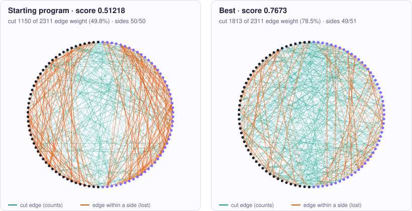

<!-- Copyright (c) 2026 by C. Klukas -->
<!-- SPDX-License-Identifier: GPL-3.0-only -->
<!-- Generated by `omega docs` from examples/max_cut/ and bench/results/*.json. Do not edit by hand. -->

# max_cut

Algorithms and heuristics · python · problem `max_cut` · [all examples](../examples.md)

## The problem

Write a heuristic for weighted max-cut. cut(n, edges) gets the number of nodes n and a list of edges (u, v, w) with 0 <= u < v < n, no duplicate pairs and integer weight 1 <= w <= 10, and must return a list of n sides, each the int 0 or 1. The cut weight is the sum of w over edges whose endpoints lie on different sides; the goal is the LARGEST cut. It is run on three fixed sparse random graphs: 100 nodes / 400 edges, 200 nodes / 1200 edges, 400 nodes / 1600 edges. The time limit is 2.0 CPU seconds per graph, measured with time.process_time() around the call; using more than 1.5 x the limit (3.0 s) makes the program invalid, so check time.process_time() regularly and return the best assignment found when time runs out. Only the Python standard library may be used (no numpy).

- **Score:** score = mean over the three graphs of (cut weight / total edge weight). Higher is better; a random or alternating split gets about 0.5 (the initial program scores about 0.51), simple one-flip local search about 0.7. Metrics per graph: <name>_cut, <name>_total, <name>_ratio, <name>_cpu_s.
- **Files:** `examples/max_cut/omega.toml`, the program `initial.py`, evaluator stages: main

### Why this is a hard problem

Max-cut splits the nodes of a network into two groups so that as much connection weight as possible runs between the groups. It appears in circuit layout, in physics (the lowest-energy states of magnetic spin glasses) and in clustering. It is one of the 21 problems Richard Karp (UC Berkeley) [proved NP-complete in 1972](https://doi.org/10.1007/978-1-4684-2001-2_9). Michel Goemans and David Williamson (MIT and IBM, [1995](https://doi.org/10.1145/227683.227684)) found a method guaranteed to reach at least 87.8 % of the optimum; under a widely believed conjecture, no fast method can guarantee more.

The starting program alternates the sides by node number and ignores the edges, so it cuts about half the weight, like a random split (score about 0.51). Moving single nodes to the side where they cut more reaches about 0.70. A score of 1.0 is impossible: in a triangle at most two of the three edges can be cut, and the sparse random graphs contain many such odd cycles. The true optimum is unknown.

It is hard because every node's best side depends on its neighbours' sides, which depend on theirs. Simple improvement gets stuck where no single move helps, and escaping needs deliberate worse moves (tabu search) or perturbations, with careful bookkeeping so that thousands of moves fit into two seconds of Python.

Run it with:

```bash
python3 -m omega_transform run examples/max_cut --minutes 15
```

## The starting program

The model may change only the code between the `OMEGA-BLOCK` markers.

```python
# Copyright (c) 2026 by C. Klukas
# SPDX-License-Identifier: MIT
"""Weighted max-cut: split the nodes of a graph into two sides to maximize the cut weight.

The evaluator calls cut(n, edges) on three fixed random graphs (100 to 400 nodes,
integer weights) and scores the weight of the edges between the two sides.
"""
import math
import random
import time

# OMEGA-BLOCK-START
def cut(n, edges):
    """Return a list of n values, side[i] in {0, 1} for node i.

    n: number of nodes (0..n-1); edges: list of (u, v, w) with 0 <= u < v < n, no
    duplicate pairs, integer weight 1 <= w <= 10. The cut weight is the sum of w over
    edges whose endpoints are on different sides; larger is better. The call has a CPU
    time limit of 2.0 s (time.process_time(); more than 1.5 x the limit makes the program
    invalid). Only the Python standard library may be used.

    Current method: alternate the sides by node index (ignores the edges entirely).
    """
    return [i % 2 for i in range(n)]
# OMEGA-BLOCK-END
```

## Benchmark results

The best result so far comes from **gpt-oss:20b (think)**, run locally with Ollama on 2026-10-26: a score of **0.76741** (×1.50 the starting program's 0.51218), reached after 11.7 of 15 minutes with 14 model requests.

What the starting program produces (left) and what the best program by gpt-oss:20b (think) produces (right), drawn for the instance `g100`:



### How it got there

The best program's ancestry, from the starting program on. "Edit" and "rewrite" are the model's changes; a parameter sweep is the engine trying values for the constants the model exposed.

| Step | Minute | Score | Kind | Idea |
|--:|--:|--:|---|---|
| 0 | 0.0 | 0.51218 | start | initial program |
| 1 | 4.5 | 0.72255 | edit | Replace the trivial alternating assignment with a greedy construction followed by an incremental one‑flip local search that updates node gains efficiently, improving the cut quality while staying within the time limit. |
| 2 | 7.3 | 0.73256 | edit | Add a perturbation step that flips a small random subset of nodes after the first local optimum and restarts the incremental local search, increasing escape from local optima and improving the ratio on the middle‑size graph. |
| 3 | 11.7 | 0.76741 | edit | Add repeated perturbation‑restart local search cycles with a larger perturbation rate (10%) to escape more local optima and improve the middle‑size graph score. |

### The best program

What changed compared with the starting program:

```diff
--- initial
+++ best
@@ -13,13 +13,136 @@
 def cut(n, edges):
     """Return a list of n values, side[i] in {0, 1} for node i.
 
-    n: number of nodes (0..n-1); edges: list of (u, v, w) with 0 <= u < v < n, no
-    duplicate pairs, integer weight 1 <= w <= 10. The cut weight is the sum of w over
-    edges whose endpoints are on different sides; larger is better. The call has a CPU
-    time limit of 2.0 s (time.process_time(); more than 1.5 x the limit makes the program
-    invalid). Only the Python standard library may be used.
+    Implements greedy construction followed by incremental one‑flip local search.
+    """
+    MAX_TIME = 1.9  # CPU seconds allowed for this graph
+    start_time = time.process_time()
 
-    Current method: alternate the sides by node index (ignores the edges entirely).
-    """
-    return [i % 2 for i in range(n)]
+    # Build adjacency list
+    adj = [[] for _ in range(n)]
+    for u, v, w in edges:
+        adj[u].append((v, w))
+        adj[v].append((u, w))
+
+    # Greedy construction: assign each node to side that maximizes current cut
+    side = [None] * n
+    for i in range(n):
+        w0 = w1 = 0
+        for nb, w in adj[i]:
+            sj = side[nb]
+            if sj == 0:
+                w1 += w
+            elif sj == 1:
+                w0 += w
+        if w0 > w1:
+            side[i] = 0
+        elif w1 > w0:
+            side[i] = 1
+        else:
+            side[i] = random.randint(0, 1)
+
+    # Compute initial cut weight
+    cur_weight = 0
+    for u, v, w in edges:
+        if side[u] != side[v]:
+            cur_weight += w
+
+    best_weight = cur_weight
+    best_side = side[:]
+
+    # Compute initial gains for each node
+    gain = [0] * n
+    for u in range(n):
+        g = 0
+        for v, w in adj[u]:
+            if side[v] == side[u]:
+                g += w
+            else:
+                g -= w
+        gain[u] = g
+
+    # One‑flip local search with incremental updates
+    while True:
+        if time.process_time() - start_time > MAX_TIME:
+            return best_side
+
+        # Find node with maximum positive gain
+        best_g = 0
+        best_node = -1
+        for i in range(n):
+            if gain[i] > best_g:
+                best_g = gain[i]
+                best_node = i
+
+        if best_g <= 0:
+            break
+
+        # Flip the best node
+        u = best_node
+        old_side = side[u]
+        side[u] ^= 1
+        cur_weight += best_g
+
+        if cur_weight > best_weight:
+            best_weight = cur_weight
+            best_side = side[:]
+
+        # Update gain of the flipped node
+        gain[u] = -gain[u]
+
+        # Update gains of neighbors
+        for v, w in adj[u]:
+            if side[v] == old_side:  # neighbor was same side before flip
+                gain[v] -= 2 * w
+            else:  # neighbor was opposite before flip
+                gain[v] += 2 * w
+
+    # Multiple perturbation‑restart local search cycles until time expires
+    PERTURB_RATE = 0.1  # fraction of nodes to flip each restart
+    while True:
+        if time.process_time() - start_time > MAX_TIME:
+            return best_side
+        # perturb a fraction of nodes
+        k = max(1, int(PERTURB_RATE * n))
+        to_flip = random.sample(range(n), k)
+        for u in to_flip:
+            side[u] ^= 1
+        # recompute gains
+        for u in range(n):
+            g = 0
+            for v, w in adj[u]:
+                if side[v] == side[u]:
+                    g += w
+                else:
+                    g -= w
+            gain[u] = g
+        # recompute current weight
+        cur_weight = sum(w for u, v, w in edges if side[u] != side[v])
+        # inner local search
+        while True:
+            if time.process_time() - start_time > MAX_TIME:
+                return best_side
+            best_g = 0
+            best_node = -1
+            for i in range(n):
+                if gain[i] > best_g:
+                    best_g = gain[i]
+                    best_node = i
+            if best_g <= 0:
+                break
+            u = best_node
+            old_side = side[u]
+            side[u] ^= 1
+            cur_weight += best_g
+            if cur_weight > best_weight:
+                best_weight = cur_weight
+                best_side = side[:]
+            gain[u] = -gain[u]
+            for v, w in adj[u]:
+                if side[v] == old_side:
+                    gain[v] -= 2 * w
+                else:
+                    gain[v] += 2 * w
+
+    return best_side
 # OMEGA-BLOCK-END
```

### All models

One run per model and reasoning mode; the [model benchmarks](../benchmarks/max_cut.md) page has speed, memory and progress over time.

| Model | Where | Machine | Best | Gain | Minutes to best | New bests |
|---|---|---|--:|--:|--:|--:|
| gpt-oss:20b (think) | local | i7-8700K + 2x GTX 1080 Ti | 0.76741 | ×1.50 | 11.7 | 6 |
| qwen3:30b-a3b-instruct-2507-q4_K_M (think) | local | Apple M1 Max | 0.7673 | ×1.50 | 8.0 | 5 |
| gpt-oss:20b (think) | local | Apple M1 Max | 0.76722 | ×1.50 | 16.4 | 8 |
| nemotron-3-nano:30b-a3b-mlx (no-think) | local | Apple M1 Max | 0.76715 | ×1.50 | 14.4 | 6 |
| gemma4:12b-it-qat (no-think) | local | i7-8700K + 2x GTX 1080 Ti | 0.76688 | ×1.50 | 10.4 | 3 |
| qwen3.8:27b-mtp-q4_K_M (think) | local | Apple M1 Max | 0.7654 | ×1.49 | 13.8 | 1 |
| qwen3:30b-a3b-instruct-2507-q4_K_M (no-think) | local | i7-8700K + 2x GTX 1080 Ti | 0.76506 | ×1.49 | 9.7 | 5 |
| gemma4:26b-a4b-it-qat (no-think) | local | Apple M1 Max | 0.76503 | ×1.49 | 5.4 | 3 |
| qwen3.8:27b-mtp-q4_K_M (no-think) | local | i7-8700K + 2x GTX 1080 Ti | 0.76207 | ×1.49 | 17.9 | 2 |
| gemma4:latest (no-think) | local | i7-8700K + 2x GTX 1080 Ti | 0.762 | ×1.49 | 11.7 | 12 |
| muse-glimmer:30b (think) | local | Apple M1 Max | 0.75919 | ×1.48 | 14.6 | 1 |
| muse-glimmer:30b (no-think) | local | Apple M1 Max | 0.75858 | ×1.48 | 16.5 | 4 |
| gemma4:26b-a4b-it-qat (no-think) | local | i7-8700K + 2x GTX 1080 Ti | 0.7572 | ×1.48 | 11.2 | 2 |
| gemma4:26b-a4b-it-qat (think) | local | i7-8700K + 2x GTX 1080 Ti | 0.75568 | ×1.48 | 8.2 | 1 |
| gemma4:latest (no-think) | local | Apple M1 Max | 0.7555 | ×1.48 | 14.1 | 8 |
| gemma4:latest (think) | local | i7-8700K + 2x GTX 1080 Ti | 0.75448 | ×1.47 | 4.4 | 4 |
| gemma4:e4b-it-qat (think) | local | Apple M1 Max | 0.75304 | ×1.47 | 15.2 | 4 |
| richardyoung/frognano-4b-2609:latest (no-think) | local | i7-8700K + 2x GTX 1080 Ti | 0.75273 | ×1.47 | 9.3 | 3 |
| qwen3-coder:30b (no-think) | local | i7-8700K + 2x GTX 1080 Ti | 0.75195 | ×1.47 | 11.9 | 5 |
| nemotron-3.5-lightning:30b-mlx (no-think) | local | Apple M1 Max | 0.75179 | ×1.47 | 13.2 | 2 |
| gpt-oss:20b (no-think) | local | Apple M1 Max | 0.75151 | ×1.47 | 14.9 | 4 |
| gemma4:e4b-it-qat (no-think) | local | Apple M1 Max | 0.75125 | ×1.47 | 10.5 | 7 |
| gemma4:latest (think) | local | Apple M1 Max | 0.75099 | ×1.47 | 15.7 | 5 |
| gemma4:e2b (no-think) | local | Apple M1 Max | 0.75025 | ×1.46 | 11.9 | 4 |
| gemma4:e2b (think) | local | i7-8700K + 2x GTX 1080 Ti | 0.74942 | ×1.46 | 6.4 | 5 |
| nemotron-3-nano:30b-a3b-mlx (think) | local | Apple M1 Max | 0.74783 | ×1.46 | 16.9 | 3 |
| gemma4:e4b-it-qat (think) | local | i7-8700K + 2x GTX 1080 Ti | 0.74504 | ×1.45 | 13.3 | 5 |
| gpt-oss:20b (no-think) | local | i7-8700K + 2x GTX 1080 Ti | 0.74483 | ×1.45 | 10.3 | 4 |
| gemma4:e2b (no-think) | local | i7-8700K + 2x GTX 1080 Ti | 0.74351 | ×1.45 | 14.9 | 8 |
| qwen3:30b-a3b-instruct-2507-q4_K_M (no-think) | local | Apple M1 Max | 0.74224 | ×1.45 | 13.7 | 4 |
| frob/sarvam:30b (no-think) | local | Apple M1 Max | 0.74075 | ×1.45 | 11.3 | 2 |
| qwen3:30b-a3b-instruct-2507-q4_K_M (think) | local | i7-8700K + 2x GTX 1080 Ti | 0.74038 | ×1.45 | 13.7 | 4 |
| gemma4:e4b-it-qat (no-think) | local | i7-8700K + 2x GTX 1080 Ti | 0.73916 | ×1.44 | 6.0 | 4 |
| qwen3.5:latest (no-think) | local | Apple M1 Max | 0.73771 | ×1.44 | 7.6 | 3 |
| qwen3.8:27b-mtp-q4_K_M (no-think) | local | Apple M1 Max | 0.73771 | ×1.44 | 17.6 | 1 |
| richardyoung/frognano-4b-2609:latest (no-think) | local | Apple M1 Max | 0.73771 | ×1.44 | 8.1 | 3 |
| qwen3.5:latest (no-think) | local | i7-8700K + 2x GTX 1080 Ti | 0.73771 | ×1.44 | 4.0 | 3 |
| ingu627/exaone4.0:32b (no-think) | local | Apple M1 Max | 0.73561 | ×1.44 | 17.8 | 2 |
| gemma4:e2b (think) | local | Apple M1 Max | 0.73531 | ×1.44 | 5.3 | 2 |
| gemma4:26b-a4b-it-qat (think) | local | Apple M1 Max | 0.73495 | ×1.43 | 12.9 | 2 |
| qwen3.5:latest (think) | local | Apple M1 Max | 0.72921 | ×1.42 | 11.5 | 2 |
| qwen3.5:latest (think) | local | i7-8700K + 2x GTX 1080 Ti | 0.72903 | ×1.42 | 6.7 | 2 |
| nemotron-3-nano:4b (think) | local | i7-8700K + 2x GTX 1080 Ti | 0.72862 | ×1.42 | 5.8 | 2 |
| qwen2.5-coder:7b (no-think) | local | i7-8700K + 2x GTX 1080 Ti | 0.72736 | ×1.42 | 12.4 | 3 |
| underdog-saluki-27b:iq2-mix (no-think) | local | Apple M1 Max | 0.72595 | ×1.42 | 7.6 | 3 |
| nemotron-3-nano:4b (think) | local | Apple M1 Max | 0.72498 | ×1.42 | 14.8 | 4 |
| yandex/YandexGPT-5-Lite-8B-instruct-GGUF:latest (no-think) | local | i7-8700K + 2x GTX 1080 Ti | 0.72369 | ×1.41 | 6.3 | 4 |
| glm-4.7-flash:latest (no-think) | local | Apple M1 Max | 0.72224 | ×1.41 | 2.9 | 1 |
| qwen3.6:27b-coding-mtp-q4_K_M (no-think) | local | Apple M1 Max | 0.71488 | ×1.40 | 9.2 | 2 |
| nemotron-3-nano:4b (no-think) | local | i7-8700K + 2x GTX 1080 Ti | 0.71461 | ×1.40 | 12.7 | 2 |
| gemma4:12b-it-qat (no-think) | local | Apple M1 Max | 0.71177 | ×1.39 | 3.5 | 1 |
| qwen3.8:27b-mtp-q4_K_M (think) | local | i7-8700K + 2x GTX 1080 Ti | 0.71141 | ×1.39 | 32.1 | 2 |
| qwen3-coder:30b (no-think) | local | Apple M1 Max | 0.69428 | ×1.36 | 12.3 | 2 |
| qwen3.5:27b (no-think) | local | Apple M1 Max | 0.69385 | ×1.35 | 9.2 | 1 |
| devstral-small-2:24b (no-think) | local | Apple M1 Max | 0.69368 | ×1.35 | 5.5 | 1 |
| frob/sarvam:30b (think) | local | i7-8700K + 2x GTX 1080 Ti | 0.69189 | ×1.35 | 13.6 | 1 |
| underdog-saluki-27b:iq2-mix (no-think) | local | i7-8700K + 2x GTX 1080 Ti | 0.69189 | ×1.35 | 7.5 | 3 |
| qwen3.6:27b-coding-mtp-q4_K_M (no-think) | local | i7-8700K + 2x GTX 1080 Ti | 0.68774 | ×1.34 | 14.0 | 2 |
| richardyoung/frognano-4b-2609:latest (think) | local | i7-8700K + 2x GTX 1080 Ti | 0.63591 | ×1.24 | 15.5 | 6 |
| nemotron-3-nano:4b (no-think) | local | Apple M1 Max | 0.61463 | ×1.20 | 4.3 | 1 |
| qwen2.5-coder:7b (no-think) | local | Apple M1 Max | 0.59204 | ×1.16 | 14.1 | 4 |
| richardyoung/frognano-4b-2609:latest (think) | local | Apple M1 Max | 0.54422 | ×1.06 | 2.0 | 2 |
| glm-4.7-flash:latest (no-think) | local | i7-8700K + 2x GTX 1080 Ti | 0.53668 | ×1.05 | 13.7 | 4 |
| Bored/GigaChat3.1-10B-A1.8B-q4_K_M:latest (no-think) | local | i7-8700K + 2x GTX 1080 Ti | 0.51849 | ×1.01 | 1.7 | 1 |
| yandex/YandexGPT-5-Lite-8B-instruct-GGUF:latest (no-think) | local | Apple M1 Max | 0.51766 | ×1.01 | 6.3 | 1 |
| gemma4:12b-it-qat (think) | local | Apple M1 Max | 0.51218 | ×1.00 | - | 0 |
| qwen3.5:27b (think) | local | Apple M1 Max | 0.51218 | ×1.00 | - | 0 |
| qwen3.6:27b-coding-mtp-q4_K_M (think) | local | Apple M1 Max | | | | failed: all 1 model requests failed: qwen3.6:27b-coding-mtp-q4_K_M … |
| MichelRosselli/apertus:8b-instruct-2509-q4_k_m (no-think) | local | Apple M1 Max | 0.51218 | ×1.00 | - | 0 |
| llm-jp-4-8b-omega:q4_k_m (no-think) | local | Apple M1 Max | 0.51218 | ×1.00 | - | 0 |
| glm-4.7-flash:latest (think) | local | Apple M1 Max | 0.51218 | ×1.00 | - | 0 |
| frob/sarvam:30b (think) | local | Apple M1 Max | | | | failed: all 5 model requests failed: frob/sarvam:30b: answer … |
| nemotron-3.5-lightning:30b-mlx (think) | local | Apple M1 Max | | | | failed: all 4 model requests failed … |
| MichelRosselli/apertus:8b-instruct-2509-q4_k_m (no-think) | local | i7-8700K + 2x GTX 1080 Ti | 0.51218 | ×1.00 | - | 0 |
| llm-jp-4-8b-omega:q4_k_m (no-think) | local | i7-8700K + 2x GTX 1080 Ti | 0.51218 | ×1.00 | - | 0 |
| frob/sarvam:30b (no-think) | local | i7-8700K + 2x GTX 1080 Ti | 0.51218 | ×1.00 | - | 0 |
| gemma4:12b-it-qat (think) | local | i7-8700K + 2x GTX 1080 Ti | 0.51218 | ×1.00 | - | 0 |
| qwen3.6:27b-coding-mtp-q4_K_M (think) | local | i7-8700K + 2x GTX 1080 Ti | 0.51218 | ×1.00 | - | 0 |
| glm-4.7-flash:latest (think) | local | i7-8700K + 2x GTX 1080 Ti | 0.51218 | ×1.00 | - | 0 |
