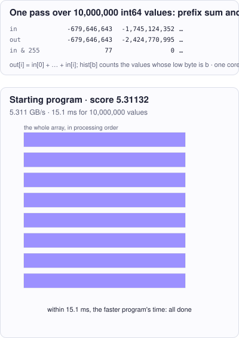

<!-- Copyright (c) 2026 by C. Klukas -->
<!-- SPDX-License-Identifier: GPL-3.0-only -->
<!-- Generated by `omega docs` from examples/prefix_sum_cpp/ and bench/results/*.json. Do not edit by hand. -->

# prefix_sum_cpp

Performance (C++) · cpp · problem `prefix_sum_histogram_single_thread` · [all examples](../examples.md)

## The problem

Make the C++ function scan_and_histogram(in, out, n, hist) use as little CPU time as possible on ONE core of this machine (Apple Silicon, ARM NEON available via <arm_neon.h>). It computes two things in one call over n int64_t values: out[i] = in[0] + in[1] + ... + in[i] (inclusive prefix sum), and hist[b] = number of i with (in[i] & 255) == b, for all 256 bins b (uint64_t counts). The time is measured with the process CPU clock, so extra threads do not help: their CPU time adds up. Results must be EXACTLY equal to a simple reference loop for every n from 0 to 20'000'000; neither out nor hist is zeroed by the caller, so every element and every bin must be written. The benchmark uses n = 10'000'000 values in [-2^31, 2^31) (sums cannot overflow); about half of them have low byte 0 and a quarter come in runs sharing one low byte, so a few histogram bins are very hot. Why the histogram: a plain prefix sum alone is a one-line loop the compiler already handles close to the memory limit, which would leave little to improve. The fused histogram with hot bins makes the straightforward loop stall on repeated read-modify-write of the same counter, so there is real headroom while the prefix sum still has to stream 80 MB in and 80 MB out.

- **Score:** score = GB of input (8 bytes per element) processed per CPU-second at n = 10'000'000 (best of 30 runs). ns_per_element is the same time per element. Correctness is checked first on n = 0, 1, 7, 1001, 65537, and on every benchmark run; any wrong out element, wrong bin, or write past the end of out or hist[255] makes the program invalid.
- **Files:** `examples/prefix_sum_cpp/omega.toml`, the program `scan.cpp`, evaluator stages: check, bench; new bests are re-measured

### Why this is a hard problem

A prefix sum (the running total of a sequence) and a histogram (how often each value occurs) are basic building blocks of data processing, inside radix sort, database aggregation and parallel algorithms. Guy Blelloch (Carnegie Mellon, [1990](https://www.cs.cmu.edu/~scandal/papers/CMU-CS-90-190.html)) showed how widely the prefix sum applies as a building block of parallel algorithms.

The starting program does both in one simple loop, about 4.9 GB of input per CPU second. The limit is memory speed: every call reads 80 MB and writes 80 MB.

It is hard because the bottleneck is hidden in the processor, not in the algorithm. When consecutive values fall into the same histogram bin, each increment must wait until the previous one has been stored and read back, a few cycles per element, and the running sum is a chain in which every step waits for the one before. The fix is to break these chains (several private sub-histograms, independent partial sums, vector instructions) while the result stays exactly the same.

Run it with:

```bash
python3 -m omega_transform run examples/prefix_sum_cpp --minutes 15
```

## The starting program

The model may change only the code between the `OMEGA-BLOCK` markers.

```cpp
// Copyright (c) 2026 by C. Klukas
// SPDX-License-Identifier: MIT
// Single-threaded inclusive prefix sum of int64 values fused with a 256-bin
// histogram of their low bytes, scored by CPU time rather than wall-clock
// time, so the score stays comparable while other programs run on the machine.
//
// This file is compiled on its own and linked with harness.cpp, which times
// scan_and_histogram with the process CPU clock and checks both results exactly
// against a simple reference loop. Extra threads do not help: their CPU time
// adds up. Only the OMEGA-BLOCK region evolves; it may define only
// scan_and_histogram as a global symbol (helpers must be static or in an
// anonymous namespace).
#include <algorithm>
#include <cmath>
#include <cstdint>
#include <cstdio>
#include <cstdlib>
#include <cstring>
#include <ctime>
#include <vector>
#if defined(__ARM_NEON)
#include <arm_neon.h>
#endif

// OMEGA-BLOCK-START
// Computes, on the calling thread, out[i] = in[0] + ... + in[i] for i < n, and
// hist[b] = number of i < n with (in[i] & 255) == b for b < 256. Neither out nor
// hist is zeroed by the caller. n is any size from 0 to 20'000'000; the sums
// never overflow int64.
extern "C" void scan_and_histogram(const int64_t* in, int64_t* out, size_t n, uint64_t* hist) {
    for (int b = 0; b < 256; ++b) hist[b] = 0;
    int64_t sum = 0;
    for (size_t i = 0; i < n; ++i) {
        sum += in[i];
        out[i] = sum;
        hist[in[i] & 255]++;
    }
}
// OMEGA-BLOCK-END
```

## Benchmark results

The best result so far comes from **glm-4.7-flash:latest (no-think)**, run locally with Ollama on 2026-11-04: a score of **5.31132** (×1.00 the starting program's 5.31132), reached after no improvement with 15 model requests.

What the starting program produces; no model improved on it:



No model improved on the starting program.

### All models

One run per model and reasoning mode; the [model benchmarks](../benchmarks/prefix_sum_histogram_single_thread.md) page has speed, memory and progress over time.

| Model | Where | Best | Gain | Minutes to best | New bests |
|---|---|--:|--:|--:|--:|
| glm-4.7-flash:latest (no-think) | local | 5.31132 | ×1.00 | - | 0 |
| frob/sarvam:30b (no-think) | local | 5.30545 | ×1.00 | - | 0 |
| cohere/north-mini-code:free (think) | cloud | 5.22357 | ×1.19 | 22.3 | 2 |
| qwen3-coder:30b (no-think) | local | 5.20055 | ×1.00 | - | 0 |
| nvidia/nemotron-3-ultra-550b-a55b:free (no-think) | cloud | 5.19129 | ×1.22 | 16.0 | 5 |
| qwen3.6:27b-coding-mtp-q4_K_M (no-think) | local | 5.07887 | ×1.11 | 28.2 | 1 |
| qwen3:30b-a3b-instruct-2507-q4_K_M (no-think) | local | 4.99407 | ×1.00 | - | 0 |
| qwen2.5-coder:7b (no-think) | local | 4.97865 | ×1.05 | 4.6 | 1 |
| gemma4:latest (no-think) | local | 4.95586 | ×1.10 | 5.4 | 1 |
| gpt-oss:20b (no-think) | local | 4.92035 | ×1.08 | 16.6 | 2 |
| richardyoung/frognano-4b-2609:latest (no-think) | local | 4.88596 | ×1.00 | - | 0 |
| underdog-saluki-27b:iq2-mix (no-think) | local | 4.86684 | ×1.09 | 53.6 | 6 |
| xingchen-agi/xing4.0-29b-a4b:free (no-think) | cloud | 4.79928 | ×1.00 | - | 0 |
| nemotron-3-nano:4b (no-think) | local | 4.78129 | ×1.00 | - | 0 |
| gemma4:e4b-it-qat (no-think) | local | 4.76532 | ×1.10 | 6.0 | 2 |
| llm-jp-4-8b-omega:q4_k_m (no-think) | local | 4.69476 | ×1.00 | - | 0 |
| MichelRosselli/apertus:8b-instruct-2509-q4_k_m (no-think) | local | 4.69193 | ×1.00 | - | 0 |
| gemma4:12b-it-qat (no-think) | local | 4.68777 | ×1.07 | 3.8 | 2 |
| nvidia/nemotron-3-nano-omni-30b-a3b-reasoning:free (no-think) | cloud | 4.67263 | ×1.00 | - | 0 |
| nvidia/nemotron-3.5-lightning:free (no-think) | cloud | 4.65112 | ×1.00 | - | 0 |
| hf.co/LiquidAI/LFM3-1.7B-GGUF:Q4_K_M (no-think) | local | | | | failed: all 16 model requests failed … |
| dots-studio/dots-3-note-preview:free (no-think) | cloud | 4.62763 | ×1.01 | 3.7 | 1 |
| qwen3.5:latest (no-think) | local | 4.62595 | ×1.06 | 2.4 | 1 |
| yandex/YandexGPT-5-Lite-8B-instruct-GGUF:latest (no-think) | local | 4.56958 | ×1.10 | 2.5 | 1 |
| nvidia/nemotron-3.5-super-vl:free (no-think) | cloud | 4.45235 | ×1.00 | - | 0 |
| gemma4:e2b (no-think) | local | 4.3636 | ×1.00 | - | 0 |
| cohere/north-mini-code:free (no-think) | cloud | 3.99453 | ×1.00 | - | 0 |
| gemma4:26b-a4b-it-qat (no-think) | local | | | | failed: RuntimeError: the initial program does not pass the … |
