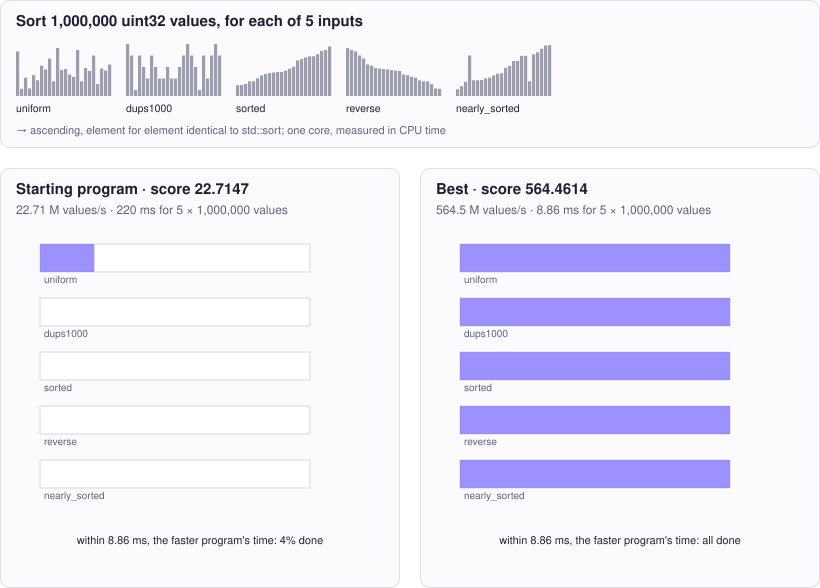

<!-- Copyright (c) 2026 by C. Klukas -->
<!-- SPDX-License-Identifier: GPL-3.0-only -->
<!-- Generated by `omega docs` from examples/sort_u32_cpp/ and bench/results/*.json. Do not edit by hand. -->

# sort_u32_cpp

Performance (C++) · cpp · problem `sort_u32_single_thread` · [all examples](../examples.md)

## The problem

Make the C++ function sort_u32(a, n), which sorts an array of n uint32_t values ascending in place, use as little CPU time as possible on ONE core of this machine (Apple Silicon, ARM NEON available via <arm_neon.h>). The time is measured with the process CPU clock, so extra threads do not help: their CPU time adds up. The result must be EXACTLY the same as std::sort for every input: any n from 0 to 2'000'000 and any values, including many duplicates and inputs that are already (nearly) sorted or reverse sorted. Extra memory may be allocated freely. The benchmark sorts n = 1'000'000 elements from five input distributions: uniform random 32-bit, many duplicates (values below 1000), already sorted, reverse sorted, and nearly sorted (about 1% of elements swapped).

- **Score:** score = total throughput over the five distributions: all elements sorted divided by the total CPU time, in million elements per CPU-second, at n = 1'000'000 per distribution (best of 5 runs per distribution, each run on freshly generated data). The metrics show the rate per distribution. Correctness is checked first on n = 0, 1, 2, 7, 100, 1001, 65537 for every distribution, and again on every benchmark run; any element differing from std::sort makes the program invalid.
- **Files:** `examples/sort_u32_cpp/omega.toml`, the program `sort.cpp`, evaluator stages: check, bench; new bests are re-measured

### Why this is a hard problem

Sorting is perhaps the most studied problem in computing. John von Neumann described merge sort in a 1945 manuscript, Tony Hoare published quicksort [in 1961](https://doi.org/10.1145/366622.366644), and punched-card machines, descended from Herman Hollerith's equipment for the 1890 US census, sorted digit by digit, the idea behind radix sort. Sorting by comparisons needs at least about n log₂ n comparisons, some 20 million for a million elements; radix sort looks at the digits of the numbers instead and avoids this bound.

The starting program is a textbook recursive merge sort, about 23 million elements per CPU second. The limit is memory speed: a radix sort needs only a few passes over the data, and an input that is already sorted can be recognized in a single pass.

It is hard because the five input distributions favour different methods. Radix sort wins on random values but wastes work on sorted input; duplicates and nearly sorted data trip up naive quicksort. The program must choose cheaply per input and stay exactly correct for every size from 0 to 2 million. At this speed, mispredicted branches and cache misses matter more than the number of operations.

Run it with:

```bash
python3 -m omega_transform run examples/sort_u32_cpp --minutes 15
```

## The starting program

The model may change only the code between the `OMEGA-BLOCK` markers.

```cpp
// Copyright (c) 2026 by C. Klukas
// SPDX-License-Identifier: MIT
// Single-threaded in-place sort of 32-bit unsigned integers, scored by CPU time.
//
// This file is compiled on its own and linked with harness.cpp, which generates
// the inputs, times sort_u32 with the process CPU clock and checks every result
// against std::sort. Only the OMEGA-BLOCK region evolves; it may define only
// sort_u32 as a global symbol (helpers must be static or in an anonymous namespace).
#include <algorithm>
#include <cmath>
#include <cstdint>
#include <cstdio>
#include <cstdlib>
#include <cstring>
#include <ctime>
#include <vector>
#if defined(__ARM_NEON)
#include <arm_neon.h>
#endif

// OMEGA-BLOCK-START
// Sorts a[0..n) ascending, in place, on the calling thread. n is any size from
// 0 to 2'000'000. Extra memory may be allocated freely.
static void merge_sort_rec(uint32_t* a, uint32_t* tmp, size_t lo, size_t hi) {
    if (hi - lo < 2) return;
    size_t mid = lo + (hi - lo) / 2;
    merge_sort_rec(a, tmp, lo, mid);
    merge_sort_rec(a, tmp, mid, hi);
    size_t i = lo, j = mid, k = lo;
    while (i < mid && j < hi) tmp[k++] = (a[j] < a[i]) ? a[j++] : a[i++];
    while (i < mid) tmp[k++] = a[i++];
    while (j < hi) tmp[k++] = a[j++];
    for (size_t t = lo; t < hi; ++t) a[t] = tmp[t];
}

extern "C" void sort_u32(uint32_t* a, size_t n) {
    std::vector<uint32_t> tmp(n);
    merge_sort_rec(a, tmp.data(), 0, n);
}
// OMEGA-BLOCK-END
```

## Benchmark results

The best result so far comes from **qwen3.8:27b-mtp-q4_K_M (think)**, run locally with Ollama on 2026-10-17: a score of **564.4614** (×24.85 the starting program's 22.7147), reached after 25.38 of 15 minutes with 1 model requests.

What the starting program produces (left) and what the best program by qwen3.8:27b-mtp-q4_K_M (think) produces (right):



### How it got there

The best program's ancestry, from the starting program on. "Edit" and "rewrite" are the model's changes; a parameter sweep is the engine trying values for the constants the model exposed.

| Step | Minute | Score | Kind | Idea |
|--:|--:|--:|---|---|
| 0 | 0.0 | 22.7147 | start | initial program |
| 1 | 25.4 | 564.4614 | edit | Replace the O(n log n) merge sort with a hybrid approach: detect sorted/reverse in O(n) for early exit, then use LSD radix sort with 11-bit passes (1-3 passes depending on max value) using a ping-pong buffer, which is O(n) for random and duplicate-heavy data … |

### The best program

What changed compared with the starting program:

```diff
--- initial
+++ best
@@ -19,22 +19,79 @@
 #endif
 
 // OMEGA-BLOCK-START
-// Sorts a[0..n) ascending, in place, on the calling thread. n is any size from
-// 0 to 2'000'000. Extra memory may be allocated freely.
-static void merge_sort_rec(uint32_t* a, uint32_t* tmp, size_t lo, size_t hi) {
-    if (hi - lo < 2) return;
-    size_t mid = lo + (hi - lo) / 2;
-    merge_sort_rec(a, tmp, lo, mid);
-    merge_sort_rec(a, tmp, mid, hi);
-    size_t i = lo, j = mid, k = lo;
-    while (i < mid && j < hi) tmp[k++] = (a[j] < a[i]) ? a[j++] : a[i++];
-    while (i < mid) tmp[k++] = a[i++];
-    while (j < hi) tmp[k++] = a[j++];
-    for (size_t t = lo; t < hi; ++t) a[t] = tmp[t];
+
+static void insertion_sort(uint32_t* a, size_t n) {
+    for (size_t i = 1; i < n; ++i) {
+        uint32_t key = a[i];
+        size_t j = i;
+        while (j > 0 && a[j - 1] > key) {
+            a[j] = a[j - 1];
+            --j;
+        }
+        a[j] = key;
+    }
 }
 
+static void radix_pass(const uint32_t* src, uint32_t* dst, size_t n, int shift, uint32_t* cnt) {
+    memset(cnt, 0, 2048 * sizeof(uint32_t));
+    for (size_t i = 0; i < n; ++i)
+        cnt[(src[i] >> shift) & 0x7FF]++;
+    uint32_t sum = 0;
+    for (int i = 0; i < 2048; ++i) {
+        uint32_t c = cnt[i];
+        cnt[i] = sum;
+        sum += c;
+    }
+    for (size_t i = 0; i < n; ++i) {
+        uint32_t d = (src[i] >> shift) & 0x7FF;
+        dst[cnt[d]++] = src[i];
+    }
+}
+
+static std::vector<uint32_t> s_buf;
+
 extern "C" void sort_u32(uint32_t* a, size_t n) {
-    std::vector<uint32_t> tmp(n);
-    merge_sort_rec(a, tmp.data(), 0, n);
+    if (n <= 1) return;
+
+    if (n < 64) {
+        insertion_sort(a, n);
+        return;
+    }
+
+    bool is_sorted = true, is_reverse = true;
+    for (size_t i = 1; i < n; ++i) {
+        if (a[i] < a[i - 1]) is_sorted = false;
+        if (a[i] > a[i - 1]) is_reverse = false;
+        if (!is_sorted && !is_reverse) break;
+    }
+    if (is_sorted) return;
+    if (is_reverse) {
+        for (size_t i = 0, j = n - 1; i < j; ++i, --j) {
+            uint32_t t = a[i]; a[i] = a[j]; a[j] = t;
+        }
+        return;
+    }
+
+    uint32_t mx = a[0];
+    for (size_t i = 1; i < n; ++i)
+        if (a[i] > mx) mx = a[i];
+
+    int passes;
+    if (mx < 2048) passes = 1;
+    else if (mx < (1u << 22)) passes = 2;
+    else passes = 3;
+
+    if (s_buf.size() < n) s_buf.resize(n);
+    uint32_t cnt[2048];
+
+    uint32_t* src = a;
+    uint32_t* dst = s_buf.data();
+    for (int p = 0; p < passes; ++p) {
+        radix_pass(src, dst, n, p * 11, cnt);
+        std::swap(src, dst);
+    }
+    if (src != a)
+        memcpy(a, src, n * sizeof(uint32_t));
 }
+
 // OMEGA-BLOCK-END
```

### All models

One run per model and reasoning mode; the [model benchmarks](../benchmarks/sort_u32_single_thread.md) page has speed, memory and progress over time.

| Model | Where | Machine | Best | Gain | Minutes to best | New bests |
|---|---|---|--:|--:|--:|--:|
| qwen3.8:27b-mtp-q4_K_M (think) | local | Apple M1 Max | 564.4614 | ×24.85 | 25.4 | 1 |
| gemma4:26b-a4b-it-qat (no-think) | local | Apple M1 Max | 526.8705 | ×21.98 | 14.2 | 7 |
| qwen3.6:27b-coding-mtp-q4_K_M (no-think) | local | Apple M1 Max | 393.2984 | ×16.97 | 17.4 | 3 |
| gpt-oss:20b (think) | local | Apple M1 Max | 368.1891 | ×16.44 | 10.2 | 4 |
| qwen3.5:27b (think) | local | Apple M1 Max | 361.2984 | ×15.79 | 9.6 | 2 |
| gemma4:12b-it-qat (no-think) | local | Apple M1 Max | 323.4781 | ×14.30 | 10.5 | 4 |
| gpt-oss:20b (no-think) | local | Apple M1 Max | 322.2479 | ×13.44 | 10.1 | 2 |
| gemma4:latest (no-think) | local | Apple M1 Max | 295.2118 | ×12.30 | 12.8 | 6 |
| gemma4:26b-a4b-it-qat (think) | local | Apple M1 Max | 287.6700 | ×12.59 | 7.0 | 1 |
| gemma4:e4b-it-qat (think) | local | Apple M1 Max | 274.2287 | ×12.04 | 15.3 | 4 |
| muse-glimmer:30b (think) | local | Apple M1 Max | 268.1684 | ×11.90 | 21.9 | 2 |
| gemma4:12b-it-qat (think) | local | Apple M1 Max | 252.1177 | ×10.98 | 8.8 | 1 |
| gpt-oss:20b (think) | local | i7-8700K + 2x GTX 1080 Ti | 241.4414 | ×10.78 | 7.2 | 4 |
| qwen3.5:27b (no-think) | local | Apple M1 Max | 239.7158 | ×10.09 | 17.3 | 2 |
| qwen3.8:27b-mtp-q4_K_M (think) | local | i7-8700K + 2x GTX 1080 Ti | 237.3475 | ×10.63 | 24.7 | 1 |
| nemotron-3.5-lightning:30b-mlx (no-think) | local | Apple M1 Max | 231.7818 | ×10.01 | 8.9 | 2 |
| muse-glimmer:30b (no-think) | local | Apple M1 Max | 231.7497 | ×10.77 | 18.9 | 2 |
| qwen3-coder:30b (no-think) | local | Apple M1 Max | 226.8907 | ×9.89 | 10.9 | 4 |
| qwen3.6:27b-coding-mtp-q4_K_M (think) | local | Apple M1 Max | 226.0805 | ×9.83 | 15.2 | 1 |
| qwen3.8:27b-mtp-q4_K_M (no-think) | local | Apple M1 Max | 220.0800 | ×9.43 | 12.9 | 1 |
| gemma4:e4b-it-qat (no-think) | local | Apple M1 Max | 216.9010 | ×9.30 | 10.1 | 6 |
| qwen3.5:latest (think) | local | Apple M1 Max | 216.6847 | ×9.29 | 19.5 | 1 |
| gemma4:latest (think) | local | Apple M1 Max | 208.4549 | ×9.20 | 16.1 | 4 |
| gemma4:e2b (no-think) | local | Apple M1 Max | 199.8160 | ×8.33 | 9.6 | 4 |
| gemma4:12b-it-qat (no-think) | local | i7-8700K + 2x GTX 1080 Ti | 197.6591 | ×8.80 | 15.5 | 6 |
| nemotron-3-nano:30b-a3b-mlx (think) | local | Apple M1 Max | 194.4692 | ×8.18 | 5.6 | 1 |
| gemma4:26b-a4b-it-qat (no-think) | local | i7-8700K + 2x GTX 1080 Ti | 189.1945 | ×8.80 | 15.8 | 6 |
| gpt-oss:20b (no-think) | local | i7-8700K + 2x GTX 1080 Ti | 187.4841 | ×8.26 | 12.5 | 4 |
| glm-4.7-flash:latest (no-think) | local | Apple M1 Max | 186.1989 | ×8.39 | 9.7 | 3 |
| gemma4:26b-a4b-it-qat (think) | local | i7-8700K + 2x GTX 1080 Ti | 180.1774 | ×7.95 | 17.6 | 3 |
| gemma4:12b-it-qat (think) | local | i7-8700K + 2x GTX 1080 Ti | 178.3551 | ×8.03 | 9.0 | 1 |
| glm-4.7-flash:latest (think) | local | Apple M1 Max | 174.2766 | ×7.56 | 10.5 | 1 |
| gemma4:e2b (no-think) | local | i7-8700K + 2x GTX 1080 Ti | 152.2101 | ×6.64 | 8.9 | 2 |
| gemma4:latest (think) | local | i7-8700K + 2x GTX 1080 Ti | 151.3129 | ×6.75 | 15.5 | 4 |
| qwen3.8:27b-mtp-q4_K_M (no-think) | local | i7-8700K + 2x GTX 1080 Ti | 149.0161 | ×6.72 | 5.6 | 1 |
| glm-4.7-flash:latest (think) | local | i7-8700K + 2x GTX 1080 Ti | 141.1194 | ×6.27 | 16.3 | 3 |
| ingu627/exaone4.0:32b (no-think) | local | Apple M1 Max | 138.0263 | ×6.15 | 17.9 | 1 |
| qwen3-coder:30b (no-think) | local | i7-8700K + 2x GTX 1080 Ti | 133.5933 | ×6.02 | 16.6 | 6 |
| gemma4:latest (no-think) | local | i7-8700K + 2x GTX 1080 Ti | 132.8138 | ×6.00 | 5.4 | 3 |
| qwen3.6:27b-coding-mtp-q4_K_M (think) | local | i7-8700K + 2x GTX 1080 Ti | 131.5523 | ×5.85 | 23.9 | 1 |
| glm-4.7-flash:latest (no-think) | local | i7-8700K + 2x GTX 1080 Ti | 131.0646 | ×5.73 | 16.1 | 4 |
| nemotron-3-nano:4b (think) | local | Apple M1 Max | 130.4122 | ×5.47 | 13.1 | 2 |
| lfm3:latest (think) | local | Apple M1 Max | 125.7167 | ×5.25 | 13.8 | 2 |
| gemma4:e2b (think) | local | i7-8700K + 2x GTX 1080 Ti | 121.9891 | ×5.69 | 9.1 | 3 |
| gemma4:e4b-it-qat (think) | local | i7-8700K + 2x GTX 1080 Ti | 105.7071 | ×4.77 | 15.0 | 5 |
| gemma4:e4b-it-qat (no-think) | local | i7-8700K + 2x GTX 1080 Ti | 102.9600 | ×4.54 | 6.3 | 2 |
| qwen2.5-coder:7b (no-think) | local | Apple M1 Max | 45.5448 | ×1.93 | 9.9 | 3 |
| hf.co/LiquidAI/LFM3-1.7B-GGUF:Q4_K_M (think) | local | i7-8700K + 2x GTX 1080 Ti | 40.0004 | ×1.76 | 12.0 | 1 |
| qwen3.5:latest (no-think) | local | Apple M1 Max | 31.0841 | ×1.30 | 16.1 | 1 |
| richardyoung/frognano-4b-2609:latest (no-think) | local | i7-8700K + 2x GTX 1080 Ti | 30.6270 | ×1.34 | 11.8 | 2 |
| underdog-saluki-27b:iq2-mix (no-think) | local | Apple M1 Max | 29.2642 | ×1.31 | 10.7 | 2 |
| underdog-saluki-27b:iq2-mix (no-think) | local | i7-8700K + 2x GTX 1080 Ti | 28.4632 | ×1.24 | 3.4 | 1 |
| qwen3:30b-a3b-instruct-2507-q4_K_M (no-think) | local | i7-8700K + 2x GTX 1080 Ti | 27.4213 | ×1.22 | 10.8 | 3 |
| qwen3:30b-a3b-instruct-2507-q4_K_M (no-think) | local | Apple M1 Max | 25.8331 | ×1.15 | 5.4 | 4 |
| hf.co/LiquidAI/LFM3-1.7B-GGUF:Q4_K_M (no-think) | local | Apple M1 Max | 23.9532 | ×1.00 | - | 0 |
| hf.co/LiquidAI/LFM3-1.7B-GGUF:Q4_K_M (think) | local | Apple M1 Max | | | | failed: all 10 model requests failed … |
| lfm3:latest (no-think) | local | Apple M1 Max | 23.7228 | ×1.00 | - | 0 |
| nemotron-3.5-lightning:30b-mlx (think) | local | Apple M1 Max | | | | failed: all 4 model requests failed … |
| qwen3:30b-a3b-instruct-2507-q4_K_M (think) | local | Apple M1 Max | 23.3623 | ×1.01 | 5.1 | 1 |
| underdog-saluki-27b:iq2-mix (think) | local | Apple M1 Max | | | | failed: all 1 model requests failed: underdog-saluki-27b:iq2-mix … |
| nemotron-3-nano:4b (no-think) | local | Apple M1 Max | 23.2840 | ×1.01 | 5.5 | 1 |
| nemotron-3-nano:30b-a3b-mlx (no-think) | local | Apple M1 Max | 23.2628 | ×1.00 | - | 0 |
| qwen3:30b-a3b-instruct-2507-q4_K_M (think) | local | i7-8700K + 2x GTX 1080 Ti | 23.1804 | ×1.04 | 9.3 | 1 |
| gemma4:e2b (think) | local | Apple M1 Max | 22.9626 | ×1.00 | - | 0 |
| qwen3.5:latest (no-think) | local | i7-8700K + 2x GTX 1080 Ti | 22.8955 | ×1.00 | - | 0 |
| underdog-saluki-27b:iq2-mix (think) | local | i7-8700K + 2x GTX 1080 Ti | | | | failed: all 2 model requests failed: underdog-saluki-27b:iq2-mix … |
| frob/sarvam:30b (no-think) | local | i7-8700K + 2x GTX 1080 Ti | 22.7542 | ×1.00 | - | 0 |
| llm-jp-4-8b-omega:q4_k_m (no-think) | local | Apple M1 Max | 22.5858 | ×1.00 | - | 0 |
| nemotron-3-nano:4b (no-think) | local | i7-8700K + 2x GTX 1080 Ti | 22.5245 | ×1.00 | - | 0 |
| yandex/YandexGPT-5-Lite-8B-instruct-GGUF:latest (no-think) | local | i7-8700K + 2x GTX 1080 Ti | 22.5031 | ×1.00 | - | 0 |
| frob/sarvam:30b (think) | local | Apple M1 Max | | | | failed: all 3 model requests failed: frob/sarvam:30b: answer … |
| frob/sarvam:30b (think) | local | i7-8700K + 2x GTX 1080 Ti | | | | failed: all 4 model requests failed: frob/sarvam:30b: answer … |
| richardyoung/frognano-4b-2609:latest (think) | local | Apple M1 Max | 22.4295 | ×1.00 | - | 0 |
| qwen3.5:latest (think) | local | i7-8700K + 2x GTX 1080 Ti | 22.3773 | ×1.00 | - | 0 |
| llm-jp-4-8b-omega:q4_k_m (no-think) | local | i7-8700K + 2x GTX 1080 Ti | 22.3341 | ×1.00 | - | 0 |
| MichelRosselli/apertus:8b-instruct-2509-q4_k_m (no-think) | local | i7-8700K + 2x GTX 1080 Ti | 22.3118 | ×1.00 | - | 0 |
| yandex/YandexGPT-5-Lite-8B-instruct-GGUF:latest (no-think) | local | Apple M1 Max | 22.2805 | ×1.00 | - | 0 |
| MichelRosselli/apertus:8b-instruct-2509-q4_k_m (no-think) | local | Apple M1 Max | 22.2474 | ×1.00 | - | 0 |
| devstral-small-2:24b (no-think) | local | Apple M1 Max | 22.2454 | ×1.00 | - | 0 |
| qwen2.5-coder:7b (no-think) | local | i7-8700K + 2x GTX 1080 Ti | 22.2427 | ×1.00 | - | 0 |
| richardyoung/frognano-4b-2609:latest (no-think) | local | Apple M1 Max | 22.1990 | ×1.00 | - | 0 |
| frob/sarvam:30b (no-think) | local | Apple M1 Max | 22.0103 | ×1.00 | - | 0 |
| hf.co/LiquidAI/LFM3-1.7B-GGUF:Q4_K_M (no-think) | local | i7-8700K + 2x GTX 1080 Ti | 21.9862 | ×1.00 | - | 0 |
| nemotron-3-nano:4b (think) | local | i7-8700K + 2x GTX 1080 Ti | 21.9141 | ×1.00 | - | 0 |
| richardyoung/frognano-4b-2609:latest (think) | local | i7-8700K + 2x GTX 1080 Ti | 21.3672 | ×1.00 | - | 0 |
| Bored/GigaChat3.1-10B-A1.8B-q4_K_M:latest (no-think) | local | i7-8700K + 2x GTX 1080 Ti | 21.2410 | ×1.00 | - | 0 |
| qwen3.6:27b-coding-mtp-q4_K_M (no-think) | local | i7-8700K + 2x GTX 1080 Ti | 21.1055 | ×1.00 | - | 0 |
