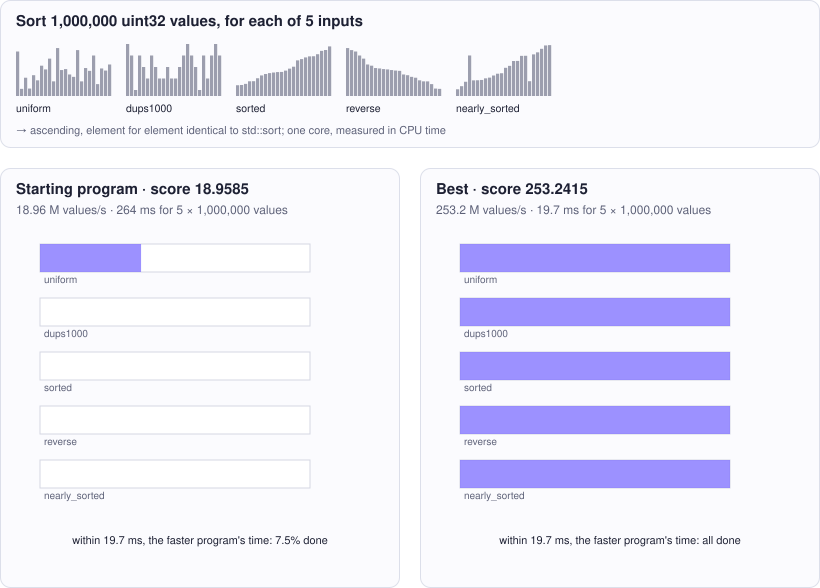

<!-- Copyright (c) 2026 by C. Klukas -->
<!-- SPDX-License-Identifier: GPL-3.0-only -->
<!-- Generated by `omega docs` from examples/sort_u32_cpp/ and bench/results/*.json. Do not edit by hand. -->

# sort_u32_cpp

Performance (C++) · cpp · problem `sort_u32_single_thread` · [all examples](../examples.md)

## The problem

Make the C++ function sort_u32(a, n), which sorts an array of n uint32_t values ascending in place, use as little CPU time as possible on ONE core of this machine (Apple Silicon, ARM NEON available via <arm_neon.h>). The time is measured with the process CPU clock, so extra threads do not help: their CPU time adds up. The result must be EXACTLY the same as std::sort for every input: any n from 0 to 2'000'000 and any values, including many duplicates and inputs that are already (nearly) sorted or reverse sorted. Extra memory may be allocated freely. The benchmark sorts n = 1'000'000 elements from five input distributions: uniform random 32-bit, many duplicates (values below 1000), already sorted, reverse sorted, and nearly sorted (about 1% of elements swapped).

- **Score:** score = total throughput over the five distributions: all elements sorted divided by the total CPU time, in million elements per CPU-second, at n = 1'000'000 per distribution (best of 5 runs per distribution, each run on freshly generated data). The metrics show the rate per distribution. Correctness is checked first on n = 0, 1, 2, 7, 100, 1001, 65537 for every distribution, and again on every benchmark run; any element differing from std::sort makes the program invalid.
- **Files:** `examples/sort_u32_cpp/omega.toml`, the program `sort.cpp`, evaluator stages: check, bench; new bests are re-measured

### Why this is a hard problem

Sorting is perhaps the most studied problem in computing. John von Neumann described merge sort in a 1945 manuscript, Tony Hoare published quicksort [in 1961](https://doi.org/10.1145/366622.366644), and punched-card machines, descended from Herman Hollerith's equipment for the 1890 US census, sorted digit by digit, the idea behind radix sort. Sorting by comparisons needs at least about n log₂ n comparisons, some 20 million for a million elements; radix sort looks at the digits of the numbers instead and avoids this bound.

The starting program is a textbook recursive merge sort, about 23 million elements per CPU second. The limit is memory speed: a radix sort needs only a few passes over the data, and an input that is already sorted can be recognized in a single pass.

It is hard because the five input distributions favour different methods. Radix sort wins on random values but wastes work on sorted input; duplicates and nearly sorted data trip up naive quicksort. The program must choose cheaply per input and stay exactly correct for every size from 0 to 2 million. At this speed, mispredicted branches and cache misses matter more than the number of operations.

Run it with:

```bash
python3 -m omega_transform run examples/sort_u32_cpp --minutes 15
```

## The starting program

The model may change only the code between the `OMEGA-BLOCK` markers.

```cpp
// Copyright (c) 2026 by C. Klukas
// SPDX-License-Identifier: MIT
// Single-threaded in-place sort of 32-bit unsigned integers, scored by CPU time.
//
// This file is compiled on its own and linked with harness.cpp, which generates
// the inputs, times sort_u32 with the process CPU clock and checks every result
// against std::sort. Only the OMEGA-BLOCK region evolves; it may define only
// sort_u32 as a global symbol (helpers must be static or in an anonymous namespace).
#include <algorithm>
#include <cmath>
#include <cstdint>
#include <cstdio>
#include <cstdlib>
#include <cstring>
#include <ctime>
#include <vector>
#if defined(__ARM_NEON)
#include <arm_neon.h>
#endif

// OMEGA-BLOCK-START
// Sorts a[0..n) ascending, in place, on the calling thread. n is any size from
// 0 to 2'000'000. Extra memory may be allocated freely.
static void merge_sort_rec(uint32_t* a, uint32_t* tmp, size_t lo, size_t hi) {
    if (hi - lo < 2) return;
    size_t mid = lo + (hi - lo) / 2;
    merge_sort_rec(a, tmp, lo, mid);
    merge_sort_rec(a, tmp, mid, hi);
    size_t i = lo, j = mid, k = lo;
    while (i < mid && j < hi) tmp[k++] = (a[j] < a[i]) ? a[j++] : a[i++];
    while (i < mid) tmp[k++] = a[i++];
    while (j < hi) tmp[k++] = a[j++];
    for (size_t t = lo; t < hi; ++t) a[t] = tmp[t];
}

extern "C" void sort_u32(uint32_t* a, size_t n) {
    std::vector<uint32_t> tmp(n);
    merge_sort_rec(a, tmp.data(), 0, n);
}
// OMEGA-BLOCK-END
```

## Benchmark results

The best result so far comes from **nvidia/nemotron-3.5-super-vl:free (think)**, run through OpenRouter on 2026-11-05: a score of **278.1298** (×15.41 the starting program's 18.0532), reached after 23.86 of 60 minutes with 24 model requests.

What the starting program produces (left) and what the best program by nvidia/nemotron-3.5-super-vl:free (think) produces (right):



### How it got there

The best program's ancestry, from the starting program on. "Edit" and "rewrite" are the model's changes; a parameter sweep is the engine trying values for the constants the model exposed.

| Step | Minute | Score | Kind | Idea |
|--:|--:|--:|---|---|
| 0 | 0.0 | 18.0532 | start | initial program |
| 1 | 23.9 | 272.3838 | edit | Replace the O(n log n) merge sort with a 4-pass LSD byte radix sort: one combined pass counts all four byte histograms, passes with a single bucket are skipped, the scatter passes ping-pong between the input and a reusable scratch buffer … |
| 2 | 23.9 | 278.1298 | parameter sweep | tuned kInsertionThreshold=64 on top of: Replace the O(n log n) merge sort with a 4-pass LSD byte radix sort: one combined pass counts all four byte histograms, passes with a single bucket are skipped, the scatter passes ping-pong between the input and a … |

### The best program

What changed compared with the starting program:

```diff
--- initial
+++ best
@@ -21,20 +21,114 @@
 // OMEGA-BLOCK-START
 // Sorts a[0..n) ascending, in place, on the calling thread. n is any size from
 // 0 to 2'000'000. Extra memory may be allocated freely.
-static void merge_sort_rec(uint32_t* a, uint32_t* tmp, size_t lo, size_t hi) {
-    if (hi - lo < 2) return;
-    size_t mid = lo + (hi - lo) / 2;
-    merge_sort_rec(a, tmp, lo, mid);
-    merge_sort_rec(a, tmp, mid, hi);
-    size_t i = lo, j = mid, k = lo;
-    while (i < mid && j < hi) tmp[k++] = (a[j] < a[i]) ? a[j++] : a[i++];
-    while (i < mid) tmp[k++] = a[i++];
-    while (j < hi) tmp[k++] = a[j++];
-    for (size_t t = lo; t < hi; ++t) a[t] = tmp[t];
+namespace {
+
+constexpr size_t kInsertionThreshold = 64;
+
+// Returns 1 if ascending, -1 if descending, 0 if neither (all-equal counts as
+// ascending since no strict decrease exists).
+static int sorted_direction(const uint32_t* a, size_t n) {
+    if (n < 2) return 1;
+    int dir = 0;
+    for (size_t i = 1; i < n; ++i) {
+        if (a[i] < a[i - 1]) {
+            if (dir == 1) return 0;
+            dir = -1;
+        } else if (a[i] > a[i - 1]) {
+            if (dir == -1) return 0;
+            dir = 1;
+        }
+    }
+    return dir == 0 ? 1 : dir;
 }
 
+static void insertion_sort(uint32_t* a, size_t n) {
+    for (size_t i = 1; i < n; ++i) {
+        uint32_t v = a[i];
+        size_t j = i;
+        while (j > 0 && a[j - 1] > v) {
+            a[j] = a[j - 1];
+            --j;
+        }
+        a[j] = v;
+    }
+}
+
+// Counts the histogram of all four byte digits in one pass over the input.
+static void count_bytes(const uint32_t* a, size_t n, uint32_t hist[4][256]) {
+    for (int p = 0; p < 4; ++p)
+        std::memset(hist[p], 0, 256 * sizeof(uint32_t));
+    size_t i = 0;
+    for (; i + 4 <= n; i += 4) {
+        uint32_t v0 = a[i], v1 = a[i + 1], v2 = a[i + 2], v3 = a[i + 3];
+        hist[0][v0 & 255u]++; hist[1][(v0 >> 8) & 255u]++;
+        hist[2][(v0 >> 16) & 255u]++; hist[3][v0 >> 24]++;
+        hist[0][v1 & 255u]++; hist[1][(v1 >> 8) & 255u]++;
+        hist[2][(v1 >> 16) & 255u]++; hist[3][v1 >> 24]++;
+        hist[0][v2 & 255u]++; hist[1][(v2 >> 8) & 255u]++;
+        hist[2][(v2 >> 16) & 255u]++; hist[3][v2 >> 24]++;
+        hist[0][v3 & 255u]++; hist[1][(v3 >> 8) & 255u]++;
+        hist[2][(v3 >> 16) & 255u]++; hist[3][v3 >> 24]++;
+    }
+    for (; i < n; ++i) {
+        uint32_t v = a[i];
+        hist[0][v & 255u]++; hist[1][(v >> 8) & 255u]++;
+        hist[2][(v >> 16) & 255u]++; hist[3][v >> 24]++;
+    }
+}
+
+// Stable scatter of one digit pass; n <= 2'000'000 so 32-bit offsets suffice.
+static void radix_pass(const uint32_t* src, uint32_t* dst, size_t n, int shift,
+                       const uint32_t hist[256]) {
+    uint32_t offsets[256];
+    uint32_t sum = 0;
+    for (int b = 0; b < 256; ++b) {
+        offsets[b] = sum;
+        sum += hist[b];
+    }
+    for (size_t i = 0; i < n; ++i) {
+        unsigned b = (src[i] >> shift) & 255u;
+        dst[offsets[b]++] = src[i];
+    }
+}
+
+}  // namespace
+
 extern "C" void sort_u32(uint32_t* a, size_t n) {
-    std::vector<uint32_t> tmp(n);
-    merge_sort_rec(a, tmp.data(), 0, n);
+    if (n <= kInsertionThreshold) { insertion_sort(a, n); return; }
+
+    int dir = sorted_direction(a, n);
+    if (dir == 1) return;
+    if (dir == -1) { std::reverse(a, a + n); return; }
+
+    // Reusable scratch buffer; POD cells are always overwritten during
+    // scattering, so no initialization is needed.
+    static uint32_t* scratch = nullptr;
+    static size_t scratch_cap = 0;
+    if (scratch == nullptr || scratch_cap < n) {
+        delete[] scratch;
+        scratch = new uint32_t[n];
+        scratch_cap = n;
+    }
+
+    uint32_t hist[4][256];
+    count_bytes(a, n, hist);
+
+    uint32_t* src = a;
+    uint32_t* dst = scratch;
+    for (int p = 0; p < 4; ++p) {
+        int nonzero = 0;
+        for (int b = 0; b < 256; ++b) {
+            if (hist[p][b]) {
+                ++nonzero;
+                if (nonzero > 1) break;
+            }
+        }
+        if (nonzero <= 1) continue;  // all keys share this digit; identity pass
+        radix_pass(src, dst, n, p * 8, hist[p]);
+        std::swap(src, dst);
+    }
+
+    if (src != a) std::memcpy(a, scratch, n * sizeof(uint32_t));
 }
 // OMEGA-BLOCK-END
```

### All models

One run per model and reasoning mode; the [model benchmarks](../benchmarks/sort_u32_single_thread.md) page has speed, memory and progress over time.

| Model | Where | Best | Gain | Minutes to best | New bests |
|---|---|--:|--:|--:|--:|
| nvidia/nemotron-3.5-super-vl:free (think) | cloud | 278.1298 | ×15.41 | 23.9 | 3 |
| nvidia/nemotron-3-ultra-550b-a55b:free (think) | cloud | 268.5245 | ×13.39 | 37.3 | 11 |
| nvidia/nemotron-3-nano-omni-30b-a3b-reasoning:free (think) | cloud | 237.6100 | ×13.40 | 11.6 | 3 |
| cohere/north-mini-code:free (think) | cloud | 220.1253 | ×10.51 | 35.8 | 5 |
| qwen3-coder:30b (no-think) | local | 210.1563 | ×9.84 | 53.1 | 7 |
| gpt-oss:20b (no-think) | local | 209.0805 | ×10.10 | 49.0 | 5 |
| gpt-oss:20b (think) | local | 199.3797 | ×9.45 | 58.1 | 5 |
| gemma4:12b-it-qat (no-think) | local | 196.9652 | ×9.41 | 12.2 | 9 |
| recursive/flint-v1.0:free (think) | cloud | 193.1179 | ×9.47 | 5.1 | 2 |
| qwen3.6:27b-coding-mtp-q4_K_M (no-think) | local | 190.7861 | ×9.01 | 46.4 | 2 |
| dots-studio/dots-3-note-preview:free (no-think) | cloud | 190.7624 | ×10.44 | 8.8 | 5 |
| dots-studio/dots-3-note-preview:free (think) | cloud | 177.3926 | ×9.65 | 50.2 | 1 |
| nvidia/nemotron-3.5-super-vl:free (no-think) | cloud | 176.1989 | ×9.78 | 2.3 | 3 |
| nvidia/nemotron-3.5-lightning:free (think) | cloud | 164.3294 | ×9.17 | 19.0 | 2 |
| hf.co/mmnga-o/Qwen3-Swallow-30B-A3B-RL-v0.2-gguf:Q4_K_M (think) | local | 161.2733 | ×6.76 | 32.6 | 4 |
| nvidia/nemotron-3-ultra-550b-a55b:free (no-think) | cloud | 158.5411 | ×8.62 | 26.8 | 6 |
| gemma4:26b-a4b-it-qat (no-think) | local | 151.3881 | ×7.19 | 6.4 | 5 |
| hf.co/mmnga-o/Qwen3-Swallow-30B-A3B-RL-v0.2-gguf:Q4_K_M (no-think) | local | 149.4041 | ×6.16 | 28.3 | 6 |
| gemma4:26b-a4b-it-qat (think) | local | 136.2851 | ×6.27 | 24.0 | 2 |
| hf.co/llm-jp/llm-jp-4.1-32b-a3b-thinking-gguf:Q4_K_M (no-think) | local | 132.2910 | ×5.83 | 13.4 | 3 |
| gemma4:e4b-it-qat (think) | local | 116.1173 | ×5.43 | 4.7 | 3 |
| gemma4:e2b (think) | local | 112.4801 | ×5.16 | 0.9 | 1 |
| cohere/north-mini-code:free (no-think) | cloud | 111.5420 | ×6.16 | 3.5 | 2 |
| gemma4:e4b-it-qat (no-think) | local | 110.5333 | ×5.25 | 2.6 | 2 |
| gemma4:latest (no-think) | local | 108.7229 | ×5.16 | 5.0 | 2 |
| nvidia/nemotron-3-nano-omni-30b-a3b-reasoning:free (no-think) | cloud | 105.6055 | ×5.83 | 1.7 | 2 |
| xingchen-agi/xing4.0-29b-a4b:free (think) | cloud | 104.5525 | ×5.70 | 56.6 | 4 |
| gemma4:latest (think) | local | 102.7348 | ×4.80 | 3.5 | 1 |
| qwen3:30b-a3b-instruct-2507-q4_K_M (no-think) | local | 102.6424 | ×4.86 | 4.0 | 1 |
| gemma4:e2b (no-think) | local | 98.6291 | ×4.53 | 3.4 | 2 |
| glm-4.7-flash:latest (think) | local | 98.5835 | ×4.57 | 57.4 | 3 |
| qwen3.6:27b-coding-mtp-q4_K_M (think) | local | 83.9068 | ×3.91 | 34.6 | 1 |
| frob/sarvam:30b (no-think) | local | 79.3777 | ×3.68 | 58.8 | 1 |
| frob/sarvam:30b (think) | local | 69.6883 | ×3.25 | 40.0 | 1 |
| hf.co/LiquidAI/LFM3-1.7B-GGUF:Q4_K_M (think) | local | 37.4444 | ×1.68 | 16.0 | 2 |
| underdog-saluki-27b:iq2-mix (no-think) | local | 27.9395 | ×1.30 | 34.7 | 2 |
| qwen2.5-coder:7b (no-think) | local | 26.1112 | ×1.45 | 7.9 | 3 |
| hf.co/Colby/apertus-v1.5-8b-text-Q4_K_M-GGUF:Q4_K_M (no-think) | local | 23.1454 | ×1.00 | - | 0 |
| qwen3:30b-a3b-instruct-2507-q4_K_M (think) | local | 21.9741 | ×1.01 | 8.8 | 1 |
| qwen3.5:latest (think) | local | 21.8265 | ×1.00 | - | 0 |
| richardyoung/frognano-4b-2609:latest (no-think) | local | 21.6144 | ×1.00 | - | 0 |
| llm-jp-4-8b-omega:q4_k_m (no-think) | local | 21.6066 | ×1.00 | - | 0 |
| hf.co/LiquidAI/LFM3-1.7B-GGUF:Q4_K_M (no-think) | local | 21.5673 | ×1.00 | - | 0 |
| glm-4.7-flash:latest (no-think) | local | 21.5517 | ×1.00 | - | 0 |
| richardyoung/frognano-4b-2609:latest (think) | local | 21.4971 | ×1.00 | - | 0 |
| nemotron-3-nano:4b (no-think) | local | 21.4822 | ×1.00 | - | 0 |
| nemotron-3-nano:4b (think) | local | 21.3231 | ×1.00 | - | 0 |
| underdog-saluki-27b:iq2-mix (think) | local | 21.2820 | ×1.00 | - | 0 |
| yandex/YandexGPT-5-Lite-8B-instruct-GGUF:latest (no-think) | local | 21.2540 | ×1.00 | - | 0 |
| qwen3.5:latest (no-think) | local | 20.7871 | ×1.00 | - | 0 |
| MichelRosselli/apertus:8b-instruct-2509-q4_k_m (no-think) | local | 20.6900 | ×1.08 | 6.7 | 2 |
| xingchen-agi/xing4.0-29b-a4b:free (no-think) | cloud | 17.9483 | ×1.00 | - | 0 |
| nvidia/nemotron-3.5-lightning:free (no-think) | cloud | 17.8017 | ×1.00 | - | 0 |
| gemma4:12b-it-qat (think) | local | | | | failed: HTTPError: HTTP Error 500: Internal Server Error |
