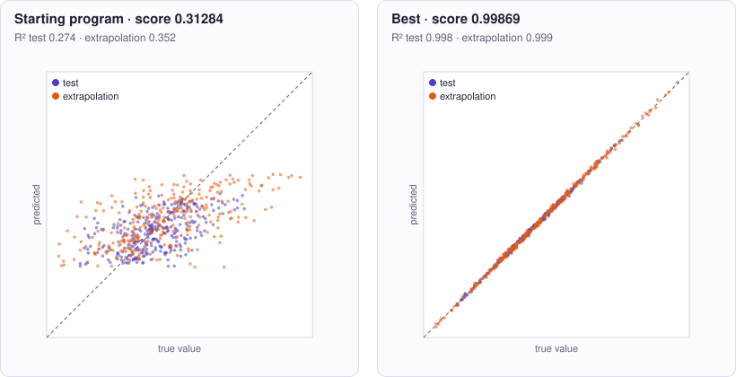

<!-- Copyright (c) 2026 by C. Klukas -->
<!-- SPDX-License-Identifier: GPL-3.0-only -->
<!-- Generated by `omega docs` from examples/symbolic_regression/ and bench/results/*.json. Do not edit by hand. -->

# symbolic_regression

Data and modelling · python · problem `symbolic_regression` · [all examples](../examples.md)

## The problem

Find the formula behind hidden data: y = f(x1, x2, x3) + Gaussian noise (sigma 0.1), where f is a fixed, fairly compact closed-form expression (elementary functions, products, powers, constants). The program defines fit(rows) -> params and predict(params, x1, x2, x3) -> float; params must be plain data (numbers, strings, lists, dicts; tuples arrive as lists), not functions or class instances. The evaluator calls fit once with 300 training rows [x1, x2, x3, y] with x1 in [-3, 3], x2 in [-2, 2], x3 in [0, 3], then predicts 300 held-out rows from the same ranges and 300 EXTRAPOLATION rows from wider ranges (x1 in [-4.5, 4.5], x2 in [-3, 3], x3 in [0, 4]). A generic curve fit does well inside the training range but fails outside it; only the right functional form extrapolates. A fixed helper least_squares(columns, targets, ridge) outside the editable block solves linear least squares, so a model linear in its coefficients over a set of basis functions is fitted in one call. Every prediction must be a finite float. fit plus all predictions: at most 10 CPU seconds. Only the Python standard library (no numpy). The first training rows (x1, x2, x3, y): 2.175 -0.337 0.085 -2.058 -1.891 -0.025 2.441 1.796 -2.056 0.295 2.016 0.117 -2.148 -0.652 0.514 0.235 -1.574 0.754 2.005 -1.164 2.476 -0.654 0.957 -1.744 -1.991 -0.655 1.067 0.695 -1.158 -1.329 1.804 3.424 -0.091 -0.237 2.429 1.684 -1.998 0.445 2.732 1.307 -0.117 1.678 2.649 1.694 0.995 -0.134 0.686 -1.531 -1.656 0.482 1.245 -1.680 -1.511 0.856 1.586 -2.232 -2.494 -0.762 2.362 2.592 -2.948 -1.906 1.665 0.992

- **Score:** score = mean of R^2 on the in-range test rows and R^2 on the extrapolation rows, each clipped to [0, 1] (higher is better, 1.0 = perfect; the noise limits it to about 0.998). The initial linear model scores about 0.31. Metrics: r2_test, rmse_test, r2_extrapolation, rmse_extrapolation (the noise alone gives RMSE 0.1), cpu_s. The feedback lists the five worst extrapolation rows with true and predicted y.
- **Files:** `examples/symbolic_regression/omega.toml`, the program `initial.py`, evaluator stages: main

Run it with:

```bash
python3 -m omega_transform run examples/symbolic_regression --minutes 15
```

## The starting program

The model may change only the code between the `OMEGA-BLOCK` markers.

```python
# Copyright (c) 2026 by C. Klukas
# SPDX-License-Identifier: MIT
"""Symbolic regression: find the formula behind y = f(x1, x2, x3) + noise.

The evaluator calls fit(train_rows) once with 300 training rows (x1, x2, x3, y), then
predict(params, x1, x2, x3) on held-out rows, both inside and OUTSIDE the training
range of the inputs, and scores the R^2 of the predictions.
"""
import math


def least_squares(columns, targets, ridge=1e-9):
    """Fixed helper: coefficients c minimizing sum_i (sum_j c_j * columns[j][i] - targets[i])^2.

    columns: list of basis columns (each a list of floats, one value per row).
    Solves the normal equations by Gaussian elimination with partial pivoting.
    """
    k = len(columns)
    a = [[sum(p * q for p, q in zip(columns[r], columns[c])) + (ridge if r == c else 0.0)
          for c in range(k)] + [sum(p * t for p, t in zip(columns[r], targets))]
         for r in range(k)]
    for col in range(k):
        piv = max(range(col, k), key=lambda r: abs(a[r][col]))
        a[col], a[piv] = a[piv], a[col]
        if abs(a[col][col]) < 1e-300:
            continue
        for r in range(k):
            if r != col:
                f = a[r][col] / a[col][col]
                if f:
                    a[r] = [x - f * y for x, y in zip(a[r], a[col])]
    return [a[r][k] / a[r][r] if abs(a[r][r]) > 1e-300 else 0.0 for r in range(k)]


# OMEGA-BLOCK-START
def basis(x1, x2, x3):
    """Basis functions of the model; the prediction is a weighted sum of them."""
    return [1.0, x1, x2, x3]


def fit(rows):
    """Fit the model on the training rows and return its parameters.

    The parameters must be plain data (numbers, strings, lists, dicts), not functions
    or class instances. predict() receives them as JSON would carry them: tuples become
    lists and dict keys become strings.
    rows: list of [x1, x2, x3, y] float lists, x1 in [-3, 3], x2 in [-2, 2],
    x3 in [0, 3]. Only the Python standard library may be used (math, statistics,
    random, ...; no numpy). fit plus all predictions must take at most 10 CPU seconds.

    Current method: linear regression on the raw inputs.
    """
    cols = list(zip(*[basis(x1, x2, x3) for x1, x2, x3, _ in rows]))
    return least_squares([list(c) for c in cols], [y for *_, y in rows])


def predict(params, x1, x2, x3):
    """Return the predicted y (a finite float) for one input."""
    return sum(c * b for c, b in zip(params, basis(x1, x2, x3)))
# OMEGA-BLOCK-END
```

## Benchmark results

The best result so far comes from **qwen3.6:27b-coding-mtp-q4_K_M (no-think)**, run locally with Ollama on 2026-10-15: a score of **0.99869** (×3.19 the starting program's 0.31284), reached after 6.28 of 15 minutes with 6 model requests.

What the starting program produces (left) and what the best program by qwen3.6:27b-coding-mtp-q4_K_M (no-think) produces (right):



### How it got there

The best program's ancestry, from the starting program on. "Edit" and "rewrite" are the model's changes; a parameter sweep is the engine trying values for the constants the model exposed.

| Step | Minute | Score | Kind | Idea |
|--:|--:|--:|---|---|
| 0 | 0.0 | 0.31284 | start | initial program |
| 1 | 6.3 | 0.99869 | edit | Replace the simple linear basis with a candidate set including quadratic terms, interaction terms, and trigonometric functions, then use forward selection to pick the best subset of basis functions that explains the variance, which should capture the … |

### The best program

What changed compared with the starting program:

```diff
--- initial
+++ best
@@ -33,9 +33,22 @@
 
 
 # OMEGA-BLOCK-START
-def basis(x1, x2, x3):
-    """Basis functions of the model; the prediction is a weighted sum of them."""
-    return [1.0, x1, x2, x3]
+def candidate_basis(x1, x2, x3):
+    """Generate a broad set of candidate basis functions."""
+    import math
+    return [
+        1.0,
+        x1, x2, x3,
+        x1**2, x2**2, x3**2,
+        x1*x2, x1*x3, x2*x3,
+        math.sin(x1), math.sin(x2), math.sin(x3),
+        math.cos(x1), math.cos(x2), math.cos(x3),
+        math.sin(x1)*x2, math.sin(x1)*x3,
+        math.cos(x1)*x2, math.cos(x1)*x3,
+        x1*math.sin(x2), x3*math.sin(x2),
+        x1**3, x2**3, x3**3,
+        x1*x2*x3,
+    ]
 
 
 def fit(rows):
@@ -48,13 +61,81 @@
     x3 in [0, 3]. Only the Python standard library may be used (math, statistics,
     random, ...; no numpy). fit plus all predictions must take at most 10 CPU seconds.
 
-    Current method: linear regression on the raw inputs.
+    Current method: forward selection over candidate basis functions.
     """
-    cols = list(zip(*[basis(x1, x2, x3) for x1, x2, x3, _ in rows]))
-    return least_squares([list(c) for c in cols], [y for *_, y in rows])
+    import math
+
+    # Split data into train and validation for cross-validation
+    n = len(rows)
+    train_idx = list(range(n))
+    val_idx = []
+    # Simple split: last 20% for validation
+    split = int(0.8 * n)
+    val_idx = list(range(split, n))
+    train_idx = list(range(split))
+
+    train_rows = [rows[i] for i in train_idx]
+    val_rows = [rows[i] for i in val_idx]
+
+    # Precompute candidate basis values for all rows
+    def get_basis_rows(data):
+        return [candidate_basis(x1, x2, x3) for x1, x2, x3, _ in data]
+
+    train_basis = get_basis_rows(train_rows)
+    val_basis = get_basis_rows(val_rows)
+    train_y = [y for _, _, _, y in train_rows]
+    val_y = [y for _, _, _, y in val_rows]
+
+    # Forward selection
+    selected_indices = [0]  # Start with intercept
+    best_val_mse = float('inf')
+
+    # Compute initial MSE with just intercept
+    def compute_mse(selected, basis_data, y_data):
+        cols = [[row[i] for row in basis_data] for i in selected]
+        coeffs = least_squares(cols, y_data)
+        preds = [sum(c * b for c, b in zip(coeffs, [row[i] for i in selected])) for row in basis_data]
+        mse = sum((p - t) ** 2 for p, t in zip(preds, y_data)) / len(y_data)
+        return mse, coeffs
+
+    # Iteratively add best basis function
+    for _ in range(15):  # Limit number of terms
+        best_mse = best_val_mse
+        best_coeffs = None
+        best_new_index = None
+
+        for j in range(len(candidate_basis(0, 0, 0))):
+            if j in selected_indices:
+                continue
+            new_selected = selected_indices + [j]
+            mse, coeffs = compute_mse(new_selected, train_basis, train_y)
+            # Also compute validation MSE
+            val_preds = [sum(c * b for c, b in zip(coeffs, [row[i] for i in new_selected])) for row in val_basis]
+            val_mse = sum((p - t) ** 2 for p, t in zip(val_preds, val_y)) / len(val_y)
+
+            if val_mse < best_mse:
+                best_mse = val_mse
+                best_coeffs = coeffs
+                best_new_index = j
+
+        if best_new_index is None:
+            break
+
+        selected_indices.append(best_new_index)
+        best_val_mse = best_mse
+
+    # Final fit on all data with selected basis
+    all_basis = get_basis_rows(rows)
+    all_y = [y for _, _, _, y in rows]
+    final_mse, final_coeffs = compute_mse(selected_indices, all_basis, all_y)
+
+    # Return coefficients and selected indices
+    return final_coeffs, selected_indices
 
 
 def predict(params, x1, x2, x3):
     """Return the predicted y (a finite float) for one input."""
-    return sum(c * b for c, b in zip(params, basis(x1, x2, x3)))
+    coeffs, selected_indices = params
+    basis_vals = candidate_basis(x1, x2, x3)
+    return sum(c * basis_vals[i] for c, i in zip(coeffs, selected_indices))
 # OMEGA-BLOCK-END
```

### All models

The latest run per model and reasoning mode; the [model benchmarks](../benchmarks.md#symbolic_regression) page has speed, memory and progress over time.

| Model | Where | Best | Gain | Minutes to best | New bests |
|---|---|--:|--:|--:|--:|
| qwen3.6:27b-coding-mtp-q4_K_M (no-think) | local | 0.99869 | ×3.19 | 6.3 | 2 |
| qwen3.5:27b (think) | local | 0.99866 | ×3.19 | 19.6 | 2 |
| qwen3.6:27b-coding-mtp-q4_K_M (think) | local | 0.99865 | ×3.19 | 11.3 | 1 |
| gemma4:latest (no-think) | local | 0.99864 | ×3.19 | 12.3 | 7 |
| qwen3.5:latest (think) | local | 0.99862 | ×3.19 | 10.4 | 4 |
| qwen3:30b-a3b-instruct-2507-q4_K_M (think) | local | 0.99801 | ×3.19 | 7.2 | 4 |
| gemma4:12b-it-qat (no-think) | local | 0.9978 | ×3.19 | 9.8 | 4 |
| gemma4:26b-a4b-it-qat (no-think) | local | 0.99772 | ×3.19 | 4.7 | 3 |
| gemma4:e4b-it-qat (no-think) | local | 0.99768 | ×3.19 | 13.4 | 6 |
| gemma4:e4b-it-qat (think) | local | 0.99759 | ×3.19 | 13.1 | 2 |
| qwen3.5:27b (no-think) | local | 0.99752 | ×3.19 | 5.2 | 2 |
| gemma4:26b-a4b-it-qat (think) | local | 0.99595 | ×3.18 | 14.2 | 1 |
| qwen3:30b-a3b-instruct-2507-q4_K_M (no-think) | local | 0.99477 | ×3.18 | 10.2 | 2 |
| qwen3.8:27b-mtp-q4_K_M (no-think) | local | 0.98968 | ×3.16 | 7.6 | 1 |
| gpt-oss:20b (think) | local | 0.70451 | ×2.25 | 15.0 | 4 |
| gemma4:e2b (think) | local | 0.49742 | ×1.59 | 15.4 | 4 |
| gpt-oss:20b (no-think) | local | 0.49719 | ×1.59 | 11.7 | 4 |
| qwen2.5-coder:7b (no-think) | local | 0.44035 | ×1.41 | 10.5 | 5 |
| qwen3.5:latest (no-think) | local | 0.39952 | ×1.28 | 9.8 | 6 |
| gemma4:e2b (no-think) | local | 0.38046 | ×1.22 | 12.9 | 6 |
| gemma4:latest (think) | local | 0.3795 | ×1.21 | 9.8 | 2 |
| qwen3-coder:30b (no-think) | local | 0.37689 | ×1.20 | 2.8 | 2 |
| gemma4:12b-it-qat (think) | local | 0.37429 | ×1.20 | 19.1 | 1 |
| qwen3.8:27b-mtp-q4_K_M (think) | local | 0.31284 | ×1.00 | - | 0 |
