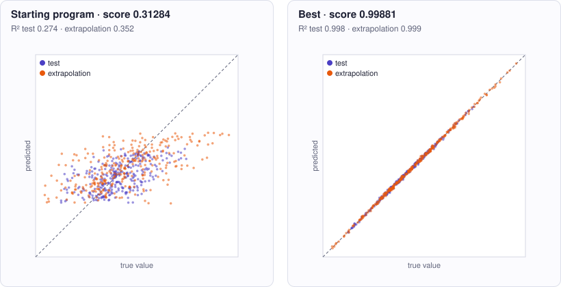

<!-- Copyright (c) 2026 by C. Klukas -->
<!-- SPDX-License-Identifier: GPL-3.0-only -->
<!-- Generated by `omega docs` from examples/symbolic_regression/ and bench/results/*.json. Do not edit by hand. -->

# symbolic_regression

Data and modelling · python · problem `symbolic_regression` · [all examples](../examples.md)

## The problem

Find the formula behind hidden data: y = f(x1, x2, x3) + Gaussian noise (sigma 0.1), where f is a fixed, fairly compact closed-form expression (elementary functions, products, powers, constants). The program defines fit(rows) -> params and predict(params, x1, x2, x3) -> float; params must be plain data (numbers, strings, lists, dicts; tuples arrive as lists), not functions or class instances. The evaluator calls fit once with 300 training rows [x1, x2, x3, y] with x1 in [-3, 3], x2 in [-2, 2], x3 in [0, 3], then predicts 300 held-out rows from the same ranges and 300 EXTRAPOLATION rows from wider ranges (x1 in [-4.5, 4.5], x2 in [-3, 3], x3 in [0, 4]). A generic curve fit does well inside the training range but fails outside it; only the right functional form extrapolates. A fixed helper least_squares(columns, targets, ridge) outside the editable block solves linear least squares, so a model linear in its coefficients over a set of basis functions is fitted in one call. Every prediction must be a finite float. fit plus all predictions: at most 10 CPU seconds. Only the Python standard library (no numpy). The first training rows (x1, x2, x3, y): 2.175 -0.337 0.085 -2.058 -1.891 -0.025 2.441 1.796 -2.056 0.295 2.016 0.117 -2.148 -0.652 0.514 0.235 -1.574 0.754 2.005 -1.164 2.476 -0.654 0.957 -1.744 -1.991 -0.655 1.067 0.695 -1.158 -1.329 1.804 3.424 -0.091 -0.237 2.429 1.684 -1.998 0.445 2.732 1.307 -0.117 1.678 2.649 1.694 0.995 -0.134 0.686 -1.531 -1.656 0.482 1.245 -1.680 -1.511 0.856 1.586 -2.232 -2.494 -0.762 2.362 2.592 -2.948 -1.906 1.665 0.992

- **Score:** score = mean of R^2 on the in-range test rows and R^2 on the extrapolation rows, each clipped to [0, 1] (higher is better, 1.0 = perfect; the noise limits it to about 0.998). The initial linear model scores about 0.31. Metrics: r2_test, rmse_test, r2_extrapolation, rmse_extrapolation (the noise alone gives RMSE 0.1), cpu_s. The feedback lists the five worst extrapolation rows with true and predicted y.
- **Files:** `examples/symbolic_regression/omega.toml`, the program `initial.py`, evaluator stages: main

### Why this is a hard problem

Symbolic regression looks for the formula behind data, not just a curve that fits it. Johannes Kepler found his third law of planetary motion (1619) this way in Tycho Brahe's observations. John Koza (Stanford, [1992](https://mitpress.mit.edu/9780262111706/genetic-programming/)) automated the search with genetic programming, and Michael Schmidt and Hod Lipson (Cornell, [2009](https://doi.org/10.1126/science.1165893)) recovered physical laws from measured motion. Marco Virgolin and Solon Pissis [proved in 2022](https://openreview.net/forum?id=LTiaPxqe2e) that the search is NP-hard.

The starting program fits a straight-line model, y = c0 + c1·x1 + c2·x2 + c3·x3, and scores about 0.31. The limit is the noise in the data, which caps the score at about 0.998.

It is hard because inside the training range many different formulas fit equally well: a polynomial with enough terms can follow almost any smooth curve. Only the true form keeps working outside that range, where half of the test rows lie. Fitting better is therefore not enough; the program must find the right building blocks (products, powers, sines) and leave out the wrong ones, a combinatorial search guided only by noisy data.

Run it with:

```bash
python3 -m omega_transform run examples/symbolic_regression --minutes 15
```

## The starting program

The model may change only the code between the `OMEGA-BLOCK` markers.

```python
# Copyright (c) 2026 by C. Klukas
# SPDX-License-Identifier: MIT
"""Symbolic regression: find the formula behind y = f(x1, x2, x3) + noise.

The evaluator calls fit(train_rows) once with 300 training rows (x1, x2, x3, y), then
predict(params, x1, x2, x3) on held-out rows, both inside and OUTSIDE the training
range of the inputs, and scores the R^2 of the predictions.
"""
import math


def least_squares(columns, targets, ridge=1e-9):
    """Fixed helper: coefficients c minimizing sum_i (sum_j c_j * columns[j][i] - targets[i])^2.

    columns: list of basis columns (each a list of floats, one value per row).
    Solves the normal equations by Gaussian elimination with partial pivoting.
    """
    k = len(columns)
    a = [[sum(p * q for p, q in zip(columns[r], columns[c])) + (ridge if r == c else 0.0)
          for c in range(k)] + [sum(p * t for p, t in zip(columns[r], targets))]
         for r in range(k)]
    for col in range(k):
        piv = max(range(col, k), key=lambda r: abs(a[r][col]))
        a[col], a[piv] = a[piv], a[col]
        if abs(a[col][col]) < 1e-300:
            continue
        for r in range(k):
            if r != col:
                f = a[r][col] / a[col][col]
                if f:
                    a[r] = [x - f * y for x, y in zip(a[r], a[col])]
    return [a[r][k] / a[r][r] if abs(a[r][r]) > 1e-300 else 0.0 for r in range(k)]


# OMEGA-BLOCK-START
def basis(x1, x2, x3):
    """Basis functions of the model; the prediction is a weighted sum of them."""
    return [1.0, x1, x2, x3]


def fit(rows):
    """Fit the model on the training rows and return its parameters.

    The parameters must be plain data (numbers, strings, lists, dicts), not functions
    or class instances. predict() receives them as JSON would carry them: tuples become
    lists and dict keys become strings.
    rows: list of [x1, x2, x3, y] float lists, x1 in [-3, 3], x2 in [-2, 2],
    x3 in [0, 3]. Only the Python standard library may be used (math, statistics,
    random, ...; no numpy). fit plus all predictions must take at most 10 CPU seconds.

    Current method: linear regression on the raw inputs.
    """
    cols = list(zip(*[basis(x1, x2, x3) for x1, x2, x3, _ in rows]))
    return least_squares([list(c) for c in cols], [y for *_, y in rows])


def predict(params, x1, x2, x3):
    """Return the predicted y (a finite float) for one input."""
    return sum(c * b for c, b in zip(params, basis(x1, x2, x3)))
# OMEGA-BLOCK-END
```

## Benchmark results

The best result so far comes from **nvidia/nemotron-3.5-super-vl:free (think)**, run through OpenRouter on 2026-11-02: a score of **0.99881** (×3.19 the starting program's 0.31284), reached after 19.3 of 60 minutes with 12 model requests.

What the starting program produces (left) and what the best program by nvidia/nemotron-3.5-super-vl:free (think) produces (right):



### How it got there

The best program's ancestry, from the starting program on. "Edit" and "rewrite" are the model's changes; a parameter sweep is the engine trying values for the constants the model exposed.

| Step | Minute | Score | Kind | Idea |
|--:|--:|--:|---|---|
| 0 | 0.0 | 0.31284 | start | initial program |
| 1 | 7.5 | 0.99868 | edit | Replace the raw-input linear model with a forward-selected sparse linear model over a large dictionary of polynomial, trigonometric, exponential and logarithmic basis functions, so the discovered functional form extrapolates beyond the training range. |
| 2 | 15.0 | 0.99831 | edit | Replace greedy forward selection with LASSO coordinate descent over an L1 lambda path (validation-chosen sparsity, then OLS debias), a different selection algorithm that picks interacting terms jointly and generalizes better to extrapolation. |
| 3 | 15.0 | 0.99881 | parameter sweep | tuned _ALPHA_MIN_RATIO=0.007747, _N_ALPHA=38, _COORD_TOL=0.005382 on top of: Replace greedy forward selection with LASSO coordinate descent over an L1 lambda path (validation-chosen sparsity, then OLS debias), a different selection algorithm that picks … |
| 4 | 19.3 | 0.99881 | edit | Add Gaussian (exp(-x^2)) and sum-angle trig candidates to the dictionary; LASSO will zero useless ones, while any true term of this form improves extrapolation without overfitting risk. |

### The best program

What changed compared with the starting program:

```diff
--- initial
+++ best
@@ -33,28 +33,410 @@
 
 
 # OMEGA-BLOCK-START
-def basis(x1, x2, x3):
-    """Basis functions of the model; the prediction is a weighted sum of them."""
-    return [1.0, x1, x2, x3]
+import math
+
+_N_ALPHA = 38
+_ALPHA_MIN_RATIO = 0.0077473928884969935
+_VAL_EVERY = 5
+_MAX_ITER = 100
+_COORD_TOL = 0.005382305446220968
+
+
+def _b1(x1, x2, x3):
+    return 1.0
+
+
+def _x1(x1, x2, x3):
+    return x1
+
+
+def _x2(x1, x2, x3):
+    return x2
+
+
+def _x3(x1, x2, x3):
+    return x3
+
+
+def _x1_2(x1, x2, x3):
+    return x1 * x1
+
+
+def _x2_2(x1, x2, x3):
+    return x2 * x2
+
+
+def _x3_2(x1, x2, x3):
+    return x3 * x3
+
+
+def _x1_3(x1, x2, x3):
+    return x1 * x1 * x1
+
+
+def _x2_3(x1, x2, x3):
+    return x2 * x2 * x2
+
+
+def _x3_3(x1, x2, x3):
+    return x3 * x3 * x3
+
+
+def _sin_x1(x1, x2, x3):
+    return math.sin(x1)
+
+
+def _cos_x1(x1, x2, x3):
+    return math.cos(x1)
+
+
+def _sin_x2(x1, x2, x3):
+    return math.sin(x2)
+
+
+def _cos_x2(x1, x2, x3):
+    return math.cos(x2)
+
+
+def _sin_x3(x1, x2, x3):
+    return math.sin(x3)
+
+
+def _cos_x3(x1, x2, x3):
+    return math.cos(x3)
+
+
+def _exp_x1(x1, x2, x3):
+    return math.exp(x1)
+
+
+def _exp_x2(x1, x2, x3):
+    return math.exp(x2)
+
+
+def _exp_x3(x1, x2, x3):
+    return math.exp(x3)
+
+
+def _log1_x1_2(x1, x2, x3):
+    return math.log(1.0 + x1 * x1)
+
+
+def _log1_x2_2(x1, x2, x3):
+    return math.log(1.0 + x2 * x2)
+
+
+def _log1_x3_2(x1, x2, x3):
+    return math.log(1.0 + x3 * x3)
+
+
+def _log1_x3(x1, x2, x3):
+    return math.log(1.0 + x3)
+
+
+def _x1_x2(x1, x2, x3):
+    return x1 * x2
+
+
+def _x1_x3(x1, x2, x3):
+    return x1 * x3
+
+
+def _x2_x3(x1, x2, x3):
+    return x2 * x3
+
+
+def _x1_2_x2(x1, x2, x3):
+    return x1 * x1 * x2
+
+
+def _x1_x2_2(x1, x2, x3):
+    return x1 * x2 * x2
+
+
+def _x1_2_x3(x1, x2, x3):
+    return x1 * x1 * x3
+
+
+def _x1_x3_2(x1, x2, x3):
+    return x1 * x3 * x3
+
+
+def _x2_2_x3(x1, x2, x3):
+    return x2 * x2 * x3
+
+
+def _x2_x3_2(x1, x2, x3):
+    return x2 * x3 * x3
+
+
+def _x1_x2_x3(x1, x2, x3):
+    return x1 * x2 * x3
+
+
+def _sin_x1_x2(x1, x2, x3):
+    return math.sin(x1) * x2
+
+
+def _sin_x1_x3(x1, x2, x3):
+    return math.sin(x1) * x3
+
+
+def _cos_x1_x2(x1, x2, x3):
+    return math.cos(x1) * x2
+
+
+def _cos_x1_x3(x1, x2, x3):
+    return math.cos(x1) * x3
+
+
+def _sin_x2_x1(x1, x2, x3):
+    return math.sin(x2) * x1
+
+
+def _sin_x2_x3(x1, x2, x3):
+    return math.sin(x2) * x3
+
+
+def _cos_x2_x1(x1, x2, x3):
+    return math.cos(x2) * x1
+
+
+def _cos_x2_x3(x1, x2, x3):
+    return math.cos(x2) * x3
+
+
+def _sin_x3_x1(x1, x2, x3):
+    return math.sin(x3) * x1
+
+
+def _sin_x3_x2(x1, x2, x3):
+    return math.sin(x3) * x2
+
+
+def _cos_x3_x1(x1, x2, x3):
+    return math.cos(x3) * x1
+
+
+def _cos_x3_x2(x1, x2, x3):
+    return math.cos(x3) * x2
+
+
+def _sin_x1_sin_x2(x1, x2, x3):
+    return math.sin(x1) * math.sin(x2)
+
+
+def _sin_x1_cos_x2(x1, x2, x3):
+    return math.sin(x1) * math.cos(x2)
+
+
+def _cos_x1_sin_x2(x1, x2, x3):
+    return math.cos(x1) * math.sin(x2)
+
+
+def _cos_x1_cos_x2(x1, x2, x3):
+    return math.cos(x1) * math.cos(x2)
+
+
+def _sin_x1_sin_x3(x1, x2, x3):
+    return math.sin(x1) * math.sin(x3)
+
+
+def _cos_x1_cos_x3(x1, x2, x3):
+    return math.cos(x1) * math.cos(x3)
+
+
+def _exp_neg_x1_2(x1, x2, x3):
+    return math.exp(-x1 * x1)
+
+
+def _exp_neg_x2_2(x1, x2, x3):
+    return math.exp(-x2 * x2)
+
+
+def _exp_neg_x3_2(x1, x2, x3):
+    return math.exp(-x3 * x3)
+
+
+def _sin_x1_plus_x2(x1, x2, x3):
+    return math.sin(x1 + x2)
+
+
+def _cos_x1_plus_x2(x1, x2, x3):
+    return math.cos(x1 + x2)
+
+
+def _sin_x1_plus_x3(x1, x2, x3):
+    return math.sin(x1 + x3)
+
+
+def _cos_x1_plus_x3(x1, x2, x3):
+    return math.cos(x1 + x3)
+
+
+def _sin_x2_plus_x3(x1, x2, x3):
+    return math.sin(x2 + x3)
+
+
+def _cos_x2_plus_x3(x1, x2, x3):
+    return math.cos(x2 + x3)
+
+
+_BASIS_FUNCS = [
+    _b1, _x1, _x2, _x3,
+    _x1_2, _x2_2, _x3_2,
+    _x1_3, _x2_3, _x3_3,
+    _sin_x1, _cos_x1, _sin_x2, _cos_x2, _sin_x3, _cos_x3,
+    _exp_x1, _exp_x2, _exp_x3,
+    _log1_x1_2, _log1_x2_2, _log1_x3_2, _log1_x3,
+    _x1_x2, _x1_x3, _x2_x3,
+    _x1_2_x2, _x1_x2_2, _x1_2_x3, _x1_x3_2, _x2_2_x3, _x2_x3_2,
+    _x1_x2_x3,
+    _sin_x1_x2, _sin_x1_x3, _cos_x1_x2, _cos_x1_x3,
+    _sin_x2_x1, _sin_x2_x3, _cos_x2_x1, _cos_x2_x3,
+    _sin_x3_x1, _sin_x3_x2, _cos_x3_x1, _cos_x3_x2,
+    _sin_x1_sin_x2, _sin_x1_cos_x2, _cos_x1_sin_x2, _cos_x1_cos_x2,
+    _sin_x1_sin_x3, _cos_x1_cos_x3,
+    _exp_neg_x1_2, _exp_neg_x2_2, _exp_neg_x3_2,
+    _sin_x1_plus_x2, _cos_x1_plus_x2, _sin_x1_plus_x3, _cos_x1_plus_x3,
+    _sin_x2_plus_x3, _cos_x2_plus_x3,
+]
+
+
+def _design_cols(xs):
+    """Build one column per basis function for the given input rows."""
+    return [[f(x1, x2, x3) for (x1, x2, x3) in xs] for f in _BASIS_FUNCS]
 
 
 def fit(rows):
-    """Fit the model on the training rows and return its parameters.
-
-    The parameters must be plain data (numbers, strings, lists, dicts), not functions
-    or class instances. predict() receives them as JSON would carry them: tuples become
-    lists and dict keys become strings.
-    rows: list of [x1, x2, x3, y] float lists, x1 in [-3, 3], x2 in [-2, 2],
-    x3 in [0, 3]. Only the Python standard library may be used (math, statistics,
-    random, ...; no numpy). fit plus all predictions must take at most 10 CPU seconds.
-
-    Current method: linear regression on the raw inputs.
+    """Fit a sparse linear model by LASSO coordinate descent on a lambda path.
+
+    Basis columns are standardized; an L1 path selects a compact support, the
+    lambda with the best held-out validation error is chosen (sparser within a
+    small tolerance), and the kept terms are refit by ordinary least squares on
+    all rows for unbiased coefficients.  Returns {"indices": [...], "coefs": [...]}
+    as plain data.
     """
-    cols = list(zip(*[basis(x1, x2, x3) for x1, x2, x3, _ in rows]))
-    return least_squares([list(c) for c in cols], [y for *_, y in rows])
+    xs = [(r[0], r[1], r[2]) for r in rows]
+    ys = [r[3] for r in rows]
+    n = len(ys)
+    k_all = len(_BASIS_FUNCS)
+    cols = _design_cols(xs)
+
+    train_i = [i for i in range(n) if i % _VAL_EVERY != 0]
+    val_i = [i for i in range(n) if i % _VAL_EVERY == 0]
+    if not train_i:
+        train_i = list(range(n))
+    if not val_i:
+        val_i = list(range(n))
+
+    y_train = [ys[i] for i in train_i]
+    y_mean = sum(y_train) / len(y_train)
+    yc = [y - y_mean for y in y_train]
+    ntr = len(y_train)
+    y_val = [ys[i] for i in val_i]
+    n_val = len(val_i)
+
+    means = [0.0] * k_all
+    stds = [1.0] * k_all
+    for j in range(k_all):
+        col = [cols[j][i] for i in train_i]
+        m = sum(col) / ntr
+        v = sum((c - m) * (c - m) for c in col) / ntr
+        means[j] = m
+        stds[j] = math.sqrt(v)
+
+    nz = [j for j in range(1, k_all) if stds[j] > 1e-12]
+    m = len(nz)
+
+    Xtr_cols = [[(cols[j][i] - means[j]) / stds[j] for i in train_i] for j in nz]
+    Xva_rows = [[(cols[j][i] - means[j]) / stds[j] for j in nz] for i in val_i]
+
+    g = [[sum(p * q for p, q in zip(Xtr_cols[a], Xtr_cols[b])) for b in range(m)] for a in range(m)]
+    xty = [sum(p * q for p, q in zip(Xtr_cols[a], yc)) for a in range(m)]
+
+    def soft_threshold(v, t):
+        if v > t:
+            return v - t
+        if v < -t:
+            return v + t
+        return 0.0
+
+    def solve_lasso(alpha, start):
+        c = list(start)
+        pen = alpha * ntr
+        for _ in range(_MAX_ITER):
+            max_chg = 0.0
+            for a in range(m):
+                gaa = g[a][a]
+                if gaa <= 1e-300:
+                    continue
+                rho = xty[a]
+                for b in range(m):
+                    cb = c[b]
+                    if cb and b != a:
+                        rho -= g[a][b] * cb
+                new = soft_threshold(rho, pen) / gaa
+                chg = abs(new - c[a])
+                if chg > max_chg:
+                    max_chg = chg
+                c[a] = new
+            scale = 1.0 + max((abs(v) for v in c), default=0.0)
+            if max_chg <= _COORD_TOL * scale:
+                break
+        return c
+
+    alpha_max = 0.0
+    for a in range(m):
+        av = abs(xty[a])
+        if av > alpha_max:
+            alpha_max = av
+    alpha_max /= ntr
+    if alpha_max <= 1e-12:
+        alpha_max = 1e-12
+    if _N_ALPHA > 1:
+        ratio = _ALPHA_MIN_RATIO ** (1.0 / (_N_ALPHA - 1))
+    else:
+        ratio = _ALPHA_MIN_RATIO
+    alphas = [alpha_max * (ratio ** i) for i in range(_N_ALPHA)]
+
+    results = []
+    start = [0.0] * m
+    for alpha in alphas:
+        c = solve_lasso(alpha, start)
+        start = c
+        sse = 0.0
+        for i in range(n_val):
+            p = y_mean
+            row = Xva_rows[i]
+            for a in range(m):
+                cv = c[a]
+                if cv:
... (29 more lines)
```

### All models

One run per model and reasoning mode; the [model benchmarks](../benchmarks/symbolic_regression.md) page has speed, memory and progress over time.

| Model | Where | Best | Gain | Minutes to best | New bests |
|---|---|--:|--:|--:|--:|
| nvidia/nemotron-3.5-super-vl:free (think) | cloud | 0.99881 | ×3.19 | 19.3 | 4 |
| qwen3.6:27b-coding-mtp-q4_K_M (think) | local | 0.99879 | ×3.19 | 48.3 | 4 |
| cohere/north-mini-code:free (think) | cloud | 0.99872 | ×3.19 | 36.7 | 5 |
| recursive/flint-v1.0:free (think) | cloud | 0.99872 | ×3.19 | 7.9 | 5 |
| dots-studio/dots-3-note-preview:free (think) | cloud | 0.99867 | ×3.19 | 49.1 | 1 |
| glm-4.7-flash:latest (think) | local | 0.99859 | ×3.19 | 27.7 | 3 |
| qwen3.6:27b-coding-mtp-q4_K_M (no-think) | local | 0.99856 | ×3.19 | 20.8 | 2 |
| hf.co/mmnga-o/Qwen3-Swallow-30B-A3B-RL-v0.2-gguf:Q4_K_M (no-think) | local | 0.99855 | ×3.19 | 37.6 | 4 |
| nvidia/nemotron-3-ultra-550b-a55b:free (think) | cloud | 0.99853 | ×3.19 | 20.6 | 5 |
| nvidia/nemotron-3.5-super-vl:free (no-think) | cloud | 0.99852 | ×3.19 | 0.2 | 1 |
| gpt-oss:20b (think) | local | 0.99847 | ×3.19 | 2.9 | 4 |
| richardyoung/frognano-4b-2609:latest (think) | local | 0.99836 | ×3.19 | 6.5 | 2 |
| yandex/YandexGPT-5-Lite-8B-instruct-GGUF:latest (no-think) | local | 0.99823 | ×3.19 | 15.5 | 7 |
| qwen3:30b-a3b-instruct-2507-q4_K_M (no-think) | local | 0.9981 | ×3.19 | 4.7 | 2 |
| gemma4:26b-a4b-it-qat (no-think) | local | 0.99809 | ×3.19 | 14.3 | 7 |
| gemma4:latest (no-think) | local | 0.99803 | ×3.19 | 2.9 | 4 |
| qwen3.5:latest (no-think) | local | 0.998 | ×3.19 | 1.1 | 1 |
| nvidia/nemotron-3-ultra-550b-a55b:free (no-think) | cloud | 0.99798 | ×3.19 | 1.8 | 5 |
| hf.co/mmnga-o/Qwen3-Swallow-30B-A3B-RL-v0.2-gguf:Q4_K_M (think) | local | 0.99761 | ×3.19 | 9.0 | 3 |
| gemma4:12b-it-qat (no-think) | local | 0.99728 | ×3.19 | 7.5 | 5 |
| qwen3:30b-a3b-instruct-2507-q4_K_M (think) | local | 0.99633 | ×3.18 | 5.6 | 3 |
| nvidia/nemotron-3.5-lightning:free (think) | cloud | 0.99085 | ×3.17 | 50.2 | 4 |
| dots-studio/dots-3-note-preview:free (no-think) | cloud | 0.98943 | ×3.16 | 4.3 | 2 |
| underdog-saluki-27b:iq2-mix (no-think) | local | 0.93038 | ×2.97 | 32.2 | 5 |
| gemma4:12b-it-qat (think) | local | 0.84383 | ×2.70 | 11.5 | 1 |
| nvidia/nemotron-3-nano-omni-30b-a3b-reasoning:free (no-think) | cloud | 0.49574 | ×1.58 | 1.2 | 2 |
| gemma4:26b-a4b-it-qat (think) | local | 0.44031 | ×1.41 | 30.6 | 4 |
| frob/sarvam:30b (think) | local | 0.41597 | ×1.33 | 32.3 | 2 |
| gemma4:e4b-it-qat (no-think) | local | 0.38196 | ×1.22 | 1.2 | 3 |
| MichelRosselli/apertus:8b-instruct-2509-q4_k_m (no-think) | local | 0.38171 | ×1.22 | 8.3 | 3 |
| glm-4.7-flash:latest (no-think) | local | 0.38166 | ×1.22 | 2.2 | 2 |
| nemotron-3-nano:4b (think) | local | 0.38164 | ×1.22 | 0.3 | 1 |
| hf.co/llm-jp/llm-jp-4.1-32b-a3b-thinking-gguf:Q4_K_M (no-think) | local | 0.38151 | ×1.22 | 6.4 | 2 |
| gemma4:e2b (no-think) | local | 0.38132 | ×1.22 | 2.2 | 3 |
| qwen3.5:latest (think) | local | 0.38078 | ×1.22 | 2.3 | 2 |
| gpt-oss:20b (no-think) | local | 0.38018 | ×1.22 | 12.1 | 2 |
| hf.co/LiquidAI/LFM3-1.7B-GGUF:Q4_K_M (think) | local | 0.37997 | ×1.21 | 12.4 | 1 |
| qwen2.5-coder:7b (no-think) | local | 0.37945 | ×1.21 | 5.0 | 5 |
| richardyoung/frognano-4b-2609:latest (no-think) | local | 0.37945 | ×1.21 | 3.2 | 3 |
| llm-jp-4-8b-omega:q4_k_m (no-think) | local | 0.37945 | ×1.21 | 4.8 | 1 |
| gemma4:e2b (think) | local | 0.37945 | ×1.21 | 0.2 | 1 |
| gemma4:e4b-it-qat (think) | local | 0.37945 | ×1.21 | 0.4 | 1 |
| gemma4:latest (think) | local | 0.37945 | ×1.21 | 0.4 | 1 |
| cohere/north-mini-code:free (no-think) | cloud | 0.37945 | ×1.21 | 1.1 | 2 |
| nvidia/nemotron-3-nano-omni-30b-a3b-reasoning:free (think) | cloud | 0.37881 | ×1.21 | 33.9 | 6 |
| qwen3-coder:30b (no-think) | local | 0.37836 | ×1.21 | 2.8 | 2 |
| hf.co/Colby/apertus-v1.5-8b-text-Q4_K_M-GGUF:Q4_K_M (no-think) | local | 0.37758 | ×1.21 | 21.3 | 3 |
| nvidia/nemotron-3.5-lightning:free (no-think) | cloud | 0.37589 | ×1.20 | 6.6 | 1 |
| nemotron-3-nano:4b (no-think) | local | 0.36846 | ×1.18 | 2.4 | 3 |
| xingchen-agi/xing4.0-29b-a4b:free (no-think) | cloud | 0.31284 | ×1.00 | - | 0 |
| hf.co/LiquidAI/LFM3-1.7B-GGUF:Q4_K_M (no-think) | local | | | | failed: all 7 model requests failed … |
| frob/sarvam:30b (no-think) | local | 0.31284 | ×1.00 | - | 0 |
| xingchen-agi/xing4.0-29b-a4b:free (think) | cloud | 0.31284 | ×1.00 | - | 0 |
| underdog-saluki-27b:iq2-mix (think) | local | 0.31284 | ×1.00 | - | 0 |
