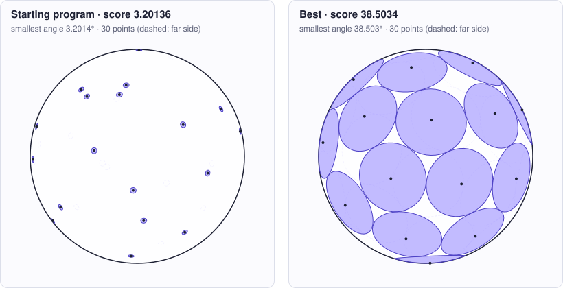

<!-- Copyright (c) 2026 by C. Klukas -->
<!-- SPDX-License-Identifier: GPL-3.0-only -->
<!-- Generated by `omega docs` from examples/tammes/ and bench/results/*.json. Do not edit by hand. -->

# tammes

Mathematical constructions · python · problem `tammes_30` · [all examples](../examples.md)

## The problem

Tammes problem (spherical code): place 30 points on the unit sphere so that the MINIMUM ANGLE between any two points is as large as possible. run() returns construct(30): a list of 30 (x, y, z) tuples. The evaluator normalizes every vector onto the sphere, so only directions matter; zero, infinite or NaN vectors are rejected. Only the Python standard library is available (numpy may be missing). The program may run an optimization, but must finish well within the time limit (aim for at most 60 seconds of CPU time).

- **Score:** score = min_angle_deg, the smallest angle in degrees between any two points (higher is better). Metrics: contact_pairs = pairs within 1e-6 degrees of the minimum (optimal configurations have many equal shortest distances); mean_nearest_neighbor_deg and nearest_neighbor_spread_deg = mean and range of each point's nearest-neighbor angle (a small spread means a uniform layout); seconds = CPU time of construct(30).
- **Files:** `examples/tammes/omega.toml`, the program `initial.py`, evaluator stages: main

### Why this is a hard problem

In [his 1930 dissertation](https://natuurtijdschriften.nl/pub/552640) the Dutch botanist Pieter Tammes asked why the pores on pollen grains are spread as they are. The mathematical question: how to place n points on a sphere so that the closest two are as far apart as possible. It is related to J. J. Thomson's [1904](https://doi.org/10.1080/14786440409463107) question about electrons repelling each other on a sphere. Proven answers are known only for n up to 14 and for n = 24; the cases 13 and 14 were settled by Oleg Musin and Alexey Tarasov in [2012](https://doi.org/10.1007/s00454-011-9392-2) and [2015](https://doi.org/10.1080/10586458.2015.1022842). For 30 points, the best known layouts come from computer searches.

The starting program draws 30 random points, so some pairs end up close together: the smallest angle is about 3 degrees. Good layouts reach more than 38 degrees.

It is hard because only the closest pair counts. Pushing those two apart brings other pairs closer, so the best layouts have many pairs at exactly the same smallest distance, a rigid network of contacts that small moves balance only slowly. There are many locally optimal layouts, and the sphere has no corners or walls to anchor the points.

Run it with:

```bash
python3 -m omega_transform run examples/tammes --minutes 15
```

## The starting program

The model may change only the code between the `OMEGA-BLOCK` markers.

```python
# Copyright (c) 2026 by C. Klukas
# SPDX-License-Identifier: MIT
"""Tammes problem (spherical code): place 30 points on the unit sphere so that the
smallest angle between any two of them is as large as possible."""
import math
import random

# OMEGA-BLOCK-START
def construct(n=30):
    """Return a list of n points (x, y, z) on the unit sphere.

    Vectors need not be normalized (the evaluator normalizes them), but none may be
    zero. The score is the minimum angle in degrees between any two points. This
    start draws uniformly random points with a fixed seed, so some pairs end up
    close together.
    """
    rng = random.Random(1)
    points = []
    for _ in range(n):
        z = rng.uniform(-1.0, 1.0)
        phi = rng.uniform(0.0, 2 * math.pi)
        s = math.sqrt(1.0 - z * z)
        points.append((s * math.cos(phi), s * math.sin(phi), z))
    return points
# OMEGA-BLOCK-END


def run():
    return construct(30)
```

## Benchmark results

The best result so far comes from **gemma4:e4b-it-qat (think)**, run locally with Ollama on 2026-11-10: a score of **38.5963** (×12.06 the starting program's 3.20136), reached after 7.55 of 60 minutes with 17 model requests.

What the starting program produces (left) and what the best program by gemma4:e4b-it-qat (think) produces (right):



### How it got there

The best program's ancestry, from the starting program on. "Edit" and "rewrite" are the model's changes; a parameter sweep is the engine trying values for the constants the model exposed.

| Step | Minute | Score | Kind | Idea |
|--:|--:|--:|---|---|
| 0 | 0.0 | 3.20136 | start | initial program |
| 1 | 3.9 | 38.5961 | edit | Implement a targeted min-angle polish algorithm that iteratively finds the closest pair(s) and pushes them apart using a decreasing step size, which is a specialized refinement strategy derived from the hints to maximize the minimum angular separation … |
| 2 | 7.5 | 38.5961 | edit | Sweep the initial step size and the step size decay factor to find optimal parameters for the targeted min-angle polish algorithm, which should lead to better convergence and a higher minimum angle. |
| 3 | 7.5 | 38.5963 | parameter sweep | tuned INITIAL_STEP_SIZE=0.3, DECAY_FACTOR=0.995 on top of: Sweep the initial step size and the step size decay factor to find optimal parameters for the targeted min-angle polish algorithm, which should lead to better convergence and a higher minimum angle. |

### The best program

What changed compared with the starting program:

```diff
--- initial
+++ best
@@ -7,20 +7,100 @@
 
 # OMEGA-BLOCK-START
 def construct(n=30):
-    """Return a list of n points (x, y, z) on the unit sphere.
-
-    Vectors need not be normalized (the evaluator normalizes them), but none may be
-    zero. The score is the minimum angle in degrees between any two points. This
-    start draws uniformly random points with a fixed seed, so some pairs end up
-    close together.
-    """
+    """Return a list of n points (x, y, z) on the unit sphere."""
     rng = random.Random(1)
+    
+    # Initial random placement
     points = []
     for _ in range(n):
         z = rng.uniform(-1.0, 1.0)
         phi = rng.uniform(0.0, 2 * math.pi)
         s = math.sqrt(1.0 - z * z)
-        points.append((s * math.cos(phi), s * math.sin(phi), z))
+        points.append([s * math.cos(phi), s * math.sin(phi), z])
+
+    # Min-angle polish optimization
+    INITIAL_STEP_SIZE = 0.3
+    DECAY_FACTOR = 0.995
+    max_iterations = 10000
+    
+    step_size = INITIAL_STEP_SIZE
+    for iteration in range(max_iterations):
+        
+        # Find minimum squared distance and closest pair indices
+        min_dist_sq = float('inf')
+        closest_pairs = []
+        
+        for i in range(n):
+            for j in range(i + 1, n):
+                dx = points[i][0] - points[j][0]
+                dy = points[i][1] - points[j][1]
+                dz = points[i][2] - points[j][2]
+                dist_sq = dx*dx + dy*dy + dz*dz
+                
+                if dist_sq < min_dist_sq:
+                    min_dist_sq = dist_sq
+                    closest_pairs = [(i, j)]
+                elif abs(dist_sq - min_dist_sq) < 1e-12:
+                    closest_pairs.append((i, j))
+
+        if not closest_pairs:
+            break # Should not happen for n>1
+
+        new_points = [list(p) for p in points]
+        
+        # Apply repulsive force only to closest pairs
+        for i, j in closest_pairs:
+            Pi = points[i]
+            Pj = points[j]
+            
+            # Vector pointing from Pj to Pi
+            dx = Pi[0] - Pj[0]
+            dy = Pi[1] - Pj[1]
+            dz = Pi[2] - Pj[2]
+            
+            # Normalize direction vector (unit distance)
+            mag = math.sqrt(dx*dx + dy*dy + dz*dz)
+            if mag < 1e-12: continue
+            
+            # Calculate movement vector (normalized direction * step_size)
+            # We push points away from each other along the chord direction.
+            # For Pi, displacement is proportional to (Pi - Pj).
+            # For Pj, displacement is proportional to (Pj - Pi).
+            
+            # Calculate displacement scaled by step size
+            # We use a simple linear push proportional to the current step size.
+            d_i = (dx/mag) * step_size
+            d_j = -(dx/mag) * step_size
+
+            # Update coordinates: Pi moves away from Pj
+            new_points[i] = (Pi[0] + d_i, Pi[1] + d_i, Pi[2] + d_i) # Note: This needs refinement, d_i should be a vector (dx/mag * step_size)
+            
+            # Correct vector updates (using tuples for clarity in calculation)
+            
+            # Displacement for Pi (Away from Pj)
+            disp_i = (dx/mag * step_size, dy/mag * step_size, dz/mag * step_size)
+            new_points[i] = (Pi[0] + disp_i[0], Pi[1] + disp_i[1], Pi[2] + disp_i[2])
+
+            # Displacement for Pj (Away from Pi)
+            disp_j = (-dx/mag * step_size, -dy/mag * step_size, -dz/mag * step_size)
+            new_points[j] = (Pj[0] + disp_j[0], Pj[1] + disp_j[1], Pj[2] + disp_j[2])
+
+        points = new_points
+        
+        # Renormalize all points after updates
+        for i in range(n):
+            p = points[i]
+            mag_sq = p[0]**2 + p[1]**2 + p[2]**2
+            mag = math.sqrt(mag_sq)
+            if mag > 1e-9:
+                points[i] = (p[0]/mag, p[1]/mag, p[2]/mag)
+            else:
+                # Safety fallback
+                points[i] = (1.0, 0.0, 0.0)
+
+        # Decrease step size for convergence
+        step_size *= 0.999
+
     return points
 # OMEGA-BLOCK-END
```

### All models

One run per model and reasoning mode; the [model benchmarks](../benchmarks/tammes_30.md) page has speed, memory and progress over time.

| Model | Where | Best | Gain | Minutes to best | New bests |
|---|---|--:|--:|--:|--:|
| gemma4:e4b-it-qat (think) | local | 38.5963 | ×12.06 | 7.5 | 4 |
| nvidia/nemotron-3.5-super-vl:free (think) | cloud | 38.5034 | ×12.03 | 19.6 | 4 |
| dots-studio/dots-3-note-preview:free (no-think) | cloud | 38.4693 | ×12.02 | 15.7 | 10 |
| gemma4:26b-a4b-it-qat (no-think) | local | 38.3889 | ×11.99 | 15.1 | 4 |
| cohere/north-mini-code:free (think) | cloud | 38.3608 | ×11.98 | 60.7 | 5 |
| nvidia/nemotron-3.5-super-vl:free (no-think) | cloud | 38.2850 | ×11.96 | 5.2 | 8 |
| gpt-oss:20b (no-think) | local | 38.2397 | ×11.94 | 50.1 | 12 |
| gpt-oss:20b (think) | local | 37.8364 | ×11.82 | 22.0 | 6 |
| recursive/flint-v1.0:free (think) | cloud | 37.7404 | ×11.79 | 35.4 | 12 |
| gemma4:latest (think) | local | 37.2435 | ×11.63 | 20.3 | 5 |
| nvidia/nemotron-3-ultra-550b-a55b:free (think) | cloud | 37.1262 | ×11.60 | 26.6 | 5 |
| cohere/north-mini-code:free (no-think) | cloud | 37.0540 | ×11.57 | 1.0 | 4 |
| gemma4:12b-it-qat (think) | local | 37.0497 | ×11.57 | 45.6 | 2 |
| gemma4:latest (no-think) | local | 36.8186 | ×11.50 | 8.7 | 7 |
| nvidia/nemotron-3.5-lightning:free (think) | cloud | 36.3532 | ×11.36 | 23.0 | 5 |
| frob/sarvam:30b (no-think) | local | 34.5838 | ×10.80 | 32.4 | 2 |
| hf.co/LiquidAI/LFM3-1.7B-GGUF:Q4_K_M (think) | local | 33.5039 | ×10.47 | 63.2 | 6 |
| qwen3.6:27b-coding-mtp-q4_K_M (no-think) | local | 32.7402 | ×10.23 | 6.2 | 2 |
| nvidia/nemotron-3.5-lightning:free (no-think) | cloud | 32.7402 | ×10.23 | 6.3 | 2 |
| qwen2.5-coder:7b (no-think) | local | 32.7402 | ×10.23 | 0.8 | 1 |
| qwen3.5:latest (no-think) | local | 32.7402 | ×10.23 | 9.1 | 2 |
| qwen3.5:latest (think) | local | 32.7402 | ×10.23 | 0.5 | 1 |
| nvidia/nemotron-3-nano-omni-30b-a3b-reasoning:free (no-think) | cloud | 32.7402 | ×10.23 | 0.3 | 1 |
| qwen3-coder:30b (no-think) | local | 30.2470 | ×9.45 | 14.4 | 5 |
| xingchen-agi/xing4.0-29b-a4b:free (think) | cloud | 29.5239 | ×9.22 | 34.0 | 3 |
| dots-studio/dots-3-note-preview:free (think) | cloud | 22.1357 | ×6.91 | 51.0 | 4 |
| qwen3:30b-a3b-instruct-2507-q4_K_M (no-think) | local | 21.4033 | ×6.69 | 1.6 | 2 |
| richardyoung/frognano-4b-2609:latest (no-think) | local | 21.4033 | ×6.69 | 0.9 | 1 |
| gemma4:12b-it-qat (no-think) | local | 21.4033 | ×6.69 | 1.2 | 1 |
| glm-4.7-flash:latest (no-think) | local | 21.4033 | ×6.69 | 1.4 | 1 |
| nvidia/nemotron-3-nano-omni-30b-a3b-reasoning:free (think) | cloud | 21.4033 | ×6.69 | 14.7 | 3 |
| gemma4:e4b-it-qat (no-think) | local | 21.0395 | ×6.57 | 1.0 | 2 |
| nvidia/nemotron-3-ultra-550b-a55b:free (no-think) | cloud | 14.3393 | ×4.48 | 8.3 | 5 |
| richardyoung/frognano-4b-2609:latest (think) | local | 13.6948 | ×4.28 | 0.9 | 1 |
| underdog-saluki-27b:iq2-mix (no-think) | local | 12.9182 | ×4.04 | 14.8 | 1 |
| xingchen-agi/xing4.0-29b-a4b:free (no-think) | cloud | 12.8503 | ×4.01 | 8.2 | 1 |
| nemotron-3-nano:4b (think) | local | 12.0000 | ×3.75 | 2.5 | 1 |
| gemma4:e2b (think) | local | 10.3782 | ×3.24 | 1.3 | 3 |
| yandex/YandexGPT-5-Lite-8B-instruct-GGUF:latest (no-think) | local | 9.80576 | ×3.06 | 6.8 | 3 |
| gemma4:e2b (no-think) | local | 9.55566 | ×2.98 | 1.0 | 3 |
| nemotron-3-nano:4b (no-think) | local | 9.50191 | ×2.97 | 2.5 | 1 |
| hf.co/LiquidAI/LFM3-1.7B-GGUF:Q4_K_M (no-think) | local | 3.20136 | ×1.00 | - | 0 |
| MichelRosselli/apertus:8b-instruct-2509-q4_k_m (no-think) | local | 3.20136 | ×1.00 | - | 0 |
| llm-jp-4-8b-omega:q4_k_m (no-think) | local | 3.20136 | ×1.00 | - | 0 |
| underdog-saluki-27b:iq2-mix (think) | local | 3.20136 | ×1.00 | - | 0 |
