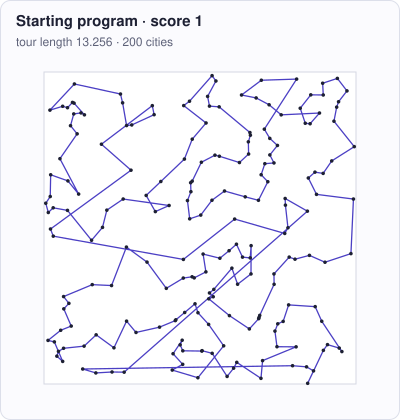

<!-- Copyright (c) 2026 by C. Klukas -->
<!-- SPDX-License-Identifier: GPL-3.0-only -->
<!-- Generated by `omega docs` from examples/tsp/ and bench/results/*.json. Do not edit by hand. -->

# tsp

Algorithms and heuristics · python · problem `tsp_heuristic` · [all examples](../examples.md)

## The problem

Write a fast heuristic for the Euclidean traveling salesman problem. solve(points, time_limit) gets a list of (x, y) city coordinates in the unit square and must return a closed tour as a permutation of range(len(points)): every city exactly once (the tour returns from the last city to the first). The goal is the SHORTEST tour. It is run on three fixed instances of 200, 500 and 1000 uniform random cities. time_limit is 2.0 CPU seconds per instance, measured with time.process_time() around the call; using more than 1.5 x the limit (3.0 s) makes the program invalid, so check time.process_time() regularly and return the best tour found when time runs out. Only the Python standard library may be used (no numpy). Threads do not help: their CPU time adds up.

- **Score:** score = mean over the three instances of (nearest-neighbour tour length / your tour length). The reference is the nearest-neighbour tour from city 0, so the initial program scores 1.0; good local search reaches about 1.2 to 1.25. Metrics per instance: <name>_length (your tour), <name>_nn_length (reference), <name>_ratio, <name>_cpu_s.
- **Files:** `examples/tsp/omega.toml`, the program `initial.py`, evaluator stages: main

### Why this is a hard problem

The traveling salesman problem asks for the shortest round trip through a set of cities. It was formulated in the 1930s (Karl Menger in Vienna; Hassler Whitney and Merrill Flood in the US), and in 1954 George Dantzig, Ray Fulkerson and Selmer Johnson at RAND [solved a 49-city instance](https://doi.org/10.1287/opre.2.4.393) to proven optimality. It is NP-hard ([Karp, 1972](https://doi.org/10.1007/978-1-4684-2001-2_9)) and appears in delivery routes, drilling circuit boards and genome sequencing.

The starting program builds a nearest-neighbour tour: from each city go to the closest unvisited one. It is the reference, so it scores 1.0. On random cities such tours are about 25 % longer than optimal, which puts the limit at about 1.25.

It is hard because the number of possible tours grows faster than exponentially (for 1000 cities, a number with more than 2500 digits), so improvement must come from local changes. Methods such as 2-opt (G. A. Croes, [1958](https://doi.org/10.1287/opre.6.6.791)) and Lin-Kernighan (Shen Lin and Brian Kernighan, Bell Labs, [1973](https://doi.org/10.1287/opre.21.2.498)) repeatedly replace a few edges of the tour. They need careful data structures to run fast enough: in two seconds of pure Python, efficiency matters as much as the idea.

Run it with:

```bash
python3 -m omega_transform run examples/tsp --minutes 15
```

## The starting program

The model may change only the code between the `OMEGA-BLOCK` markers.

```python
# Copyright (c) 2026 by C. Klukas
# SPDX-License-Identifier: MIT
"""Euclidean traveling salesman heuristic: find a short closed tour through all cities.

The evaluator calls solve(points, time_limit) on three fixed instances (200, 500 and
1000 random cities in the unit square) and scores the tour lengths.
"""
import math
import random
import time

# OMEGA-BLOCK-START
def solve(points, time_limit):
    """Return a closed tour through all cities as a permutation of range(len(points)).

    points: list of (x, y) float tuples in the unit square; time_limit: CPU seconds
    allowed for this call (measured with time.process_time(); more than 1.5 x the limit
    makes the program invalid). The tour returns from the last city to the first.
    Only the Python standard library may be used.

    Current method: plain nearest-neighbour construction starting at city 0.
    """
    n = len(points)
    unvisited = set(range(1, n))
    tour = [0]
    x, y = points[0]
    while unvisited:
        nxt = min(unvisited, key=lambda j: (points[j][0] - x) ** 2 + (points[j][1] - y) ** 2)
        unvisited.remove(nxt)
        tour.append(nxt)
        x, y = points[nxt]
    return tour
# OMEGA-BLOCK-END
```

## Benchmark results

The best result so far comes from **nvidia/nemotron-3-ultra-550b-a55b:free (think)**, run through OpenRouter on 2026-11-03: a score of **1.18849** (×1.19 the starting program's 1), reached after 60.53 of 60 minutes with 36 model requests.

What the starting program produces (left) and what the best program by nvidia/nemotron-3-ultra-550b-a55b:free (think) produces (right), drawn for the instance `n200`:



### How it got there

The best program's ancestry, from the starting program on. "Edit" and "rewrite" are the model's changes; a parameter sweep is the engine trying values for the constants the model exposed.

| Step | Minute | Score | Kind | Idea |
|--:|--:|--:|---|---|
| 0 | 0.0 | 1 | start | initial program |
| 1 | 24.7 | invalid | edit | Replace nearest-neighbor construction with greedy edge matching (multi-fragment heuristic) for a better initial tour, followed by 2-opt local search with grid-based candidate lists and iterated double-bridge kicks. |
| 2 | 37.3 | 1.16468 | fix-up | Define the missing constants CANDIDATE_COUNT, DONT_LOOK_LIMIT, and TIME_MARGIN at the start of solve() to fix the NameError and allow the program to run. |
| 3 | 52.0 | 1.18534 | edit | Fix the don't-look bits indexing bug (currently indexed by tour position `i` instead of city ID `a`) which was identified as a +0.023-0.032 score improvement in previous runs, and expose kick parameters for optimization. |
| 4 | 60.5 | 1.18849 | edit | Replace the full-tour 2-opt reoptimization after each kick with a localized 2-opt that only examines edges incident to the perturbed segment and their neighbors, dramatically reducing per-kick cost and allowing many more effective perturbations within the … |

### The best program

What changed compared with the starting program:

```diff
--- initial
+++ best
@@ -18,16 +18,266 @@
     makes the program invalid). The tour returns from the last city to the first.
     Only the Python standard library may be used.
 
-    Current method: plain nearest-neighbour construction starting at city 0.
+    Method: greedy edge matching (multi-fragment) initial tour, then 2-opt with
+    grid-based candidate lists and don't-look bits, plus iterated double-bridge kicks.
     """
     n = len(points)
-    unvisited = set(range(1, n))
+    if n <= 3:
+        return list(range(n))
+
+    # Constants
+    CANDIDATE_COUNT = 8
+    DONT_LOOK_LIMIT = 3
+    TIME_MARGIN = 0.95
+    KICK_SEGMENT = 22
+    KICK_PASSES = 5
+
+    # Precompute coordinates in flat lists for speed
+    x = [p[0] for p in points]
+    y = [p[1] for p in points]
+
+    # ---------- grid for candidate neighbor lists ----------
+    grid_size = int(math.sqrt(n / CANDIDATE_COUNT)) + 1
+    cell_w = 1.0 / grid_size
+    cells = [[] for _ in range(grid_size * grid_size)]
+    for i in range(n):
+        gx = int(x[i] / cell_w)
+        gy = int(y[i] / cell_w)
+        if gx >= grid_size: gx = grid_size - 1
+        if gy >= grid_size: gy = grid_size - 1
+        cells[gy * grid_size + gx].append(i)
+
+    # For each city, collect up to CANDIDATE_COUNT nearest neighbors
+    cand = [[] for _ in range(n)]
+    for i in range(n):
+        gx = int(x[i] / cell_w)
+        gy = int(y[i] / cell_w)
+        best = []
+        for dy in (-1, 0, 1):
+            for dx in (-1, 0, 1):
+                nx, ny = gx + dx, gy + dy
+                if 0 <= nx < grid_size and 0 <= ny < grid_size:
+                    for j in cells[ny * grid_size + nx]:
+                        if j != i:
+                            d2 = (x[i] - x[j]) ** 2 + (y[i] - y[j]) ** 2
+                            if len(best) < CANDIDATE_COUNT:
+                                best.append((d2, j))
+                                best.sort(reverse=True)
+                            elif d2 < best[0][0]:
+                                best[0] = (d2, j)
+                                best.sort(reverse=True)
+        cand[i] = [j for _, j in best]
+
+    # ---------- initial tour: greedy edge matching (multi-fragment) ----------
+    # Generate all edges with squared distances
+    edges = []
+    for i in range(n):
+        xi, yi = x[i], y[i]
+        for j in range(i + 1, n):
+            dx = xi - x[j]
+            dy = yi - y[j]
+            edges.append((dx * dx + dy * dy, i, j))
+    edges.sort(key=lambda e: e[0])
+
+    # Union-find for cycle detection
+    parent = list(range(n))
+    rank = [0] * n
+    degree = [0] * n
+
+    def find(u):
+        while parent[u] != u:
+            parent[u] = parent[parent[u]]
+            u = parent[u]
+        return u
+
+    def union(u, v):
+        ru, rv = find(u), find(v)
+        if ru == rv:
+            return False
+        if rank[ru] < rank[rv]:
+            parent[ru] = rv
+        elif rank[ru] > rank[rv]:
+            parent[rv] = ru
+        else:
+            parent[rv] = ru
+            rank[ru] += 1
+        return True
+
+    tour_edges = []
+    for d2, u, v in edges:
+        if degree[u] >= 2 or degree[v] >= 2:
+            continue
+        if not union(u, v):
+            # Would create cycle - only allow as final closing edge
+            if len(tour_edges) == n - 1:
+                tour_edges.append((u, v))
+                degree[u] += 1
+                degree[v] += 1
+                break
+            continue
+        tour_edges.append((u, v))
+        degree[u] += 1
+        degree[v] += 1
+        if len(tour_edges) == n:
+            break
+
+    # Build tour from edges
+    adj = [[] for _ in range(n)]
+    for u, v in tour_edges:
+        adj[u].append(v)
+        adj[v].append(u)
+
     tour = [0]
-    x, y = points[0]
-    while unvisited:
-        nxt = min(unvisited, key=lambda j: (points[j][0] - x) ** 2 + (points[j][1] - y) ** 2)
-        unvisited.remove(nxt)
+    prev = -1
+    cur = 0
+    for _ in range(n - 1):
+        nxt = adj[cur][0] if adj[cur][0] != prev else adj[cur][1]
         tour.append(nxt)
-        x, y = points[nxt]
-    return tour
+        prev, cur = cur, nxt
+
+    # position array: pos[city] = index in tour
+    pos = [0] * n
+    for idx, city in enumerate(tour):
+        pos[city] = idx
+
+    # distance function (squared)
+    def dist2(a, b):
+        dx = x[a] - x[b]
+        dy = y[a] - y[b]
+        return dx * dx + dy * dy
+
+    def tour_len(t):
+        return sum(math.hypot(x[t[i]] - x[t[(i + 1) % n]], y[t[i]] - y[t[(i + 1) % n]]) for i in range(n))
+
+    def reverse_segment(tour, pos, l, r):
+        while l != r:
+            tour[l], tour[r] = tour[r], tour[l]
+            pos[tour[l]] = l
+            pos[tour[r]] = r
+            l = (l + 1) % n
+            if l == r: break
+            r = (r - 1) % n
+
+    def two_opt_move(tour, pos, i, j):
+        i1 = (i + 1) % n
+        j1 = (j + 1) % n
+        if (j1 - i1) % n <= (i1 - j1) % n:
+            reverse_segment(tour, pos, i1, j)
+        else:
+            reverse_segment(tour, pos, j1, i)
+
+    # ---------- 2-opt with candidate lists and don't-look bits ----------
+    start_time = time.process_time()
+    deadline = start_time + time_limit * TIME_MARGIN
+
+    dont_look = [0] * n
+    improved = True
+    while improved and time.process_time() < deadline:
+        improved = False
+        for i in range(n):
+            a = tour[i]
+            if dont_look[a] >= DONT_LOOK_LIMIT:
+                continue
+            b = tour[(i + 1) % n]
+            base = dist2(a, b)
+            best_gain = 0.0
+            best_j = -1
+            for c in cand[a] + cand[b]:
+                j = pos[c]
+                if j == i or j == (i + 1) % n:
+                    continue
+                d = tour[j]
+                e = tour[(j + 1) % n]
+                gain = base + dist2(d, e) - dist2(a, d) - dist2(b, e)
+                if gain > best_gain:
+                    best_gain = gain
+                    best_j = j
+            if best_gain > 1e-12:
+                two_opt_move(tour, pos, i, best_j)
+                improved = True
+                dont_look[a] = 0
+                dont_look[b] = 0
+                dont_look[tour[best_j]] = 0
+                dont_look[tour[(best_j + 1) % n]] = 0
+            else:
+                dont_look[a] += 1
+
+    # ---------- iterated local search: localized kicks + fast local 2-opt ----------
+    best_tour = tour[:]
+    best_len = tour_len(tour)
+
+    while time.process_time() < deadline:
+        # localized perturbation kick on a small tour segment
+        seg_len = KICK_SEGMENT
+        if n <= seg_len:
+            break
+        center = random.randrange(n)
+        half = seg_len // 2
+        # Build list of indices in the segment (circular)
+        seg_indices = [(center + i) % n for i in range(-half, half + 1)]
+        seg_indices.sort()
+        # Extract segment cities
+        seg_cities = [tour[i] for i in seg_indices]
+        # Perturb: reverse a random subsegment or rotate
+        if random.random() < 0.5:
+            i1 = random.randrange(len(seg_cities))
+            i2 = random.randrange(i1, len(seg_cities))
+            seg_cities[i1:i2+1] = reversed(seg_cities[i1:i2+1])
+        else:
+            k = random.randrange(1, len(seg_cities))
+            seg_cities = seg_cities[k:] + seg_cities[:k]
+        # Write back
+        for idx, city in zip(seg_indices, seg_cities):
+            tour[idx] = city
+        for idx, city in enumerate(tour):
+            pos[city] = idx
+
+        # Localized 2-opt re-optimization: only check edges incident to segment
+        affected = set(seg_indices)
+        for idx in list(affected):
+            affected.add((idx - 1) % n)
+            affected.add((idx + 1) % n)
+        affected = sorted(affected)
+
+        local_improved = True
+        passes = 0
+        while local_improved and passes < KICK_PASSES and time.process_time() < deadline:
+            local_improved = False
+            for i in affected:
+                a_city = tour[i]
+                b_city = tour[(i + 1) % n]
+                base = dist2(a_city, b_city)
+                best_gain = 0.0
+                best_j = -1
+                for c_city in cand[a_city] + cand[b_city]:
+                    j = pos[c_city]
+                    if j == i or j == (i + 1) % n:
+                        continue
+                    d_city = tour[j]
+                    e_city = tour[(j + 1) % n]
+                    gain = base + dist2(d_city, e_city) - dist2(a_city, d_city) - dist2(b_city, e_city)
+                    if gain > best_gain:
+                        best_gain = gain
+                        best_j = j
+                if best_gain > 1e-12:
+                    two_opt_move(tour, pos, i, best_j)
+                    local_improved = True
+                    # Update affected region after move
+                    i1 = (i + 1) % n
+                    j1 = (best_j + 1) % n
+                    affected = set(affected)
+                    affected.add(i); affected.add(i1); affected.add(best_j); affected.add(j1)
+                    affected = sorted(affected)
+            passes += 1
+
+        cur_len = tour_len(tour)
+        if cur_len < best_len:
+            best_len = cur_len
+            best_tour = tour[:]
+        else:
+            tour = best_tour[:]
+            for idx, city in enumerate(tour):
+                pos[city] = idx
+
+    return best_tour
 # OMEGA-BLOCK-END
```

### All models

One run per model and reasoning mode; the [model benchmarks](../benchmarks/tsp_heuristic.md) page has speed, memory and progress over time.

| Model | Where | Best | Gain | Minutes to best | New bests |
|---|---|--:|--:|--:|--:|
| nvidia/nemotron-3-ultra-550b-a55b:free (think) | cloud | 1.18849 | ×1.19 | 60.5 | 9 |
| cohere/north-mini-code:free (think) | cloud | 1.16178 | ×1.16 | 33.6 | 2 |
| gemma4:12b-it-qat (no-think) | local | 1.13768 | ×1.14 | 3.2 | 2 |
| gemma4:e4b-it-qat (no-think) | local | 1.13508 | ×1.14 | 19.5 | 5 |
| nvidia/nemotron-3.5-super-vl:free (think) | cloud | 1.09539 | ×1.10 | 27.3 | 1 |
| gemma4:26b-a4b-it-qat (no-think) | local | 1.09374 | ×1.09 | 38.1 | 7 |
| gemma4:latest (no-think) | local | 1.08936 | ×1.09 | 7.7 | 4 |
| nvidia/nemotron-3.5-lightning:free (think) | cloud | 1.08723 | ×1.09 | 28.2 | 2 |
| gpt-oss:20b (no-think) | local | 1.08584 | ×1.09 | 19.8 | 5 |
| qwen3.6:27b-coding-mtp-q4_K_M (no-think) | local | 1.03857 | ×1.04 | 25.8 | 1 |
| cohere/north-mini-code:free (no-think) | cloud | | | | failed: all 6 model requests failed: cohere/north-mini-code:free … |
| nvidia/nemotron-3.5-super-vl:free (no-think) | cloud | | | | failed: all 6 model requests failed … |
| nvidia/nemotron-3-ultra-550b-a55b:free (no-think) | cloud | | | | failed: all 6 model requests failed … |
| dots-studio/dots-3-note-preview:free (no-think) | cloud | | | | failed: all 6 model requests failed … |
| nvidia/nemotron-3.5-lightning:free (no-think) | cloud | | | | failed: all 6 model requests failed … |
| nvidia/nemotron-3-nano-omni-30b-a3b-reasoning:free (no-think) | cloud | | | | failed: all 6 model requests failed … |
| xingchen-agi/xing4.0-29b-a4b:free (no-think) | cloud | | | | failed: all 6 model requests failed … |
| hf.co/LiquidAI/LFM3-1.7B-GGUF:Q4_K_M (no-think) | local | 1 | ×1.00 | - | 0 |
| nemotron-3-nano:4b (no-think) | local | 1 | ×1.00 | - | 0 |
| richardyoung/frognano-4b-2609:latest (no-think) | local | 1 | ×1.00 | - | 0 |
| gemma4:e2b (no-think) | local | 1 | ×1.00 | - | 0 |
| qwen2.5-coder:7b (no-think) | local | 1 | ×1.00 | - | 0 |
| yandex/YandexGPT-5-Lite-8B-instruct-GGUF:latest (no-think) | local | 1 | ×1.00 | - | 0 |
| MichelRosselli/apertus:8b-instruct-2509-q4_k_m (no-think) | local | 1 | ×1.00 | - | 0 |
| llm-jp-4-8b-omega:q4_k_m (no-think) | local | 1 | ×1.00 | - | 0 |
| qwen3.5:latest (no-think) | local | 1 | ×1.00 | - | 0 |
| underdog-saluki-27b:iq2-mix (no-think) | local | 1 | ×1.00 | - | 0 |
| qwen3:30b-a3b-instruct-2507-q4_K_M (no-think) | local | 1 | ×1.00 | - | 0 |
| qwen3-coder:30b (no-think) | local | 1 | ×1.00 | - | 0 |
| glm-4.7-flash:latest (no-think) | local | 1 | ×1.00 | - | 0 |
| frob/sarvam:30b (no-think) | local | 1 | ×1.00 | - | 0 |
| dots-studio/dots-3-note-preview:free (think) | cloud | 1 | ×1.00 | - | 0 |
| nvidia/nemotron-3-nano-omni-30b-a3b-reasoning:free (think) | cloud | 1 | ×1.00 | - | 0 |
| xingchen-agi/xing4.0-29b-a4b:free (think) | cloud | 1 | ×1.00 | - | 0 |
| recursive/flint-v1.0:free (think) | cloud | | | | failed: all 6 model requests failed: recursive/flint-v1.0:free … |
