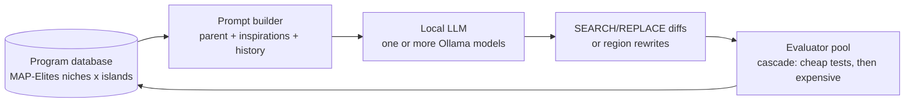

<!-- Copyright (c) 2026 by C. Klukas -->
<!-- SPDX-License-Identifier: GPL-3.0-only -->

# How it works

OMEGA TRANSFORM is an evolutionary coding engine for a single machine:
Python and C/C++ programs, a local LLM served by Ollama, and evaluation as
parallel local jobs. This page explains the overall loop, the design choices
behind each component, how the LLM is told what has been tried, and the
search policy of one iteration.

## The loop

A user supplies three things:

1. **A program with marked regions** (`# OMEGA-BLOCK-START` / `END`) that may
   change. Everything else is fixed scaffolding.
2. **An evaluator** that runs the program and prints scalar scores to
   maximize. The engine has no notion of "correct". It only climbs the
   evaluator.
3. **Optional context**: a problem description, metric explanations, and
   expert hints.

The engine then runs an asynchronous loop:



Key mechanisms:

| Mechanism | Purpose |
|---|---|
| **Diff-based edits** (`<<<<<<< SEARCH … ======= … >>>>>>> REPLACE`) | Small targeted changes to large programs; a full rewrite of the region is optional |
| **Program database** with MAP-Elites niches and islands | Keeps *diverse* good solutions, not only the top one, to avoid premature convergence |
| **Rich prompts**: parent, "inspiration" programs with scores, problem text, feedback, a lessons notebook, varied prompt styles | Gives the LLM history and contrast so its changes are informed |
| **Evaluation cascade** | Cheap filters first (small inputs, sanity checks); only survivors get expensive evaluation |
| **Asynchronous pipeline** | The model generates the next candidates while earlier ones are built and benchmarked |

## Design choices

| Component | OMEGA TRANSFORM | Rationale |
|---|---|---|
| Models | 1–N local Ollama models, weighted (`[llm].models`); temperature and prompt variety substitute for model variety | 32 GB RAM holds one 30B-class model; swapping models costs load time |
| Concurrency | `llm.concurrency` (1–2) LLM slots, `evaluator.concurrency` job slots, worker threads = both | Local model throughput is the bottleneck, so the evaluator pool overlaps compiling and benchmarking with generation |
| Evaluators | Local subprocess jobs, one process group each, a timeout kills the whole tree; optional `launcher` prefix (`srun -n1`, `ssh host`) on a shared filesystem | Enough for single-node; the batch-system hook is one config line |
| Languages | Python and C/C++ (build step + run) | Scope |
| Diversity | SQLite archive: per-island MAP-Elites grid over user features (default: code size), ring migration of island bests | Proven diversity mechanism, inspectable with plain SQL |
| Long-term memory | **Lessons notebook**: every K evaluations the LLM condenses the recent journal into ≤12 bullets (what worked, what failed and why, untried directions), prepended to every prompt | Cheap, compact memory that fits a 32k context |
| Feedback | Evaluator `feedback` text plus distilled compiler errors and tracebacks | Concrete and cheap |
| Prompt variety | Per-iteration choice of *style* (refine / bold / fix) and *edit* (diff / rewrite) | Avoids mode collapse of a single prompt |
| Cascade | `[[evaluator.stages]]` with `min_score` gates and `exclusive` stages | Exclusive stages give clean timings for performance problems |

Deliberately left out of v0.1: multi-file programs, meta-prompt *evolution*
(a fixed template plus the notebook instead), LLM-based evaluation of
"soft" qualities, and distributed databases.

## The context: how the LLM knows what was tried

The defining problem with a local model is the small, noise-sensitive
context. Code is the expensive part, so the history is told as **one line
per attempt** and code appears only twice (the parent in full, inspirations
as their editable region only).

Every attempt is stored, failures included, with: parent, island,
generation, the selection/edit/style mode, the model, the **one-sentence
IDEA** the LLM was required to state, the status (`ok`, `compile_error`,
`runtime_error`, `timeout`, `invalid`, `filtered`, `edit_error`,
`duplicate`, `llm_error`), the score, metrics, and distilled feedback.

Prompt sections (droppable ones are shed in a fixed order when over budget):

1. **TASK / SCORING**: the problem text, metric meanings, and expert hints.
2. **LESSONS LEARNED**: the notebook (long-term, cross-branch memory).
3. **LEADERBOARD**: the global top 5 with distinct ideas (what "good" looks like).
4. **LINEAGE**: the branch history from root to parent, one line per step with
   its score delta. This is the *ideation path* of the current branch.
5. **ALREADY TRIED ON THE CURRENT PROGRAM**: all children of the parent with
   their results. This is the "do not repeat; learn from" list, and it is
   what makes branching work: the same parent is revisited with knowledge of
   its earlier offspring.
6. **OTHER RECENT ATTEMPTS IN THIS BRANCH** (island): short-term memory.
7. **INSPIRATIONS**: 1–3 elites from other niches or islands (code, score, idea).
8. **CURRENT PROGRAM** in full, with metrics, feedback, or error output.
9. **YOUR TASK NOW**: the style instruction and the strict answer format.

A journal line looks like this:

```
#3fa9c1 g4 score 2.4183 (+0.0412) [exploit] IDEA: optimize centers by penalty gradient descent
#77b0e2 g5 FAILED: crashed [explore] IDEA: use scipy SLSQP | ModuleNotFoundError: No module named 'scipy'
```

## Search policy per iteration

```
island  = iteration mod islands
parent  = repair  (p=0.10): a recent failed attempt → style "fix"
          exploit (p=0.60): rank-weighted pick among the island's top 8
          explore (p=0.25): uniform pick among the island's niche elites
          best    (rest):   global best
style   = bold (0.3) | tune (0.15) | refine       edit = rewrite (0.15) | diff
          (priors; adapted per run by Thompson sampling on "beat the parent")
→ prompt → LLM → apply edits (exact, then whitespace-tolerant match;
  the fixed regions must remain byte-identical) → dedupe by normalized hash
→ build → cascade stages → store → MAP-Elites placement
every migration_interval: ring migration of island bests
every insights_interval: notebook update
```

