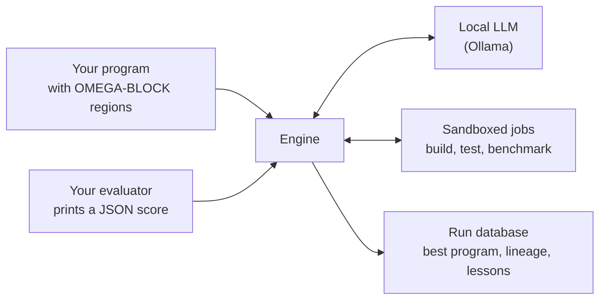

<!-- Copyright (c) 2026 by C. Klukas -->
<!-- SPDX-License-Identifier: GPL-3.0-only -->

# OMEGA TRANSFORM

OMEGA TRANSFORM improves programs by evolution, entirely on your own machine.
A local language model served by [Ollama](https://ollama.com) proposes changes
to a Python or C/C++ program. A pool of local, sandboxed compute jobs builds,
tests and scores every candidate. A program database keeps the best and the
most diverse results, and tells the model what has already been tried.

It is built for private compute: by default there is no cloud and no API
key, and no code or data leaves the machine. Cloud models through OpenRouter
are an explicit option ([Cloud models](cloud-models.md)).
[How it works](how-it-works.md) explains the loop.

The source is on GitHub: <https://github.com/cklukas/OMEGA_TRANSFORM>.

## What you provide

- **A program** in which the regions the model may change are marked with
  `OMEGA-BLOCK-START` and `OMEGA-BLOCK-END` comments.
- **An evaluator**: any command that runs the program and prints a score as
  JSON. Higher is better.
- **A problem file**, `omega.toml`, with a description, hints for the model,
  and the search budget.

## What you get

- The best program found, updated live while the search runs.
- The idea behind every step: each attempt records the one-sentence idea the
  model stated, so the lineage of the best program reads as a research log.
- A lessons notebook the model keeps about what worked and what failed.
- Statistics showing which strategies paid off, plus a benchmark mode that
  compares all installed models on the same problems.

## Where to go next

| If you want to | Read |
|---|---|
| Run the examples | [Getting started](getting-started.md) |
| Optimize your own code | [Defining a problem](defining-problems.md) |
| Understand the search | [How it works](how-it-works.md), [Parameter sweeps](sweeps.md) |
| Know what protects your machine | [Robustness and safety](robustness.md) |
| Compare models | [Benchmarking models](benchmarking.md), [Model benchmarks](benchmarks.md), [by developer](benchmarks/developers.md), [by country](benchmarks/countries.md) |
| Look up a setting or command | [Configuration](configuration.md), [Command line](cli.md) |
| Know the project's status and license | [Status and license](license.md) |

## Related work

Improving programs by search is an old idea, and many projects have taken
it up. OMEGA TRANSFORM builds on the same basic loop as the work below:
change a program, measure it automatically, and keep what is better.

**Evolving code without language models.** Genetic programming
([Koza, 1992](https://mitpress.mit.edu/9780262527910/genetic-programming/))
evolves programs with random mutation and crossover, guided by a fitness
function. Genetic improvement applies the same idea to existing software, to
make it faster or to repair bugs; GenProg
([Le Goues et al., 2012](https://doi.org/10.1109/TSE.2011.104)) and the
survey by [Petke et al. (2018)](https://doi.org/10.1109/TEVC.2017.2693219)
are good entry points. MAP-Elites
([Mouret and Clune, 2015](https://arxiv.org/abs/1504.04909)) keeps the best
solution for each region of a feature space, rather than only the single best
one. OMEGA TRANSFORM's program database uses it to keep diverse candidates.

**Language models as the editing step.** From 2022 on, language models
replaced random edits, so the changes became meaningful code rather than
syntax noise:

| Work | Year | What it evolves |
|---|---|---|
| [Evolution through Large Models](https://arxiv.org/abs/2206.08896) (Lehman et al.) | 2022 | Programs, with a code-diff model as the mutation operator |
| [OpenELM](https://github.com/CarperAI/OpenELM) (CarperAI) | 2023 | Open-source library for the same approach |
| [Language Model Crossover](https://arxiv.org/abs/2302.12170) (Meyerson et al.) | 2023 | Text and code, by combining several parents in one prompt |
| [EvoPrompting](https://arxiv.org/abs/2302.14838) (Chen et al.) | 2023 | Neural network architectures as code |
| [Large Language Models as Optimizers](https://arxiv.org/abs/2309.03409) (Yang et al.) | 2023 | Solutions and prompts, from a history of scored attempts |
| [Eureka](https://arxiv.org/abs/2310.12931) (Ma et al.) | 2023 | Reward functions for robot learning |
| [STOP](https://arxiv.org/abs/2310.02304) (Zelikman et al.) | 2023 | A code-improving program that improves itself |
| [FunSearch](https://www.nature.com/articles/s41586-023-06924-6) (Romera-Paredes et al.) | 2023 | Single functions for mathematical and packing problems |
| [Evolution of Heuristics](https://arxiv.org/abs/2401.02051) (Liu et al.) | 2024 | Heuristics, evolving the idea and the code together |
| [ReEvo](https://arxiv.org/abs/2402.01145) (Ye et al.) | 2024 | Heuristics for combinatorial problems, with reflection |
| [AlphaEvolve](https://arxiv.org/abs/2506.13131) (Novikov et al.) | 2025 | Whole files, with an ensemble of large cloud models |
| [OpenEvolve](https://github.com/algorithmicsuperintelligence/openevolve) | 2025 | Open-source framework for whole-file evolution |
| [ShinkaEvolve](https://arxiv.org/abs/2509.19349) (Lange et al.) | 2025 | Programs, with a focus on needing few samples |

Many ideas recur across these works and in OMEGA TRANSFORM: an island model
for diversity, a database of earlier attempts shown to the model, staged
evaluation that rejects broken candidates cheaply, and feedback from the
evaluator in the next prompt.

**OMEGA TRANSFORM's own focus.** Most of this work assumes large cloud
models and a large compute budget. OMEGA TRANSFORM asks how far the approach
goes with small local models on one ordinary machine. It adds sandboxed
building and benchmarking of C/C++ kernels, a lessons notebook the model
keeps, parameter sweeps that spare the model numeric tweaking, and a
benchmark that compares many local models on the same problems
([Model benchmarks](benchmarks.md)).

## Status

OMEGA TRANSFORM is a short research prototype, tested on the examples that
come with it but not yet on any real project. The framework is GPL-3.0-only,
its evaluator interface LGPL-3.0-only and the examples MIT; programs you
optimize with it keep their own license. [Status and license](license.md)
explains what this means.

<!-- examples-gallery:start (generated by `omega docs`) -->

The benchmark so far: 32 models and reasoning modes in 400 runs on the 15 examples; on 15 of them a model improved on the starting program. Each picture shows what the starting program and the best program found so far produce; click one for the problem, the path to the best result and all models.

| | | |
|---|---|---|
|  **[circle_packing](examples/circle_packing.md)** <small>Place 26 circles in a unit square so that their radii add up to as much as possible.</small> |  **[circles_in_circle](examples/circles_in_circle.md)** <small>Place 21 circles in the unit circle so that their radii add up to as much as possible.</small> |  **[heilbronn](examples/heilbronn.md)** <small>Place 13 points in the unit square so that the smallest triangle they form is as large as possible.</small> |
|  **[tammes](examples/tammes.md)** <small>Place 30 points on a sphere so that the closest pair is as far apart as possible.</small> |  **[bin_packing](examples/bin_packing.md)** <small>Pack items of given sizes into as few bins of capacity 1000 as possible.</small> |  **[max_cut](examples/max_cut.md)** <small>Split the nodes of a weighted graph into two sides so that as much edge weight as possible crosses.</small> |
|  **[tsp](examples/tsp.md)** <small>Find short round trips through 200 to 1000 random cities within two seconds.</small> |  **[float_parse_cpp](examples/float_parse_cpp.md)** <small>Parse a long text of decimal numbers into doubles as fast as possible, bit-exact.</small> |  **[matmul_cpp](examples/matmul_cpp.md)** <small>Multiply two 1024 × 1024 float matrices as fast as possible on all cores.</small> |
|  **[matmul_st_cpp](examples/matmul_st_cpp.md)** <small>Multiply two 768 × 768 float matrices as fast as possible on one core.</small> |  **[prefix_sum_cpp](examples/prefix_sum_cpp.md)** <small>Compute a prefix sum and a byte histogram of ten million integers in one fast pass.</small> |  **[sort_u32_cpp](examples/sort_u32_cpp.md)** <small>Sort a million 32-bit integers per input as fast as possible on one core, exactly like std::sort.</small> |
|  **[compressor](examples/compressor.md)** <small>Compress a web server access log losslessly into as few bytes as possible.</small> |  **[feature_engineering](examples/feature_engineering.md)** <small>Compute features from six raw columns so that a fixed linear classifier predicts the label well.</small> |  **[symbolic_regression](examples/symbolic_regression.md)** <small>Find a formula that fits noisy data and still holds outside the training range.</small> |

<!-- examples-gallery:end -->
