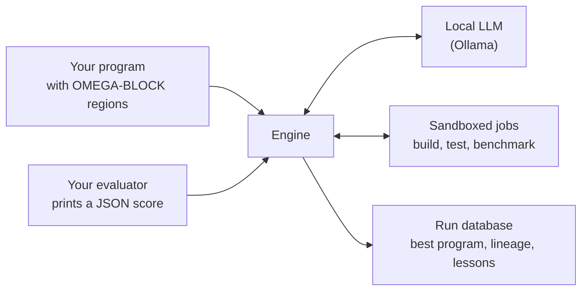
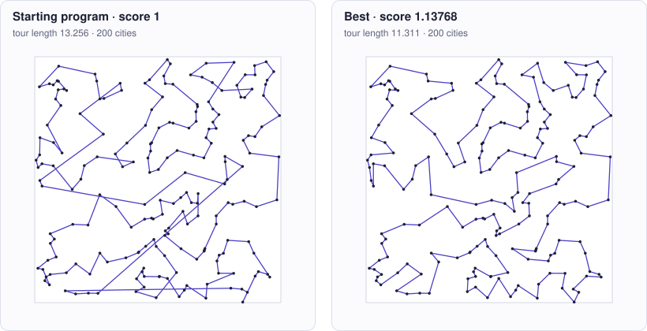

<!-- Copyright (c) 2026 by C. Klukas -->
<!-- SPDX-License-Identifier: GPL-3.0-only -->

# OMEGA TRANSFORM

OMEGA TRANSFORM improves programs by evolution, entirely on your own machine.
A local language model served by [Ollama](https://ollama.com) proposes changes
to a Python or C/C++ program. A pool of local, sandboxed compute jobs builds,
tests and scores every candidate. A program database keeps the best and the
most diverse results, and tells the model what has already been tried.

It is built for private compute: by default there is no cloud and no API
key, and no code or data leaves the machine. Cloud models through OpenRouter
are an explicit option ([Cloud models](cloud-models.md)).
[How it works](how-it-works.md) explains the loop.

The source is on GitHub: <https://github.com/cklukas/OMEGA_TRANSFORM>.

## What you provide

- **A program** in which the regions the model may change are marked with
  `OMEGA-BLOCK-START` and `OMEGA-BLOCK-END` comments.
- **An evaluator**: any command that runs the program and prints a score as
  JSON. Higher is better.
- **A problem file**, `omega.toml`, with a description, hints for the model,
  and the search budget.

## What you get

- The best program found, updated live while the search runs.
- The idea behind every step: each attempt records the one-sentence idea the
  model stated, so the lineage of the best program reads as a research log.
- A lessons notebook the model keeps about what worked and what failed.
- Statistics showing which strategies paid off, plus a benchmark mode that
  compares all installed models on the same problems.

## Where to go next

| If you want to | Read |
|---|---|
| Run the examples | [Getting started](getting-started.md) |
| Optimize your own code | [Defining a problem](defining-problems.md) |
| Understand the search | [How it works](how-it-works.md), [Parameter sweeps](sweeps.md) |
| Know what protects your machine | [Robustness and safety](robustness.md) |
| Compare models | [Benchmarking models](benchmarking.md), [Model benchmarks](benchmarks.md) |
| Look up a setting or command | [Configuration](configuration.md), [Command line](cli.md) |
| Know the project's status and license | [Status and license](license.md) |

## Status

OMEGA TRANSFORM is a short research prototype, tested on the examples that
come with it but not yet on any real project. The framework is GPL-3.0-only,
its evaluator interface LGPL-3.0-only and the examples MIT; programs you
optimize with it keep their own license. [Status and license](license.md)
explains what this means.

<!-- examples-gallery:start (generated by `omega docs`) -->

The benchmark so far: 32 models and reasoning modes in 400 runs on the 15 examples; on 15 of them a model improved on the starting program. Each picture shows what the starting program and the best program found so far produce; each example's page has the problem, the path to the best result and all models.

| | | |
|---|---|---|
|  **[circle_packing](examples/circle_packing.md)** <small>Place 26 circles in a unit square so that their radii add up to as much as possible.</small> |  **[circles_in_circle](examples/circles_in_circle.md)** <small>Place 21 circles in the unit circle so that their radii add up to as much as possible.</small> |  **[heilbronn](examples/heilbronn.md)** <small>Place 13 points in the unit square so that the smallest triangle they form is as large as possible.</small> |
|  **[tammes](examples/tammes.md)** <small>Place 30 points on a sphere so that the closest pair is as far apart as possible.</small> |  **[bin_packing](examples/bin_packing.md)** <small>Pack items of given sizes into as few bins of capacity 1000 as possible.</small> |  **[max_cut](examples/max_cut.md)** <small>Split the nodes of a weighted graph into two sides so that as much edge weight as possible crosses.</small> |
|  **[tsp](examples/tsp.md)** <small>Find short round trips through 200 to 1000 random cities within two seconds.</small> |  **[float_parse_cpp](examples/float_parse_cpp.md)** <small>Parse a long text of decimal numbers into doubles as fast as possible, bit-exact.</small> |  **[matmul_cpp](examples/matmul_cpp.md)** <small>Multiply two 1024 × 1024 float matrices as fast as possible on all cores.</small> |
|  **[matmul_st_cpp](examples/matmul_st_cpp.md)** <small>Multiply two 768 × 768 float matrices as fast as possible on one core.</small> |  **[prefix_sum_cpp](examples/prefix_sum_cpp.md)** <small>Compute a prefix sum and a byte histogram of ten million integers in one fast pass.</small> |  **[sort_u32_cpp](examples/sort_u32_cpp.md)** <small>Sort a million 32-bit integers per input as fast as possible on one core, exactly like std::sort.</small> |
|  **[compressor](examples/compressor.md)** <small>Compress a web server access log losslessly into as few bytes as possible.</small> |  **[feature_engineering](examples/feature_engineering.md)** <small>Compute features from six raw columns so that a fixed linear classifier predicts the label well.</small> |  **[symbolic_regression](examples/symbolic_regression.md)** <small>Find a formula that fits noisy data and still holds outside the training range.</small> |

<!-- examples-gallery:end -->
