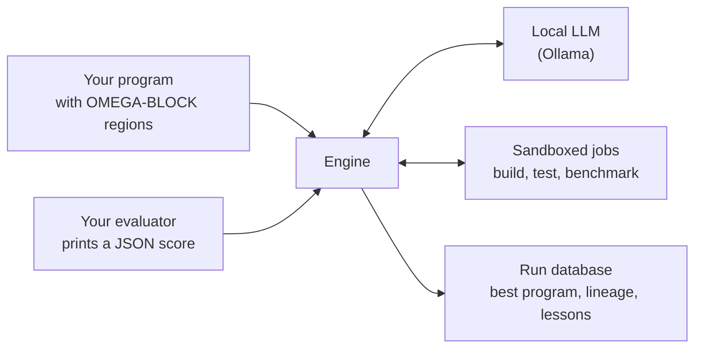

<!-- Copyright (c) 2026 by C. Klukas -->
<!-- SPDX-License-Identifier: GPL-3.0-only -->

# OMEGA TRANSFORM

OMEGA TRANSFORM improves programs by evolution, entirely on your own machine.
A local language model served by [Ollama](https://ollama.com) proposes changes
to a Python or C/C++ program. A pool of local, sandboxed compute jobs builds,
tests and scores every candidate. A program database keeps the best and the
most diverse results, and tells the model what has already been tried.

It is built for private compute: by default there is no cloud and no API
key, and no code or data leaves the machine. Cloud models through OpenRouter
are an explicit option ([Cloud models](cloud-models.md)).
[How it works](how-it-works.md) explains the loop.

## What you provide

- **A program** in which the regions the model may change are marked with
  `OMEGA-BLOCK-START` and `OMEGA-BLOCK-END` comments.
- **An evaluator**: any command that runs the program and prints a score as
  JSON. Higher is better.
- **A problem file**, `omega.toml`, with a description, hints for the model,
  and the search budget.

## What you get

- The best program found, updated live while the search runs.
- The idea behind every step: each attempt records the one-sentence idea the
  model stated, so the lineage of the best program reads as a research log.
- A lessons notebook the model keeps about what worked and what failed.
- Statistics showing which strategies paid off, plus a benchmark mode that
  compares all installed models on the same problems.

## Where to go next

| If you want to | Read |
|---|---|
| Run the examples | [Getting started](getting-started.md) |
| Optimize your own code | [Defining a problem](defining-problems.md) |
| Understand the search | [How it works](how-it-works.md), [Parameter sweeps](sweeps.md) |
| Know what protects your machine | [Robustness and safety](robustness.md) |
| Compare models | [Benchmarking models](benchmarking.md), [Model benchmarks](benchmarks.md) |
| Look up a setting or command | [Configuration](configuration.md), [Command line](cli.md) |
| Know the project's status and license | [Status and license](license.md) |

## Status

OMEGA TRANSFORM is a short research prototype, tested on the examples that
come with it but not yet on any real project. The framework is GPL-3.0-only,
its evaluator interface LGPL-3.0-only and the examples MIT; programs you
optimize with it keep their own license. [Status and license](license.md)
explains what this means.
