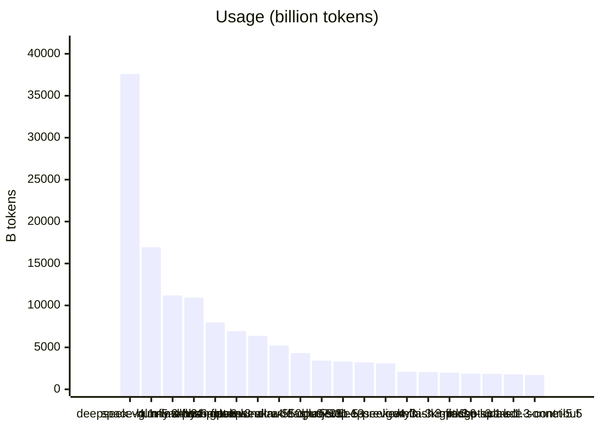
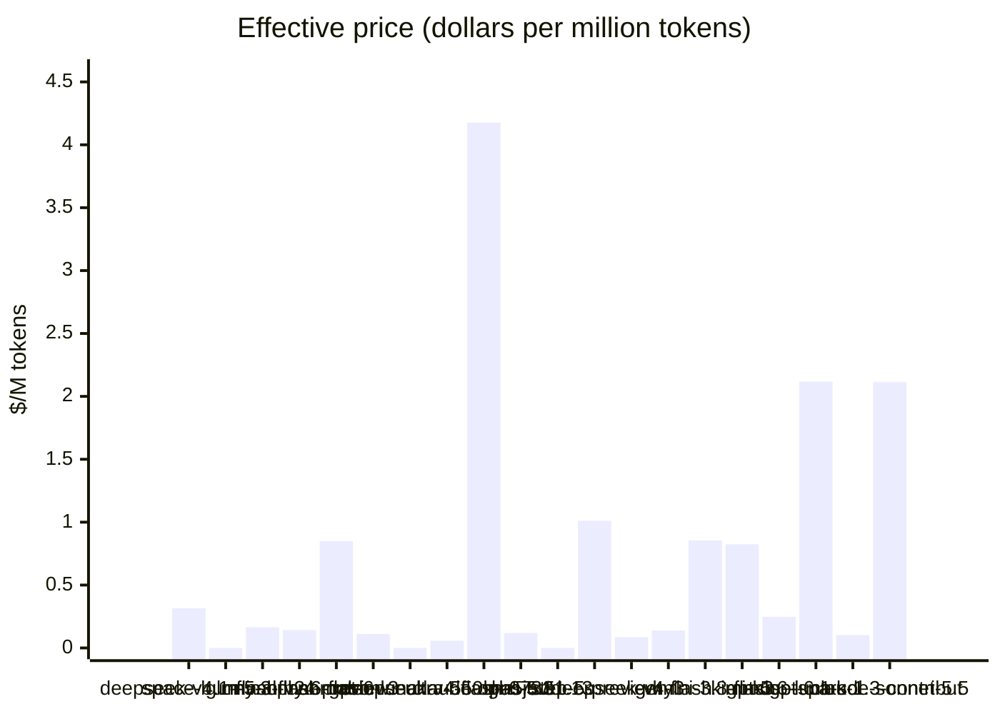
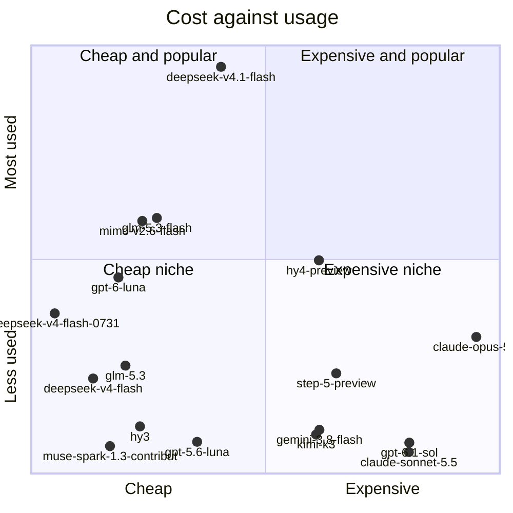

<!-- Copyright (c) 2026 by C. Klukas -->
<!-- SPDX-License-Identifier: GPL-3.0-only -->
<!-- Generated by `omega report` from bench/openrouter/*.json. Do not edit by hand. -->

# OpenRouter models

Which cloud models does the community use most, and what do they cost? The table joins OpenRouter's public usage rankings with its price list (snapshot of 2026-10-10; rerun `omega openrouter-snapshot` to refresh). See [Cloud models](cloud-models.md) for using them.

Usage measures popularity, not quality: it also reflects price, free periods and the defaults of widely used tools. The **effective price** weights a model's input and output price by how the community actually used it (most traffic is input).

| # | Model | Tokens (B) | Requests (M) | In $/M | Out $/M | Effective $/M | Free variant | Reasoning | Context |
|--:|---|--:|--:|--:|--:|--:|---|---|--:|
| 1 | deepseek/deepseek-v4.1-flash | 37,598 | 606.7 | 0.30 | 1.20 | 0.315 | - | yes | 1048k |
| 2 | stealth/space-bunny-alpha (unlisted) | 16,945 | 249.0 | - | - | - | - | - | 0k |
| 3 | z-ai/glm-5.3-flash | 11,198 | 696.9 | 0.15 | 0.50 | 0.164 | - | yes | 1048k |
| 4 | xiaomi/mimo-v2.6-flash | 10,931 | 132.5 | 0.14 | 0.28 | 0.142 | - | yes | 1050k |
| 5 | tencent/hy4-preview | 7,963 | 71.4 | 0.83 | 2.50 | 0.850 | - | yes | 1048k |
| 6 | openai/gpt-6-luna | 6,939 | 323.0 | 0.10 | 0.50 | 0.111 | - | yes | 1050k |
| 7 | nvidia/nemotron-3-ultra-550b-a55b:free ★ | 6,384 | 47.4 | 0.00 | 0.00 | 0.000 | yes | yes | 262k |
| 8 | deepseek/deepseek-v4-flash-0731 | 5,211 | 399.9 | 0.01 | 1.28 | 0.058 | - | yes | 1048k |
| 9 | anthropic/claude-opus-5.5 | 4,316 | 39.2 | 4.00 | 20.00 | 4.176 | - | yes | 1000k |
| 10 | z-ai/glm-5.3 | 3,422 | 68.6 | 0.04 | 4.80 | 0.119 | - | yes | 1048k |
| 11 | typesafe/jev-1.13 (unlisted) | 3,316 | 999.4 | - | - | - | - | - | 0k |
| 12 | stepfun/step-5-preview | 3,220 | 17.2 | 1.00 | 2.70 | 1.011 | - | yes | 1000k |
| 13 | deepseek/deepseek-v4-flash | 3,093 | 358.5 | 0.01 | 1.28 | 0.086 | - | yes | 1048k |
| 14 | tencent/hy3 | 2,104 | 28.3 | 0.13 | 0.53 | 0.139 | - | yes | 262k |
| 15 | google/gemini-3.8-flash | 2,051 | 80.2 | 0.75 | 3.75 | 0.854 | - | yes | 1048k |
| 16 | moonshotai/kimi-k3 | 1,970 | 30.5 | 0.64 | 13.50 | 0.824 | - | yes | 1048k |
| 17 | openai/gpt-5.6-luna | 1,859 | 193.2 | 0.20 | 1.20 | 0.248 | - | yes | 1050k |
| 18 | openai/gpt-6.1-sol | 1,846 | 38.5 | 2.00 | 10.00 | 2.118 | - | yes | 1050k |
| 19 | meta/muse-spark-1.3-contributor | 1,796 | 42.4 | 0.10 | 0.20 | 0.102 | - | yes | 1048k |
| 20 | anthropic/claude-sonnet-5.5 | 1,714 | 28.0 | 2.00 | 10.00 | 2.113 | - | yes | 1000k |

★ benchmarked by OMEGA TRANSFORM, see [Model benchmarks](benchmarks.md).

### Cost against usage

Both axes are logarithmic, from the cheapest to the most expensive model ($0.0584 to $4.18 per million tokens) and from the least to the most used (1,714 to 37,598 billion tokens). Free and unlisted models are not shown.

